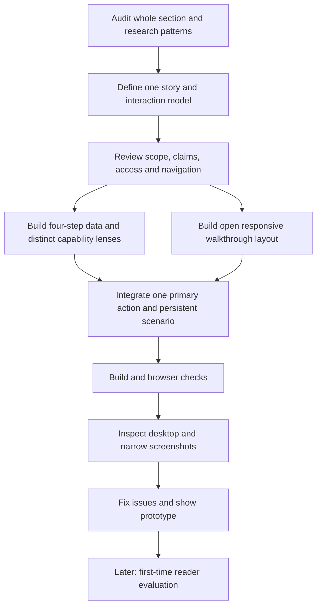

# Whole-section walkthrough redesign

Date: 2026-09-17. Status: plan reviewed, implemented and locally verified. Owner request: research, DAG plan, plan review, then a working prototype of the whole explanation section.

## Diagnosis

The user reports that the section is hard to follow. In [ExplanationPaths.tsx](src/ExplanationPaths.tsx), four task controls and six capability controls precede a two-column stage; Apply, Reset and Previous/Next are separate actions; the capability explanation appears below. The previous round improved copy but retained this interaction structure. This redesign replaces that structure.

## Research and interpretation

- [NN/g: Wizards](https://www.nngroup.com/articles/wizards/) recommends visible named steps and descriptive forward/back actions, while discussing the cost and restrictions of forced sequences. Borrow orientation and one main action; retain direct jumps because this is an explanation, not a required form workflow.
- [NN/g: Recognition and Recall](https://www.nngroup.com/articles/recognition-and-recall/) supports keeping relevant cues available. Keep the scenario and event visible rather than making visitors reconstruct them after each navigation choice.
- [Red Blob: Introduction to A*](https://www.redblobgames.com/pathfinding/a-star/introduction.html) connects input, representation, output and controllable demonstrations. Give every step the same causal structure with an inspectable result.
- [GOV.UK: Details](https://design-system.service.gov.uk/components/details/) provides a secondary-disclosure pattern. Keep optional capability exploration and implementation evidence behind labelled disclosures; essential limitations remain visible beside the corresponding claim.
- [GOV.UK: Step-by-step navigation](https://design-system.service.gov.uk/patterns/step-by-step-navigation/) is an orientation reference, not a package to install or evidence that this exact layout will work.

These are adaptations and design hypotheses. Sources were inspected through their published content; no external site usability trial was conducted. Earlier findings remain in [round-two research](EXPLANATION-RESEARCH-ROUND2.md).

## Task DAG

## Design

One story: a team building invitation-only signup. Four steps: prepare context, agree on meaning, use a test result, resume the work. Start at step one. Each step shows one event, then an icon-led causal diagram: event → ARE contribution → next action. A primary button first reveals the prepared result, then names the next step. Previous and replay are secondary. Direct step navigation remains available.

Keep the scenario visible. Treat direct jumps as prepared story snapshots, not a real dependent workflow. Remember revealed state when revisiting. Before/after review does not erase progress. The last step offers restart without pretending the signup feature passed its tests.

Move capability browsing into an optional disclosure. Selecting evidence versus next-step support must reveal distinct content; selecting state versus boundaries must likewise show distinct contributions. Preserve all six source references and capability limitations. Close the selector and bring the selected scene into view on activation.

Use open space, icon outlines and connector arrows, not feature cards. On narrow screens, stack the same causal order vertically and wrap controls. Keep headings readable and no content clipped by fixed heights. Preserve the hero, role introduction and deeper docs canvas.

## Plan review

1. Scope check: approved whole-section replacement, not another heading-only patch.
2. Reading order: one primary path; capability browsing is secondary. No duplicate selector above the main story.
3. Control check: no forced autoplay, modal, scroll hijacking or required completion. A user may revisit or jump directly.
4. State check: snapshots and reveal state are separate; no fabricated cross-step model execution. Restart resets the illustration only.
5. Meaning check: ARE does not implement the code, run all tools, grant permission or guarantee success. Host responsibilities are explicit. Language learning remains a scoped prototype.
6. Evidence check: preserve status and limitation text; illustrative outcomes are labelled. No benchmark improvement or reader success is claimed.
7. Access check: standard buttons/details, visible current step, descriptive actions, polite result announcement, keyboard focus on newly selected content, reduced-motion-safe transitions.
8. Verification check: old shared-demo scripts describe the superseded interaction model and must be replaced, not left as misleading failing gates. Keep the role-map checks relevant.

Review outcome: proceed. The plan addresses the structural complaint. Human comprehension remains an open evaluation question.

## Acceptance and construction boundary

Product frontier: a locally runnable whole-section prototype. Runnable work: source edits, build, browser checks and screenshot inspection. Operational prerequisites: none. Owner: the user's explicit request. No external model calls or publishing.

Verify all four steps and six capabilities, revisit/restart behavior, selected versus saved context, distinct next-step/boundary lenses, keyboard operation, reduced motion, and no overflow at 1440×900, 331×587 and 240×320. Check hero and docs navigation remain available. Screenshots establish appearance, not comprehension.

Deferred operational residue: product owner arranges reader recruitment; real trace integration and release are separately scoped. J is not a blocker for I.

## Open Questions

- Can a first-time reader explain ARE's contribution after one step?
- Does the optional capability path remain discoverable enough?
- Is the four-step story concise enough in an embedded pane?
- Are the role distinctions clear without reading implementation detail?

Use the reader questions in [the earlier reviewed plan](EXPLANATION-ROUND2-PLAN.md#reader-evaluation-script-ready-not-run). This prototype tests presentation, not engine quality.

## Execution evidence

- Replaced the shared-demo section with a four-step walkthrough in [ExplanationPaths.tsx](src/ExplanationPaths.tsx), styled by [walkthrough.css](src/walkthrough.css).
- Removed the competing always-visible capability rail and separate Apply/Reset controls. Optional capability browsing retains all six scopes and source references.
- Implemented distinct next-step and action-boundary lenses; direct jumps select explicit prepared snapshots.
- Build passed. Walkthrough browser suite: 161 checks passed. Retained role diagram: 9 checks passed.
- Tested desktop 1440×900, narrow 331×587 and embedded 240×320; keyboard and reduced motion included.
- Inspected rendered desktop and narrow screenshots. Evidence is in evidence/walkthrough-proof.json and evidence/walkthrough-*.png.
- Historical explanation-paths-proof command now runs the current walkthrough contract. explanation-round2-proof retains the role introduction checks; prior dated results remain historical.
- No first-time reader trial has run, and no model-quality or token-saving claim follows from these checks.
