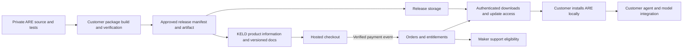

# Connecting the KELD offering to ARE

Date: 2026-09-17. Evidence-based proposal. KELD will sell a prepared distribution
of the existing private engine. This research does not publish or license it.

## Recommendation

Use KELD as the commercial/customer layer around ARE. Keep engine development,
release construction, commerce, and the customer's local runtime distinct.
Their primary link is a versioned release manifest and artifact, rather than
routing web-shop requests through the reasoning engine.

KELD's service period and customer records should not be embedded into the core
reasoning loop. Under the supplied downloadable offer, no KELD-hosted engine API
or provider credits are promised. A paid support/update period is distinct from
the software rights attached to a delivered artifact.

## What exists, and what the offering still needs

| Offering / concern | Local evidence | Gap / proposed connection |
| --- | --- | --- |
| Studio, legend, shop | ../prototype/ and ../KELD_PROJECT.md | Preserve visual identity; production frontend migration is optional until needed |
| Commercial preview | ../prototype/assets/shop-config.js | Explicit preview, sale/fulfillment/entitlement gates false; no commerce backend |
| Actual ARE identity | ../../agent-reasoning-engine/product.json and README.md | Map storefront `agent-reasoning-engine` to engine `cyberalchemy-agent-reasoning-engine`; identifiers need not be renamed |
| Runtime candidate | ../../implementation/agent-reasoning-engine/product.json and package.json | Current version 0.10.0-signed-envelope-candidate.2, Node 26.8.1, private package; not a public installer version promise |
| Health | Local doctor on 2026-09-17: PASS, 18 components, exact Node match | Doctor verifies current local health, not clean-machine installation or sale readiness |
| Candidate release | ../../implementation/agent-reasoning-engine/RELEASE.md | Existing unit is private-repository-product-candidate; add customer distribution pipeline |
| Package contents | Doctor closure: 3,410 files, 53,860,253 bytes | Review exact closure before export; do not zip the umbrella repository or copy benchmark caches |
| License | Store config says Apache-2.0; runtime package has private:true and no license field | No LICENSE/NOTICE file found under runtime in this inspection; review distribution ownership and dependencies; absence here does not establish global rights status |
| Agent interoperability | ../../implementation/agent-reasoning-engine/packages/codex-app-server-wrapper/src/backend-adapter.mjs | Model-neutral process adapter exists; transport contract is not automatic compatibility with every agent |
| First-class conversation / context / state | Required components in runtime product.json | Select and document supported release scope with grounded limits |
| Language learning | ../../implementation/agent-reasoning-engine/benchmarks/real-reasoning-v1/interaction-learning/README.md | Scoped prototype evidence; avoid arbitrary-language or measured-gain claims |
| Public documentation | ../../workspace/experiments/are-documentation/ | Reuse explanations and examples through a reviewed docs build; align to shipped release; don't publish private paths/receipts |
| First 100 and maker support | ../prototype/ALPHA-OFFER.md and CHECKOUT-CONTRACT.md | Need authoritative customer identity, transactional allocation, service dates, real support route and recovery |

The `private:true` npm flag is consistent with current packaging policy; it does
not decide whether the product may later be sold. Do not remove that flag merely
to bypass the existing verifier. Build and validate a separate customer release
boundary while preserving private development evidence.

## Release contract to design next

Candidate fields, not a fabricated release:

- Store product ID and engine product ID, distribution version and channel.
- Exact source/candidate identity; archive hash, size, signature/provenance reference.
- Approved license identifier, required notices and third-party inventory.
- Supported operating systems, runtime versions, integrations and setup requirements.
- Installation/verification instructions, quickstart, changelog and known limitations.
- Versioned documentation URL and reviewed capability claims with evidence references.
- Publication date and release approval state.

Split a public metadata projection from the private artifact locator and approval
evidence. KELD may read only approved metadata. Do not expose private checkout paths,
repository profiles, raw experiment histories, credentials or buyer data in assets.
A release manifest is not itself an order or service entitlement.

## The first customer journey

1. KELD describes the actual approved alpha scope and links its versioned docs.
2. Buyer selects a price; backend validates integer cents and snapshots offer,
   release identity, terms and supporter availability before redirecting.
3. Hosted checkout receives the selected subtotal. Provider verifies payment.
4. Idempotent fulfillment grants the purchase once and records customer-level
   supporter eligibility, expiry, and the purchased release.
5. Customer recovers authenticated download access, verifies the artifact, and
   follows a clean-machine quickstart with their own supported agent/model setup.
6. Update access and support are evaluated from server records. Expiring service
   access must not be presented as revocation of the delivered software license.

The last available supporter place needs transactional reservation/allocation.
Payment retries and repeat customers must not consume extra slots. Refund and
reservation expiry policies remain owner decisions; they are not filled in by UI.

## External research and reuse

- [Stripe Checkout Sessions](https://docs.stripe.com/api/checkout/sessions/create)
  supplies hosted checkout creation. Its
  [price migration guide](https://docs.stripe.com/payments/checkout/migrating-prices?locale=it-IT)
  documents dynamic price_data at session creation. This fits server-validated
  buyer-selected amounts; Stripe is an evaluated option, not a selected provider.
- [Stripe fulfillment](https://docs.stripe.com/checkout/fulfillment?locale=pt-BR)
  requires server-side payment checks and fulfillment safe for repeated/concurrent
  calls. Redirects alone do not establish payment; delayed methods need handling.
  This reinforces the starter's contract rather than replacing it.
- [GitHub immutable releases](https://docs.github.com/en/code-security/concepts/supply-chain-security/immutable-releases)
  locks published assets/tags and supplies release attestations. This is a useful
  provenance/distribution option after approval. It is not a customer entitlement
  database and does not automatically make a private repository buyer-accessible.
- [Astro on-demand rendering](https://docs.astro.build/en/guides/on-demand-rendering/)
  provides server-rendered routes through an adapter. Astro is consistent with
  the handoff's content-first recommendation. Plain static hosting still cannot
  execute the checkout backend. No stack migration is necessary just to preserve
  and test the current Python-built static prototype.
- [Apache License 2.0](https://www.apache.org/licenses/LICENSE-2.0), sections 2, 4,
  6 and 9, separates redistribution conditions, trademark rights, and additional
  support obligations. Review actual distribution rights and notices; the
  storefront's intended license label does not apply itself to private source.

No payment provider, merchant jurisdiction, public repository, domain or backend
has been selected. No external account was accessed or altered for this research.

## What to reuse, and what to build

Reuse the existing engine entrypoint, candidate verification, adapter interfaces,
known-limit descriptions, starter pricing behavior, six KELD illustrations, and
selected brand. Build the distributable boundary, release-to-offer projection,
commerce/entitlement service and customer delivery path. Keep KELD's workshop
identity while the product docs retain ARE's own visual language.

Do not embed the raw private engine in the public site bundle, use the website
ZIP as the purchased product, or offer hosted reasoning simply because a gateway
exists. The gateway belongs to the customer's runtime integration in this offer.

## Open Questions

See [intake](PROJECT-INTAKE.md#open-questions) and [delivery DAG](DELIVERY-PLAN.md).
Most urgent: exact artifact scope, portable installation, license/notice boundary,
and supported first customer integration. These are concrete sales-preparation
work, not reasons to abandon the sale objective.
