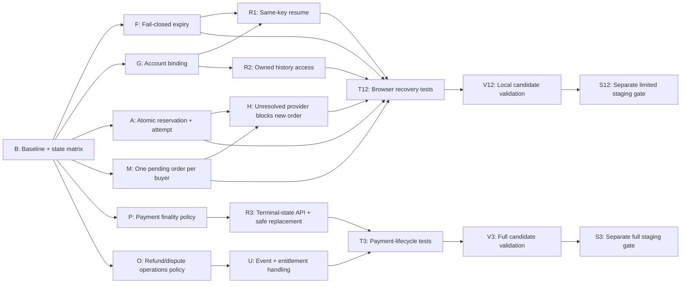

# KELD Checkout Recovery DAG

This is a candidate plan for the current React checkout and sandbox payment
boundary. It supplements [CHECKOUT-UX-REDESIGN-PLAN.md](CHECKOUT-UX-REDESIGN-PLAN.md).
The plan itself grants no deployment authority; the owner separately approved
the limited S12 cutover, which ran on 2026-09-21 as recorded below. The working
tree contains uncommitted checkout and deployment work. Preserve it and
distinguish later local source changes from the exact H3 image on staging.

## Outcome and invariants

A buyer can safely resume, verify, or exit every checkout state after refresh,
provider return, authentication loss, delayed provider preparation, and account
switching. A retry must retain the original request key. A new payment is offered
only when the prior attempt is conclusively closed or a reviewed policy explicitly
allows replacement. Browser state and provider return URLs never prove payment;
only authenticated, owned server state and verified provider evidence authorize
delivery.

## Current product frontier

The runnable product frontier is **A/M/H**, server-side atomic reservation,
the one-pending-order invariant, and a fail-closed unresolved-provider guard,
alongside **F/G**, the browser fail-closed and account-binding corrections.
**R1** then resumes result-less or still-preparing
attempts using the original key. **R2** separates read-only order history from
the active attempt. **R3** needs a provider-specific terminal-state contract
before automatic expired-order replacement is safe.

After the owner selected D1-A/D2-C/D3-A, P has read-only local candidates for
Stripe card-only, Mercado Pago Payments Pix, and Mercado Pago Orders Pix
terminal-unpaid classification. PayPal remains explicitly unresolved. The
affected integration suites passed 60/60 on 2026-09-21, followed by 3/3
focused tests after a strict missing-field correction. These synthetic
predicates now feed a **default-disabled local R3 candidate**: bounded
unique-resource discovery, a terminal-unpaid provider read, and an atomic
old-order close plus new reservation/attempt. They have not been checked
against authenticated terminal sandbox resources. A network call cannot occur
inside the SQLite write lock; the transaction instead requires fresh proof and
rejects an intervening inbox event or active reconciliation lease. Provider
race qualification, automatic refund, and entitlement revocation remain open.
The deployed staging service does not enable this path.
The current local candidate passes commerce 62/62 and the affected integration
suites 62/62, including atomic rollback, event conflict, and an active
reconciliation-lease guard. These tests do not qualify live provider finality.
For D3, the local trusted-core candidate records normalized verified reversals
and gates future entitlements and unused download grants. A newer, local-only
worker slice now binds Stripe refund events and Mercado Pago Payments payment
notifications to the exact recorded payment, re-fetches current provider
refund state, and atomically records one verified full refund plus event
completion under a live generation-fenced lease. Verified full refund revokes
unused access; a single verified final partial refund is audited and sent to
review without automatic revocation. Pending, multiple, or ambiguous refund
observations also go to event review. This slice has synthetic
GET-only tests, not authenticated sandbox proof or staging enablement. A
Stripe-only lost-dispute candidate now re-fetches dispute, charge, payment,
and checkout state before revoking on a verified `lost` outcome; won/non-final
outcomes review. Mercado Pago and PayPal disputes remain review-only. D2 now
creates a durable refund intent for a newly verified late
payment and has local generation-fenced claim/finish and irreversible
may-send marker primitives; no scheduler is enabled. Historical reviews are
not auto-enqueued, and buyer notice/failure ownership remain open.
Read-only provider inspection candidates now re-fetch the frozen checkout and
payment for Stripe, Mercado Pago Payments, and PayPal. Stripe and Mercado Pago
Payments can classify an exact unrefunded payment, one verified full or
single final partial refund, or a review-required state. A refund observation carries its
resource reference for audit binding. The worker can use that reference only
after matching a claimed signed event and the recorded paid order.
At that point PayPal and Mercado Pago Orders remained review-only:
the installed PayPal capture SDK lacks a refund collection/aggregate proof,
and Orders has a distinct refund-state contract. The read-only snapshots now
feed a default-disabled local refund worker, but are not staging-qualified.
In particular, a
snapshot cannot eliminate a concurrent operator refund between read and POST;
the command/idempotency and post-command reconciliation gates remain open.
An operator-only local inspection read keeps both completed-refund evidence
and any later partial-refund/dispute review visible without issuing a refund.
After the D2/D3 core, inspection, and durable worker-boundary edits, the exact
local candidate passed commerce 79/79 with the pinned Stripe test dependency
in an isolated target, and the affected Node integration/download suites 66/66.
The subsequent provider-inspection candidate passed the affected Node
integration/download/refund suites 75/75, including nine focused refund-state
checks. These synthetic SDK fixtures do not establish authenticated sandbox
refund behavior or enable a financial command.
The operator inspection path now opens SQLite read-only before any ledger
initialization, and rejects missing/legacy schemas without migration. Its
focused test verifies unchanged database bytes and no creation-state backfill.
With this addition, commerce passed 81/81 using the pinned Stripe dependency
in an isolated target, focused Node refund/inspection tests passed 13/13, and
the full Node integration suite passed 115/115. This remains local evidence.
Bounded sub-agent review prompted fixes for unsafe generic retry, stale leases,
an ambiguous command later resolved by verified full-refund evidence, missing
Stripe charge fields, and false PayPal refund-state assumptions.
The lease and may-send marker do not issue a provider command or authorize a
retry after an ambiguous result. These are local fixtures only.

The next D2 local candidate adds a default-disabled refund worker, still
disconnected from staging maintenance. It claims an expired paid-review order,
reads frozen order/provider state, records the may-send marker, permits at most
one exact-amount/idempotency-key command, and reads the provider again. A new
trusted bridge operation atomically binds a verified full-refund outcome to the
claimed order and revokes unused access. A pending result, timeout, or failed
completion moves to review, never an automatic second POST. Stripe and
Mercado Pago Payments command adapters have synthetic exact-amount,
stable-key, GET-after-POST fixtures; no real provider command was sent.
PayPal and Mercado Pago Orders remain unsupported. Buyer notice, support
ownership, authenticated sandbox evidence, and a
separate staging gate remain open.
The exact local candidate passed commerce 85/85 with the pinned Stripe test
dependency in an isolated target and integration `npm test` 132/132. Those
tests use intercepted provider HTTP and do not prove a real sandbox refund,
webhook subscription, dispute outcome, buyer notice, or staging behavior.
The owner's clarified D3 rule is covered at the download-grant boundary as
well: a verified partial refund leaves an unused grant available for review,
while a later verified lost dispute invalidates a different unused grant and
blocks new issuance. The full commerce suite then passed 86/86 with the same
isolated Stripe dependency. No provider command or staging change was made.
The bounded sub-agent follow-up added a read-only Mercado Pago Orders refund
classifier. It requires an exact sandbox seller, application, order, Pix
transaction, reference, and BRL amount, plus explicit bounded refund and
chargeback lists. A single final full refund can be observed locally; partial,
pending, multiple, missing-list, or chargeback states remain in review. The
Orders D2 worker and D3 event/ledger bridge are still disabled. Focused
synthetic tests passed 25/25, and the full Node integration suite passed
133/133. Authenticated Orders sandbox response shapes and refund finality are
not yet qualified; these results do not authorize a provider command or
staging promotion.
The following PayPal D3 read-only slice accepts only a known refund ID from a
separately signed source. It re-fetches the frozen order, exact capture, and
refund, then requires final refund state, merchant and amount binding, and one
exact sandbox `up` link back to that capture. Partial refunds classify for
review; at this earlier point a full refund was only an observation because no
PayPal event/ledger reversal path was wired yet. Focused synthetic tests passed
28/28 and the full
Node integration suite passed 136/136. The generic capture inspection still
cannot prove that no prior refund exists, so PayPal D2 automatic refund stays
disabled. No authenticated sandbox refund, event subscription, provider
command, or staging cutover was exercised.

The latest local D3 candidate wires a signed PayPal `PAYMENT.CAPTURE.REFUNDED`
refund-ID hint through fresh refund, capture, and order GETs to the same
generation-fenced reversal bridge used by Stripe and Mercado Pago Payments.
An exact verified full refund revokes future access; a final partial refund
goes to review without revocation. Unknown webhook shapes also go to review.
The bridge now projects revocation into owned checkout restore and history;
the React checkout no longer promises a download for a revoked order and
offers a fresh local draft. Different webhook IDs for the same provider
refund now share one reversal record while each inbox event remains audited.
The combined local validation passed commerce 88/88, integration 142/142,
storefront 37/37 plus typecheck/build, and scoped `git diff --check`.
These are synthetic fixtures. Authentic PayPal sandbox refund webhook shape,
subscription, and completed refund evidence remain unqualified. PayPal D2
automatic refund, Mercado Pago Orders D2/D3, buyer notice, review ownership,
full T3/V3, and S3 staging cutover remain open; no provider command or deploy
was run for this candidate.
The built-page buyer fixture now covers paid-to-revoked reload, no download
action, revoked history, and one new-checkout action. The host Playwright CLI
could not launch because system Chrome was absent, and host Chromium lacked
`libnspr4.so`. The already-present Playwright 1.63.0 container instead ran
the exact built React page and fixture with network disabled, read-only source
mounts, and temporary output. The full fixture passed at 1440, 1024, 768,
390, and 320 pixels with zero page errors; its revoked mobile screenshot was
visually inspected. This tests mocked sandbox APIs, not a real provider,
Keycloak session, or staging image. No system package was installed.

The next **R3 local candidate** adds an explicit, default-off replacement
contract. An owned expired Stripe or Mercado Pago order may *offer a check*,
but the new payment is created only after fresh unique-resource discovery and
terminal-unpaid provider proof. The buyer supplies a new price/method and the
browser persists a distinct successor request key before dispatch. Generic
`/api/checkout` cannot replace an old order; an explicit `replaceOldOrderId`
is required. The ledger atomically closes the old order, creates the successor,
and stores their unique link. An authenticated, read-only
`/api/checkout/lookup` resolves a lost response or post-commit conflict by
the exact successor key. The browser keeps the old order and draft key on
ambiguous outcomes, including reload; PayPal, paid-review, unbound, unknown,
or inconclusive cases stay locked. The prospective Mercado Pago quote and Pix
deadline are refreshed after the potentially slow provider read.

This R3 slice passed local commerce 90/90 with the isolated pinned Stripe SDK,
integration 144/144, frontend 42/42 plus typecheck/build, and the built-page
browser fixture at five widths with zero page errors. The browser fixture
includes a lost replacement response, reload, exact-key lookup, and exactly
one successor create. All provider APIs in these tests are mocked or
intercepted. The feature flag remains **off**; no authenticated terminal
sandbox proof, real replacement payment, staging enablement, refund command,
or deployment occurred. T3/V3/S3 are not closed by these local results.

An independent read-only sub-agent review then found three current-source
recovery defects. The browser could discard a replacement key after a 409 when
its exact-key lookup failed; it could replay a prepared, result-less successor
without the old-order link; and a linked Mercado Pago `preparing` checkout
could retry without that link. All three now retain/replay the exact successor
key and `replaceOldOrderId`, including a server-restored successor. A fourth
browser timing gap could leave the page on account-checking after hide/show
during a slow request; refresh is now queued until that action finishes.
The exact follow-up source passed frontend 45/45 with typecheck/build,
commerce 90/90, integration 144/144, and deployment/security 76/76. Its
portable offline install passed all 144 integration tests from an 84-file
staged runtime. The built-page browser fixture passed at five widths with
zero page errors, including the visibility race and a linked Mercado Pago
`preparing` response that reused one key and old-order link on Pix retry.
These are local and mocked
tests, not authenticated sandbox terminal examples; V3 remains open. Switching this
same tab from buyer A's unresolved key to buyer B remains deliberately
fail-closed; whether to add an explicit local-only discard is an owner UX
decision, not permission to change A's server order.

### Authenticated sandbox finality spot-check (2026-09-21)

At 2026-09-21T21:53Z, an on-host, GET-only inspection of the current staging
ledger found two expired Stripe attempts and one expired Mercado Pago Orders
attempt with provider resources. The running worker image was
`sha256:2702a6d412186ad4261f1829ea607be4591d956dc7227d2ea91f5ede451f9b4b`;
the current local R3 classifier is **not** deployed there. No buyer, order,
payment, or credential identifiers were emitted or changed.

- Both Stripe sessions matched the configured test merchant and the frozen
  order, offer digest, amount, currency, and expiry. Both provider GETs returned
  `expired` / `unpaid`, card-only, with a null PaymentIntent. The local
  candidate's narrow terminal-unpaid predicate would accept these two
  snapshots. A subsequent bounded provider search returned exactly one
  matching session for each frozen Stripe reference. Neither check tests a
  late-event race or an actual replacement transaction.
- The Mercado Pago Orders GET matched the test seller/application and frozen
  order terms. Its Order returned `canceled` / `expired` and its Pix transaction
  `expired` / `expired`, but `total_paid_amount` was nonzero while the Pix
  `paid_amount` field was absent. A bounded provider search also returned
  **two distinct Orders for the same frozen reference**, one of which is not
  the recorded provider ID; both showed the same canceled/expired statuses and
  nonzero `total_paid_amount`. The local candidate correctly returns
  **unresolved** and its unique-resource gate would also reject replacement,
  so this buyer must remain in review. Do not weaken the
  zero-credited-amount check or infer nonpayment from status labels alone.
  Mercado Pago [defines `total_paid_amount` as the amount effectively paid](https://www.mercadopago.com.br/developers/pt/docs/wallet-connect/process-payments)
  and [documents Order status separately](https://www.mercadopago.com.br/developers/en/docs/checkout-api-orders/payment-management/status/order-status);
  this mixed sandbox response requires provider support or additional
  transaction-level evidence before any automatic release.

A further GET-only comparison validated the complete frozen seller,
application, reference, amount, currency, and Pix terms for **both** Orders;
their payment IDs are distinct. They were created 398 seconds apart, about 2
and 400 seconds after the local order. The local creation record is `bound`,
generation 3, with an uncertainty flag. An independent read-only sub-agent
review confirmed that both the current local source and the deployed worker
derive one stable create idempotency key from provider, merchant, and local
order ID; the SDK passes it as `X-Idempotency-Key` with automatic SDK retries
disabled. Mercado Pago [documents same-key creation as returning the original
result](https://www.mercadopago.com.br/developers/en/docs/mp-point/migrate-payment-intent-to-orders).
This timeline is consistent with an ambiguous-create retry but does **not**
prove which POST produced the second Order: exact request logs/key evidence
and provider-side reconciliation are still missing. Do not label this a
provider idempotency defect as a confirmed root cause.

The local candidate now hardens the same-key Mercado Pago Orders path after an
uncertain or stale in-flight create. It performs bounded provider discovery
before any retry: exactly one resource is strictly resumed and generation-
fenced into the existing order; zero or incomplete results remain retryable
for another GET-only check; duplicate resources or mismatched terms require
reconciliation. None of these branches sends another Orders create POST.
A trusted inbox event inserted between terminal reads and the replacement
transaction also blocks a successor. Focused synthetic tests cover these
cases; the exact current local integration suite passed 154/154, the React
storefront passed 45/45 plus typecheck/build, and scoped `git diff --check`
passed. This is local source only, not a staging repair or proof that the
historical duplicate has been resolved.

This qualifies two specific Stripe reads and their bounded discovery only.
The duplicate Mercado Pago Orders need exact case reconciliation and an
idempotency/root-cause review before any future release policy is reconsidered.
The spot-check does not close P, R3, T3,
V3, or S3; PayPal remains review-only, and D2/D3 live refund/revocation
evidence is still missing. `checkout.automaticReplacement` remains off on
staging, and no provider command or deployment was performed.

A separate read-only staging review of all six unpaid PayPal attempts found
five Orders GETs returning 404 and one `PAYER_ACTION_REQUIRED` order with
matching frozen merchant/terms and no capture or authorization. None proves
terminal nonpayment. PayPal [defines 404 as resource not found](https://developer.paypal.com/api/rest/integration/orders-api/errors),
not as a no-later-capture guarantee; treating it as unresolved is a cautious
KELD policy inference. Local regression covers both the 404 and observed
`PAYER_ACTION_REQUIRED` state after checkout expiry: a fresh key remains
blocked, and an explicit old-order replacement remains unavailable even when
the R3 feature flag is enabled. Neither case creates a successor order or
calls a new payment provider. The staging review used GETs only and emitted
no buyer, order, or credential identifiers; the added enabled-R3 checks are
synthetic local tests, not fresh staging proof. The focused PayPal cases passed
2/2 and the full integration suite passed 164/164. Independent read-only
review found no duplicate-create path and prompted the enabled-R3 fresh-key
assertions now present in both cases.

The D3 buyer projection now also reports `revoked` for a late-paid
`paid-review` order after a verified full refund or lost dispute. Owned list,
restore, exact-key lookup, and verify agree; restore no longer exposes the old
checkout URL. This does not send a buyer notification or enable the refund
worker. The exact local integration suite passed 155/155 and commerce passed
90/90 with the existing isolated pinned Stripe SDK. These are synthetic
fixtures, not authenticated sandbox refund or live buyer-notice evidence.

The next GET-only staging refund/dispute audit found 22 local orders, 11 paid:
five Stripe, five Mercado Pago Orders-v1, and one PayPal. None is a recorded
late-paid D2 case. All five Stripe paid resources had matching frozen terms,
undisputed/unrefunded charges, zero refunded amount, and empty complete refund
lists. All five paid Mercado Pago Orders matched frozen seller/application,
reference, currency, amount, and recorded payment, but their GET responses
omitted both `transactions.refunds` and `transactions.chargebacks`. That means
the Orders refund classifier returns **review**, even for these apparently
unrefunded cases; the fields cannot be silently interpreted as empty lists.
The one paid PayPal case has no known signed refund ID, and its refund GET was
not attempted under the strict GET-only scope because obtaining an OAuth token
would require a POST. The deployed staging schema lacks
`late_refund_intents`, `payment_reversals`, and `access_revocations`; the event
inbox has no refund, dispute, or chargeback events. These are absence-of-proof
findings, not evidence that any provider cannot refund. An exact schema/image
preflight is required before any S3 proposal, and controlled sandbox
late-payment/refund/dispute cases require separate financial-command authority.

The local Orders D3 adversarial review found that `live_mode` is absent in all
five authenticated paid sandbox GETs; the classifier now accepts absence (or
explicit `false`) only after the adapter's test-credential seller check and
exact seller/application/reference/amount/payment binding. It still rejects
`true`. More importantly, Mercado Pago's [Order status table](https://www.mercadopago.com.br/developers/en/docs/checkout-api-orders/payment-management/status/order-status)
defines `refunded/refunded` as a full refund, while its [refund POST example](https://www.mercadopago.com.br/developers/en/reference/online-payments/checkout-api/refund-order/post)
shows `processed/refunded`. The local candidate now treats the latter as
review-only and requires `refunded/refunded` on the fresh Order and Pix
transaction, a single processed full-amount REF, and complete reversal lists
before recording revocation. These are **synthetic contract tests**, not a
qualified provider finality sequence. Orders D3 must remain undeployed until
an authenticated pending-to-final refund GET sequence and signed event prove
the actual response shape; if it differs, keep review-only and adjust the
classifier before enabling it.
After that correction, the local integration suite passed 155/155 and the
commerce suite passed 91/91 with the isolated pinned Stripe SDK. The added
commerce case rejects wrong Order, payment, and REF bindings before accepting
one exact full-refund reversal; the Orders integration case keeps partial and
conflicting-status events in review. These tests do not change the staging
schema, issue a refund, or prove a provider final state.

The latest **local-only D2 full-refund recovery slice** changes the started
command path from one immediate outcome read to bounded GET-only
reconciliation. A durable may-send marker still precedes the only provider
POST. An inconclusive post-command read, pending refund, or command timeout
queues another provider read with generation-fenced lease and backoff; a
reclaimed worker receives the marker and cannot obtain another command key.
Only a fresh, exact full-refund observation records success and revokes unused
access. Partial or conflicting outcomes remain in review. After eight
inconclusive claims, the intent stops in review; a later verified signed full
refund can still resolve it, but a missing webhook needs named operator
follow-up. Focused ledger/worker tests and the end-to-end local ledger/worker
case cover one POST, deferred recheck, and final revocation. The exact local
commerce suite passed 92/92 and integration suite 159/159. Independent
read-only review found no duplicate-command or false-success path in this
slice. These are synthetic tests: provider finality, buyer notice, failed-
refund response owner, authenticated sandbox behavior, scheduler enablement,
and staging cutover are still open. No provider command or deployment was run
for this candidate.

The next **local-only operator recovery candidate** lets a trusted operator
select one reviewed D2 intent by exact order ID and generation after automatic
rechecks are exhausted. A read-only schema/eligibility preflight precedes the
write-capable repository path; a generation-fenced claim records an operator
label and a 60-second lease. The action performs only provider GETs. It can
record a verified, exact full refund and revoke unused future access, or return
the intent to review; it cannot issue another refund POST. Partial and
inconclusive observations remain review. An expired operator claim can be
reclaimed by generation without losing the durable command marker. The local
commerce suite passed 95/95, the focused operator CLI tests passed 3/3, and
the full integration suite passed 163/163. External provider proof remains a
separate gate.
The operator label is caller-supplied, not an independently authenticated
person; run this only on a controlled operator host until attribution is bound
to a trusted identity. This candidate has not been deployed or run against a
provider. Buyer notice, failed-refund ownership, and staging enablement remain
open. Partial-refund automation is explicitly out of the current scope.

A further **local T3 race check** covers a trusted full-refund event arriving
after the operator claim but before the operator's GET result is committed.
The event atomically records the reversal, revokes future access, and closes
the operator audit. The operator's stale write is rejected; a separate
read-only, exact-generation status check can report the already-recorded full
refund without claiming it came from a particular event source. This check
requires the full reversal to match the recorded payment, the D2 intent to be
succeeded, and access to be revoked. It performs no provider request or ledger
migration. The focused commerce and integration race tests pass; full-suite
validation also passed (commerce 95/95, integration 164/164). No staging state
or provider resource changed for this test.
An operator `review` response is a point-in-time action result: a later
trusted full-refund event can still move the order to succeeded and revoke
access. Operators must inspect current refund state before communicating a
final outcome to a buyer. Independent read-only review found no duplicate
refund or false-success path in this race.

The local **N buyer-status candidate** now projects only owner-scoped ledger
states into checkout restore and history: recorded late payment, active check,
review required, verified full refund, or a distinct lost-dispute revocation.
It never equates a queued intent with a refund command. A fresh `paid-review`
confirmation reloads the owned order before showing its status. A later
verified lost dispute takes priority over an earlier full-refund completion;
the refund intent reopens for operator review. The browser fixture passed at
five widths with the immediate late-payment transition, revoked history, and
zero page errors; commerce passed 96/96, web 47/47 plus typecheck and an
isolated build, and the full integration suite passed 165/165. These fixtures are
local and mocked; they do not establish a provider outcome, buyer notification
delivery, support ownership, or staging readiness. Partial-refund automation
remains out of scope.
An additional local T3 HTTP contract check now exercises the actual handler,
shared session consumer, and owner-scoped ledger bridge for a recorded late
payment, a verified full refund, and a later verified lost dispute. A second
buyer sees no history and cannot restore the order; the response omits raw
refund intent, payment, and reversal fields. The full integration suite passes
165/165 after this check. This closes the buyer-status HTTP evidence slice,
not T3's provider-finality, webhook, authenticated sandbox, or staging gates.



| Node | Dependency | Exact work | Exit evidence / state |
| --- | --- | --- | --- |
| B | none | Record deployed-vs-local image, API/error/state matrix, owner invariants, and dirty-file baseline. | Sources and tests identified; no claim that local work is live. |
| A | B | Commit order reservation, first-100 hold, SDK attempt, and creation state atomically. Audit historical orders without an SDK attempt before cutover; do not silently delete or release an existing order. | A forced attempt-insert failure rolls back the entire reservation; retries and history use one visible order. Historical orphan handling is a separate preflight. |
| M | B | Enforce one pending order per buyer independently of early-supporter benefit availability. Preserve same-key idempotency and repeat purchases after a prior order is paid or a never-issued provider attempt expires. | Sold-out and already-active buyers cannot hold two distinct pending orders; concurrent-key tests prove the invariant. |
| H | A, M | Block a new request key for the same authenticated buyer while any older provider attempt is unresolved, even after local reservation expiry or in a fresh tab/device. Recheck before provider creation for an already-prepared historical key. Preserve same-key lookup; allow a new checkout after a definite no-creation failure or an expired never-issued attempt. Do not infer finality from a clock, an empty provider check, or the existing operator-closure label. Keep new operator closures in review until terminal evidence exists. | Transactional `prepare` and `claim` guards and tests for bound/review, uncertain creation, paid-review, never-issued attempt, definite failure, other buyer, rejected unproven operator closure, and a historical second prepared key. This is a fail-closed interim invariant, not P or automatic R3 replacement. |
| F | B | Stop releasing an expired tab on `awaiting-payment` or `checkout-unbound` plus ledger expiry. Treat those as inconclusive, preserve the key, and change tests that currently expect release. | No automatic replacement based on absence of a payment ID. Runnable safety fix. |
| G | B | Establish an authenticated account binding for saved attempts before displaying payment claims or retrying a result-less key. Prove resultful ownership through server restore; quarantine legacy result-less state that cannot be bound without creating a second order. | Account-switch and old-state tests show no cross-account order creation or stale paid UI. Runnable safety fix. |
| R1 | F, G | Resume result-less pending attempts through `create()` with the saved key and bound owner; resume Mercado Pago `preparing` through the same endpoint; distinguish session renewal from provider uncertainty. Handle `checkout-not-pending` and `checkout-reconciliation-required` as non-retry outcomes, never a fresh key or endless loop. | Reload, request timeout, lost create response, delayed Pix preparation, session expiry, and account-switch tests recover without a second key or provider resource. Runnable product work. |
| R2 | G | Permit read-only access/download of an older paid order without replacing a different active key; keep cross-account tab state hidden until server ownership is proved. | History, prior paid download, and ownership-denial tests. Runnable product work. |
| P | B | D1-A selected: qualify conclusive terminal-unpaid evidence separately for Stripe, Mercado Pago Payments/Orders, and PayPal; define cancellation, pending-vs-expired, late settlement, replacement, and operator review. | Owner policy selected; provider evidence and a safe predicate for each terminal signal remain open. Never infer finality from a null verification result. |
| R3 | P | Return an owned replacement-check affordance; require an explicit old order ID and fresh provider terminal-unpaid proof before atomically linking one successor. Keep `paid-review` and unknown states locked for reconciliation. | Default-disabled local ledger, HTTP, React, and built-browser candidate passed synthetic tests. Authenticated provider sandbox finality and late-event race qualification remain required before enablement; PayPal stays review-only. |
| O | B | D2-C/D3-A selected: automatic refund for a verified payment after local expiry; revoke future unused grants after verified full refund or lost dispute; review partial/ambiguous cases. Define buyer notice, failed-refund owner, and audit trail. | Owner policy selected; local trusted-core audit/access and default-disabled Stripe/Payments refund-command candidates exist. Authenticated sandbox outcome proof, buyer notice, failed-refund owner, and support procedure remain open. No staging refund is active. |
| U | O | Implement idempotent verified late-payment refund and outcome reconciliation, signed event transitions, review queue, and future-entitlement revocation required by O. | Local Stripe/Payments exact-amount refund commands, bounded GET-only post-command rechecks, an explicit GET-only operator recovery candidate, and Stripe/Payments/PayPal signed-event revocation are synthetic, default-disabled candidates; Stripe lost-dispute revocation is also synthetic. Partial/ambiguous events review, with no partial-refund workflow planned for this slice. Authenticated provider sandbox proof, PayPal/Orders command and Orders reversal qualification, buyer notice, trusted operator attribution and failed-refund ownership, maintenance enablement, and staging remain open. |
| N | O | Project an owner-scoped, read-only `lateRefundStatus` from the durable intent and verified reversal/access state into history and restore. Distinguish recorded, live checking, review-required, and verified full refund without exposing provider references or promising a refund while the worker is disabled. Keep a paid-review order with no intent generic, an expired processing lease uncertain, and lost-dispute revocation distinct. Add commerce, HTTP, and browser tests for ownership, close/reopen, replay, and fail-closed copy. | Local candidate implemented and tested with owned bridge/service, close/reopen client, and built-browser fixtures; not a buyer-notification channel, worker enablement, provider proof, or permission to promise a response time. Partial refunds remain review-only. |
| T12 | A, M, H, F, G, R1, R2 | Exercise close/reopen, failed attempt registration, sold-out concurrent keys, an expired unresolved attempt from a fresh tab/device, network loss before/after create, idle/absolute session expiry, multiple tabs, different account, paid-history access, delayed Pix preparation, and storage denial/corruption at client, HTTP, and browser layers. | No invisible held order, second pending order, second provider resource, false paid claim, or unauthorized download. Phase-local tests; no dependency on P or O. |
| V12 | T12 | Run frontend typecheck/build and the affected integration/security tests against the exact changed candidate. | Exact outputs and diff review; P/R3/O/U remain explicitly open. |
| S12 | V12, separate owner cutover approval | If requested, freeze image/source digest, backup/rollback, and deploy the limited recovery candidate to staging. | Live browser evidence for R1/R2 and rollback readiness; does not claim full payment-finality policy. No deployment authority from this plan. |
| T3 | R3, U, N | Exercise provider-specific terminal/late-payment/cancel/expired/replacement, signed refund/dispute events, webhook-before-return, replay, reconciliation, and owner-scoped buyer status at adapter, ledger, HTTP, and browser layers. | No double-payment release, false refund promise, cross-buyer status disclosure, or unreviewed entitlement transition. |
| V3 | T3 | Run the complete frontend, integration, commerce, and deployment/security suites against the exact candidate. | Full candidate evidence and diff review. |
| S3 | V3, separate owner cutover approval | Freeze image/source digest, backups and rollback, then deploy/test staging with all three sandbox providers. | Live full-lifecycle staging evidence and rollback readiness. No deployment authority from this plan. |

### Current two-lane frontier for P/R3/O/U

The product frontier is provider-qualified payment finality and reversal, not
the already-passing synthetic checkout UI. These branches can progress in
parallel; none inherits permission to send a provider refund or enable R3.

| Branch | Depends on | Runnable product work and proof needed | Operational gate or residue |
| --- | --- | --- | --- |
| Stripe D1/R3 | P, existing default-off R3 | Qualify the two observed expired/unpaid sessions against a late event and a single real successor in a separately authorized sandbox test. | Exact staging test/cutover authorization; historical orders unchanged. |
| Mercado Pago D1/R3 | P, duplicate-case review | Reconcile the two Orders for one frozen reference and prove provider creation/idempotency chronology; then qualify terminal-unpaid and unique discovery with a fresh case. | Provider-side support/log evidence and an owner-reviewed disposition of the historical case. No automatic release from the observed canceled labels. |
| PayPal D1/R3 | P | Keep 404 and `PAYER_ACTION_REQUIRED` in review; seek a provider-backed no-later-capture predicate or an explicit operator remedy before offering a new payment. | No staging case yet proves terminal nonpayment. Review-only is the current safe behavior, not all-provider automatic replacement. |
| Stripe and Mercado Pago Payments D2/D3 | O, local U candidates | Obtain authorized sandbox late-payment, final full-refund and lost-dispute fixtures; prove webhook subscription, command idempotency, fresh post-command GET, and future-grant revocation. Keep partial/ambiguous outcomes in review without making partial-refund automation a current test frontier. | Provider mutation requires its own exact test authorization; worker stays disabled until buyer notice and failure ownership exist. |
| Mercado Pago Orders D2/D3 | O, Orders read-only classifier and undeployed D3 event candidate | Qualify actual Orders refund GET and signed event shapes, especially `processed/refunded` versus final `refunded/refunded`. The provider [documents a dedicated full-refund endpoint](https://www.mercadopago.com.br/developers/en/docs/checkout-api-orders/payment-management/refunds-cancellations?scope=prod); only after proof should a one-shot, fenced command candidate be considered. | Five paid sandbox Orders omit both reversal lists, and the separate two-resource anomaly is unresolved. The synthetic D3 path must not be deployed before an authenticated finality sequence; neither missing fields nor an absent refund example can authorize an automatic Orders refund. |
| PayPal D2/D3 | O, known-refund D3 candidate | Qualify a real signed refund event and completed refund GET. Resolve how to detect a prior or concurrent refund before any automatic capture-refund POST; the published [Payments v2 endpoint inventory](https://developer.paypal.com/api/payments/v2) offers GET by refund ID but no capture-refund listing endpoint. | Do not silently substitute manual PayPal refund for the owner's automatic D2 policy. An explicit provider-proof or policy decision is required before an all-provider staging claim. |
| Buyer status construction | N | Build the owner-scoped, non-promissory in-app projection and exact state/ownership tests before any worker enablement. | This local product work can proceed without choosing an outbound notice channel or support SLA. |
| Buyer notice and operator recovery | O, N | Define outbound channel, failed-refund escalation and delivery/audit tests; do not confuse an intent row with a sent or completed refund. | Product owner must name channel, response time, support operator, and failed-refund escalation before live operation. |

The operational lane does not block the local read-only classifiers, fixtures,
or buyer-status construction. It **does** block provider mutation, staging
enablement, and claims that D2-C works for every gateway. T3/V3 must include
each selected provider branch or explicitly record its review-only exception;
S3 remains a separate cutover gate.

## Current implementation boundary

The initial request authorized local plan, review, implementation, and validation;
the owner subsequently authorized the exact limited S12 staging deployment and
test, then selected D1-A/D2-C/D3-A for the payment lifecycle on 2026-09-21.
These selections do not authorize production or activate a refund worker.
Preserve existing pending orders and
request keys. Do not erase storage to make a test pass, mark orders paid from a
route, auto-refund, or turn `awaiting-payment` into terminal unpaid. Existing
server payment verification and ownership remain the source of truth.

### Local execution evidence (2026-09-21)

The single read-only sub-agent review found the missing F/G dependencies and
phase-split validation; this DAG was revised before checkout code changed.
Current source implements F, G, R1, and R2 as a **local candidate**, including
preserving unresolved keys across sign-out. The authenticated `/api/session`
response now includes a pseudonymous `buyerRef`; the changed frontend and
backend must be promoted as one exact candidate. No staging cutover occurred.
That was the pre-S12 state; the later exact H3 cutover is recorded below.

| Node | Current evidence | Remaining before closure |
| --- | --- | --- |
| B | Dirty worktree and current client/service/ledger paths inspected. A source-only staging audit found that the existing `.bundle` is stale against current tested source. | Freeze a fresh exact source and image manifest for any staging candidate; preserve the old bundle until rollback ownership is resolved. |
| A | The gap audit reproduced a pending order missing from the SDK history join after reservation but before attempt registration. Local code now places both writes in one transaction; a forced attempt-insert failure test proves rollback, same-key retry, and history visibility. Read-only staging aggregate found zero historical pending orders lacking SDK attempts at the time sampled. | Recheck on an exact pre-cutover snapshot; local results do not prove live code. |
| M | The gap audit reproduced two pending orders for one buyer after the first-100 holds were exhausted. Local ledger now checks pending orders regardless of benefit eligibility; sold-out, already-active, and concurrent-key tests pass. Current integration 96/96 and commerce 57/57 pass; the earlier A/M image below is historical. | S12 blocked a fresh-tab new-key attempt against a real pending order; sold-out and concurrent server cases remain local-test evidence. |
| H | Read-only staging aggregates at 2026-09-21T16:40:39Z showed three reconciliation-review orders: two expired PayPal and one pending Stripe after local expiry. The local SDK checks older attempts inside both reservation and provider-creation claim transactions; a fresh key fails with HTTP 409 before provider creation. Independent review found that the existing operator-closure action does not bind terminal provider proof; local code now rejects new unproven closures and keeps reviews visible. The guard still blocks older labeled closures. The corrected read-only staging preflight at 2026-09-21T17:21:07Z found zero active orders with another unresolved attempt, including zero already-bound active orders. | The immediate pre-cutover counts were also zero, and a live fresh-tab duplicate PayPal attempt was blocked. Review the five historical staging closures before any migration; do not silently reopen or delete them. P must define evidence-backed closure before R3 can unlock replacement. |
| F | Expired checkout no longer releases on `awaiting-payment` or an unbound provider; focused negative tests pass. | P is still required for a safe automatic replacement path. |
| G | Saved resultful orders restore under the signed-in owner before display; result-less keys are bound to the account reference, and legacy unbound keys are quarantined. | Live sign-up/auth return and same-account restore passed S12; auth-switch/session-revocation acceptance remains open. |
| R1 | Pending result-less and preparing Pix states expose same-key resume; non-retryable server errors persist a local retry block. | Live Stripe reload/fresh-tab resume and provider-specific Mercado Pago/PayPal creation are recorded below; real delayed Pix preparation and lost-provider-response acceptance remain open. |
| R2 | History inspection and paid download do not overwrite the active key; an owned pending order can be resumed into a fresh tab after the original tab closes. A historical second key blocked before provider creation can inspect and verify an older owned expired order in the same tab without replacing either key or issuing a new payment. Pending-key switches remain barred. Server still owns restore/download authorization. | Live owned pending-order history and fresh-tab resume passed S12; paid download and cross-account denial remain local-test evidence. |
| T12 | The current source passed frontend 36/36, integration 96/96, and commerce 57/57, including rejected unproven closure, preserved review queue, missing historical creation-state handling, and older-order verification without replacing a blocked or uncertain key. The built-bundle Chromium fixture passed against the current React build with lost response/reload, fresh-tab history resume, second-tab create rejection, older-order check without key switch, account switch, hidden old-account history, old paid download, corrupt storage history, simulated session expiry/sign-in return, provider return/back/cancel without false payment, Pix clipboard success/denial/expiry, five viewport widths, logout, and zero page errors. | Add live Keycloak/session-expiry, multiple-tab/server, provider-return, and Pix clipboard evidence when staging is authorized. The fixture proves browser behavior with simulated APIs, not an actual provider transaction or provider idempotency. |
| V12 | Current source passed frontend build/typecheck, 36/36 frontend tests, 96/96 integration tests, 57/57 commerce tests, 76/76 deployment tests, offline portable 96/96 from an 81-file staged runtime, the built-bundle browser fixture, and scoped `git diff --check`. The final H3 exact image below passed non-root, network-disabled read-only imports and pinned raw vulnerability/secret, SBOM, and license scans. | The final preflight and separately authorized limited S12 cutover passed. Local tests and scans do not prove full live provider behavior or authorize production. |

The A/M changes invalidated the earlier V12 image. Its hashes below remain
historical evidence only; the fresh A/M image following that section supersedes
it for local candidate purposes. Rollback and staging-specific preflight remain
required before any S12 request.

The subsequent H changes also invalidate that A/M image. The final H3
candidate below supersedes the earlier local images. It was promoted to staging
under the separate S12 authorization recorded below; this document itself does
not authorize any further cutover.

The first commerce test attempt could not import the pinned Python Stripe SDK;
the suite passed after installing `stripe==15.6.1` into an isolated temporary
test target. No global Python or repository dependency files were changed.

### Read-only staging preflight (2026-09-21)

At 2026-09-21T16:40:39Z, one read-only SQLite transaction over the live staging
commerce database found zero pending orders without SDK attempts, zero buyers
with more than one unexpired pending order, and zero live first-100 holds without
a matching live pending order. Aggregate status counts were seven expired, ten
paid, and one pending order; the reconciliation queue had three review rows:
two expired PayPal `payment-not-complete-after-expiry` and one Stripe row still
`pending` after its deadline with the same reason. No identifiers or payment
credentials were emitted, and no live row was changed by the preflight.
A second read-only snapshot at 2026-09-21T16:53:28Z found zero buyers with a
live second prepared attempt after an older unresolved bound attempt. This
does not rule out every historical ordering or future race; the candidate's
`claim` guard and a pre-cutover recheck remain required.
Another read-only staging count found five historical `operator-closed-unpaid`
rows (one Mercado Pago, three PayPal, one Stripe), all with expired orders.
They are not in the active review queue. The local guard still blocks a new
payment for an affected buyer, but those rows need owner-reviewed restoration
to an observable reconciliation path after provider evidence and policy are
agreed. No historical row was changed by this audit.
At 2026-09-21T17:21:07Z the corrected expanded query below found zero active orders
with another unresolved attempt and zero already-bound active orders in that
pattern. This is a time-limited aggregate, not a future cutover proof.

The live `web` and `worker` still ran exact image
`sha256:fe87c5dda8a6dfc70c32e826071fde2781f84f9e8dea006a020f1379dfd365bf`;
the documented immediate rollback image `checkout-redesign-20260920-r1`
resolved to
`sha256:ea28cdcc35e5ceb3e65be5612fb048468eaf6d40906e8eeab3f087091cc4f705`.
The pre-cutover full-state backup at
`/opt/keld-staging/backups/full-state-pre-checkout-auth-return-20260921T021824Z`
passed its on-host structural, checksum, SQLite integrity, and PostgreSQL dump
header verifier. This proves the named inputs exist and verify; it is not a
post-H rollback drill or permission to restore that older backup over live
commerce. Image rollback and current-state preservation remain separate gates.

### Source-bundle drift gate (2026-09-21)

An earlier source-only staging script produced an 81-file temporary runtime manifest.
Every staged file matched its declared SHA-256. The manifest SHA-256 was
`b02161a654d8753c1488af6ddfffe00ae05be9f421c71a6befdabe63093539bb`.
The existing `deploy/.bundle/runtime/manifest.json` SHA-256 was
`e845a3a84243b47bf71ed670c5b77a0295d787a03894fbbf079bf9d806a017ea`.
At that earlier snapshot, five entries differed: the React asset manifest,
React entry JavaScript, React index HTML, integrations auth handler, and
integrations HTTP handler. After A/M and the fresh frontend build, the old
bundle differs from the new 81-file manifest in eight entries, including
`commerce/ledger.py` and `commerce/sdk_bridge.py`. The old bundle was not
overwritten; its presence and hash are not evidence of the current candidate.
The earlier source audit is historical, not a durable release manifest.

### Exact local image candidate (2026-09-21)

An isolated context from the same 81-file source manifest was built with the
digest-pinned `node:26.8.1-alpine` base and the current Dockerfile. The new
local tag is `keld-sandbox:checkout-recovery-20260921`; its image ID is
`sha256:d3c6745dfe7f37a792d3ca231fa2027880da57a44ba6253862d3213872caf190`.
The tag is mutable and is not a deployment reference. Dockerfile SHA-256 is
`8d16fa81190e54d9fd0cdec6f2d30c446e4966249259d9a7251cb2396eb4283d`.
The image's embedded `/app/manifest.json` hashes to the source manifest
`b02161a654d8753c1488af6ddfffe00ae05be9f421c71a6befdabe63093539bb`.
The private Docker archive hashes to
`b22581c9dd21bd341beeed51dc3c0c15220d3073baae4dc89077aada9455dad5`
and its OCI index names the exact image ID above.

Pinned Trivy 0.74.0 scanned that archive for raw vulnerabilities and secrets
without VEX suppression: zero vulnerability records and zero detected secrets
with the database downloaded on 2026-09-21. The raw report SHA-256 is
`8fc9a987836f289feb4e27816046cbc01d43af6f27d6e33e077e4b2e2b0f8080`.
The CycloneDX 1.7 SBOM contains 93 components (SHA-256
`716a7eab5ec58ea1db9c1490b950375124cfa7378354dba9c9e9478fef9926c1`), and the
full-license classifier found 109 matches (SHA-256
`6c54ec5a7c147fe10e1e32e1e5e1dbf90159ba5af46920e180158379edaf3797`).
These are scanner/classifier observations, not a legal clearance or guarantee
against future findings. The mode-`0700`, Git-ignored private evidence directory
is `keld-project/deploy/.runtime/checkout-recovery-image-20260921/`; reports,
archive, source manifest, and image ID there have mode `0600`. The temporary
build context and scanner cache were removed; the pre-existing `.bundle` was
preserved. Exact-image module imports passed in a network-disabled, read-only
one-shot container. No application service, registry push, or staging cutover
occurred.

### Superseding A/M local image candidate (2026-09-21)

After the atomic-reservation and one-pending-order changes, a new 81-file
source-only runtime was staged without replacing the existing `.bundle`.
Its manifest SHA-256 is
`190388cc2e97fd9600ed9cbd46cd82209fb22b39f1f6fd3e5f32ae8c508c0d47`.
The Dockerfile SHA-256 remains
`8d16fa81190e54d9fd0cdec6f2d30c446e4966249259d9a7251cb2396eb4283d`.
The local tag `keld-sandbox:checkout-recovery-am-20260921` resolves to exact
image ID
`sha256:764a7359235cbb563cf684e087293aab4547c081146d0dbf1b36f42639180000`;
the tag itself is mutable. The Docker archive SHA-256 is
`388e69e5bd832adcdb7ef640d3ad97600726a186e84cb92d53fd6566d83d6186`.
Its OCI index names that image ID, and the image's `/app/manifest.json`
matches the source manifest hash. Exact-image imports passed with no network
and a read-only root.

The same pinned Trivy 0.74.0 image scanned the exact archive with a fresh
2026-09-21 vulnerability database, raw vulnerability and secret scanners,
and no VEX suppression: zero vulnerability records and zero detected secrets.
The raw report SHA-256 is
`63334acb8dec09a41b333c15651aaf6db256006ced5ae421ec13b3f8bb0f2ae0`.
The CycloneDX SBOM contains 93 components (SHA-256
`60358f8dd52a8c564a07fccf9a259867025151b5d440fc7429f9f98551a60d3a`),
and full-license scanning found 109 matches (SHA-256
`59f79e038cb911a786bb57ba62103de8640b028b677c6c68705d2e4766199984`).
These are bounded scanner observations, not legal or production clearance.
The archive, manifest, and reports are in the mode-`0700`, Git-ignored private
directory `keld-project/deploy/.runtime/checkout-recovery-am-image-20260921/`
with mode-`0600` files. No registry push, staging cutover, or provider payment
test occurred.

### Pre-final H local image (2026-09-21; superseded)

An earlier 81-file allowlisted runtime was staged into a new private context
without touching the existing `.bundle`. Its source manifest SHA-256 is
`7c14eceb01af8ae0f362dfb7ae2b37bb028d627898dd81387949264c88b72940`;
the image's `/app/manifest.json` has the same hash. The Dockerfile remains
`8d16fa81190e54d9fd0cdec6f2d30c446e4966249259d9a7251cb2396eb4283d`.
The uniquely named local tag `keld-sandbox:checkout-recovery-h-20260921`
currently resolves to image ID
`sha256:2a03888ddda8b05ec78e5c9401c214636998a929a7472a81bdbae90dabd9b8a5`;
the tag is mutable, so the ID is the exact identity. The OCI Docker archive
SHA-256 is
`abd547c1d580f5d40208d98e3c9cd6dc48e4d028f50ee628421f13888a82ea4f`,
and its index names that image ID. Non-root module imports passed with no
network and a read-only container filesystem. An initial build-context mode
mistake made the first image unreadable by the non-root user; that image was
superseded locally and is not a candidate.

Pinned Trivy 0.74.0 scanned the exact archive using a vulnerability database
downloaded on 2026-09-21, raw vulnerability and secret scanners, and no VEX
suppression: zero vulnerability records and zero detected secrets. The raw
report SHA-256 is
`eb54cce90c7414ac601f4646786d2ad42090afcae1f45a66d164466b34cbff45`.
The CycloneDX 1.7 SBOM has 93 components (SHA-256
`e60a719663bd50136682cb46be22482db21aef80463f02fee36b6411b4005b1c`),
and full-license scanning found 109 matches (SHA-256
`76ad2e17bc8c010a7a961b2dcfe328ed0b74ec0befe2dcfd56620101d2e0da6c`).
These are bounded scanner observations, not legal or production clearance.
The archive, staged source manifest, reports, and scanner cache are under the
Git-ignored, mode-`0700`
`keld-project/deploy/.runtime/checkout-recovery-h-image-20260921/` directory;
the archive and reports are mode `0600`. No registry push, application service,
staging cutover, or provider payment was performed.

The independent final review then rejected a client-side pending-key switch
based only on a browser-stored error flag. That source change invalidated this
image for promotion; the final H2 candidate below supersedes it.

### Pre-final H2 local image (2026-09-21; superseded)

After removing the unsafe key switch, the current 81-file allowlisted runtime
was staged in a new private context. Source manifest SHA-256
`b055b36990173aafcfa723335e770f6123b691b71051c0eb6dae938dee8d5c7c`
matches the image's `/app/manifest.json`. The Dockerfile SHA-256 is still
`8d16fa81190e54d9fd0cdec6f2d30c446e4966249259d9a7251cb2396eb4283d`.
Local tag `keld-sandbox:checkout-recovery-h2-20260921` resolves to exact image
ID `sha256:cf067b547e76c6e6844d34f670ee447eee9c55c9ae036474326915c2623dfb67`;
the tag itself is mutable. The OCI Docker archive SHA-256 is
`0805f9840aca0d998a94938b42c4f3ad820bb6e6760a1b27fc5229b7e9d04283`,
and its index names that image ID. The image runs as UID/GID 10001, and
Node/Python module imports passed in a network-disabled, read-only container.

Pinned Trivy 0.74.0 scanned the exact archive with a database downloaded on
2026-09-21, raw vulnerability and secret scanners, and no VEX suppression:
zero vulnerability records and zero detected secrets. Raw report SHA-256 is
`206d7a88e69693e510742d049a20c7bbbc98778a637028392461a1163f059d9d`.
The CycloneDX 1.7 SBOM has 93 components (SHA-256
`b2ca73154e17505465e692c9ce4d4791e06e18a68d628523b9123d47f2ef67cb`),
and full-license scanning found 109 matches (SHA-256
`ac952d9cd3fd60fe4f96a5f14a74ba9927e1f703f49b058a9747bc6de3aea5d6`).
These are scanner observations, not legal or production clearance. The
Git-ignored, mode-`0700` private evidence directory is
`keld-project/deploy/.runtime/checkout-recovery-h2-image-20260921/`; its
archive and reports are mode `0600`. The existing `.bundle` was preserved.
At the time of this local image/scan evidence, no registry push, application
service, staging cutover, or provider payment had been performed. The subsequent
S12 cutover and sandbox provider tests are recorded below.

### S12 limited live staging cutover and browser acceptance (2026-09-21)

The owner separately approved deploying and testing the exact H3 candidate on
staging. Immediately before cutover, a consistent read-only SQLite preflight
returned zero for pending orders without SDK attempts, buyers with multiple
active pending orders, active orders with another unresolved attempt, and the
already-provider-bound subset. Five historical operator-closed-unpaid rows and
three reconciliation reviews remain; they were not repaired, deleted, or
treated as proof of terminal unpaid status.

A full-state online backup at
`/opt/keld-staging/backups/full-state-pre-checkout-recovery-h3-20260921T174201Z`
passed its eight-member/seven-checksum, SQLite-integrity, PostgreSQL-catalog,
and image-ID verification. An encrypted mode-`0600` off-VPS copy is held at
`/home/vlad_/.local/share/keld-staging-operator/backups/keld-staging-full-state-pre-checkout-recovery-h3-20260921T174201Z.tar.age`,
SHA-256 `5f1392441408dad8bc9b4b4be80f6d8325ff32f69422bdcba0764159fecc2fab`;
stream-only decryption and embedded hashes passed. This is an online backup,
not a cross-database atomic snapshot or an isolated restore rehearsal. Older
backups must not be restored over newer commerce state.

The 81 source files and transferred archive matched the frozen manifests. Only
`KELD_VERSION` changed in the mode-`0600` staging environment, and only `web`
and `worker` were recreated. Both now run exact H3 image ID
`sha256:6081fdd26ba9d10da35fb4587d256e5bcb36c6316eb125bdda81b4a974cf3d40`
and are healthy; edge, PostgreSQL, Keycloak, and ARE were not recreated. The
verified release manifest is
`/opt/keld-staging/release-manifests/staging-r26-checkout-recovery-h3-20260921T1747Z.json`,
SHA-256 `16f3e03d69d87c6523aaf4469b36b80c0f5a6a6263f2fd63d4dc18cbc92b7644`;
its mode-`0600` off-VPS copy matches. The staging monitor passed and its timer
remains active. Public storefront checkout, Keycloak issuer, and ARE root
responded; storefront `/are/` remained 404. The quote remained fixed at 5.10,
reference `merchant-fixed-5.10`, with no expiry.

Live Firefox acceptance used normal public registration for one synthetic
staging identity (`h3-checkout-20260921-1751@example.test`) and created one
unpaid Stripe sandbox order for USD 50. The credentialed auth callback returned
to `/checkout?amount=50`; reload recovered the same Stripe-ready order, and a
fresh tab found and resumed it from owned history. A third tab's new PayPal
request was blocked with 409 rather than creating another order or provider
resource. Provider return and explicit verification did not claim payment or
deliver the artifact. The post-test database aggregate showed exactly one new
pending Stripe order, one bound provider attempt, no payment ID, and the same
three reconciliation reviews. No provider payment, refund, or order closure
was performed in this first Stripe-only browser pass. The synthetic identity
and pending order remain as staging test data. Anonymous order, checkout, and
restore APIs returned 401; the 320-pixel
checkout had no horizontal overflow and the inspected browser console had no
errors or warnings.

Nonblocking UI defects observed: a blocked duplicate PayPal request retained
the stale “Preparing one retry-safe PayPal checkout” progress copy beside the
409 alert; during restore, the page briefly showed its default USD 200 before
the saved USD 50 amount loaded, and status copy could regress to generic
“Review amount” despite a provider-ready state. Do not patch the deployed H3
image in place; fix and revalidate a successor candidate. Live Mercado Pago and
PayPal initiation/cancel evidence is recorded below; real PayPal approval,
provider return/webhook timing, long-idle/session-revocation, and
cross-device acceptance remain open. P/R3/O/U and the full S3 gate remain open.
The old r2/r1 images lack H3's unresolved-attempt guard: if H3 needs rollback,
suspend new checkout first or preserve an equivalent guard, rather than simply
reopening payment initiation on the older image.

### S12 provider-specific extension (2026-09-21; live staging)

A second synthetic account (`h3-mp-20260921-1808@example.test`) registered
through the public Keycloak form and returned to `/checkout?amount=50`. A
Mercado Pago Orders API sandbox Pix request for USD 50 froze BRL 255.00 at
`merchant-fixed-5.10`. Before any manual Pix action, the browser polled
`/api/confirm` and displayed payment verified. This was **not** treated as UI
proof alone: the server's confirm path retrieves the provider order, checks
merchant/terms and approved/accredited non-refunded status, then settles the
owned ledger order. A consistent read-only ledger query found exactly one new
paid Mercado Pago order, bound remote attempt, payment ID, and paid timestamp
six seconds after creation. The authenticated sandbox fixture downloaded. The
[Mercado Pago Orders API Pix test documentation](https://www.mercadopago.com.br/developers/en/docs/checkout-api-orders/integration-test/pix)
describes automatic approval in its predefined Pix test flow. The observed
approval is sandbox-specific evidence; it does not prove a real Pix payer paid
or establish production settlement behavior. No refund was performed.

After that paid order, “Start another checkout” allowed a distinct PayPal
sandbox order for USD 50 / BRL 255.00 under the same account, proving the
one-pending-order guard does not permanently bar a buyer after payment. The
hosted PayPal sandbox sign-in loaded; no buyer signed in or approved payment.
“Check payment status” said the provider had not confirmed payment. PayPal's
cancel link returned to `/purchase/cancel`, preserving the PayPal checkout and
showing no paid claim or download. A read-only ledger aggregate found this
PayPal order pending with a bound remote attempt and no payment ID, while the
three pre-existing reconciliation reviews remained unchanged. This account,
one paid Mercado Pago sandbox order, and one pending PayPal sandbox order remain
as staging test data. The generated test password was not retained.

The provider flow briefly invoked Keycloak silent session renewal after the
PayPal cancel-page status check. It returned to the same cancel route with no
paid claim, but this is not a controlled session-expiry or revocation test. The
silent renewal URL carried an `id_token_hint`; no token value is retained in
this document. Review browser history, referrer, and log exposure of that
query field before production rather than treating this observation as a
confirmed exploit or a completed security assessment.
The Playwright browser session was closed; its current-turn snapshot and fixture
download files were restricted to mode `0600` in a mode-`0700` local directory.
Real PayPal approval/capture, webhook-before-return, Pix timing variants,
long-idle/session-revocation, cross-device ownership, and replacement policy
remain open.

### Post-S12 UI follow-up (deployed as H4)

The current local source now replaces stale “preparing” status after a rejected
new checkout with a recovery message, sets state-appropriate status when an
owned checkout is hydrated, and withholds provisional dollar amounts while the
account and saved order are still being checked. This is display-only work;
it does not change server payment, idempotency, or entitlement behavior. The
frontend test suite passed 36/36 and the production bundle built. The existing
built-bundle Chromium fixture passed with new assertions that hold the restore
response while a URL says USD 50, show no provisional USD 50 or USD 200 total,
then show the saved USD 200 total and its restored-state copy. It also verifies
that a duplicate checkout 409 replaces the stale preparing copy. The fixture
reported no page errors and no horizontal overflow at 1440, 1024, 768, 390,
or 320 pixels. These local checks preceded the exact H4 staging cutover below;
they were not evidence that the earlier H3 image had the UI change.

### H4 display-only staging cutover and acceptance (2026-09-21)

The owner explicitly approved deploying and testing the UI follow-up on
staging. H4's 81-file source manifest SHA-256 is
`777d07a6c9f7e215c0a5d1a80a5640af887af1318cd0196ed1d5f3ef6cec2238`.
Comparison with H3 found no backend, commerce, or runtime-source changes: only
the generated React asset manifest, renamed entry bundle, and index reference
changed. The Dockerfile stayed at SHA-256
`8d16fa81190e54d9fd0cdec6f2d30c446e4966249259d9a7251cb2396eb4283d`.
The corrected, non-root-capable local image and live staging `web`/`worker`
both identify as
`sha256:2702a6d412186ad4261f1829ea607be4591d956dc7227d2ea91f5ede451f9b4b`;
the transferred Docker archive SHA-256 is
`7e08ee23f38796ca41aaa173aa178e083e03c745eeec093b2675f72fbc2696b2`.
The 81 remote files, source manifest, Dockerfile, archive, and loaded image
were hash-verified before service recreation. An initial local build had
unreadable source modes for UID 10001; it was superseded before transfer and
was never a staging candidate.

Frontend 36/36, integrations 96/96, commerce 57/57, production build, and
the built-bundle Chromium recovery fixture passed. The pinned Trivy 0.74.0
offline scan of the corrected exact archive reported zero raw vulnerability
records and zero detected secrets (report SHA-256
`e0e66307d735ed7b2a7d5f0b8885cdfda61d0412c11e9aba40b582ef143ac7e9`).
Its CycloneDX SBOM had 93 components, and the full-license scan found 109
matches. These are bounded scanner observations, not production or legal
clearance. The private local evidence is under
`keld-project/deploy/.runtime/checkout-ui-h4-20260921/`.

Before cutover, the r26 H3 manifest and staging monitor verified, both H3
app containers were healthy, the fixed BRL quote remained 510/100 with no
expiry, and consistent read-only commerce counts found zero pending orders
without attempts, buyers with multiple active pending orders, or active
orders with another unresolved attempt. The fresh online full-state backup
`/opt/keld-staging/backups/full-state-pre-checkout-ui-h4-20260921T1829Z`
passed eight-member/seven-checksum, SQLite-integrity, PostgreSQL-catalog,
and image-ID checks. Its encrypted off-VPS copy at
`/home/vlad_/.local/share/keld-staging-operator/backups/keld-staging-full-state-pre-checkout-ui-h4-20260921T1829Z.tar.age`
has SHA-256
`f1c805716354a9be2fa834569f682c11ff420454291efbfeba00f31561f360d7`;
stream decryption verified all seven embedded hashes. It is an online backup,
not an isolated restore rehearsal.

Only `KELD_VERSION` changed and only `web` and `worker` were recreated. Both
run H4 healthy; edge, PostgreSQL, Keycloak, and the four ARE container IDs
did not change. The verified schema-v3 release manifest is
`/opt/keld-staging/release-manifests/staging-r27-checkout-ui-h4-20260921T1835Z.json`,
SHA-256 `8696c0f729ec49875f1669c605a7a0694bcd5a57d15cee2e33aa3030613f922a`;
its mode-0600 off-VPS copy matches. The full monitor was healthy again at
`2026-09-21T18:41:06Z`.

Live Firefox used public registration for a third synthetic account and
returned to `/checkout?amount=50`. One unpaid Stripe sandbox order became
provider-ready, survived reload, and restored its frozen USD 50 total even
when the tab URL said `amount=200`. A fresh tab attempted PayPal and got 409
before a new provider payment was opened. H4 displayed “No new checkout was
opened” with a history-recovery action instead of stale preparing progress.
History found the original pending Stripe order; explicit resume restored it
without a fresh key. Server status verification reported awaiting payment,
with no paid claim or artifact download. The browser console had zero warnings
or errors; the 320-pixel page had no horizontal overflow. The account and
one pending Stripe order remain staging test data. The browser signed out and
closed. No provider approval, real-money payment, refund, or order closure
occurred in this H4 test. H3 is the immediate rollback image because it
retains the same unresolved-attempt guard. P/R3/O/U, genuine terminal-state
replacement, real session expiry/revocation, and full S3 acceptance remain
open.

The final review then aligned the runtime guard with the historical preflight:
a missing `sdk_creation` row must be unresolved even before normal entrypoint
backfill. That SQL change invalidated H2. The H3 image below supersedes it.

### Final H3 exact local image candidate (2026-09-21)

The current 81-file allowlisted runtime has source manifest SHA-256
`8fcf2f66fde44caea5928152a2351bbb1d7c5e7b834ec511cf96e6c9a31ba6c2`,
which matches `/app/manifest.json` in the image. The Dockerfile SHA-256 remains
`8d16fa81190e54d9fd0cdec6f2d30c446e4966249259d9a7251cb2396eb4283d`.
Local tag `keld-sandbox:checkout-recovery-h3-20260921` currently resolves to
image ID
`sha256:6081fdd26ba9d10da35fb4587d256e5bcb36c6316eb125bdda81b4a974cf3d40`;
the tag is mutable, so use the ID for exact identity. The OCI Docker archive
SHA-256 is
`f3b877bca6ba4566a48cb1156172af5d4d6225484fae12397e1bcb1383a5093e`.
The image runs as UID/GID 10001; Node/Python imports passed with networking
disabled and a read-only filesystem. The offline portable install/test proof
passed 96/96 integrations from the same current 81-file source stage.

Pinned Trivy 0.74.0 scanned that exact archive with a database downloaded on
2026-09-21, raw vulnerability and secret scanners, and no VEX suppression:
zero vulnerability records and zero detected secrets. Raw report SHA-256 is
`ddd423c4140c34ef7c5fc32ec472f2ca6b8d1489dcbe9b9c329cce9e87e7db49`.
The CycloneDX 1.7 SBOM has 93 components (SHA-256
`93c923dd4139d825240f952373d0cc2df34f49e3bbd4415741885fd3e4c60f92`),
and full-license scanning found 109 matches (SHA-256
`91f0d0368e0f47c82cb37ee771d91920251d71f540811aa29d966ba0cf65cf40`).
These are bounded scanner observations, not legal or production clearance.
The Git-ignored, mode-`0700` private evidence directory is
`keld-project/deploy/.runtime/checkout-recovery-h3-image-20260921/`; its
archive and reports are mode `0600`. The existing `.bundle` was preserved.
At the time of the H3 local image/scan evidence, no registry push, application
service, staging cutover, or provider payment had been performed. The subsequent
S12 cutover and sandbox provider tests are recorded above.

### Customer interruption matrix and uncovered gaps

| Interruption | Candidate behavior | Evidence or remaining gap |
| --- | --- | --- |
| Refresh while provider creation response is lost | The saved, account-bound request key is reused. | Client and Chromium fixture verify the same key; the fixture does not simulate a real provider-side creation. |
| Close the tab, then open checkout in a fresh tab | Tab storage is gone; the buyer finds the server-owned pending order in history and resumes that order, without a new create. | Chromium fixture closes the original tabs and covers a fresh tab. If the server has not yet materialized the reservation, there may be no order to list; that uncertain interval still needs an explicit server recovery contract. |
| Leave the tab open and come back later | The tab hides saved order details while hidden, rechecks session and ownership on focus, and restores server state before displaying them again. | Local browser account-switch checks pass; long-idle live authentication, provider expiry, and quote behavior still need staging evidence. |
| Authentication expires during checkout | Mutations require a fresh authenticated session; the saved key is preserved for sign-in renewal and the checkout return path. | Client tests and a simulated Chromium sign-in/return cover this; live Keycloak return and cross-device/session-revocation behavior remain unproven. |
| Sign out or switch accounts | An unresolved key remains bound to its original account. The new account cannot retry it or see its provider instructions; old history is hidden on focus. Successful late checkout/restore responses and artifact downloads are rejected if the account changed during the request. | Client and browser fixtures cover the checkout response; client tests cover late restore and artifact response. Live multi-tab and session-revocation behavior still need staging evidence. |
| Provider instructions expire | Actionable instructions disappear, but an inconclusive provider check does not release the order or permit a replacement charge. | Local tests pass. R3/P still need conclusive provider-specific finality before a new checkout can be automatic. |
| Provider return, browser back, or cancel | The old order and request key survive. Neither a return nor cancel is payment proof; a server check that reports awaiting payment does not unlock delivery. | Chromium fixture passes with a simulated provider outcome. Real provider redirects and webhook timing still require staging evidence. |
| Pix copy is denied or its code expires | The buyer can select the visible code manually if automatic clipboard access fails. At expiry, the code and copy action disappear; the order is preserved. | Chromium fixture covers permission success/denial and a short expiry. Mobile browser activation and real Mercado Pago instructions remain unproven. |
| Browser storage is corrupt or denied | Checkout actions are gated; authenticated history remains available where possible. | Chromium fixture covers corrupt storage, not all storage-denial modes. A legacy result-less key without an account binding remains quarantined and may require support. |

Additional acceptance gaps: test two real tabs with different saved keys against
the live server's one-active-order constraint (the local fixture checks the UI
on a simulated 409); real provider callback/back-button loops;
Mercado Pago browser activation failure on mobile; mobile
background/foreground transitions; and a lost response in the narrow interval
after a provider resource is created but before the ledger stores its binding.
These are tests or contracts to establish, not claims that staging already
handles them.

The gap audit also found an interrupted-server interval between order reservation
and SDK-attempt registration that could leave an invisible first-100 hold. New
local writes are atomic, but any previously persisted orphan requires a bounded
staging audit and owner-reviewed repair. The former one-active-order guard only
covered a held first-100 benefit; it did not cover sold-out or already-active
buyers. The new local invariant closes that case, pending full validation.

Before S12, run these **read-only counts** against a consistent staging commerce
snapshot, without emitting customer or order IDs. Any nonzero result is a stop
for owner-reviewed repair; the new code does not silently alter old rows.

```sql
SELECT count(*) AS orders_without_sdk_attempt
FROM orders AS o LEFT JOIN sdk_attempts AS a ON a.order_id=o.id
WHERE a.order_id IS NULL AND o.status='pending' AND o.payment_id IS NULL;

SELECT count(*) AS buyers_with_multiple_pending_orders
FROM (
  SELECT customer FROM orders
  WHERE status='pending' AND expires_at>CAST(strftime('%s','now') AS INTEGER)
  GROUP BY customer HAVING count(*)>1
);

SELECT count(*) AS active_orders_with_another_unresolved_attempt,
       coalesce(sum(b_attempt.remote_id IS NOT NULL),0) AS already_bound_active_orders
FROM orders AS b
JOIN sdk_attempts AS b_attempt ON b_attempt.order_id=b.id
WHERE b.status='pending' AND b.payment_id IS NULL
  AND b.expires_at>CAST(strftime('%s','now') AS INTEGER)
  AND EXISTS (
    SELECT 1 FROM orders AS a
    JOIN sdk_attempts AS a_attempt ON a_attempt.order_id=a.id
    LEFT JOIN sdk_creation AS a_creation ON a_creation.order_id=a.id
    WHERE a.customer=b.customer AND a.id<>b.id
      AND (a.status='paid-review' OR
        (a.status IN ('pending','expired') AND a.payment_id IS NULL
         AND (a_creation.order_id IS NULL OR
              NOT (a_attempt.remote_id IS NULL AND a_creation.state='ready'
                   AND a_creation.uncertain=0))))
  );
```

The last count catches an expired unresolved A plus active historical B that
the multiple-*active*-pending query misses. If B is already provider-bound,
its existing link could remain actionable without traversing the new `claim`
guard. A missing historical `sdk_creation` row is treated as unresolved, not
silently filtered by SQL null semantics. A nonzero result requires
owner-reviewed provider/ledger recovery before S12; do not silently delete
either order or expose another payment link.

## Operational support and deferred residue

| Task | Owner | Affected stage | Blocking basis | State |
| --- | --- | --- | --- | --- |
| Payment finality/replacement policy P | KELD product/payment owner | R3 | Financial safety: provider absence is not terminal proof | [D1-A selected](decisions/CHECKOUT-PAYMENT-LIFECYCLE-2026-09-21.md); exact provider terminal proof and implementation remain open |
| Refund/dispute/late-payment policy O | KELD product/payment owner | U and production release | Financial and entitlement consequences | [D2-C/D3-A selected](decisions/CHECKOUT-PAYMENT-LIFECYCLE-2026-09-21.md); refund/revocation implementation and other production gates remain open |
| Exact staging cutover approval | KELD operator/product owner | S12 or S3 | External deployment and rollback gate | S12 approved and executed; S3 needs separate authorization |
| Production merchant eligibility, real artifacts, legal terms | KELD product/operator owners | production release only | Outside this sandbox recovery slice | deferred residue |

## Open Questions

- For each provider, which authenticated API observation or event makes an
  unpaid attempt impossible to complete later?
- Which provider-specific states prove terminal-unpaid finality without a
  possible later settlement, and which flows must remain operator-reviewed?
- Who owns failed-refund review and buyer notification, and what response time
  applies? Partial refunds and ambiguous disputes require manual review.
- Should a buyer who switches accounts in the same tab be offered a deliberate
  local-only discard of the previous account's unresolved key, or be directed
  to a fresh isolated tab? The old account's server order must remain intact.
