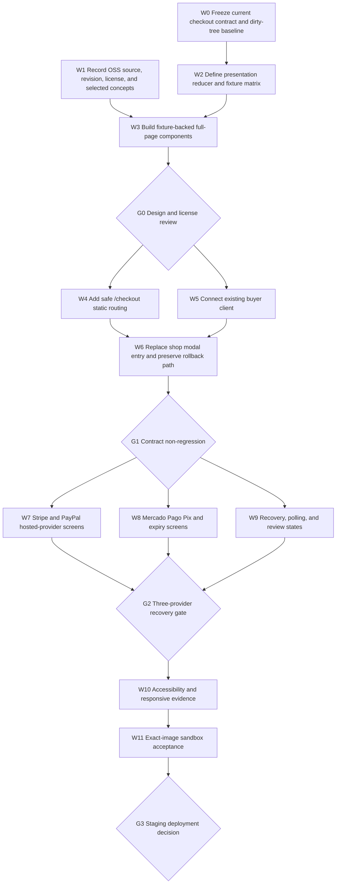

# KELD Checkout UX Redesign Plan

This plan records the implemented replacement of the modal-shaped checkout with
a dedicated, state-aware checkout surface while preserving the implemented KELD
payment, identity, order, entitlement, and delivery boundaries. It extends the
completed React migration recorded in
[REACT-CHECKOUT-MIGRATION-DAG.md](REACT-CHECKOUT-MIGRATION-DAG.md). The local
candidate is deployed to staging for controlled testing; production publication
remains separately gated.

## Outcome

An authenticated customer can move through one understandable full-page flow:

```text
Review -> Provider action -> KELD verification -> Paid / Pending / Failed
```

The checkout form, active provider instructions, verification state, and final
outcome are separate screens. A customer can always return to the shop, recover
an owned checkout, or start another checkout after a terminal result without
erasing order history.

## Implementation Status (2026-09-20)

The checkout candidate implements W0-W10 of this plan and has passed the
authorized non-payment staging cutover gate:

- `/checkout`, `/purchase/return`, and `/purchase/cancel` render the same
  full-page React checkout, while the storefront remains at `/#shop`;
- the shop review action navigates to `/checkout` and the accepted build no
  longer mounts the legacy modal portal;
- a typed presentation reducer maps browser and server state without allowing
  a return route or query string to infer payment;
- Stripe and PayPal use explicit hosted-provider handoff screens, while Mercado
  Pago exposes its frozen BRL total, Pix code, copy feedback, and expiry timer;
- pending verification is bounded, pauses while the document is hidden, and
  keeps a manual `Check again` action;
- terminal-only restart, authenticated history/restore, verified download,
  logout, keyboard focus, status announcements, and responsive layout are wired
  through the existing buyer client;
- `/checkout` is an explicit server allowlist entry rather than an unrestricted
  SPA fallback.

No commerce framework, visual asset, source fragment, or runtime dependency was
copied from the researched projects. Their licenses and pinned revisions remain
design provenance only.

### Local acceptance evidence

| Surface | Result |
| --- | --- |
| Frontend unit/parity suite | 19/19 passed; production Vite build passed |
| Integration suite | 96/96 passed |
| Portable staged-runtime check | passed; 81-file manifest; no sibling checkout required at runtime |
| Production-bundle browser journey | passed in Chrome 153 at 1440, 1024, 768, 390, and 320 pixels; no overflow or page errors |
| Browser payment fixture | one checkout create across reload, one server confirmation, verified binary download, terminal restart, and logout passed |
| Manual route/provider review | storefront entry, Stripe paid flow, Mercado Pago Pix/fixed 5.10 quote, cancellation preservation, and return verification passed |
| Deployment/security suite | 76/76 passed |
| Exact local application image | `sha256:ea28cdcc35e5ceb3e65be5612fb048468eaf6d40906e8eeab3f087091cc4f705`; non-root/read-only/no-network smoke passed |
| Exact-image security scan | digest-pinned Trivy 0.74.0 reported zero High/Critical vulnerabilities and zero secret findings |

The source-only application context contains 84 files and 2,699,315 bytes; its
deterministic file-entry digest is
`3cd3271d3290d9bdaf5a2d958369288cc396a158a2d5031708273e1eff7ade6b`.
The local candidate tag is `keld-sandbox:checkout-redesign-20260920-r1`.

The original browser evidence used intercepted sandbox-shaped responses against
the production bundle. A later live-staging Chrome 153 gate passed the deployed
exact image at 1440, 1024, 768, 390, and 320 pixels without creating a payment.
It proves deployed frontend behavior and contract preservation, not a new
genuine provider transaction. W11 therefore remains the real-sandbox staging
acceptance step.

## Current State

- The exact checkout-auth-return r2 image is live on staging as the controlled
  test release. Only `web` and `worker` changed; r1 and the verified
  pre-cutover recovery point remain available for immediate rollback.
- Historical provider-confirmed purchase-to-download evidence remains valid for
  the backend boundary, but all three providers must be exercised again through
  this deployed UI before W11 closes.
- The local source candidate in [`web/src/App.tsx`](../web/src/App.tsx) now
  navigates into the dedicated route, with state-specific presentation in
  [`web/src/checkout/CheckoutPage.tsx`](../web/src/checkout/CheckoutPage.tsx).
- [`web/src/checkout/client.ts`](../web/src/checkout/client.ts) already preserves
  request-key idempotency, fresh CSRF for mutations, exact provider-host
  allowlists, server confirmation, authenticated restore, and terminal-only
  local reset.
- The backend already serves `/purchase/return` and `/purchase/cancel` and never
  treats those browser routes as proof of payment.

The implemented candidate changes presentation and routing without weakening
those guarantees; W11 must verify that boundary on the promoted exact image.

### Post-cutover authentication return repair

Live r24 testing found that signing in from `/checkout` completed OIDC correctly
but always redirected to `/`. The deployed r2 candidate now carries the allowlisted
checkout path and selected `amount` through an HttpOnly, Secure, SameSite=Lax
transaction cookie. The callback consumes and clears that cookie, session
renewal uses the same return path, and invalid external, API, duplicate-field,
fragment, and out-of-range amount targets fail closed. Provider-return query
parameters are deliberately not carried through authentication because they are
not payment authority and the owned checkout is already recoverable.

The repair passes 20/20 frontend tests, the complete 96/96 integration suite,
76/76 deployment/security tests, a production build, and a real Chrome check of
the generated login and registration targets. Exact image
`sha256:fe87c5dda8a6dfc70c32e826071fde2781f84f9e8dea006a020f1379dfd365bf`
also passes the constrained UID/GID `10001:10001` no-network/read-only smoke and
a digest-pinned Trivy 0.74.0 scan with zero High/Critical vulnerabilities and
zero secret findings. Its exact staging cutover is complete through the
anonymous checkout-to-Keycloak handoff: schema-v3 r25, the frozen 84-file
context digest, route isolation, unsafe-return rejection, fixed quote, and both
direct and scheduled monitors pass. A real credentialed callback returning to
the same `/checkout?amount=200` remains the final acceptance gate for this
repair; no payment is required for that check.

## Open-Source Design Review

The repositories below were inspected at the listed revisions on 2026-09-20.
The revision pins are research provenance, not new runtime dependencies.

| Candidate | Revision | License | Useful pattern | Decision |
| --- | --- | --- | --- | --- |
| [Commerce Layer React Checkout](https://github.com/commercelayer/mfe-checkout) | `2e6c9c19833df9b7043e38e8e41f4cd750decc4c` | [MIT](https://github.com/commercelayer/mfe-checkout/blob/main/LICENSE) | Full-page two-column checkout, persistent order summary, step navigation, dedicated complete and expired screens, return-to-cart action | **Primary design reference** |
| [Medusa DTC Starter](https://github.com/medusajs/dtc-starter) | `d871b32233642be3a7afa556009d5956bb655c12` | [MIT](https://github.com/medusajs/dtc-starter/blob/main/LICENSE) | Responsive `1fr / 416px` layout, sticky summary, explicit review section, detailed order-complete page | **Secondary layout reference** |
| [Stripe one-time Checkout sample](https://github.com/stripe-samples/checkout-one-time-payments) | `c834ba3ae155bd77a6aeb5879b58edd6a944af00` | [MIT](https://github.com/stripe-samples/checkout-one-time-payments/blob/main/LICENSE) | Minimal success route and server-fetched Checkout Session example | **Protocol/sample reference only** |
| [Saleor Storefront](https://github.com/saleor/storefront) | `82f1bf576d20b34b3fd35f2a65c25b75dd62939a` | FSL-1.1-ALv2, converting later to Apache 2.0 | Modern server-backed checkout and design tokens | **Do not copy current code without a separate license decision** |

Commerce Layer is the closest structural fit. Its application already separates
the main checkout, `StepNav`, `OrderSummary`, `StepComplete`, and `StepExpired`.
Its documented flow also skips shipping for digital products and provides a
return-to-cart action. KELD should adapt those concepts to the existing Vite and
plain-CSS application, not import Commerce Layer, Next.js, Tailwind, or its API
components.

Medusa provides the clearest simple desktop composition: checkout content on the
left and a sticky order summary on the right. Its shipping and address stages do
not apply to KELD's downloadable artifact and must not be copied into the flow.

Stripe's sample is intentionally sparse. It is useful for confirming that a
success page is a separate route, but its visual treatment and browser restart
behavior are not sufficient for KELD's multi-provider, server-verified state
machine.

## Reuse and License Boundary

1. Reimplement the layout and interaction concepts in KELD components and CSS.
2. Do not add a commerce framework or replace KELD's backend, ledger, auth, or
   provider adapters.
3. Before copying a substantial source fragment, record the exact upstream file,
   revision, license, changed portions, and retained copyright notice in a
   KELD third-party notice file.
4. Do not copy Saleor FSL source into this implementation under this plan.
5. Do not copy brand assets, product imagery, merchant copy, or visual trade
   dress from any candidate.

## Selected KELD Information Architecture

### Routes

| Route | Purpose | Authority boundary |
| --- | --- | --- |
| `/checkout` | Review amount and choose provider; resume current owned checkout | Browser proposes; server creates or restores |
| `/purchase/return` | Provider return landing; immediately show verification state | Return parameters never prove payment |
| `/purchase/cancel` | Explain cancellation and preserve the order for safe recovery | Cancellation does not imply provider failure |
| `/#shop` | Product and price-selection surface | No payment state mutation |

The existing provider return URLs remain unchanged in the first implementation
wave. A future order-specific public URL is explicitly deferred until its
authentication, enumeration, and recovery semantics are separately designed.

### Screen Model

| Screen | Main content | Primary action | Secondary actions |
| --- | --- | --- | --- |
| Review | Price, selected product, provider choices, final presentment explanation | `Continue to Stripe`, `Generate Pix`, or `Continue to PayPal` | Back to shop; find my checkouts |
| Provider action | Provider-specific instructions or redirect handoff | Open provider / copy Pix | Back to checkout; find my checkouts |
| Verifying | Order reference, waiting explanation, bounded progress | Automatic server check with manual `Check again` fallback | Back to shop without losing order |
| Paid | Verified status, product, charged amount/currency, order reference | Download verified artifact | Start another checkout; back to shop |
| Pending | Current provider state and what the customer should do next | Resume provider or check again | Back to shop |
| Failed / expired | Specific recoverable explanation | Start a new payment attempt when safe | View order history; back to shop |
| Review required | Outcome is uncertain or requires operator reconciliation | Contact/support guidance | View order history; back to shop |

### Desktop Composition

```text
+------------------------------------------------------------------+
| KELD                                      Sandbox     Back to shop |
| Review  >  Pay  >  Verify  >  Complete                           |
+--------------------------------------+---------------------------+
| Main state-specific content          | Order summary             |
|                                      | ARE alpha release         |
| One primary action                   | USD price                 |
| Provider or verification details     | BRL quote when applicable |
| Recovery guidance                    | Payment method            |
|                                      | Final amount              |
+--------------------------------------+---------------------------+
```

The right summary is sticky on desktop. On mobile it becomes a collapsed,
keyboard-operable `Order summary` disclosure above the main content. The page
must never trap the customer inside a modal.

## Component Plan

| Component | Responsibility | Existing source reused |
| --- | --- | --- |
| `CheckoutRoute` | Select screen from authenticated checkout and URL state | `App.tsx` checkout orchestration |
| `CheckoutLayout` | Header, progress, main column, responsive summary column | New KELD component; Commerce Layer/Medusa concept only |
| `CheckoutProgress` | Review, Pay, Verify, Complete orientation; not a source of truth | New presentation component |
| `OrderSummaryCard` | Product, USD input, provider presentment, quote reference, final amount | Existing server response values |
| `PaymentMethodSelector` | Provider cards and provider-specific required fields | Current amount/provider/email controls |
| `ProviderActionPanel` | Hosted-provider CTA or Pix code/copy/expiry | Current `CheckoutResult` presentation |
| `VerificationScreen` | Automatic bounded confirmation plus manual fallback | Existing `client.confirm()` |
| `CheckoutOutcome` | Paid, pending, failed, expired, review-required variants | Existing checkout and ledger states |
| `CheckoutHistory` | Owned history, pagination, restore | Existing `client.orders()` and `restore()` |

No component may infer paid status from the route, provider query string, or
client storage. `CheckoutProgress` is orientation only and must render server or
client state already established through the existing contract.

## State Translation

The current browser type exposes only `pending | paid | failed`, while provider
and ledger details carry additional string states. Before visual implementation,
one typed presentation reducer must map the combined values to:

```text
review
creating
awaiting_provider
awaiting_customer_action
verifying
pending
paid
failed
expired
review_required
unavailable
```

The reducer is presentation-only. It cannot change ledger state, authorize a
download, start a replacement attempt, or hide an uncertain payment behind a
generic failure screen.

## Implementation Layering

### L0 - Fixture-backed design shell

**After this layer, we know whether** the selected open-source layout concepts
fit KELD's visual language and all required checkout states without modifying a
payment.

- Add the typed presentation reducer and fixture states.
- Build `CheckoutLayout`, `CheckoutProgress`, `OrderSummaryCard`, and the state
  screens behind a local-only fixture harness or non-production preview.
- Implement responsive desktop/mobile structure with KELD's existing typography,
  colors, spacing, buttons, and focus treatment.
- Do not call checkout, confirmation, download, or provider endpoints.

Exit evidence:

- reviewed desktop and 390-pixel screenshots for every state;
- keyboard navigation and focus order pass;
- no horizontal overflow at 320, 390, 768, 1024, and 1440 pixels;
- license/provenance register identifies any copied source fragment.

### L1 - Dedicated live checkout route

**After this layer, we know whether** KELD can replace the modal presentation
without changing its proven payment and recovery contract.

- Serve `/checkout` from the existing React application without allowing SPA
  fallback to shadow `/api`, `/auth`, `/events`, `/readyz`, or other reserved
  namespaces.
- Change shop checkout entry from modal opening to navigation into `/checkout`.
- Connect the new components to the existing buyer client.
- Keep `/purchase/return` and `/purchase/cancel`, but render verification and
  cancellation screens instead of the mixed form/result view.
- Preserve history restore, logout behavior, exact provider host validation,
  and terminal-only restart.
- Keep the old checkout portal available only as a temporary rollback path
  until the L1 gate passes.

Exit evidence:

- current client and backend integration suites remain green;
- browser refresh, Back, provider return, provider cancellation, logout/login,
  and history restoration preserve the same request key and order;
- no duplicate provider resource is created by React lifecycle or repeated CTA;
- old modal and new route do not operate simultaneously in the accepted build.

### L2 - Provider and recovery completeness

**After this layer, we know whether** every supported provider and degraded state
has a truthful, recoverable customer experience.

- Stripe: explicit redirect/return language and server-verification screen.
- Mercado Pago: QR/code presentation, copy feedback, expiration countdown, and
  expired-instruction removal.
- PayPal: approval, cancellation, capture/verification, and funding-failure
  recovery.
- Shared: delayed webhook, lost browser storage, session renewal, existing
  server checkout conflict, provider unavailable, network timeout, review, and
  cross-buyer denial.
- Poll only while a state is legitimately pending; bound interval, duration,
  visibility behavior, and retry backoff. Keep `Check again` available.

Exit evidence:

- per-provider happy, cancel, pending, expired, failed, return-before-webhook,
  webhook-before-return, refresh, and recovery scenarios;
- forged return parameters never unlock paid UI or delivery;
- an uncertain attempt cannot be replaced with a second payment;
- paid and failed terminal orders can start a new checkout without deletion.

### L3 - Accessibility, visual acceptance, and staging candidate

**After this layer, we know whether** the redesigned checkout is ready for an
exact staging deployment decision.

- Add programmatically determinable status messages for creating, copying,
  verifying, failure, and success updates.
- Move focus to the new page heading after route navigation and to a concise
  error summary after failed submission; preserve logical tab order.
- Verify 200% zoom, reduced motion, forced colors, keyboard-only use, and screen
  reader names/roles/states.
- Capture stable screenshots, traces, ARIA snapshots, accessibility results,
  console/network output, and DOM measurements.
- Run the exact packaged-image test matrix and prepare rollback evidence.

Exit evidence:

- all deterministic accessibility and functional gates pass;
- reviewed screenshots approve the intended KELD visual differences;
- all three sandbox provider journeys work on the exact candidate image;
- deployment remains a separate owner-authorized `CA2-ROUTE-PUBLISH` action.

## Dependency DAG



## Work Units

| ID | Work unit | Depends on | Completion evidence |
| --- | --- | --- | --- |
| W0 | Freeze current client/API behavior and list overlapping dirty files | - | Baseline test results and exact file manifest |
| W1 | Record selected upstream files, revisions, licenses, and reuse posture | - | Reviewed provenance and third-party notice decision |
| W2 | Define presentation states, transitions, actions, and forbidden actions | W0 | Reducer table and unit fixtures |
| W3 | Build route layout and all state screens against fixtures | W1, W2 | Responsive screenshots and component tests |
| W4 | Add `/checkout` to the allowlisted React-page routes | G0 | Routing/security tests; reserved namespaces still fail closed |
| W5 | Bind screens to the existing buyer client without contract changes | G0 | Existing and new client tests pass |
| W6 | Navigate shop entry to the new route and retain bounded rollback | W4, W5 | Browser back/refresh/focus checks |
| W7 | Complete Stripe and PayPal hosted-provider presentation | G1 | Hosted-provider scenario tests |
| W8 | Complete Pix code, copy, timer, expiry, and removal behavior | G1 | Pix scenario tests |
| W9 | Add recovery, polling, conflict, review, and history flows | G1 | Failure/recovery matrix passes |
| W10 | Run deterministic accessibility, layout, and interaction checks | G2 | UX evidence bundle and residue ledger |
| W11 | Exercise exact image with all three sandbox providers | W10 | Sanitized exact-build acceptance receipts |

## UX Evidence Classification

### Hard gates

- Provider return or query parameters never produce paid state.
- The final amount and currency are visible before a provider CTA.
- Only one primary action is visually dominant per state.
- Form errors identify the field and correction in text.
- Dynamic verification, error, copy, and success messages are exposed through
  appropriate status semantics.
- Focus order remains meaningful; all actions are keyboard operable.
- The customer can leave the checkout without losing an uncertain order.
- Mobile layouts have no horizontal overflow or unreachable action.

### Soft flags

- Order summary is sticky on desktop and collapsible on mobile.
- Step progress accurately reflects only reachable/current stages.
- Provider helper copy states that the customer will leave and return.
- Recovery copy identifies the next safe action without internal diagnostics.

### Screenshot review

- Visual hierarchy matches the KELD editorial storefront rather than looking
  like an imported generic commerce template.
- Sandbox labeling is visible without dominating the purchase task.
- Paid, pending, failed, expired, and review-required states are visually
  distinct without relying on color alone.

### Human-study residue

Automated tests cannot prove customer trust, comprehension of quote conversion,
confidence that payment succeeded, or satisfaction with the flow. Those remain
short moderated-test questions after the deterministic staging gates pass.

## Non-Regression Guardrails

- Preserve KELD's existing server authority for payment, entitlement, and
  download authorization.
- Preserve request-key persistence before checkout dispatch.
- Preserve exact provider host allowlists and same-origin authenticated API use.
- Preserve frozen USD/BRL amounts and quote references from the server response.
- Preserve uncertain orders; never reset them to make the UI appear recoverable.
- Preserve account ownership checks for history, restore, confirmation, and
  download.
- Preserve current backend return/cancel URLs until an exact migration and
  provider reconfiguration are separately authorized.
- Do not introduce shipping, address, tax, coupon, inventory, or guest-checkout
  concepts from the reference implementations.
- Do not add Next.js, Tailwind, Commerce Layer, Medusa, Saleor, or Stripe UI
  runtime dependencies merely to reproduce the selected layout.

## Recommended Next Layer

Run W11 against the deployed exact image: one truthful Stripe, Mercado Pago,
and PayPal sandbox journey through server verification and exact-artifact
delivery, plus cancellation, delayed confirmation, reload, and terminal restart
checks. Preserve the r12 image and verified pre-cutover state backup as rollback
targets.

The exact candidate identity, permitted effects, ordered checks, and rollback
triggers are frozen in
[CHECKOUT-STAGING-CUTOVER-2026-09-20.md](CHECKOUT-STAGING-CUTOVER-2026-09-20.md).

## Open Questions

1. Should checkout history remain inside `/checkout`, or move to a separate
   account page after L1? Recommendation: keep a compact recovery section in
   checkout for L1 and defer a full account page.
2. Should KELD copy any MIT source fragments or only reimplement concepts?
   Recommendation: reimplement concepts; copy only small utilities when it
   materially reduces risk and record them in third-party notices.
3. Should pending verification poll automatically when the page is hidden?
   Recommendation: pause while hidden and resume with an immediate bounded
   check when visible.
4. What customer-facing support route or email is approved for
   `review_required`? This must close before L2 acceptance.
5. Is the sandbox banner retained in production builds as an environment label,
   or replaced by a production trust statement? This must be decided before the
   later publication route.

## Claim Ceiling

This artifact records an implemented, deployed, and non-payment-validated
staging test candidate. It does not prove customer usability, genuine provider
behavior for this new UI, full staging acceptance, commercial readiness, or
production readiness. The completed authorization was limited to the exact
staging cutover envelope and does not authorize any production publication.
