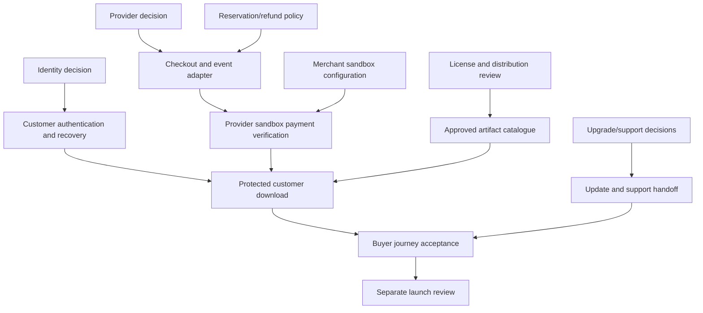

# KELD commercial integration handoff

Candidate implementation contract, grounded in the current local code. The owner's
latest license intent and Stripe/PayPal/USDC/Pix direction are recorded in
[license and payment research](LICENSE-PAYMENT-RESEARCH.md). Merchant eligibility,
identity service, final license terms and live configuration remain unresolved.
Owner: the requesting product owner for those decisions;
implementation owner: the agent after the affected choices are supplied.

## Current construction frontier

The starter is imported, the complete private engine is packaged, installation and
customer-context checks work, and the local order/grant path can deliver real bundle
bytes. A customer project starter is included. Source portability and recovery work
are recorded in [release readiness](RELEASE-READINESS.md).

The next commerce milestone is a **provider-sandbox buyer journey**: selected price
→ real test checkout → verified provider payment → authenticated customer download
→ artifact verification → installation. Another synthetic payment fixture does not
meet this milestone. Existing local tests remain useful regression coverage.

The [provider binding layer](../commerce/provider_bindings.py) now stores immutable
session-to-order links scoped by provider/account/environment and resolves order
ownership before forwarding verified receipts to the ledger. The combined local
commerce suite passes 19 tests. Session creation, provider verification, durable
event intake and authenticated HTTP delivery remain unimplemented; these local
checks do not satisfy the sandbox milestone. Operationally, sandbox and live must
use separate databases and catalogues, not just separate ID namespaces.

## Decisions and exact affected stages

| Decision | Current evidence | Stage it controls |
| --- | --- | --- |
| License direction | User selected paid resale only for substantive new functionality or material functional improvement; reseller offers its modified source code free to verified ARE purchasers. [Candidate clauses](ARE-LICENSE-CANDIDATE.md) are not operative. | Distribution review, customer terms and approved artifact |
| Payment provider | User requests Stripe, PayPal, USDC and Pix; country-dependent routing is researched; no adapter or provider session exists | Checkout API, currency-aware quotes, signature/event verification and sandbox integration |
| Merchant/account and sandbox access | Not configured | Running the chosen provider's real sandbox journey |
| Customer identity and recovery | Ledger accepts a trusted internal customer ID; no login or recovery implementation | Binding orders and protected downloads to the actual buyer |
| Support destination/owner | Direct-maker support is proposed, but no destination is configured | Customer receipt and support handoff |
| Reservation duration, cancellations, refunds, late-payment resolution | Duration is a required constructor value; tests use a fixture; expired payments become `paid-review` | Checkout expiry, customer messaging and exception handling |
| Upgrade eligibility and distribution scope | Benefits have an expiry; no versioned catalogue or final inclusion decision | Release-by-release access, updates and final distribution approval |

The broad license/payment direction is supplied; exact terms and merchant country
remain open. Credentials must be configured through the chosen
service/environment, not pasted into this document or chat.

## Interfaces to connect

1. **Checkout.** Preserve the starter's `POST /api/checkout` contract:
   `productId`, `offerId`, integer `amountCents`, `currency`, and `quantity`.
   Authenticate the customer, obtain a stable server-bound idempotency key, load
   approved release configuration, then call `Ledger.create_order`. The browser
   must not choose the customer ID, release digest or supporter eligibility.
2. **Provider session.** Create checkout from the stored order's amount, currency,
   release, benefit and expiry. Persist the provider-session-to-order/customer
   mapping and use provider idempotency. Show the actual benefit/terms before
   payment. Return only a verified HTTPS provider checkout URL; never an artifact
   path or a customer-selected redirect target. Handle the browser's 15-second
   timeout as a retry of the same order, not a new reservation.
3. **Verified payment.** Verify provider authenticity, successful payment and the
   server-side order/customer mapping before calling `record_verified_payment`.
   Its exact input fields are `event_id`, `payment_id`, `order_id`, `customer`,
   `amount_cents`, `currency`, and `paid_at`. Normalize these from verified provider
   data. Namespace provider identifiers if more than one provider is ever supported.
   Preserve the distinction between selected subtotal, tax and final total.
4. **Delivery.** Use the authenticated session's customer ID with `Delivery.issue`
   and `Delivery.redeem`. Keep the artifact root private. The live service uses
   `approved-release`, never `local-test`. Send verified bytes through an authenticated
   response. A lost transfer can require a fresh grant; grant consumption does not
   prove the browser received the complete file.
5. **Recovery and upgrades.** Link verified account recovery to the same customer
   identity. Add an approved versioned catalogue and the chosen upgrade-access rule.
   Existing benefit dates alone do not implement an upgrade service. Route refunds
   and `paid-review` through the selected policy before granting access.

Source contracts: [checkout](../prototype/CHECKOUT-CONTRACT.md),
[ledger](../commerce/ledger.py), [delivery](../commerce/delivery.py),
and [commerce trust boundaries](../commerce/README.md).

## Construction and operations DAG

Provider/identity adapter implementation is product construction. Merchant account,
secret configuration, support destination and eventual publication are operational
support. Each blocks only its named stage. Existing engine fixes can proceed when
independently justified; they must not be presented as completion of the buyer journey.

## Acceptance evidence required

| Check | Proof needed |
| --- | --- |
| Selected-price integrity | Browser-selected amount equals stored subtotal and provider checkout subtotal at allowed boundaries; forged/fractional/out-of-range values are rejected |
| Reservation and retry | Same customer/idempotency key retries one order; concurrent final slots cannot oversell; displayed benefit agrees with stored/provider terms |
| Provider authenticity | Invalid or unverified events never mutate payment state; verified successful sandbox payment does |
| Binding and replay | Wrong customer, order, amount, currency, reused payment and changed duplicate event are refused; valid duplicates remain idempotent |
| Delayed payment | Expired checkout/payment follows the adopted review/refund policy; no silent supporter reassignment |
| Customer isolation | Another authenticated customer cannot inspect or download the order; recovery restores the intended identity only |
| Artifact approval | Unapproved, corrupt, missing or wrong-release artifacts cannot be delivered |
| End-to-end success | Actual sandbox checkout leads to an authenticated download of the exact reviewed bytes, verified extraction and installation |
| Failure recovery | Checkout timeout, duplicate callback, interrupted download and expired grant have tested recovery without duplicate orders or entitlement escalation |
| Updates and support | Receipt links to the selected support channel; catalogue eligibility matches the adopted update policy and expiry boundaries |

The existing local ledger/delivery tests prove only their internal portions of these
checks. They do not supply provider authenticity, authentication or HTTP evidence.

## Open Questions

The decisions above remain owned by [project intake](PROJECT-INTAKE.md). A provider
choice permits concrete adapter construction; it does not authorize live payments.
Exact launch authorization is a later decision over the tested release/configuration.
