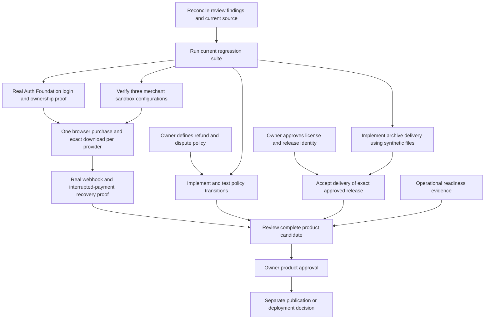

# KELD integration execution DAG

Date: 2026-09-17. Candidate owner-directed construction under CAV2-D65.
Route receipt: `keld-review-dag-124`. No publication or merchant effects.

## Objective and current frontier

2026-09-18 migration prerequisite: Mercado Pago Pix must move to Orders before
its real staging journey. The [researched Orders DAG](MERCADO-PAGO-ORDERS-PLAN.md)
owns this work and supersedes prior Payments-specific token/webhook guidance.
Local Orders implementation and SDK/ledger verification are complete; [implementation evidence](MERCADO-PAGO-ORDERS-IMPLEMENTATION.md) owns the original test results and unresolved provider contract gates. The [review repair DAG](MERCADO-PAGO-ORDERS-REPAIR-DAG.md) owns the current repairs and validation. Merchant credentials and genuine sandbox acceptance remain outstanding.

An authenticated buyer can purchase ARE through Stripe cards, Mercado Pago Pix,
or PayPal, and receive the correct approved release exactly under their entitlement.
Reuse Auth Foundation; do not introduce another identity system or cart. USDC is deferred.

The original [four review fixes](SDK-REMEDIATION-DAG.md) are implemented.
Storefront, durable attempts, payment verification, reconciliation, event processing,
lost-binding recovery and operator inspection now exist. The frontier is proving
the integrated product against real sandbox services, then completing commercial
policy and release delivery. Passing intercepted SDK tests is not that proof.

## Execution order and close conditions

| ID | Task and dependency | Owner | Close condition | Current status |
| --- | --- | --- | --- | --- |
| A | Reconcile completed fixes with current source | Coding agent | Historical findings retained; stale next-task pointers corrected | Complete |
| B | Run final current default suite; after A | Coding agent | Current regression and added transport checks pass | Complete: full 72-case run plus 2 added checks passed |
| C | Real issuer login, callback, renewal, logout and two-buyer isolation; after B | Operator supplies dedicated configuration; agent validates | Real issuer and PostgreSQL evidence, including browser cookies and cross-buyer denial | Configuration missing; local protocol fixture already passed |
| D | Configure Stripe, Mercado Pago and PayPal sandboxes plus BRL quote policy; after B | Merchant owner supplies configuration; agent validates | Correct test merchant identities and accepted provider-specific checkout responses | Configuration missing |
| E | Authenticated browser purchase per provider; after C and D | Agent with merchant test configuration | Paid state verified server-side, exact fixture hash downloaded, replay safe, other buyer denied | Waiting for C/D |
| F | Real webhook receipt and recovery; after E | Operator configures ingress; agent validates | Duplicate, delayed and interrupted-binding events reconcile without duplicate grants; no callback-only payment proof | Local tests pass; real delivery unverified |
| P/G | Define then implement refund/dispute transitions; G also depends on B | Product owner decides; agent implements | Agreed full/partial refund, dispute, future download/support and first-100 behavior covered by tests | Policy unresolved; events currently go to review |
| H | Implement archive transport using synthetic files; after B | Coding agent | Full integrity before streaming, bounded memory, disconnect cleanup and exact bytes beyond 1 MiB | Complete for synthetic sandbox artifacts: verified snapshot, binary HTTP stream and disconnect cleanup passed |
| L/R | Approve license/release and accept exact release delivery; after H | Product owner approves; agent validates | Approved archive hash and notices, portable shared package and approved release delivery | Portable package passed; commercial approval and real release delivery remain |
| I/J | Review then approve exact candidate; after F/G/R/O | Agent reviews; product owner approves | Traceable passing evidence and explicit disposition of remaining risks | Pending |
| K | Publication/deployment | Owner/operator | Separate exact authorization and deployment envelope | Outside current execution |

## Deployment preparation update

2026-09-18: The [staging execution plan](STAGING-PLAN.md) now owns the ordered
VPS setup and real-service test frontier. SSH access to `187.77.163.194` works;
`staging.keld.studio` and `auth.staging.keld.studio` resolve there. Preserve the existing
orchestrator. Merchant credentials remain missing. Infrastructure execution is
tracked in [STAGING-STATUS.md](STAGING-STATUS.md). The plan separates infrastructure startup from merchant configuration.

The [VPS deployment package](../deploy/README.md) is implemented locally using the
copied secret store. File-secret loading, worker-only credentials, private
listeners, pinned images and Compose startup were tested. The application suite
now passes 78 cases. The copied store passes 31 tests. Real local PostgreSQL and
Keycloak initialized successfully behind a loopback Caddy smoke configuration.
This advances operational node O and configuration tooling for C/D; real public
TLS, browser login, merchant transactions, recovery/backup acceptance and the
actual VPS deployment remain unverified. The deployment target and DNS are now
known; merchant credentials have not been supplied.

## Operational work and causal blockers

Completed this execution: A and B, with no regression failures. Shared-package staging is also runnable independently of commercial approval;
its isolated install proof passed with all 69 integration cases, plus a separate
production-only offline install/import check. Archive transport now passes with synthetic files independently of release
approval; real release admission wiring remains under R. Real-service and policy work still depends on C/D/G;
license/release approval gates R, not implementation H. Existing optional browser
and PostgreSQL/issuer-fixture harnesses remain available; rerun when related source
changes require them. Do not substitute repeated fixture runs for C–F.

Operational node O is owned by the operator with agent support: process supervision,
TLS/ingress, credential custody, backup/restore, monitoring, queue capacity and
retention. It blocks final readiness I, not local implementation B/G/H. No service
installation is implied by the maintenance command's existence.

Dedicated identity configuration blocks C; merchant configuration and a defined
BRL quote policy block D. Policy decisions block G; approved license/release
identity blocks R's final acceptance. No secrets belong in chat or committed docs.

Deferred residue: USDC; general PayPal historical discovery without an event or
known ID; automated expired/unlocated-attempt resolution; archive purge. Existing
operator review/recovery must be evaluated at I to determine whether any item is
a launch blocker. Empty searches never prove payment absence. Completed-event
archival frees inbox slots but does not promise host disk reclamation.

## Execution evidence

Current run: `npm --prefix keld-project/integrations test`.
Result: **72 passed, 0 failed, 0 skipped**, exit 0, approximately 87 seconds.
Two subsequently added HTTP-disconnect and large-file configuration tests also
passed; the current default inventory is 74. No full 74-case run is claimed.
Provider responses were intercepted; the result proves local behavior only.
Prior optional browser and
real PostgreSQL/local issuer evidence is described in
[SDK-INTEGRATION.md](SDK-INTEGRATION.md); those checks do not prove real merchant
or Keycloak connectivity.

No ontology runtime record or selector dependency is introduced. This plan is
candidate construction evidence, not admitted execution state, product approval,
or authorization to deploy.

## Open Questions

Configuration, quote policy, commercial terms, release approval and operational
questions remain owned by [SDK-INTEGRATION.md](SDK-INTEGRATION.md#open-questions).
In particular, refund/dispute policy must not be inferred from unanswered proposals.
