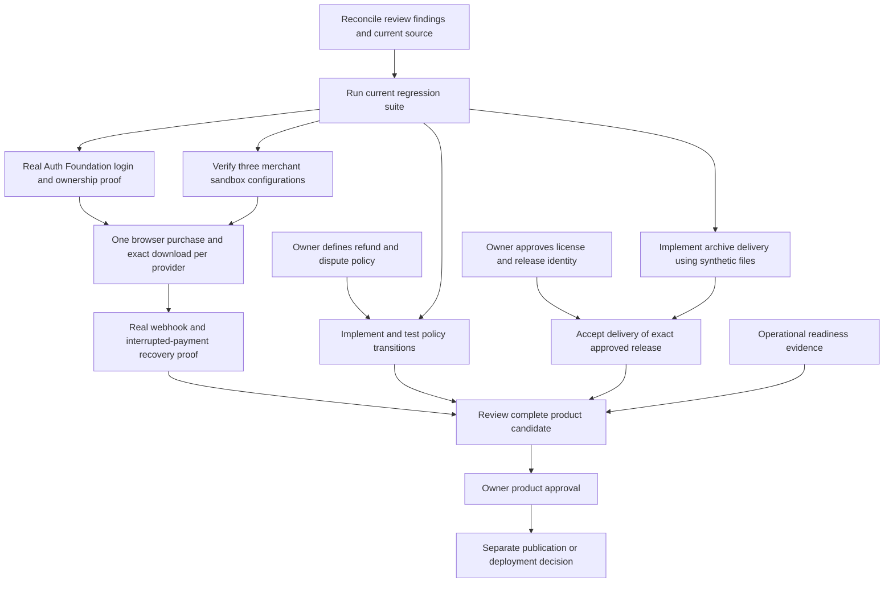

# KELD integration execution DAG

> **Current execution update (2026-09-21 UTC):** the owner-approved checkout
> authentication-return cutover is deployed to staging as
> `checkout-auth-return-20260920-r2`, exact image
> `sha256:fe87c5dda8a6dfc70c32e826071fde2781f84f9e8dea006a020f1379dfd365bf`.
> Only `web` and `worker` changed. A verified pre-cutover full-state backup and
> r1 image rollback remain available. Anonymous Chrome 153 verified the exact
> checkout login/registration return links, KELD-realm handoff, protected
> return cookie, and zero page/console errors without creating an identity,
> checkout, or payment. Schema-v3 r25, SHA-256
> `7c492262653e5ca0edb7b23f3387a27eb803560d5720d73f546acb46359fc25b`,
> verifies and both direct and scheduled monitor runs are green. This supersedes
> later `current` wording retained in the historical execution context below.
> One real credentialed callback to the same checkout is the next gate; W11
> genuine Stripe, Mercado Pago, and PayPal journeys follow. Production remains
> separately blocked.
>
> **Prior execution context (2026-09-20):** the security-plan candidate was
> deployed to staging on the Alpine application base as
> `fixed-brl-5.10-20260920-r12`. This successor preserves the reviewed r11
> application behavior and makes the merchant-owned conversion policy an
> explicit, non-expiring 5.10 BRL/USD quote. Identity signup and
> renewal, ARE chat/preferences, and complete Stripe and Mercado Pago sandbox
> purchases through verified download pass in a real browser. The live ledger
> also retains one provider-confirmed PayPal BRL purchase with one consumed
> exact-artifact grant; a privacy-safe receipt now binds that evidence. Genuine Stripe
> signed delivery, provider redelivery, and stopped-worker restart recovery pass
> without a duplicate grant. The anonymous storefront now loads without a
> console-error 401 while mutations remain authenticated and CSRF-gated. PayPal
> later reached its genuine sandbox handoff twice for regression attempts. Both bounded attempts expired
> locally before buyer approval; the second was observed by a 36-check watcher
> through `approval-window-expired`, paid false. A replacement should be created
> only when the sandbox buyer is ready to test the current fixed-rate release;
> these later unpaid attempts do not erase the completed purchase proof. Mercado
> Pago/PayPal webhook and recovery proof remain open. Audited review resolution and PayPal 404 classification are
> deployed with a ledger-level guard preventing the missing-order action from
> closing a still-retrievable review. Three historical missing orders completed
> guarded audit resolution; two unpaid PayPal buyer-action reviews now need an
> explicit policy disposition. The r9 review repair retained by r10 restores the
> fail-closed worker-health check for a full durable event inbox; 96 integration
> tests and the exact-image fixable-vulnerability/secret release scan pass.
> The current exact-release manifest binds 43 reviewed inputs and all nine live
> containers. A hardened five-minute timer has completed a real scheduled run
> and now requires service-specific content for the three positive public probes.
> Deployment monitoring accepts the explicit fixed quote only when its
> reference, null expiry, and no-refresh state are internally consistent.
> Deployment
> monitoring now semantically verifies chat availability and the 1,800-second
> retention setting without invoking the model. Its probes are now restricted
> to the three explicit HTTPS hosts and refuse redirects or ambiguous URL forms.
> A bounded official-API BCB PTAX
> fetcher reproduces the active quote without applying it. Deployment coverage
> is 67/67; the focused deployment-tool scan reports zero High findings and one
> dispositioned Medium finding for the private container listener.
> A follow-up path/topology review also corrected the reusable deployment
> candidate: `ARE_DOMAIN` is now distinct from the storefront domain, ARE is
> canonical at that host's root, and the storefront no longer routes `/are/`.
> The live staging override already had this topology. The five-minute monitor
> now fails if storefront `/are/` stops returning 404 or ARE `/are/` stops
> redirecting to `/`; its first seven-probe run and new immutable manifest pass.
> The deployed r10 React candidate also keeps session-service failures
> distinct from anonymous sessions, reports logout failure, and validates one
> configurable ARE public origin at build time. It passes 15/15 React tests,
> the default and explicit-origin production builds, an unsafe-origin rejection,
> the full 96-test integration suite, and a real-Chrome failure/retry/logout
> browser flow with zero page errors. Its live Chrome smoke reached signup in
> the KELD realm and reported zero console/page errors. The exact r10 image scan
> reports zero fixable High/Critical findings under `--ignore-unfixed` and zero
> secrets; the new immutable r10
> manifest passed after the old r9 manifest correctly detected image drift.
> The public edge is now separately hardened on the exact scanned, module-locked Caddy 2.11.4
> image. A backed-up ownership migration moved the two existing Caddy volumes
> from root to UID/GID 1001 after the first live attempt exposed and rolled back
> the incompatibility. The hardened retry, all seven route checks, and the live
> Chrome smoke pass. The scheduled monitor then detected the intended r10
> manifest drift and passed autonomously after r11 capture. The dependency-
> locked r2 rebuild produced the same Caddy binary, passed a separate exact scan,
> and caused the expected r11 drift. Manifest schema v2 additionally binds the
> complete Caddy build/migration inputs, added capabilities, and memory limits;
> the immutable r13 release manifest now passes manually and through the
> five-minute timer.
> The r13 evidence set bound all eight then-live runtime images and 1,019
> across-image components. Its no-ignore High/Critical inventory distinguished
> the clean Caddy/PostgreSQL/ARE results from 31 unique unfixed CVEs in the old
> Debian KELD r10 image and five unique Keycloak CVEs. A digest-pinned Alpine
> replacement then passed a raw scan with zero vulnerability and secret records,
> a 15-check disposable deployment smoke, fresh SBOM/license capture, a verified
> pre-cutover backup, and the live monitor. The application and worker now
> run that exact r11 image; the remaining live raw High/Critical dependency gate
> is Keycloak. The canonical Alpine Dockerfile and the complete 84-file build
> context were included in schema-v3 r16. Schema-v3 r17 then exposed a second
> `dist/` overlay in public chat. The source-clean replacement removed four stale
> unreferenced chunks while keeping all 96 declared payload files byte-identical
> to live. Schema-v3 r18 binds the replacement plus exact ARE image IDs, declared
> package manifests, and independently observed `/srv` trees. All 82 KELD
> runtime-source files match the deployed image, and all three ARE package trees
> now match their declarations. This closes the live-source gap without claiming
> an independent clean-room rebuild. Production remains
> gated on security and license-owner decisions. A post-cutover real-Chromium
> customer journey also passes storefront load, bag, anonymous checkout closure,
> PKCE signup entry, ARE preferences, one live chat turn without
> `intent-output-invalid`, and session reset with zero console errors.
> A non-live Keycloak Bouncy Castle 1.85 candidate now reduces the exact raw
> identity scan from five unique High/Critical CVEs to three, with zero secrets.
> Its isolated read-only restored-state rehearsal passes with 9 users, 2 realms,
> readiness and issuer discovery; exact SBOM/license evidence is copied off-VPS.
> A second internal-only stack passes two Chromium registrations, real PKCE
> callback exchange, forced token renewal, logout, and two-buyer order isolation
> against the candidate and exact r11 app image. Candidate-specific
> security/license-owner acceptance is still required. Live staging remains on
> the stock image.
> The historical r13 off-VPS custom-image archive passed a clean load/retag
> rehearsal: Docker restored all seven original OCI index IDs in 37 seconds,
> and a private recovery manifest binds the archive, engine, retag, and exact
> matches. It is no longer the current set after the r11 application and r18
> public-chat replacements. A fresh archive covered the seven-image r20 set,
> verifies 91 OCI blobs, and has matching private off-VPS hashes;
> an automated 15.566-second empty containerd-snapshotter load recovered all
> seven exact manifest IDs with zero containers before and after. It is retained
> as rollback evidence after r21 replaced the application image. The current r21
> set now has a fresh 91-blob archive and a 28.78-second empty-engine load with
> all seven exact IDs. The archive and receipts have matching off-VPS copies,
> and schema-v3 r23 binds the current receipts and tools. A classic
> `vfs` load was rejected because it returned config IDs instead. The
> first single-ID namespace attempt exposed a Docker zero-exit ownership failure,
> so recovery now requires output inspection plus exact inventory verification.
> A credential-safe HTTPS success-heartbeat sender and
> inactive systemd drop-in are staged; this remains local detection until an
> external receiver and missed-heartbeat recipient are selected and tested.
> The reviewed current DAG, exact image,
> implementation details, evidence, path-move impact, and release gates are in
> [SECURITY-PLAN-EXECUTION-2026-09-20.md](SECURITY-PLAN-EXECUTION-2026-09-20.md).
> The reviewed promotion layers and updated dependency order are in
> [KELD-ARE-PRODUCTION-IMPLEMENTATION-LAYERING.md](KELD-ARE-PRODUCTION-IMPLEMENTATION-LAYERING.md).
> The image recovery evidence and remaining boundary are in
> [CUSTOM-IMAGE-RECOVERY.md](CUSTOM-IMAGE-RECOVERY.md).
> The exact live-image SBOM, complete vulnerability inventory, and license
> evidence boundaries are in
> [LIVE-IMAGE-SBOM-LICENSE-REVIEW.md](LIVE-IMAGE-SBOM-LICENSE-REVIEW.md).
> The application-base build, scan, rehearsal, rollback, and r11/r16 promotion record
> is in
> [ALPINE-APPLICATION-PROMOTION-2026-09-20.md](ALPINE-APPLICATION-PROMOTION-2026-09-20.md).
> The dated material below is retained as historical execution context.

Date: 2026-09-17. Candidate owner-directed construction under CAV2-D65.
Route receipt: `keld-review-dag-124`. No publication or merchant effects.

## Current frontier and close conditions

This table is the current execution source of truth. The dated tables below are
retained only as historical context and must not be used to infer missing
configuration or test counts.

The unresolved production-owner choices are normalized in the
[production release decision gate](decisions/PRODUCTION-RELEASE-GATE-2026-09-20.md).
That gate is currently `BLOCK`; it records options and implementation impact
without treating recommendations or silence as approval.

| Lane | Current evidence | Required close condition | Blocker/owner |
| --- | --- | --- | --- |
| Staging baseline | The exact checkout-auth-return r2 image is live for `web` and `worker`; hardened edge, PostgreSQL, Keycloak, and source-clean public chat retained their identities. Schema-v3 r25 binds the exact 84-file candidate context and all live containers. The verified pre-change backup, r1 rollback, exact archive, zero-High/Critical and zero-secret scans, unsafe-return rejection, anonymous Chrome checkout-to-KELD-realm handoff, fixed quote, direct monitor, and scheduled monitor pass. | Complete one real credentialed callback to the same `/checkout?amount=200`, then run W11 genuine Stripe, Mercado Pago, and PayPal purchase-to-exact-download journeys; preserve r1 and the verified backup until acceptance | Test-account holder, then sandbox buyer/operator coordination |
| PayPal purchase | Complete: the live ledger retains one provider-confirmed BRL purchase for the USD 50 commercial input, one consumed exact-artifact grant, and a matching privacy-safe r23 receipt. Two later regression handoffs expired unpaid and remain review records. | Preserve the completed proof; create another attempt only when deliberately testing the current fixed 5.10 quote with the sandbox buyer ready | None for provider purchase; sandbox buyer only for an optional current-rate regression |
| Mercado Pago and PayPal webhooks | Local verification passes; Stripe genuine duplicate/restart proof passes. A fail-closed phased verifier and provider-specific runbook are implemented locally. | Mercado Pago: genuine signed delivery while the worker is stopped, restart settlement, exact download, and duplicate replay with no duplicate payment/grant. PayPal: genuine signed capture-event delivery while stopped, provider-verified idempotent processing after restart, and redelivery with no duplicate payment/grant. Decide separately whether the post-capture/pre-ledger crash window requires an approved fault-injection test. | Coordinated operator/provider action; fault-injection decision only if that extra PayPal claim is required |
| BRL quote | Explicit merchant-fixed 5.10 BRL/USD (`510/100`), reference `merchant-fixed-5.10`, with `expiresAt: null`; r25 and the healthy monitor bind the fixed/no-refresh semantics. Existing checkout attempts retain the quote frozen when they were created. | Preserve the policy until the merchant deliberately changes it; any change requires a private apply, new immutable manifest, and healthy monitor | Merchant owner |
| Identity dependency | Live pinned Keycloak 26.7.4 remains the latest supported release and has five raw findings. A non-live downstream Bouncy Castle 1.85 candidate removes both BC CVEs, leaving three raw findings, and passes exact scan, restored-state rehearsal, plus candidate-backed Chromium registration, PKCE callback, renewal, logout, and two-buyer isolation. An exact-subject, non-operative OpenVEX proposal covers all three retained records but remains explicitly unapproved and is not supplied to Trivy or Compose. | Security/license owner accepts or revises the downstream overlay and exact-subject proposal, or a newer supported image passes the same raw scan and regression surface | Security/license owner and upstream |
| Account policy | Public signup works; SMTP verification and recovery are intentionally disabled. The registration form is visibly headed `Register`, but its document title still says `Sign in to keld`. | Approved SMTP, verification, recovery, and abuse-control behavior passes browser regression; align the registration document title with the selected onboarding flow | Product/security owner |
| Payment exception policy | Authenticated non-settling events go to review; PayPal subscription is wildcard | Approved refund/dispute/review transitions and matching explicit event allowlist pass tests | Product/merchant owner |
| ARE policy | Public chat/preferences and semantic status pass with 1,800-second process-memory retention | Approved source-address/rate identity, spend limits, retention/provider statement, and review date | Product/security owner |
| Recovery and alerting | Full-state backup, encrypted off-VPS copy, and isolated restore pass. The current r21 seven-image/91-blob archive has matching off-VPS hashes, passed a 28.78-second empty-engine load with seven exact IDs, and is bound by r23. Local monitor and sender validation also pass. | Close independent key custody, destination/retention, RTO/RPO, public rollback with a fresh post-restore release manifest, external heartbeat delivery, and missed-heartbeat escalation | Operations owner |
| Artifact and licenses | The r13 eight-image evidence set is preserved; the replacement application image has its own evidence; the non-live Keycloak BC 1.85 candidate has a 556-component SBOM, exact scan, restore receipt, and verified off-VPS copies. Corrected like-for-like Trivy 0.74.0 full-license scans find 52 classifier matches in both stock and candidate images, with zero normalized candidate-only or stock-only entries. | Approve unchanged stock-image obligations, product artifact rights, notices/source offers, customer license, support destination/window, and exact Keycloak candidate security dispositions; produce a final aggregate evidence receipt for the frozen production candidate | Product/security/license owner |
| Final candidate | No production candidate frozen | All preceding lanes close; admit exact artifact/license/support terms, scan, manifest, back up, canary, and explicit go/no-go | Product/security/operations owners |

## Objective and current frontier

2026-09-18 migration prerequisite: Mercado Pago Pix must move to Orders before
its real staging journey. The [researched Orders DAG](MERCADO-PAGO-ORDERS-PLAN.md)
owns this work and supersedes prior Payments-specific token/webhook guidance.
Local Orders implementation and SDK/ledger verification are complete; [implementation evidence](MERCADO-PAGO-ORDERS-IMPLEMENTATION.md) owns the original test results and unresolved provider contract gates. The [review repair DAG](MERCADO-PAGO-ORDERS-REPAIR-DAG.md) owns the current repairs and validation. Merchant credentials and genuine sandbox acceptance remain outstanding.

An authenticated buyer can purchase ARE through Stripe cards, Mercado Pago Pix,
or PayPal, and receive the correct approved release exactly under their entitlement.
Reuse Auth Foundation; do not introduce another identity system or cart. USDC is deferred.

The original [four review fixes](SDK-REMEDIATION-DAG.md) are implemented.
Storefront, durable attempts, payment verification, reconciliation, event processing,
lost-binding recovery and operator inspection now exist. The frontier is proving
the integrated product against real sandbox services, then completing commercial
policy and release delivery. Passing intercepted SDK tests is not that proof.

## Execution order and close conditions

| ID | Task and dependency | Owner | Close condition | Current status |
| --- | --- | --- | --- | --- |
| A | Reconcile completed fixes with current source | Coding agent | Historical findings retained; stale next-task pointers corrected | Complete |
| B | Run final current default suite; after A | Coding agent | Current regression and added transport checks pass | Complete: full 72-case run plus 2 added checks passed |
| C | Real issuer login, callback, renewal, logout and two-buyer isolation; after B | Operator supplies dedicated configuration; agent validates | Real issuer and PostgreSQL evidence, including browser cookies and cross-buyer denial | Configuration missing; local protocol fixture already passed |
| D | Configure Stripe, Mercado Pago and PayPal sandboxes plus BRL quote policy; after B | Merchant owner supplies configuration; agent validates | Correct test merchant identities and accepted provider-specific checkout responses | Configuration missing |
| E | Authenticated browser purchase per provider; after C and D | Agent with merchant test configuration | Paid state verified server-side, exact fixture hash downloaded, replay safe, other buyer denied | Waiting for C/D |
| F | Real webhook receipt and recovery; after E | Operator configures ingress; agent validates | Duplicate, delayed and interrupted-binding events reconcile without duplicate grants; no callback-only payment proof | Local tests pass; real delivery unverified |
| P/G | Define then implement refund/dispute transitions; G also depends on B | Product owner decides; agent implements | Agreed full/partial refund, dispute, future download/support and first-100 behavior covered by tests | Policy unresolved; events currently go to review |
| H | Implement archive transport using synthetic files; after B | Coding agent | Full integrity before streaming, bounded memory, disconnect cleanup and exact bytes beyond 1 MiB | Complete for synthetic sandbox artifacts: verified snapshot, binary HTTP stream and disconnect cleanup passed |
| L/R | Approve license/release and accept exact release delivery; after H | Product owner approves; agent validates | Approved archive hash and notices, portable shared package and approved release delivery | Portable package passed; commercial approval and real release delivery remain |
| I/J | Review then approve exact candidate; after F/G/R/O | Agent reviews; product owner approves | Traceable passing evidence and explicit disposition of remaining risks | Pending |
| K | Publication/deployment | Owner/operator | Separate exact authorization and deployment envelope | Outside current execution |

## Deployment preparation update

2026-09-18: The [staging execution plan](STAGING-PLAN.md) now owns the ordered
VPS setup and real-service test frontier. SSH access to `187.77.163.194` works;
`staging.keld.studio` and `auth.staging.keld.studio` resolve there. Preserve the existing
orchestrator. Merchant credentials remain missing. Infrastructure execution is
tracked in [STAGING-STATUS.md](STAGING-STATUS.md). The plan separates infrastructure startup from merchant configuration.

The [VPS deployment package](../deploy/README.md) is implemented locally using the
copied secret store. File-secret loading, worker-only credentials, private
listeners, pinned images and Compose startup were tested. The application suite
now passes 78 cases. The copied store passes 31 tests. Real local PostgreSQL and
Keycloak initialized successfully behind a loopback Caddy smoke configuration.
This advances operational node O and configuration tooling for C/D; real public
TLS, browser login, merchant transactions, recovery/backup acceptance and the
actual VPS deployment remain unverified. The deployment target and DNS are now
known; merchant credentials have not been supplied.

## Operational work and causal blockers

Completed this execution: A and B, with no regression failures. Shared-package staging is also runnable independently of commercial approval;
its isolated install proof passed with all 69 integration cases, plus a separate
production-only offline install/import check. Archive transport now passes with synthetic files independently of release
approval; real release admission wiring remains under R. Real-service and policy work still depends on C/D/G;
license/release approval gates R, not implementation H. Existing optional browser
and PostgreSQL/issuer-fixture harnesses remain available; rerun when related source
changes require them. Do not substitute repeated fixture runs for C–F.

Operational node O is owned by the operator with agent support: process supervision,
TLS/ingress, credential custody, backup/restore, monitoring, queue capacity and
retention. It blocks final readiness I, not local implementation B/G/H. No service
installation is implied by the maintenance command's existence.

Dedicated identity configuration blocks C; merchant configuration and a defined
BRL quote policy block D. Policy decisions block G; approved license/release
identity blocks R's final acceptance. No secrets belong in chat or committed docs.

Deferred residue: USDC; general PayPal historical discovery without an event or
known ID; automated expired/unlocated-attempt resolution; archive purge. Existing
operator review/recovery must be evaluated at I to determine whether any item is
a launch blocker. Empty searches never prove payment absence. Completed-event
archival frees inbox slots but does not promise host disk reclamation.

## Execution evidence

Current run: `npm --prefix keld-project/integrations test`.
Result: **72 passed, 0 failed, 0 skipped**, exit 0, approximately 87 seconds.
Two subsequently added HTTP-disconnect and large-file configuration tests also
passed; the current default inventory is 74. No full 74-case run is claimed.
Provider responses were intercepted; the result proves local behavior only.
Prior optional browser and
real PostgreSQL/local issuer evidence is described in
[SDK-INTEGRATION.md](SDK-INTEGRATION.md); those checks do not prove real merchant
or Keycloak connectivity.

No ontology runtime record or selector dependency is introduced. This plan is
candidate construction evidence, not admitted execution state, product approval,
or authorization to deploy.

## Open Questions

Configuration, quote policy, commercial terms, release approval and operational
questions remain owned by [SDK-INTEGRATION.md](SDK-INTEGRATION.md#open-questions).
In particular, refund/dispute policy must not be inferred from unanswered proposals.
