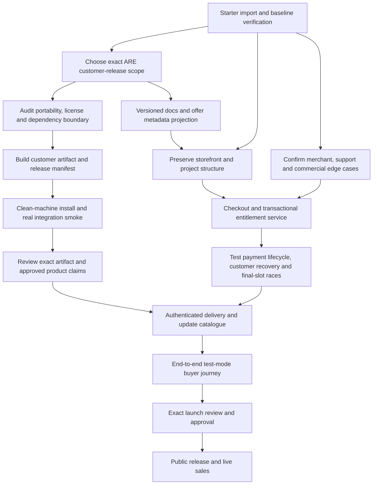

# KELD × ARE delivery DAG

Date: 2026-09-17. Candidate plan for the owner's stated sale objective.
The private engine is to be prepared for sale, not excluded from it.
No publication, live payment or customer entitlement has occurred.

## Current progress

### Current direction: SDK integrations with shared Auth Foundation

The owner's latest request explicitly authorizes building SDK integrations and
reusing the existing Auth Foundation project. This supersedes the hosted-only
selection pause below and in earlier platform research. Stripe cards, Mercado
Pago Pix and PayPal are implemented as sandbox adapters; USDC remains deferred.
No new cart or identity provider was introduced. The existing commerce ledger is
reused behind a trusted local bridge.

See [SDK integration contract](SDK-INTEGRATION.md) for source locations,
configuration, evidence, limitations and the current task DAG. The current 74-case integration inventory is covered by a full 72-case run
plus two subsequently added passing checks using the real SDKs with intercepted provider responses.
They do not establish live merchant or OIDC connectivity.
The four SDK review fixes and their dependencies are tracked in
[SDK-REMEDIATION-DAG.md](SDK-REMEDIATION-DAG.md).

The [current execution DAG](CURRENT-EXECUTION-DAG.md) separates completed review
fixes, runnable verification, configuration dependencies and owner decisions.

Current task order:

1. The loopback HTTPS launcher and configuration preflight are implemented. Supply
   dedicated KELD configuration, then verify interactive OIDC login/callback/renewal.
   Real PostgreSQL custody, signed-token/introspection, callback/PKCE/nonce and
   renewal/logout checks passed in isolation with a local protocol issuer fixture.
2. In parallel, configure merchant sandboxes and the server-owned BRL quote policy.
3. Sandbox buyer, return and sign-out views are wired and locally tested.
   An integrated buyer-client → handler → SDK → ledger → download/logout test
   now passes with substituted identity/provider services. Chromium rendering and a simulated checkout/refresh/download/sign-out journey
   passed at five widths, including 240 px. Next prove authenticated purchase and exact test download
   through each provider after 1 and 2.
4. Authenticated checkout recovery and older-order navigation are implemented.
   Operator reconciliation of bound payments, paginated event queue inspection
   and audited review retry are implemented. Known-ID paid-payment recovery is implemented with fresh SDK
   proof. Known-ID unpaid checkout resumption is also implemented without creating
   or capturing payments. Verified events now recover lost bindings through SDK
order references, including PayPal captures. Complete PayPal discovery without
an event/known ID, expired/unlocated-attempt
   resolution, deployment supervision, long-term retention and refund/dispute handling.
   Explicit completed-event archival now preserves duplicate protection and
   review audit while freeing active inbox slots; no archive purge is implemented.
   An opt-in maintenance command runs sequential event/reconciliation cycles;
   no service has been installed or started.
   Verified event receipt, durable inbox and bounded worker are implemented behind optional
   configuration; real merchant delivery remains untested. See [event DAG](WEBHOOK-DESIGN.md).
5. Private runtime staging now bundles the unchanged Auth Foundation package;
   an isolated installation passed all 69 integration tests, and a separate
   production-only offline install/import check passed without the sibling checkout.
   Binary HTTP delivery now passes with a 13 MiB synthetic archive, including
   integrity checks and disconnect cleanup; the configured limit is 256 MiB.
   With lifecycle tests and release/license approval complete, validate delivery
   of the approved ARE release and review production readiness.

Automatic discovery now has a [provider-specific evidence matrix and DAG](PAYMENT-DISCOVERY.md).
Mercado Pago bounded exact-reference search, ambiguity/transport tests and
optional verified recovery are implemented locally. Stripe bounded session scanning
and transport tests are also implemented. PayPal reporting needs separate scope/mapping evidence. Empty searches
never prove that no payment exists.

Earlier evidence below is historical. The hosted acceptance matrix remains
comparison research, not the active implementation restriction. Open questions
are owned by the integration contract and project intake.

- Imported 59 files, byte-identical; 16,169,791 bytes, including original evidence.
- Rebuilt six static outputs in disposable storage with exact byte matches.
- Added a served-route smoke check and separate current evidence directory.
- Inspected engine identity, release procedure, adapter, component inventory and health.
- Documented the offering-to-engine gaps and researched primary platform sources.
- Added a repeatable, hash-bound file/package review inventory: all 3,414 files,
  76 package manifests, explicit unreviewed status and notice/dependency evidence.
- Built a reproducible 10.5 MB private archive of the complete engine. Its extracted
  full suite passed (1,244 cases), followed by a doctor check in an isolated Linux
  Node container. See [artifact evidence](PRIVATE-ARCHIVE.md). Customer release
  approval and license materials remain incomplete; host evidence is recorded below.
- Verified a real Codex 0.153.0-alpha.5 initialization exchange through the extracted
  wrapper, with zero model turns. Added [candidate onboarding](CUSTOMER-QUICKSTART.md).
  The included default profile remains repository-specific; the subsequent separate
  customer profile and real task are recorded below.
- Implemented explicit separate-root customer profile setup and launcher. Real
  wrapper preflight tests confirm customer-only projected context, live refresh,
  boundary rejection and safe setup cleanup. See [customer profiles](CUSTOMER-PROFILES.md).
  This initially established deterministic isolation before the live check below.
- The new customer launcher now passes a real extracted-engine model task with
  exact customer-definition recall and zero observed tools. File-backed completed
  state recovers in a fresh wrapper, and exact completion replay sends no upstream
  messages. Task/replay evidence is in [customer profiles](CUSTOMER-PROFILES.md).
  Interrupted-action recovery and agent transport resumption remain separate work.
- Built the standalone private customer bundle, including setup/launcher tools,
  installer, sample and README. Its extracted installation and customer-context
  projection passed in a container with no development checkout or network.
  See [exact bundle evidence](CUSTOMER-BUNDLE.md).
- Connected the bundle version, size, contents and tested setup to a generated
  KELD preview. 27 browser checks pass; private artifacts remain inaccessible and
  sale/download gates remain closed. Original import identity is preserved.
- Implemented the [local commerce ledger](../commerce/README.md): strict price and
  order binding, pre-payment first-100 reservations, transactional payment/event
  idempotency, calendar-year benefits and caller-authenticated-customer entitlement
  lookup. Synthetic receipts are not real payment evidence.
- Added persisted, expiring, customer-bound single-use delivery grants and catalogue
  approval checks. All 13 commerce tests pass. A synthetic paid order received the
  real bundle through the grant path; extracted installation and engine doctor
  passed. Provider verification, sign-in and public HTTP delivery remain open.
- Verified the full 3,414-file engine closure after relocation: doctor and 1,244 product test cases passed across 156 test files. Temporary copy removed. See [distribution audit](DISTRIBUTION-AUDIT.md).
- No checked-in engine source copy, no benchmark cache corpora, no nested Git repo.
  Ignored private archives contain the complete engine for distribution testing.
- [Release-readiness audit](RELEASE-READINESS.md) reconciles implemented work with
  remaining provider, identity, upgrade, support, licensing and acceptance gaps.

## Dependency graph

## Tasks in execution order

| ID | Work / result | Prerequisites | Owner / lane |
| --- | --- | --- | --- |
| K0 | Import, reproducible build, local smoke and provenance | Supplied starter | Agent / product construction; done |
| A1 | Provisional full-engine alpha; Linux / Node 26.8.1 / exact Codex binding; final distribution scope review remains | K0 | Engine product owner |
| A2 | Portability and inventory complete; ownership, license materials and private-content review remain | A1 | Engine release implementation + owner license decision |
| A3 | Private full-engine artifact and standalone customer bundle built and verified; sale approval remains false | A2 review needed for distribution | Engine release implementation; local candidate done |
| A4 | Isolated installation, one real task and completed-state replay passed; crash transport recovery remains | A3 | Engine validation; bounded evidence complete |
| K1 | Generated preview projects actual bundle metadata; 27 browser checks pass; no sale activation | K0, provisional A1 | KELD construction; local preview done |
| O1 | Merchant/provider, support destination, customer identity, refunds, reservations, post-year-one rules | K0 | Owner / operations; parallel, affects live commerce |
| K2 | Local validation/reservations/payment ledger tested; provider session and webhook integration missing | O1 for provider and policy | Commerce implementation; partial |
| K3 | Local grant/byte delivery tested; sign-in, HTTP delivery, updates and support handoff missing | A4, K2 | Customer-access implementation; partial |
| V1 | Test-mode purchase to actual approved artifact download/install; retries and failure cases | K1, K3 | Product validation |
| R1 | Review artifact, claims, terms, exact release and live configuration | V1 | Owner / release approval |
| R2 | Publish selected assets and enable verified services | R1 and exact authorization | Owner-controlled operations |

## Customer recovery finding

Four [failure-path tests](CUSTOMER-RECOVERY.md) now pass. They show that malformed
ledgers remain untouched, and a killed customer wrapper leaves an internal lock
that blocks restart. The outer OS lock improvement does not resolve this internal
lock or incomplete actions. An explicit reconciliation command now verifies local stopped-writer conditions,
refuses invalid/uncheckpointed state, preserves a full backup, and permits tested
restart from a valid checkpoint. Automatic reconciliation and interrupted-action
recovery remain unimplemented.

## Immediate next bounded task

A1/A2: use the completed relocation test and file/package inventory to resolve
distribution ownership and notices; classify the remaining local references and
declare supported customer runtime/OS and the first integration. The full engine
remains the provisional scope. The local archive and extracted-content validation
are complete, as is a real host initialization check. Separate-root profile setup
now passes deterministic and live task/completed-state recovery tests. The standalone
delivery bundle also passes independent installation and preflight checks. The
storefront now shows an allowlisted metadata projection. Next prepare the commerce
provider adapter, verified customer identity and protected HTTP delivery around the
tested local ledger/grant path. Provider selection has been requested; real sale
activation depends on owner license and commercial decisions. No default provider account,
merchant identity, support destination or final license is inferred.
Do not merely change npm private:true or publish the private repository candidate.

The first meaningful integration result is a test-mode KELD buyer receiving a
verifiable actual engine artifact that runs outside this checkout. A clickable
payment button or a fabricated download does not meet that result.

## Product and operational separation

Runnable now: static KELD development, content mapping, release closure analysis,
packaging experiments and local verification. No merchant account is needed for these.
Operational residue: provider account, domain/hosting, support delivery, legal merchant,
tax/refund terms, real payment credentials. These block their specific commerce or
launch nodes, not the independent engine packaging work.

## Validation targets

- Exact import and reproducible frontend build; no drift in preserved baseline.
- Customer artifact content allowlist, hashes/provenance, notice inventory and portability.
- No hidden requirement for this private repository's paths, profiles or caches.
- One real supported runtime integration and a documented failure/recovery path.
- Selected-price integrity at every accepted amount; forged requests rejected.
- Idempotent payment fulfillment; no delivery from a client-side redirect alone.
- Concurrent final-slot allocation, repeated customer purchases, time boundaries,
  refund/expiry policy and authenticated recovery.
- Versioned claims/documentation consistent with the delivered artifact.

## Commercial handoff

The [commercial integration contract](COMMERCIAL-HANDOFF.md) maps current ledger,
checkout and delivery interfaces to the pending owner decisions and exact sandbox
acceptance checks. This is the next commerce milestone; more local packaging
checks cannot substitute for provider verification and customer authentication.

## Open Questions

The exact A1 scope, distribution license audit, and operational choices are owned
by [PROJECT-INTAKE.md](PROJECT-INTAKE.md#open-questions). No launch date or public
release number is inferred. The starter's first-100 commercial interpretations
must be confirmed before becoming binding purchase terms.
