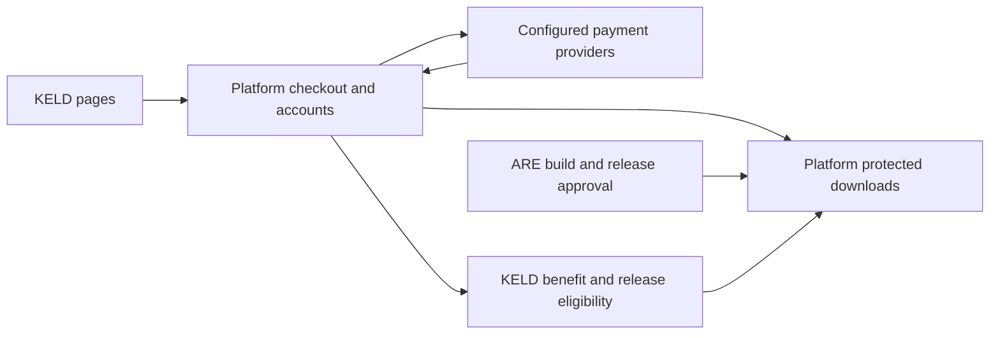

# Reusing an ecommerce platform for KELD

Research date: 2026-09-17. Candidate recommendation, not platform selection,
account creation, license purchase or deployment authorization. Owner: requesting
product owner. No ontology-runtime dependencies. Evidence is official documentation,
maintainer repositories and provider listings; no platform has been installed or
proven against KELD's acceptance scenarios in this research.

## Decision to make

**Current owner update:** the Brazilian seller already has Stripe, Mercado Pago
and PayPal accounts and explicitly defers USDC. Prior all-four-method gates and
the pending own-Stripe question below are historical. Evaluate existing-account
integration for launch; USDC remains future work. The working mapping is Stripe
cards, Mercado Pago Pix and PayPal. See [current acceptance](HOSTED-COMMERCE-ACCEPTANCE.md).
Rechecked [Payhip's processor-combination documentation](https://help.payhip.com/article/173-how-do-i-get-paid):
it generally allows PayPal plus one other processor, so three simultaneous
connections are not established. Account possession does not remove this platform
limitation. No account has been connected or payment attempted by this work.

### Owner clarification: delegate commerce operations

The owner subsequently clarified: “i think we just dont need to go in user
management, carts, orders and so on”. This supersedes the WooCommerce-first
recommendation below: evaluate a hosted digital-sales service before a
self-managed commerce platform. The earlier comparison remains research evidence.

KELD should present ARE and link to hosted checkout. The service should own buyer
access, order administration, receipts, payment handling and ideally file delivery.
Keep release preparation and documentation in this repository. Do not extend the
custom customer-session, order or cart implementation as the default next step.

Lemon Squeezy is the first candidate for the simplest complete download journey;
Paddle remains the candidate when Pix coverage takes priority, but its documented
fulfillment webhook leaves a delivery integration to solve. Neither has documented
USDC coverage in the sources reviewed. This clarification does not waive Stripe,
PayPal, Pix or USDC: record gaps before selecting a provider. A merchant-of-record
checkout is also not equivalent to processing through the owner's Stripe account.

Next evaluation: hosted purchase → receipt/download → later purchase recovery →
refund/access behavior → version/update eligibility. Reject a proposed integration
that quietly requires rebuilding user or order management in KELD. Account
eligibility and final commercial terms remain unresolved; no service is selected.

Use a mature platform for orders, checkout, customer accounts, refunds and normal
download delivery. Preserve the KELD presentation and ARE's release engineering.
Further custom commerce construction should wait for a reuse decision. The existing
44 passing local tests provide acceptance scenarios, not a reason to retain the
Python commerce backend. The latest HTTP validation is in [COMMERCE-HTTP.md](COMMERCE-HTTP.md).

Constraints carried from [intake](PROJECT-INTAKE.md) and owner answers:

- Private development of a downloadable ARE product for sale through KELD.
- Stripe, PayPal, Pix and USDC requested; owner confirmed seller country Brazil on
  2026-09-17. Legal entity type and account activation remain unverified.
- Candidate offer: USD 200 suggested, USD 50 minimum, USD 1,000 maximum, identical
  engine/software rights at every price; a currency policy is needed for Pix/BRL.
- Candidate first-100-customer benefit: 12 months of updates/support, not a recurring
  software subscription. Historical purchased releases and new-update eligibility
  must be separate. These commercial terms still require final adoption.
- Broad software use/sharing/modification with a custom unchanged-resale restriction.
  Platform license keys are optional access technology; they do not define the
  software license and should not introduce unrequested activation/DRM restrictions.
- Preserve the existing KELD brand/front end and tested customer release bundle.

## Shortlist and fit

| Candidate | Existing capability | Remaining KELD work | Assessment |
| --- | --- | --- | --- |
| WooCommerce | Catalog, orders, accounts, downloadable products, maintained payment-extension ecosystem, configurable customer price | Exact plugin compatibility, hosting/maintenance, tax obligations, first-100 allocation and version eligibility | First proof-of-concept choice if all requested payment methods and own Stripe/PayPal accounts remain requirements |
| Paddle | Merchant of record; one-time software payments, PayPal/Pix, invoices, tax handling, customer billing portal, custom transaction amounts | Download fulfillment/access layer, USDC alternative, benefit/version rules, seller approval | Strong alternative if reducing payment/tax operations is more important than own Stripe processing; not currently a documented all-four solution |
| Lemon Squeezy | Merchant of record; digital files, customer purchase access, optional license keys, native pay-what-you-want | Pix/USDC not documented; maximum-price enforcement and time-limited update eligibility need proof | Closest simple software storefront, but does not satisfy the requested payment set as documented |
| Shopify | Hosted commerce/admin plus Digital Downloads app; USDC via eligible Shopify Payments accounts | Country-specific payment constraints, Pix provider, custom pricing app, historical-version/update rules | Mature hosted option; merchant country can materially alter fit |
| Medusa | Open-source headless commerce modules, administration, Stripe integration, custom front end | PayPal/community integrations, Pix/USDC providers, digital fulfillment and entitlement validation | Better than building core commerce from scratch, but more construction than the other options |

These are qualitative fit judgments, not measured reliability or implementation-time scores.

## WooCommerce: preferred full-requirement trial

Proposed components:

- [Stripe for WooCommerce](https://woocommerce.com/products/stripe/) and
  [PayPal Payments](https://woocommerce.com/products/woocommerce-paypal-payments/).
- [Mercado Pago's WooCommerce Pix integration](https://www.mercadopago.com.br/developers/pt/docs/woocommerce/payments-configuration/checkout-api/pix).
  Account eligibility and BRL behavior still require a real merchant test.
- A crypto extension such as [DePay for WooCommerce](https://depay.com/plugins/woocommerce),
  which documents USDC. Evaluate current MoonPay/Helio integration as an alternative;
  do not infer that Stripe's WooCommerce extension exposes every Stripe API method.
  Token/network, settlement, refunds and merchant terms require separate verification.
- [Name Your Price](https://woocommerce.com/products/name-your-price/) documents
  minimum, maximum and suggested amounts, directly matching the candidate price
  rule. Listed price at research time: USD 59 for one year; hosting and other
  extension/provider fees are additional.
- [Core downloadable-product handling](https://woocommerce.com/document/digital-downloadable-product-handling/)
  supports payment-controlled access and login-required downloads. Use protected
  delivery; the documented redirect-only option exposes reusable public file URLs.

[Maintainer repository](https://github.com/woocommerce/woocommerce) provides source,
issues, tests and development documentation. This establishes inspectability, not
proof that our exact extension combination works. WooCommerce requires WordPress
operations and plugin maintenance; payment/tax calculation plugins do not by
themselves make a merchant-of-record service.

Keep KELD's marketing pages and initially use a branded platform checkout/account
area. A completely headless checkout could preserve more UI detail but may lose
extension compatibility and reintroduce integration work. Prove the supported
platform checkout first, then decide whether headless adaptation is justified.

## Paddle: lower payment operations, different payment ownership

[Digital-product documentation](https://developer.paddle.com/get-started/how-paddle-works/digital-products/)
explicitly covers one-time software purchases and server-created custom amounts.
The platform emits completed-transaction webhooks; the seller still implements
access or file fulfillment. The billing portal is not a complete ARE release portal.

[Paddle Pix](https://developer.paddle.com/concepts/payment-methods/pix/) and
[the supported-method list](https://developer.paddle.com/concepts/payment-methods/)
confirm PayPal/Pix availability subject to customer location/currency. USDC is not
listed. Using Paddle also changes the requirement to process through our own
Stripe account: Paddle processes/resells the transaction as merchant of record.
An additional crypto checkout would need unified entitlement/reconciliation and
would not automatically inherit Paddle's merchant-of-record coverage.

[Published pricing](https://www.paddle.com/pricing): 5% + USD 0.50 per checkout
transaction. A hypothetical USD 200 transaction produces USD 10.50 at that rate;
this is arithmetic, not a merchant-specific net-payout quote. Product acceptance,
merchant verification and exact commercial terms remain prerequisites.

## Lemon Squeezy: good software fit, payment gaps

[Pay what you want](https://docs.lemonsqueezy.com/help/products/pay-what-you-want)
has minimum and suggested prices; a maximum is not established by this page.
[Payment methods](https://docs.lemonsqueezy.com/help/checkout/payment-methods)
include cards/PayPal but do not list Pix or USDC.
[Digital files](https://docs.lemonsqueezy.com/help/products/adding-products) and
[My Orders](https://docs.lemonsqueezy.com/help/online-store/my-orders) provide
customer download access. Replacing files grants the updated version to existing
customers; that behavior needs adaptation for a 12-month update window.
[Fees](https://docs.lemonsqueezy.com/help/getting-started/fees) include a base
5% + USD 0.50 plus stated surcharges such as international and PayPal transactions;
payout fees can also apply. Do not compare only headline rates.

## Shopify and Medusa

[Shopify USDC](https://help.shopify.com/en/manual/payments/shopify-payments/local-payment-methods/usdc-payments)
requires an eligible Shopify Payments region/account. Brazil is absent from the
[current Shopify Payments country list](https://help.shopify.com/en/manual/payments/shopify-payments/supported-countries),
so native USDC must not be promised to a Brazilian merchant.
[Digital Downloads](https://help.shopify.com/en/manual/products/digital-service-product/digital-downloads)
provides file delivery, but replacing/deleting files can affect historical access;
version entitlement behavior needs testing. Additional payment/pricing apps can
change both cost and checkout compatibility.

[Medusa core](https://github.com/medusajs/medusa) and its
[Stripe integration](https://medusajs.com/integrations/%40medusajspayment-stripe)
provide reusable commerce foundations.
[The digital-products recipe](https://docs.medusajs.com/resources/recipes/digital-products)
is construction guidance. There is also a
[third-party digital-products plugin](https://medusajs.com/integrations/medusa-plugin-digital-products)
with versioned assets, entitlements and protected grants. At inspection the listing
showed version 0.2.2, an individual maintainer and 89 monthly downloads. Treat it
as a candidate needing code/release/compatibility review, not mature functionality
inherited from Medusa core. Device activation features are unnecessary for the
owner's stated licensing direction.

## Proposed architecture

Let the selected platform own the authoritative commerce order/payment/customer
state. Any KELD extension should own only missing benefit/version rules; do not
maintain a parallel general-purpose payment ledger. Reuse platform fulfillment
where it can enforce the final terms. Keep runtime reasoning and software use
independent from storefront accounts unless the owner explicitly chooses otherwise.

## Next proof and implementation boundary

1. Confirm merchant country and whether own Stripe processing is a hard requirement.
2. Run a bounded WooCommerce trial with the chosen extensions and the existing KELD
   visual identity. No clone of the entire upstream monorepo is needed to test a store.
3. Verify all requested methods with eligible accounts, not just plugin installation.
4. Exercise the USD 50/200/1,000 boundaries, Pix's BRL quote, duplicate callbacks,
   pending/failed payments, refund behavior, customer recovery and protected download.
5. Prove first-100 allocation under concurrent buyers, including an already-used
   customer, without preventing later ordinary sales. Stock=100 alone is not the rule.
6. Prove an expired update benefit cannot fetch a new version while historical
   purchased-release access remains intact. Decide behavior before selecting a
   memberships/licensing plugin; do not assume one subscription expiry solves both.
7. Port useful acceptance tests and retire superseded custom paths only after the
   platform proves the same behavior. Keep current work intact during evaluation.

Platform choice is the current construction decision. Merchant access, paid
extension licenses, hosting and final tax/license terms are separately owned
operational dependencies. Research authorizes none of those external effects.

## Open Questions

### Hosted lifecycle follow-up — 2026-09-17

The next evidence pass adds **Payhip** to the hosted shortlist. This is a
documentation comparison, not a tested merchant integration or final selection.
No platform account, plugin, checkout or payment was created in this pass.

| Required behavior | Payhip evidence | Lemon Squeezy evidence | Implication |
| --- | --- | --- | --- |
| Purchase without a KELD account | Email checkout, direct Buy Now, receipt and download page [P1] | Provider-owned email magic-link purchase history [L1] | Both can remove KELD identity/order implementation |
| File delivery and later recovery | Hosted downloads, emailed receipt link; seller can resend receipts [P1, P2] | Hosted files and My Orders recovery [L1] | Keep delivery with the provider |
| Refund access handling | Buyer help states refunded digital orders lose download-page access [P3] | Dashboard supports full/partial refunds; reviewed page does not establish file-revocation semantics [L2] | Verify full and partial refunds separately; already downloaded bytes cannot be recalled |
| Own Stripe plus PayPal | Both integrations documented, generally PayPal plus one other processor [P4] | Merchant-of-record checkout, not own Stripe processing | Payhip is a closer candidate if owning the Stripe relationship matters |
| Pix | Stripe integration lists Pix; Mercado Pago integration explicitly lists Brazilian Pix and matching account/store currency [P5, P6] | Not listed in reviewed payment methods | Eligibility and actual checkout must be checked; do not assume all processors can coexist |
| USDC | Not established by reviewed integration documentation | Not listed in reviewed payment methods | Neither is proven to cover all four requested methods |
| Variable price | Pay-what-you-want minimum documented; maximum/suggested behavior remains unproven [P7] | Minimum/suggested documented in earlier research; maximum remains unproven | Do not treat a frontend amount control as enforcement |
| 12-month updates with historical access | No proof of the exact rule in reviewed docs | New product files become available to existing buyers; deleted files disappear [L1] | Product-version labels alone do not implement the proposed benefit policy |

**Payment compatibility finding:** Payhip's general marketing page says multiple
gateways are possible, but its detailed help says usually PayPal plus one other
processor. Prefer the narrower rule until account-level evidence proves otherwise.
Stripe's Payhip guide itself lists Pix, potentially avoiding a separate Mercado
Pago connection, but [Stripe's Pix documentation](https://docs.stripe.com/payments/pix)
still controls merchant eligibility and currency support. Neither a Stripe logo
nor Stripe's standalone USDC capability proves Payhip exposes USDC.

**Version finding:** Lemon Squeezy's
[file-version documentation](https://docs.lemonsqueezy.com/help/products/managing-file-versions)
suggests using its License API and file API for restricted upgrades. That is an
integration mechanism, not evidence that its hosted purchase page enforces KELD's
exact update policy. Do not introduce activation requirements into ARE merely to
fit a platform. Separate release products or hosted benefit tooling are candidates
to investigate, not adopted changes to customer rights.

**Evidence that would close the next decision:** seller country and eligible
accounts; confirmed requested-method combination; hosted purchase/recovery/refund
demonstration; exact price boundaries; and historical-release/update eligibility.
Payhip documents a 100%-off-coupon checkout test [P2], but this does not prove paid
payment processing, and its documentation says test orders cannot be deleted.
Do not confuse that with a provider sandbox transaction. The owner subsequently
answered the merchant-country question with “brasil”; use Brazil from that answer.

Current assessment: compare Payhip and Lemon Squeezy for full hosted delivery,
retaining Paddle for Pix plus a separately supplied fulfillment service. No
reviewed candidate yet proves the complete payment and benefit requirements.
The prior custom backend remains evidence only; no new commerce code is warranted
by these documentation gaps.

Sources (official help, checked 2026-09-17):

- P1: [Buying from Payhip](https://help.payhip.com/article/158-buying-from-payhip).
- P2: [Adding digital products](https://help.payhip.com/article/59-adding-a-digital-product).
- P3: [Missing files/orders and refunded access](https://help.payhip.com/article/379-did-not-receive-files-or-orders).
- P4: [Supported processor combinations](https://help.payhip.com/article/173-how-do-i-get-paid).
- P5: [Payhip Stripe integration](https://help.payhip.com/article/65-connecting-your-stripe-account).
- P6: [Payhip Mercado Pago integration](https://help.payhip.com/article/343-connecting-your-mercado-pago-account).
- P7: [Payhip pay-what-you-want pricing](https://help.payhip.com/article/78-pay-what-you-want-pricing).
- L1: [Lemon Squeezy My Orders and file updates](https://docs.lemonsqueezy.com/help/online-store/my-orders).
- L2: [Lemon Squeezy refunds](https://docs.lemonsqueezy.com/help/orders/refund-order).

### Outstanding owner and provider questions

- Selling entity type and available Stripe, PayPal, Pix and USDC accounts in Brazil.
- Own Stripe account versus merchant-of-record preference.
- Acceptance of a branded platform checkout/account area alongside KELD's pages.
- Exact crypto provider/network and compatibility with the chosen Woo checkout.
- Currency conversion, tax, refunds, benefit timing and historical-release policy.
- Which first-100/update rules are configuration, extension or narrowly custom code.

Questions remain with the product owner and [project intake](PROJECT-INTAKE.md).

### Brazil eligibility update — owner confirmed 2026-09-17

Brazil is now an explicit input, not an assumption. The
[Stripe support page](https://support.stripe.com/questions/how-to-enable-pix-as-a-payment-method-in-brazil)
and [Pix documentation](https://docs.stripe.com/payments/pix) say Brazilian accounts
need invite-only access for one-time Pix, with BRL settlement. Payhip listing Pix
under Stripe does not prove this merchant can activate it. Current Connect docs
also distinguish charge types and the merchant of record; do not rely on an older
search excerpt asserting universal same-country platform restrictions.

Payhip's Mercado Pago integration documents Brazil, Pix and matching store/account
currency (BRL). It remains a candidate for hosted Pix plus file delivery. The
usual PayPal-plus-one-other-processor rule means Stripe + Mercado Pago + PayPal
in one store is still unproven. USDC remains unresolved. Do not remove any requested
method or build separate customer/order systems to hide this gap.

Lemon Squeezy's supported-country page could not establish a Brazilian bank payout
in this check (no Brazil entry found); it separately permits supported PayPal payout
countries. Verify that exact payout route and merchant approval before treating it
as eligible: [supported countries](https://docs.lemonsqueezy.com/help/getting-started/supported-countries).
Country confirmation alone does not establish provider approval or payout access.

### Hosted crypto and software-delivery coverage — 2026-09-17

Two further targeted checks address the remaining payment/delivery intersection:

| Candidate | Verified documentation | Still unverified |
| --- | --- | --- |
| FastSpring | [Pix for Brazilian buyers](https://developer.fastspring.com/docs/pix), BRL requirement; [payment list including PayPal](https://developer.fastspring.com/docs/payment-methods-accepted-by-fastspring); [built-in file downloads](https://developer.fastspring.com/docs/file-downloads) and [fulfillment](https://developer.fastspring.com/docs/fulfillments) | Brazilian seller onboarding/payout approval, USDC, current-platform variable-price boundaries, exact benefit/version rules |
| Whop | [Hosted Files app maintained by Whop](https://whop.com/apps/app_5UWRrs7haZZeiQ); [payment documentation](https://docs.whop.com/payments-and-billing/local-payment-methods) lists crypto and PayPal; crypto purchases settle as USD and support one-time payments | Pix absent from reviewed detailed list; exact USDC tokens/networks not established; Brazilian seller approval; price and benefit/version rules |

FastSpring is a closer documented match than Paddle for **hosted Pix plus software
file delivery**, not a proven all-requirement winner. Its Pix page describes buyer
location, which must not be mistaken for Brazilian seller onboarding eligibility.
The pay-what-you-want article found belongs to FastSpring Classic; do not use it as
proof of the current platform's controls. No merchant signup or checkout test ran.

Whop's documentation was retrieved from its official `.md` endpoints after web
open failed. Its marketing article discusses USDC generically and crypto checkout;
that does not establish the precise coins/networks offered by a Brazilian seller's
checkout. Crypto payouts also do not prove USDC buyer payments. Likewise, broad
global coverage claims do not prove Pix. Do not select it on those assumptions.

**Decision boundary:** identify whether the owner's Stripe requirement means own
Stripe processing or simply card acceptance; an explicit question is pending.
No requested method is waived while that answer is pending. Prefer a hosted
service proving the full lifecycle over adding separate KELD accounts or orders.

#### Provider verification brief (draft only; not sent)

We are preparing a downloadable software product sold by a Brazilian entity.
We want hosted checkout, purchase recovery, refunds and file delivery, with no
customer-account or order backend in our site. Please confirm:

1. Can you onboard this Brazilian seller and pay out to a Brazilian bank or
   supported Brazilian PayPal account? Which entity/account requirements apply?
2. Can one product offer cards, PayPal, Pix and USDC? Specify buyer regions,
   presentment currencies, crypto networks, settlement and activation requirements.
   Is an independently owned Stripe account supported or replaced by your processing?
3. Can a one-time buyer choose USD 50–1,000 with USD 200 suggested, with the same
   product rights at every price? How is the BRL quote handled and the maximum enforced?
4. Can purchased releases remain accessible while new-version eligibility ends
   after 12 months, without requiring us to build a customer database or license server?
5. Can the first 100 unique paying customers receive the update/support benefit,
   excluding repeat purchases and pending/failed payments, without stopping later sales?
6. Which sandbox demonstrates delayed payments, duplicate notifications, full/partial
   refunds, file-access changes and purchase recovery? Provide a complete fee quote.

This brief captures open questions, not approved commercial terms or a request
already delivered to a provider. Exact answers/account evidence should precede
platform selection; the 12-month and first-100 offer remains a candidate policy.
