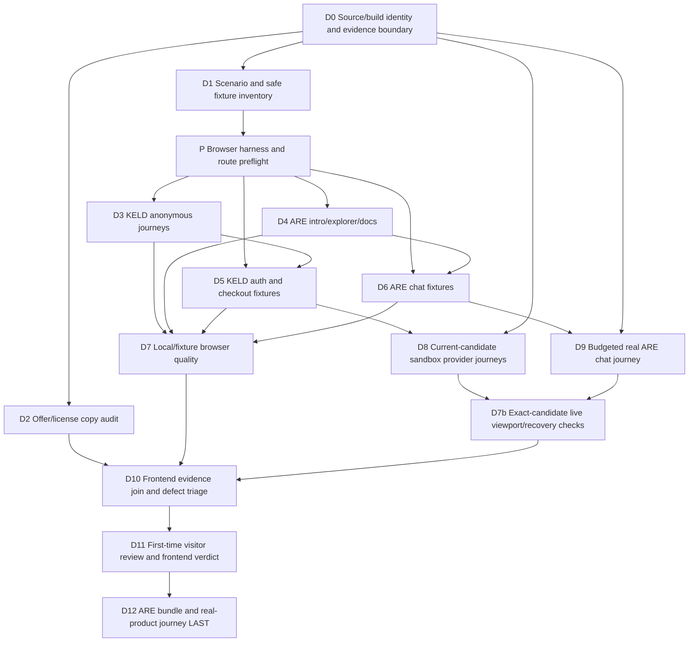

# KELD and ARE frontend matrix execution DAG

This candidate plan covers every journey in the [frontend journey/test
matrix](FRONTEND-JOURNEYS-TEST-MATRIX.md): K01–K16 and A01–A11. It plans
tests of the existing KELD staging storefront and ARE public page, not release
of the actual ARE customer bundle. The bundle is the last, separate join.
This DAG is not an admitted work-pack, deployment approval, license decision,
or evidence that any current candidate has passed browser acceptance.

## Goal and evidence rule

The frontend milestone is an exact-build, reproducible account of what a
customer sees and can recover from: truthful offer copy; accessible and
responsive navigation; owned, retry-safe sandbox checkout; usable anonymous
ARE explanation and chat; and honest failure states. Every test result binds
the source revision or served image/assets, browser, viewport, fixture, route,
timestamp, observed UI, relevant server truth, and a sanitized receipt.
Historical receipts remain historical. A future pass cannot be inferred from
the 2026-09-19/20/21 browser reports or 2026-09-22 local unit tests.

Use the UX evidence layers in the matrix: L0 smoke, L1 accessibility,
L2 layout, L3 interaction as deterministic/fixture-backed checks; L4 attention
and L5 domain practice as explainable flags and screenshot review; L6 actual
visitor comprehension as human evidence. No universal UX score or blanket
accessibility certification is in scope. The generic UX validator remains a
seed, so existing project scripts or a bounded CLI browser session supply the
execution surface until a fixture-calibrated harness exists.

## Dependency DAG



D8 and D9 are operationally distinct: sandbox provider actions change test
merchant/order state; a real model turn consumes a shared allowance. Neither is
required to run D3–D7. A copy defect in D2 fails the final frontend verdict
without blocking independent fixture construction. D12 is a later product
join, not permission to deliver ARE during this run.

Any source repair after D0 creates a new candidate: rebuild, capture new
source/build identifiers as D0b, then rerun every affected browser lane and
downstream join. An old `web/dist` is not evidence about current source.

## Nodes, owners, coverage and exit evidence

| Node | Prerequisite; owner | Exact work and matrix IDs | Exit evidence / current state |
| --- | --- | --- | --- |
| D0 — identity | None; frontend tester | Record git status without altering unrelated work; identify source and local build separately, then staging HTML/asset IDs, active route/config and test-only artifact. Build current source before claiming a local browser candidate. Preserve old receipts as dated references. Re-run as D0b after any repair. | Candidate identity and safe test boundary. **Runnable now.** |
| D1 — scenarios/fixtures | D0; frontend tester | Expand each matrix row into initial state → action → expected UI/server truth → cleanup; inventory existing `web` tests, ARE proofs, Playwright/browser availability, synthetic account/order/chat fixtures and missing evidence. Include a known-good, known-bad and false-positive case for each reusable gate. | Scenario-to-ID coverage map, commands and fixture limits. **Runnable now.** |
| P — browser preflight | D1; frontend tester | Resolve a trusted Playwright module, Chromium executable and fresh evidence directory; confirm local build/route serving and fix or parameterize absent hard-coded `/home/vrondelli` script paths before a run. Capture browser/version and source/build identity. A missing harness cannot become a journey pass. | Executable commands or exact blocked cells. **Needed before D3–D7.** |
| D2 — offer copy | D0; product/legal owner for adoption, frontend tester for audit | K03 plus product/license/delivery copy in K02/K06/K13. Locate every active Apache statement and compare with the candidate-but-nonoperative license; propose truthful sandbox wording only. Do not present the draft as governing or alter real-sale terms by test fiat. | Cross-surface text inventory and a **fail** until approved, consistent copy exists. Audit runnable; final wording/adoption gated. |
| D3 — KELD anonymous | D1; frontend tester | K01–K04 and the visible unavailable-path part of K16: navigation/ARE domain, legend, shop/shelf/bag, price bounds, FAQ, contact draft and account-recovery disclosure. Test desktop, narrow/mobile, back/forward and keyboard. | Current-candidate browser assertions, screenshots, console/network and focus/ARIA snapshots. **Runnable without accounts.** |
| D4 — ARE read-only | D1; frontend tester | A01–A06: intro/hero, reduced motion, explanation links, graph/search/lenses/tours, manuals, deep links, canvas persistence, malformed storage and reset. Do not send chat messages. | Current-candidate browser/fixture results and viewport screenshots. **Runnable without model spend.** |
| D5 — auth/checkout fixtures | D1+D3; frontend and commerce tester | K05–K07, K11–K15 and K16's recovery design: callback preservation, checkout state set, exact price/quote, idempotent creation, reload/back/tabs, history isolation, expiry, late payment/refund/revocation, logout, session loss and stale-account response. Use local/isolated fixtures first. | Unit/handler + browser state matrix; no fake provider-paid claim. **Runnable locally where fixtures exist; real Keycloak expiry/recovery gated.** |
| D6 — chat fixtures | D1+D4; ARE tester | A07–A11: streaming, Markdown safety, preferences, scoped/full reset, refresh, cross-session separation, stop/retry, malformed output, quota/outage and no tool surface. Use mocked stream and server tests; instrument forbidden effects separately. | Fixture browser receipt plus server-isolation evidence reference. **Runnable locally without paid model turn.** |
| D7 — local/fixture quality | D3–D6; frontend tester | Apply L0–L3 to completed local/fixture journeys: Chromium/Firefox where available, 320/390/768/1440 px, reduced motion, keyboard/focus, scroll/overlap and screen-reader-readable status. WebKit/real 200% browser zoom and assistive-technology coverage remain explicit if unavailable. L4/L5 stay soft/human review. | Browser/viewport matrix, screenshots, measurements, console/network, ARIA/focus and trace for interactions. **Runnable to installed-browser ceiling; not live acceptance.** |
| D8 — sandbox providers | D0+D5; sandbox test-account holder and merchant operator | K05–K10, K11–K15 on one exact staging candidate: credentialed auth return; Stripe card, Mercado Pago Pix and PayPal success/cancel/pending; one server-verified fixture grant per paid order; refund/dispute only through approved sandbox paths. Never use live-money credentials, mutate a real customer, or force a duplicate payment for a test. | Redacted provider/ledger/browser correlation and exact fixture hash. **Requires test identities, provider coordination and current candidate.** |
| D9 — real chat | D0+D6; ARE operator/tester | A07–A09 and critical A10 on the exact public candidate: one budgeted real GLM turn, visible preference, same-tab refresh, scoped reset and Start fresh; monitor `intent-output-invalid`, token use and browser errors. Do not paste secrets or intentionally exhaust the shared quota. | Privacy-safe browser + server status receipt. **Requires available service and budget; not replaced by mock success.** |
| D7b — live quality | D8+D9; frontend tester | Recheck relevant viewport, keyboard, focus and recovery behavior against the exact staging/public candidate after real provider/chat turns. This cannot be inferred from D7 fixtures. | Current-candidate browser receipts or explicit blocked cells. |
| D10 — join/triage | D2+D7+D7b; product/test owner | Bind each K/A ID to passing exact-candidate receipt, fail finding, or explicit not-run blocker. Distinguish source, fixture, prior deployment and current live observation. Fix defects only in separately bounded implementation slices, run D0b, and rerun affected nodes. | Coverage and defect table; no silent promotion of old evidence. |
| D11 — human verdict | D10; product owner and independent first-time visitors | L6 tasks: find/understand the offer, recover a checkout, explain ARE's capabilities/limits, locate and clear a chat preference. Record real task success, confusion, time and notes; do not fabricate participants or convert it to an automated UX score. | Frontend/sandbox pass, fail, or blocked verdict with residue. Human participants are required for L6. |
| D12 — ARE bundle last | D11 plus independent legal/distribution/artifact gates; release/IP owner | Actual versioned bundle, clean installation, real customer agent task, license/notice approval. **Excluded from this frontend execution.** | Separate later product test and authorization; never inferred from sandbox fixture delivery. |

## Current product frontier and operational residue

The immediate product-construction frontier is D0–D2 and P, then D3–D4 plus local D5/D6 fixtures.
Those can progress despite open legal text, SMTP, sandbox accounts, WebKit,
model allowance or human participants. D2's earlier Apache/custom-license
contradiction was a causal blocker for D10/D11, not for collecting other UI
evidence. Existing H4 staging and r23 ARE receipts are comparison baselines,
not a frozen current candidate.

2026-09-22 follow-up: the owner approved interim sandbox-only copy, and the
active local shop/checkout now show it. The old D2 finding remains historical
for the earlier build. D2 is **locally repaired, not closed**: the custom
license remains a draft, the exact bundle remains last, and the new copy has
not been verified on staging. See the [copy verification](INTERIM-LICENSE-COPY-VERIFICATION-2026-09-22.md).

## Implementation review and execution commands

The read-only implementation review found that the KELD fixture browser script
[`integrations/test/browser-check.mjs`](../integrations/test/browser-check.mjs)
needs a built `web/dist`, an explicit Playwright module and a Chromium binary;
it covers selected checkout/retry/account-switch/Pix/revocation states, not all
K01–K16, PayPal or real Keycloak. Several ARE browser scripts (including
[`product-explorer-browser-matrix.mjs`](../are-documentation/scripts/product-explorer-browser-matrix.mjs))
hard-code a `/home/vrondelli` path absent on this host. ARE `npm test` covers
server tests only, so browser and canvas/graph tests are separate. The old
[`live_public_browser_acceptance.mjs`](../deploy/live_public_browser_acceptance.mjs)
spends a real model turn and asserts that reload clears chat, which contradicts
the current persisted-chat implementation; it is **not** a valid D9 pass.
[`live-chat-proof.mjs`](../are-documentation/scripts/live-chat-proof.mjs)
also uses stale copy and can store raw model response text, so it must not be
run live as-is. A11 requires backend containment evidence beyond DOM proof.
K16 email verification/reset remains an operational test, not a local-design
pass. D11 requires independent humans.

Safe local commands, after inspecting their environment and output targets:

```text
cd keld-project/web && npm test && npm run typecheck && npm run build
cd keld-project/are-documentation && npm test && node --test scripts/canvas-workspace.test.mjs scripts/engine-graph.test.mjs scripts/workspace-persistence.test.mjs && npm run build
cd keld-project/integrations && npm test
```

The KELD browser fixture command is `npm run test:browser --
/ABS/playwright/index.mjs /ABS/chromium /ABS/new-output-dir` from
`keld-project/integrations`, only after P validates those paths. ARE
`npm run test:chat-ui` also needs a validated `ARE_PLAYWRIGHT_ROOT` and
`ARE_CHROMIUM`. Neither is a complete matrix harness; add receipts per
journey ID before claiming coverage. Do not run integration preflight against
an unexpected remote Docker builder, deploy smoke against live containers, or
secret-reading runtime probes as part of this local gate.

| Operational input | Owner | Blocks exactly |
| --- | --- | --- |
| Approved interim offer/license wording and eventual final terms | Product and legal/IP owner | D2 final copy, D10–D11; actual license also D12. |
| Synthetic accounts, provider sandbox action, retention/cleanup of test orders | Merchant/test-account holder | D8 only, and its part of D10. |
| Signup email verification/reset transport and policy | Identity operator/product owner | K16 production-style recovery; not anonymous D3. |
| Live chat availability, model allowance and no-secret prompt set | ARE operator | D9 only, and its part of D10. |
| WebKit libraries / real zoom / assistive-technology environment | Test-environment owner | Those D7 cells only; mark unavailable, never pass. |
| First-time participants | Product researcher | D11 L6 only. |
| Bundle ownership, notices, installation target and approval | Release/IP owner | D12 only. |

## Execution safety and review gates

- The first implementation pass should run read-only audits, current local
  suites and isolated browser fixtures; do not deploy, publish, issue real
  payments/refunds, consume model tokens, or modify live state merely because
  the DAG exists. Test-account actions and model turns need their own exact
  bounded run with sanitized receipts.
- Existing files and dirty changes belong to other work unless explicitly
  scoped here. Changes to checkout, chat or legal copy require inspection of
  the current overlapping diff, narrow patches, and affected regression tests.
- Every browser run records a candidate hash and separates deterministic
  failures from L4/L5 judgment and L6 human residue. Never put capability
  tokens, credentials, buyer identifiers or raw conversations in public proof.
- Stop a branch on an unsafe external-effect or authority boundary, but keep
  unrelated local fixture and read-only work progressing.

## Open Questions

- What exact browser candidate should D0 freeze: the current local build,
  existing staging image, or a later approved staging candidate? Keep source
  and deployed bytes distinct.
- Which interim copy may be shown while the ARE license is still a candidate?
- Are synthetic Keycloak identities and provider sandbox orders available for
  D8, and who owns their cleanup? Never substitute personal accounts.
- What capped model-turn budget is acceptable for D9?
- Who will perform independent L6 visitor tasks, and which browsers/assistive
  technology are available for D7?
