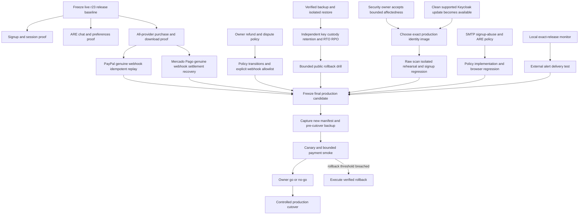

# KELD and ARE Production Implementation Layering

This document turns the current staging work into evidence-gated implementation
layers. It distinguishes a presentable staging system from a production payment
system and prevents completed work in one branch from masking an open dependency
in another.

## Context

- Target: production-deployable KELD storefront, commerce backend, identity, and
  bounded public ARE chat.
- Current state: brownfield; the `fixed-brl-5.10-20260920-r12` Alpine
  application and the separately scanned r12 hardened, dependency-locked edge
  are live on staging.
- Primary users: buyer, anonymous ARE visitor, merchant operator, and incident
  operator.
- Primary constraint: payment correctness and recovery must be proven without
  weakening identity, secret custody, or rollback guarantees.
- Source references: [current execution DAG](CURRENT-EXECUTION-DAG.md),
  [security-plan execution](SECURITY-PLAN-EXECUTION-2026-09-20.md),
  [staging status](STAGING-STATUS.md),
  [Alpine application promotion](ALPINE-APPLICATION-PROMOTION-2026-09-20.md), and
  [security handoff](SECURITY-REVIEW-HANDOFF.md).

## Layering Method

- Minimum proof: preserve the already-working presentation and sandbox slice.
- Decision-first: each layer answers one promotion question.
- Progressive hardening: later layers add provider completeness, recovery,
  governance, and cutover proof.
- Non-regression: no later work may weaken authenticated payment authority,
  exactly-once grants, ARE isolation, or private secret handling.
- Evidence-gated promotion: a partial provider journey or a clean application
  scan cannot stand in for a different service's acceptance evidence.

## Layer Decision Table

| Layer | Decision question | Minimum working unit | Outcome | Promotion decision |
| --- | --- | --- | --- | --- |
| L0 - staging proof | After this layer, we know whether a user can sign up, use ARE, buy with at least one provider, and receive a server-verified artifact. | Live r12 fixed-rate Alpine application with hardened, dependency-locked edge, source-clean public chat, Keycloak signup, ARE chat/preferences, and Stripe, Mercado Pago, and PayPal purchase-to-download. | Presentable and testable staging system. | Complete. Preserve r11 as the immediate application-image rollback input, the stock and r1 Caddy compose inputs plus volume archives as edge rollback inputs, and schema-v3 r23—43 deployment/evidence inputs, the complete 84-file KELD application build context, matching declared/observed ARE source evidence, the current r21 image-recovery receipts and tools, and the privacy-safe provider-paid-delivery receipt—as the current staging baseline. |
| L1 - provider completeness | After this layer, we know whether every advertised provider handles its genuine signed delivery path without duplicate grants. | Preserve completed purchase/download evidence for all three providers; prove Mercado Pago stopped-worker settlement recovery; prove PayPal stopped-worker signed receipt, provider-verified idempotent processing, and redelivery. Treat the separate post-capture/pre-ledger PayPal crash window as an explicit fault-injection decision rather than implying that a webhook normally initiates capture. | Credible three-provider sandbox acceptance with provider-specific authority boundaries. | In progress: provider-confirmed purchase-to-download passes for all three providers. The fail-closed phased verifier and runbook are implemented locally; genuine Mercado Pago and PayPal runs still require coordinated provider actions. |
| L2 - operational recovery | After this layer, we know whether all state and custom runtime images can be recovered by an operator after host or release failure. | Full-state backup, off-host encrypted copy with independent key custody, selected-platform image archive, isolated restore, and a bounded public rollback drill. | Recoverable staging service with documented RTO/RPO evidence. | Partial: scripted backup, standalone secret-silent package verification, encrypted off-VPS state copy, and isolated full-state restore pass. The current r21 archive verifies 91 blobs, recovered all seven exact manifest IDs in 28.78 seconds, has matching off-VPS archive/receipt hashes, and is bound by r23. Independent key custody, retention, RTO/RPO, post-restore release manifest, and traffic cutover remain open. |
| L3 - security and policy closure | After this layer, we know whether identity, signup, payment exceptions, and anonymous chat operate under approved production policy. | Keycloak dependency disposition and exact chosen-image rehearsal, refund/dispute transitions, webhook allowlist, signup/recovery controls, monitoring, and chat retention/spend policy. | A reviewable production candidate rather than a technical demo. | Partial; all-flow/client crypto-surface enforcement, public dynamic-registration block, local fail-closed route/drift/quote and semantic chat-status monitoring with an explicit HTTPS host allowlist and no redirects, and a staged HTTPS heartbeat sender are implemented. The live application raw scan is empty; the remaining dependency decision is the five-unique-CVE Keycloak inventory. Receiver/escalation proof and policy decisions remain open. |
| L4 - controlled production cutover | After this layer, we know whether the exact approved images, configuration, artifacts, and rollback path survive production traffic. | Immutable release manifest, pre-cutover backup, canary/smoke, alerts, rollback trigger, and owner authorization. | Production deployment with an evidence-backed go/no-go decision. | Partial preparation only: exact r23 staging release/drift evidence binds 43 allowlisted inputs, the canonical application Dockerfile, complete KELD build context, source-clean public chat, matching ARE declared/observed source trees, the current r21 archive/recovery receipts and tools, and privacy-safe paid-delivery evidence. Fresh r12 application and public-chat scan/smoke/browser evidence, a verified pre-change backup, scheduled local verification, and matching off-VPS current-image archive/load proof exist. Aggregate final-candidate receipt, artifact/license/support approval, canary, external alert delivery, rollback trigger/drill, and authorization remain open. Production is not authorized. |

## Reviewed Dependency DAG

Nodes A-D, J, and R have passing evidence. F-G require genuine sandbox actions.
H, K, P, and W require owner/operator decisions or inputs. M1/M2 is an
alternative identity release gate: the exact pinned stock image may advance
only after security-owner acceptance of the bounded affectedness assessment,
or a newer supported image may advance after a clean exact-image scan. The
experimental optimized image is optional and is not deployable while its raw
scan has unresolved Bouncy Castle findings. The current manifest is an
immutable r23 staging baseline, not the future production-candidate manifest:
node U must capture a new one after every preceding change is closed.

## Capability Progression

| Capability | L0 | L1 | L2 | L3 | L4 |
| --- | --- | --- | --- | --- | --- |
| Commerce | Server-verified grant for all three providers | Genuine MP settlement recovery and PayPal idempotent webhook replay | Restore payment/event state | Refund/dispute policy | Controlled live enablement |
| Identity | Signup, PKCE, session renewal | Buyer completes all provider returns | Keycloak/session DB restore | Dependency, SMTP, recovery, and abuse closure | Canary and rollback |
| ARE | Public isolated chat and preferences | Preserve during commerce tests | Restore/redeploy package evidence | Approved retention, spend, abuse response | Production monitoring |
| Operations | Healthy/degraded queue semantics | Provider event evidence | Full-state recovery | Alerts, runbooks, key custody | Cutover and rollback proof |

## Layer Definitions

### L0 - Presentation and minimum commerce proof

- Included: canonical storefront and ARE domains, signup, session renewal,
  isolated anonymous chat, provider handoffs, verified Stripe, Mercado Pago, and PayPal
  artifact delivery, durable event/reconciliation queues, and exact r11 raw scanning.
- Deferred: non-Stripe genuine webhook recovery, owner policy,
  independent backup custody, and production traffic.
- Exit evidence: browser acceptance, exact-image scan, automated suites, and live
  health evidence already recorded in the security-plan execution report.
- Prior guarantees: redirects never prove payment; artifact entitlement is
  server-side; anonymous ARE has no commerce or host capability.

### L1 - Three-provider acceptance

- Added scope: genuine Mercado Pago signed settlement recovery plus PayPal
  signed receipt/idempotent replay, including duplicate delivery and a stopped
  worker. A new PayPal purchase is only an optional regression of the current
  5.10 quote, not an L1 prerequisite. Recovery across a successful PayPal
  capture followed by local process failure requires a separately approved
  fault-injection test; it is not implied by normal webhook processing.
- Explicitly deferred: refunds, disputes, production credentials, and production
  cutover.
- Exit evidence: one sanitized provider receipt per required event class, one
  durable receipt while the worker is stopped, one settlement after restart, no
  duplicate payment/grant, and exact artifact download.
- Promotion decision: proceed only when all advertised providers meet the same
  authority and recovery standard already demonstrated for Stripe.

### L2 - Recoverability

- Added scope: a reproducible full-state procedure for commerce SQLite,
  Keycloak PostgreSQL, and session PostgreSQL, then off-host encrypted custody
  and rollback of the public route.
- Explicitly deferred: unrelated host disaster-recovery automation and scale.
- Exit evidence: checksums, database integrity, restored counts, issuer discovery,
  anonymous session response, worker cycle, recovery key custody, and a timed
  cutover/rollback transcript.
- Prior guarantees preserved: no restore drill mutates the live volumes and no
  plaintext secret bundle leaves approved operator custody.

### L3 - Production policy and identity closure

- Added scope: dependency remediation or a bounded affectedness disposition,
  exact chosen-Keycloak-image rehearsal, refund/dispute behavior, explicit webhook event
  subscriptions, SMTP/recovery, signup abuse controls, monitoring, and approved
  ARE retention/spend values.
- Explicitly deferred: feature polish and scale not required for the first
  controlled deployment.
- Exit evidence: raw and adjusted scans, configuration-bound security checks,
  isolated restored-state rehearsal, browser signup regression, policy tests,
  alert delivery, and owner approvals.
- Promotion decision: do not promote any Keycloak image without a reviewed raw
  scan and exact-runtime regression. Do not deploy the optimized experiment
  while its raw findings are unresolved or merely suppressed by an unverified
  VEX; it is not a prerequisite for choosing the pinned stock image.
- Current evidence: a separate Bouncy Castle 1.85 downstream candidate removes
  both BC findings and passes an exact raw scan plus an isolated read-only
  restored-state rehearsal. A second internal-only stack passes two Chromium
  registrations, real application PKCE callback exchange, forced renewal,
  logout, and two-buyer order isolation. It remains non-live and outside
  upstream support. Its exact-subject OpenVEX proposal is schema-valid but
  deliberately non-operative: two records are proposed `not_affected`, the
  OpenJDK record stays `under_investigation`, and exact security/license
  decisions are still required.

### L4 - Production cutover

- Added scope: immutable image/config/artifact manifest, pre-cutover backup,
  canary, bounded payment smoke, monitoring, explicit rollback threshold, and
  owner authorization.
- Exit evidence: exact deployed identities, public health and browser checks,
  alert confirmation, payment ledger verification, and rollback readiness.
- Promotion decision: go, rollback, or stop; there is no automatic promotion
  from a successful staging demonstration.

## Immediate Implementation Wave

1. Keep r12 and the current hardened Keycloak deployment stable. Retain r11 and
   the verified pre-r12 full-state backup as rollback inputs.
2. Preserve the deployed storefront corrections—distinct account-service
   failure and retry, visible logout failure, and one validated ARE public
   origin—through every later candidate and browser regression.
3. Preserve the completed PayPal purchase/download proof. If the merchant wants
   a current-rate browser regression, wait until the sandbox personal buyer is
   ready, then create exactly one attempt and complete it in the same bounded
   session. Do not reuse an expired URL or create speculative attempts.
4. Preserve the explicit merchant-fixed 5.10 BRL/USD quote and its r23 manifest
   evidence. Existing checkout attempts retain their creation-time quote. Any
   later merchant-directed rate change must use the private workflow and create
   a new exact-release manifest; the PTAX fetcher remains proposal-only. Then
   complete PayPal and Mercado Pago genuine event/restart recovery using
   sandbox-only payments.
5. Have the security owner decide between the fully rehearsed downstream
   candidate, the stock image with exact-subject dispositions, or waiting for a
   clean supported update. Review and approve, revise, or reject the existing
   candidate-specific OpenVEX proposal plus license evidence; stock-image
   statements cannot silently transfer to a new digest.
6. Replicate the verified encrypted full-state archive to the approved off-site
   destination, then prove independent key recovery and the public rollback.
7. Obtain owner decisions for refund/dispute behavior, signup/recovery, and ARE
   retention/spend; only then narrow PayPal's wildcard subscription.
8. Treat the current exact-release manifest as the immutable r23 staging
   baseline. After all remaining changes are closed, capture a new final-candidate
   manifest and pre-cutover backup for the canary/rollback decision; never edit
   an existing manifest after drift.

Items 5-7 are independent owner/operator branches and can run in parallel with
the provider-acceptance work in item 4. All must close before item 8.

## Non-Regression Guardrails

- Provider redirects and browser state never mark orders paid.
- Payment events and reconciliation stay durable, leased, replay-safe, and
  exactly-once for grants.
- Anonymous session discovery may be public; checkout/history/download mutations
  remain authenticated and CSRF-gated.
- ARE stays outside the commerce/session networks and holds no payment or model
  provider credential outside its dedicated gateway.
- PostgreSQL remains non-root, read-only at the container root, capability-free,
  and backed by preserved state volumes.
- The stock Keycloak image must use the non-optimized startup command. The
  `--optimized` command is allowed only after Compose selects a pre-built,
  independently scanned optimized image.
- No production claim is made from staging evidence, local tests, or a VEX alone.

## Open Decisions

- Refund, partial-refund, dispute, future-download, and support behavior.
- PayPal event allowlist after the policy above is fixed.
- SMTP, password recovery, email verification, and public-signup abuse controls.
- ARE anonymous retention, spend ceilings, source-address controls, and review
  trigger.
- Keycloak dependency remediation versus a security-owner-approved, executable-
  path affectedness assessment.
- Full-state backup retention, independent recovery-key custodian, monitoring,
  incident ownership, RTO, and RPO.
