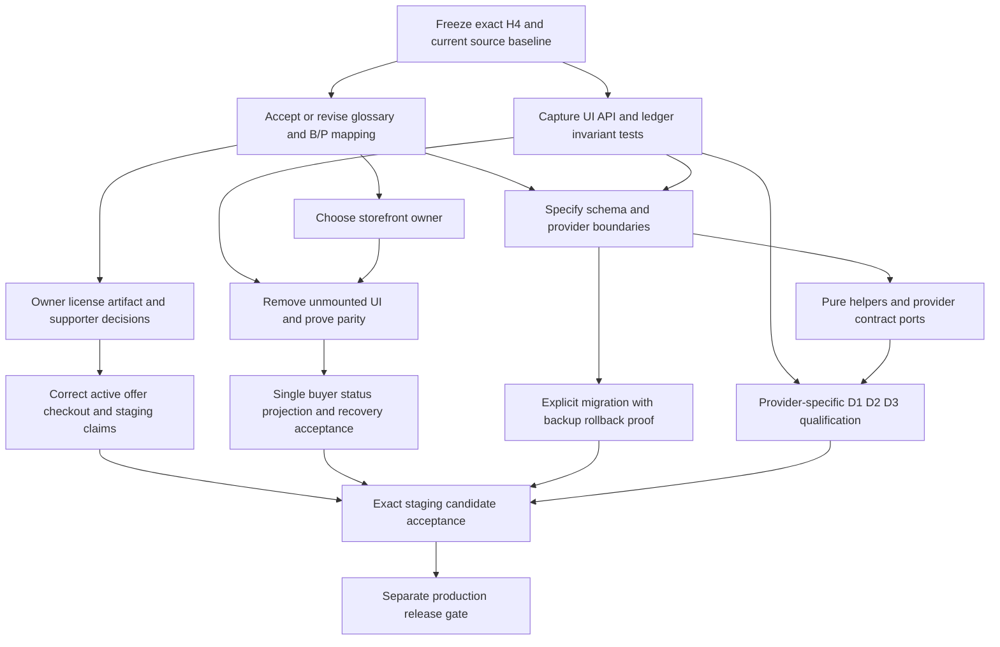

# KELD ontology alignment implementation layering

This is the gap-to-acceptance map for the [architecture review](KELD-ARCHITECTURE-COUPLING-REVIEW-2026-09-21.md), [concept glossary](KELD-CONCEPTS-CANDIDATE.md), [business ontology](KELD-BUSINESS-ONTOLOGY-CANDIDATE.md), and [product ontology](KELD-PRODUCT-ONTOLOGY-CANDIDATE.md). It does **not** replace the [checkout recovery DAG](CHECKOUT-RECOVERY-DAG-2026-09-21.md) or [production implementation layering](KELD-ARE-PRODUCTION-IMPLEMENTATION-LAYERING.md). The ontologies are candidate meaning, not an implementation contract until the product owner accepts or revises them. No code, provider state, staging, production, or policy is changed by this plan.

## Context and minimum proof

- Target: one truthful, recoverable KELD journey for a downloadable ARE release: explore, review offer, authenticate, preserve an owned checkout attempt, pay through a provider, verify with KELD, then deliver or recover safely.
- Current state: brownfield. [Staging H4 evidence](STAGING-STATUS.md) covers the current image's unpaid checkout/recovery behavior; earlier [React acceptance](REACT-STAGING-ACCEPTANCE.md) records provider-paid fixture delivery on a preceding candidate. Neither proves a production sale, paid delivery on the exact H4 UI, or the advanced D1/D2/D3 recovery policy. The current local source has a separate `/checkout` page, a legacy HTML storefront injected into React, and a single SQLite ledger behind Node/Python adapters.
- Primary user: buyer; secondary users: anonymous ARE visitor and operator. The public chat is informational and does not obtain commerce authority.
- Primary constraint: preserve no-double-charge, no-unverified-delivery, account ownership, exact frozen terms, event deduplication, and future-access revocation while removing accidental coupling.
- Claim ceiling: local tests and the H4 staging record do not qualify a real ARE release, legal terms, automatic replacement/refunds, all-provider reversal behavior, or production cutover.
- Current-turn validation: integration preflight (`test` mode) passed and the local synthetic integration suite passed 165/165. This did not contact a live provider or mutate staging. The earlier architecture review's statement that integration dependencies were absent was a mistaken inference from a missing `node_modules/.bin` directory; the package dependencies and tests are present.

## Layering method

Layer 0 is the smallest existing technical proof: one account-bound sandbox order, provider-verified payment, and exact test-artifact download with a recoverable history. Later layers each answer a distinct decision question; they do not reimplement this proof. Layer value is the decision unlocked plus buyer/operator outcome plus risk reduced; cost is implementation, verification, and coordination time. Stop a layer when the next unit adds less value to its decision than beginning the next bounded layer. Each layer preserves every earlier payment and ownership invariant.

| Layer | Decision question | Minimum working unit and included scope | Explicitly deferred | Visible outcome / risk reduced | Main cost and exit evidence | Promotion decision |
| --- | --- | --- | --- | --- | --- | --- |
| L0 — technical vertical (existing, bounded) | After this layer, we know whether one owned checkout can reach server-verified test-artifact delivery and be restored. | Authenticated sandbox buyer, frozen price, provider attempt, verified payment, ledger grant, history and fixture download. [Earlier paid-journey acceptance](REACT-STAGING-ACCEPTANCE.md) plus [H4 recovery evidence](STAGING-STATUS.md) cover complementary candidates, not one exact current-image paid run. | Real ARE artifact/license, automatic replacement/refund, production claims. | Buyer can test the technical path; removes basic integration uncertainty. | Fresh exact-image paid/recovery regression before promoting a later staging candidate. **Technically evidenced in slices, not product-accepted.** |
| L1 — truth and meaning | After this layer, we know whether every active offer, checkout and status claim represents an owner-accepted business concept and environment. | Accept/revise the candidate glossary and B/P mappings; decide exact license, distributable artifact and supporter promise; identify one current-status owner; make active prototype and checkout copy agree with the approved decision and sandbox fixture boundary. | Storefront rewrite, schema migration, new provider commands. | Buyer is not shown contradictory Apache/owner-intent or engine-versus-fixture claims; reduces mis-sale risk. | Product/legal/release decisions, active-page copy inventory, viewport/accessibility and copy regression, exact release/rights evidence. **Block real-money claims until decisions and tests pass.** |
| L2 — one buyer-facing owner | After this layer, we know whether one maintained UI projects the server's owned order, payment, review and access states across normal and recovery journeys. | Choose React/prototype transition owner; remove unmounted React tree after parity proof; retire raw-HTML string surgery incrementally; keep one routed checkout; define one typed buyer status projection and exercise close/reopen, long idle, auth renewal, account switch, provider return, expiry, paid-review and revocation. | Provider finality policy changes, full visual redesign, new account system. | Predictable self-service recovery without duplicate-charge prompts; reduces UI/state drift. | Browser parity across devices, authenticated staging account/session tests, accessibility, one-source copy assertions; rollback to exact prior assets. |
| L3 — explicit backend boundaries | After this layer, we know whether the ledger and provider integrations can change independently without changing financial behavior. | Separate schema migration/bootstrap from per-operation bridge paths; assert schema version and prove backup/rollback; extract pure key/money/terms helpers; group provider ports by create, verify, terminal-proof and reversal/refund-proof contracts; validate configuration by running role. Preserve the Node/Python ledger boundary unless a measured problem warrants replacement. | A new payment framework, a database rewrite, production enablement. | Safer maintenance and smaller provider-specific test blast radius; reduces accidental migration/SDK coupling. | Snapshot/restore and migration tests, old/new schema compatibility, per-provider contract tests, full commerce/integration suites, diff against exact ledger invariants. |
| L4 — exception-policy qualification | After this layer, we know whether the selected D1/D2/D3 policies can operate safely for each advertised provider in staging and yield truthful buyer/operator outcomes. | Use the [recovery DAG](CHECKOUT-RECOVERY-DAG-2026-09-21.md) as the detailed owner: provider-specific terminal-unpaid and duplicate-resource proof, atomic successor, verified late-payment refund command/outcome, full-refund/lost-dispute revocation, buyer notice, named failed-refund owner and trusted operator attribution. Keep partial refund review-only. | Automatic PayPal replacement without finality proof, unqualified Mercado Pago Orders refunds, production cutover. | Safe restart or explicit review, no false refund promise, no future grant after verified reversal. | Authorized authenticated sandbox cases, signed-event/replay and crash tests, exact-image staging acceptance, disabled-by-default rollout/rollback evidence. **Provider paths may remain review-only where proof is unavailable.** |

### Current product frontier and operational lane

| Lane | Work that can proceed now | Exact blocker or owner input | Affected layer |
| --- | --- | --- | --- |
| Product construction | Inventory active copy and stale docs; capture the current UI/API contract; prepare L2 parity and status tests; isolate pure helper seams; leave financial states unchanged. | None beyond bounded local scope and preservation of the dirty working tree. | L1–L3 |
| Product/merchant decision | Accept/revise concepts; approve exact software rights, artifact, first-100 promise and what staging may claim. | Product/license/release owner decisions; the [license research](LICENSE-PAYMENT-RESEARCH.md) is not final legal text. | L1 and real-sale claims |
| Provider/financial qualification | Qualify D1/R3 and D2/D3 per provider under the [recovery DAG](CHECKOUT-RECOVERY-DAG-2026-09-21.md). | Authenticated sandbox evidence, exact test authorization, Mercado Pago duplicate disposition, PayPal finality/remedy, notice and failed-refund ownership. | L4 |
| Operations/security | Preserve exact H4 baseline and backups; rehearse migration rollback and final staging candidate. | Named backup custody/retention, identity image, signup/recovery, ARE policy, alert delivery and production gate decisions remain in the [production release gate](decisions/PRODUCTION-RELEASE-GATE-2026-09-20.md). | L3 staging cutover; production only |

## Dependency DAG

`N` is *not* implied by `M`: production still needs the independent identity,
signup, ARE policy, security, backup, alerting, merchant/legal, artifact and
owner cutover decisions. If a provider cannot prove terminal nonpayment or
refund finality, its safe review-only path can pass a narrower staging slice,
but the product must not advertise automatic recovery for that provider.

## Cross-layer acceptance checks

| Business/product obligation | Concrete pass evidence | Fail condition |
| --- | --- | --- |
| B04/P04 truthful offer and B03/B16 release/rights | Owner-approved offer/artifact/license mapped to every *active* storefront, checkout and delivery string; sandbox test-artifact disclosure adjacent to payment. | Apache or real-engine claim survives in an active path without matching approval. |
| B05/B08 owned attempt and P05/P06/P09 recovery | Same account/key/terms across sign-in, close/reopen, tab/device, session expiry and provider return; server rejects cross-account reuse. | Browser key loss, cross-account display, or second charge from an unresolved attempt. |
| B09/B17/B18 proof boundary and P07/P08 | Exact merchant/resource/API/amount/currency checks per provider; duplicates/unknowns go to review. | Redirect, webhook alone, timeout, 404 or clock expiry grants access or unlocks replacement. |
| B10/B11/B12 money and access | Ledger grants only after eligible verified payment; supporter slot and 12-month service stay distinct from artifact rights; delivery checks current revocation. | `paid-review` grants download/support or a reversed order gets a fresh grant. |
| B13–B15/P12/P13 remedy | One fenced refund command; fresh full outcome verified; lost dispute/full refund revoke future access; partial and ambiguous review; buyer sees non-promissory status and named help route. | Refund intent is presented as completed, command retried after uncertainty, or operator identity is unaudited on an enabled path. |
| P02/P03 anonymous ARE boundary | Chat can explain ARE but has no account, order, provider, secret, or artifact authority; policy/retention/spend acceptance before production. | Public chat can perform or infer commerce actions, or its production policy is undefined. |

## Non-regression and value/cost guardrails

- Do not remove the first-100 reservation, stable request-key identity, provider-scoped proof, signed-event deduplication, ambiguous-outcome lock, one-shot refund marker, or revocation checks to reduce line count.
- Prefer extracting one pure helper or one schema lifecycle seam with tests over a simultaneous UI and ledger rewrite. UI simplification can run in parallel with provider investigation but should not enable disabled financial branches.
- Do not add a generic payment-state abstraction unless it can express Stripe, Mercado Pago Payments versus Orders, and PayPal's actual different finality/refund contracts without erasing review states.
- Retire code or documents only after their active consumer and parity/rollback path are identified. Historical documents may be marked superseded, not silently rewritten as if they were never true.

## Immediate next step and open decisions

The recommended next layer is **L1**. The first runnable work is an active-copy/contract inventory and a source-of-truth table, while the product owner decides the exact license, ARE artifact, supporter terms, and staging disclosure. The next independent engineering work is L2 parity tests around the active legacy storefront and `/checkout`; no provider mutation is needed for that.

Open decisions: (1) rights/artifact/support promise and copy approver; (2) long-term storefront implementation owner; (3) provider-specific D1/D2/D3 activation or review-only scope; (4) buyer notice/failed-refund/operator ownership; (5) separate production decisions in the release gate. The existing D1-A, D2-C, D3-A selections are **not** reopened by this plan.
