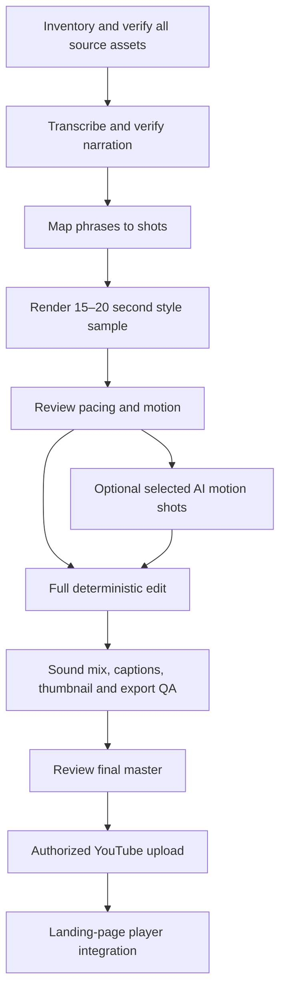

# KELD legend video: production research

Date: 2026-09-17. Candidate research, requested by the product owner.
No video rendered, paid generation requested, upload performed or landing page changed.

**Subsequent execution:** the owner selected editing without AI video generation
and authorized the reviewed DAG. The current implementation is documented in
[the video project](../video/README.md). It uses FFmpeg directly, an English
recording with local word-aligned transcription, and 26 narration-led shots.
The no-render statement above describes this research snapshot, not later work.

## Recommendation

Produce a narrated cinematic illustrated film using the supplied artwork and
recording. Build a deterministic edit first, then optionally replace a few shots
with image-to-video animation. Preserve the amber light, black stone, hooded maker
and geometric mark. The legend is the studio's fictional origin story; it must not
present fictional instruments as demonstrated ARE capabilities.

## Local evidence

The supplied Windows path resolves here to
`/mnt/c/Users/vlad_/Downloads/keld-video` (the literal `vlad/_` path is absent).
It contains 18 PNGs, each 1672 × 941, and one ElevenLabs MP3. There are two numbered
image batches (1–10 and 1–8); suffix alone is not a unique scene identity. Use full
filenames and hashes in the future shot manifest. Keep originals in place.

The audio filename is
`ElevenLabs_2026-09-17T17_43_34_Adam - Distinct, Deep and Engaging_pvc_sp100_s50_sb75_v3.mp3`.
A local MPEG frame scan found 7,253 audio frames at 44.1 kHz, approximately 189.466
seconds. This is an estimate pending a decoder probe; it does not establish spoken
content, language, pauses or narration quality. No transcript was found in that folder.

Three images were visually inspected: the first workshop entrance, the first
batch's final workshop still life, and the second batch's final KELD end frame.
The last already displays “Even minds need tools.” Full shot selection still needs
inspection of the other fifteen images and comparison against the recording.

Existing story evidence:
[six chapter definitions](../prototype/assets/legend/chapters.json),
[legend page](../prototype/legend.html), and
[existing illustrations](../prototype/assets/legend/).
The website prose is a story reference, not a verified transcript of the MP3.

## Tools and reuse

| Approach | Useful for this project | Tradeoff |
| --- | --- | --- |
| Remotion | Editable React timeline, precise audio/shot timing, captions and reusable full/teaser compositions | Requires a renderer/browser setup and checking the applicable commercial license |
| FFmpeg | Small deterministic first edit; pan/zoom, transitions, audio mix and final encoding | Elaborate layered composition is less convenient to author |
| Runway image-to-video | Selected atmospheric shots: drifting smoke, cloth, furnace light or gentle camera travel | Paid external generation, iteration and possible identity/geometry drift |

Recommended composition tool: Remotion for an evolving branded film; FFmpeg is
the leaner alternative for a first pan-and-zoom cut. Neither was installed for this
research. Neither `ffmpeg` nor `ffprobe` was found on the current shell PATH.
Image generation alone produces still assets, not the finished motion edit.

Primary sources: [Remotion documentation](https://www.remotion.dev/docs/),
[Remotion repository](https://github.com/remotion-dev/remotion),
[FFmpeg filters](https://ffmpeg.org/ffmpeg-filters.html).
Remotion has its own licensing terms; do not assume a permissive open-source
license merely because the repository is public. Check its
[current license/pricing](https://www.remotion.dev/) for the actual team/use case.

Runway's [image-to-video guide](https://help.runwayml.com/hc/en-us/articles/48324313115155-Image-to-Video-Prompting-Guide)
recommends describing motion while the input image supplies composition and style.
Candidate prompt for a workshop shot: “The camera slowly pushes toward the
workbench. Fine smoke rises from the furnace and warm light flickers across the
stone. The maker remains still. One continuous shot.” This is an untested prompt.
Keep the final logo/type as deterministic artwork; do not ask a video model to
redraw it. Additional depth layers require segmentation and background repair;
flat-image camera movement does not create true parallax.

## Narrative and visual treatment

Use narration beats, not equal durations across all 18 images. At roughly 189
seconds, one shot per image averages 10.5 seconds; introduce purposeful detail
crops where the voice changes subject, without excessive zoom on the source size.

| Story beat from existing chapters | Candidate treatment |
| --- | --- |
| The threshold | Begin at the workshop entrance; slow inward movement and room ambience |
| Hoarder of Secrets | Archive details, notes and discarded mechanisms; restrained lateral movement |
| Cyber Blacksmith | Strongest motion moment: sparks, warm light, one deliberate tool sound |
| Keeper of the Unmade | Slow down; hold unfinished instruments and give the narration space |
| Tools for another mind | Detail shots that follow each instrument named in the verified narration |
| The maker's mark | Resolve into the existing KELD end artwork; hold the line long enough to read |

These are editorial proposals, not confirmed image-to-audio matches. Prefer cuts
at narration changes and brief dissolves for atmosphere. Do not dissolve between
incompatible character poses. Make movement visible but subtle; avoid constant
floating particles everywhere. Keep music below the voice and effects sparse.
Prepare reviewed captions from the recording and a readable transcript.

## Deliverables

1. Full legend: approximately 3:09 plus only any needed ending hold, depending on
   the actual recording. YouTube master at 1920 × 1080, 16:9, 24 fps, SDR BT.709,
   MP4/H.264, AAC audio and fast-start metadata. This mildly upscales the supplied
   images; it does not create native 1080p detail. Avoid stretching or a 4K-first render.
2. Teaser: proposed 20–30 seconds using an intentionally edited excerpt and ending
   mark. Do not simply speed up the full narration.
3. Poster/thumbnail, caption file (SRT or VTT), transcript and editable shot manifest.

YouTube recommends MP4/H.264, retaining the authored frame rate, and 8 Mbps video
for standard-frame-rate SDR 1080p. At that rate the full upload is roughly 200 MB
including audio, not a multi-gigabyte image sequence. See
[YouTube encoding recommendations](https://support.google.com/youtube/answer/1722171?hl=en).
24 fps is our creative proposal, not a YouTube requirement. Probe the final file,
check color conversion, listen for clipping and review subtitle synchronization.

## Landing-page integration

Place a full-width poster in the existing legend section, with a clear “Watch the
legend” button and duration. On activation, load the YouTube player in that same
space. Maintain aspect ratio to avoid layout shifts. Offer captions and the text
story; keep audible playback user-initiated. A teaser is optional, not required to
load the page. Preserve the full YouTube edition as the canonical hosted film.

Use a lightweight facade rather than loading an iframe at page startup. Google's
[embed performance guidance](https://web.dev/articles/embed-best-practices)
describes deferred/facade embeds. An existing reusable option is
[`justinribeiro/lite-youtube`](https://github.com/justinribeiro/lite-youtube).
Evaluate its accessibility and privacy behavior in KELD before adoption; load a
local poster if avoiding pre-click requests is desired.

## Candidate production DAG

Current product frontier: source-grounded production research is complete; a
short local style sample is the next implementation candidate. Runnable work:
source manifest, full artwork review, audio transcript, phrase timing and sample
composition. No live commerce setup is a dependency of this film.

Operational owners: product owner supplies final creative direction and publication
decision; media editor verifies timing/mix; channel owner handles YouTube metadata
and access. Audio/music usage terms and any paid generation are relevant before
publication or spending, not reasons to block a local edit of the supplied assets.
Deferred residue: upload, website deployment, optional AI service connection and
translated captions. Research grants no publication or service-spending effects.

Storage: retain originals once, save an asset manifest with hashes, render directly
to compressed drafts, and retain only selected draft/final exports. Keep render
cache disposable and explicitly bounded; avoid a lossless full-frame PNG sequence
given this project's previous WSL disk pressure.

## Open Questions

- Does the recording match the current six-chapter story, and which language is it?
- Is the full recording the intended YouTube cut, with the shorter teaser secondary?
- Is deterministic movement sufficient after the sample, or are paid generated
  motion shots desired? No service access or spending is assumed.
- What music/ambience should accompany the supplied voice, and are commercial
  usage terms for the supplied recording confirmed before publication?
- Which YouTube channel, final title and thumbnail should be used at upload time?
