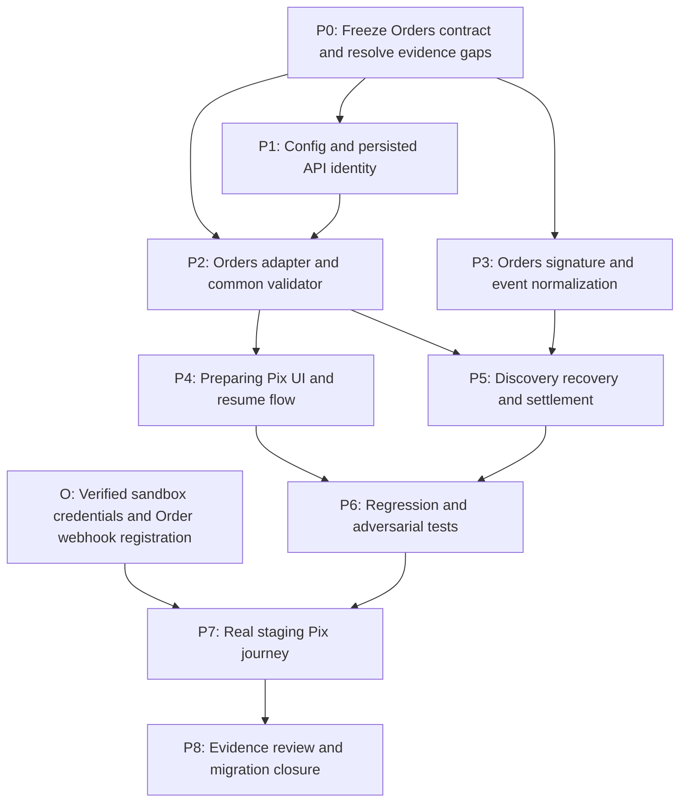

# Mercado Pago Orders migration: research and execution DAG

Date: 2026-09-18. Candidate plan under CAV2-D65. User authorized implementation.
Local construction and validation are recorded in [implementation evidence](MERCADO-PAGO-ORDERS-IMPLEMENTATION.md). Genuine merchant acceptance and VPS application rollout remain pending.
No ontology record/selector dependency. Goals validation remains blocked; this
document is not admitted execution state or commercial product approval.

## Objective

Move KELD's Pix integration from Payments to Checkout API / Checkout Transparente
via Orders, retaining authenticated ownership, frozen amount/release binding,
idempotency, recovery and exact-once entitlement effects. Close with a genuine
sandbox order, verified webhook, authoritative status lookup and exact synthetic
download on staging. Preserve Stripe/PayPal behavior and the existing ARE service.

The official [Payments overview](https://www.mercadopago.com.br/developers/pt/docs/checkout-api-payments/overview?scope=prod)
describes Payments as legacy: existing integrations continue, with security and
stability fixes but no new features. No shutdown date was established in this
research. Orders is the migration target; do not claim Payments has stopped working.

## Verified findings and source boundaries

| Finding | Evidence | Implementation consequence |
| --- | --- | --- |
| Pix uses `POST /v1/orders`, decimal-string amounts, an idempotency header and nested payment transactions | [Pix guide](https://www.mercadopago.com.br/developers/pt/docs/checkout-api-orders/payment-integration/pix) | Use automatic processing, one Pix payment per KELD attempt, and integer-cent conversion to exact strings |
| Responses can precede payment/QR availability; `ORD...` and `PAY...` identify different resources | Same Pix guide | Bind an accepted order immediately; distinguish preparing from ready; never recreate because QR is missing |
| Our installed `mercadopago` 3.6.1 provides `Order.create/get/search` | [Official SDK](https://github.com/mercadopago/sdk-nodejs/blob/master/src/clients/order/index.ts); installed `integrations/node_modules/mercadopago/dist/clients/order/` | Reuse SDK; no unconditional upgrade or custom HTTP replacement |
| Webhook topic is **Order (Mercado Pago)**, with order IDs and order lifecycle notifications | [Orders notifications](https://www.mercadopago.com.br/developers/en/docs/checkout-api-orders/notifications) | Replace payment-topic assumptions; same KELD endpoint can remain |
| Documented test access tokens can use `APP_USR`; the GET reference describes test-user credentials for sandbox | [Pix testing](https://www.mercadopago.com.br/developers/en/docs/checkout-api-orders/integration-test/pix), [GET order](https://www.mercadopago.com.br/developers/en/reference/online-payments/checkout-api/get-order/get) | Token prefix cannot prove environment; establish positive seller/application/test-account binding before any create |
| Documented Pix test uses `payer.first_name=APRO`; it first waits for transfer and later changes state automatically | Same Pix testing guide | Dedicated sandbox fixture; no real bank transfer and no simulation fields in production behavior |
| Order search is `GET /v1/orders`; installed SDK uses date filters and page/page_size; response has `data` and string pagination counts | [Search reference](https://www.mercadopago.com.br/developers/en/reference/online-payments/checkout-pro/search-orders/get), installed SDK search types/source | Reimplement bounded discovery; prove applicability to online Pix orders, not just Checkout Pro examples |

Documentation conflicts are evidence, not permission to weaken checks:

- Notification examples use 13-digit timestamps. Our verifier requires 10 digits,
  and the installed SDK's freshness calculation assumes seconds. Test exact signed
  vectors and a real delivery. Preserve original timestamp bytes for HMAC; handle
  units separately for freshness. If needed, use the SDK for authenticity plus a
  tested explicit freshness check, or a demonstrated upstream fix. Do not disable
  freshness or try arbitrary signature variants until one passes.
- Orders examples do not consistently expose `live_mode`, currency or a generic
  `metadata.release`. SDK response types expose `currency`; a webhook example uses
  `currency_id`. Country alone is not currency proof. Document the authoritative
  response contract and verified merchant context before settlement is enabled.
- The notification guide describes the dashboard's Production mode tab, while the
  Pix guide describes sandbox testing with `APP_USR` credentials. Verify the exact
  test seller/application and notification registration arrangement; do not replace
  staging credentials with a real seller's production token to make requests work.

## Local impact inventory

| Surface | Current assumption that must change |
| --- | --- |
| [payments.mjs](../integrations/src/payments.mjs) | `Payment` client; numeric payment identity; collector/live_mode/metadata checks; `approved/accredited`; top-level amount; old QR and expiry fields; Payments search pagination |
| [config.mjs](../integrations/src/config.mjs), [prepare.py](../deploy/prepare.py) | Require `TEST-` tokens; lack explicit Orders API identity and positive sandbox-account preflight |
| [events.mjs](../integrations/src/events.mjs) | Numeric query ID only, ten-digit timestamp, hard-coded payment resource/type |
| [event-worker.mjs](../integrations/src/event-worker.mjs) | Processes `payment.notification` through a Payments lookup |
| [checkout.mjs](../integrations/src/checkout.mjs), [resume-checkout.mjs](../integrations/src/resume-checkout.mjs) | Response treated as ready immediately; cached response cannot represent QR preparation correctly |
| [buyer-client.mjs](../integrations/public/buyer-client.mjs), [buyer.mjs](../integrations/public/buyer.mjs) | Every ordinary Pix create response must contain a code; UI assumes readiness |
| [sdk_bridge.py](../commerce/sdk_bridge.py), [recover-payment.mjs](../integrations/src/recover-payment.mjs), [discover-payment.mjs](../integrations/src/discover-payment.mjs), [reconcile.mjs](../integrations/src/reconcile.mjs) | Persist order-versus-payment identities and API version unambiguously; preserve generation/lease and immutable terms during recovery |
| Tests and operator docs | Payments-shaped mocks, tokens, signatures and recovery expectations; old webhook instructions |

## Proposed design

Use an explicit provider API identity such as `orders-v1` in configuration and
persist it with each Mercado Pago attempt; missing identity in existing rows means
legacy, not implicitly Orders. Name the new SDK variable `mpOrders` so it cannot be
confused with PayPal's `OrdersController`. Store provider `ORD...` as remote order
identity and settled `PAY...` separately as payment identity. Keep all IDs as strings.

One validated Orders contract feeds create, resume, verify, discovery and recovery.
It reports safe field paths/reason codes for all invalid required fields in one
pass, without values or payer data. Avoid a sequence of ad hoc checks patched one
field at a time. Version fixtures and explicitly distinguish incomplete, pending,
paid, cancelled, expired, failed and refund/review states.

Bind the KELD order, frozen release digest, amount/currency, merchant, application,
environment and provider API identity before create. Existing generic metadata
cannot be assumed available: P0 must select a documented round-tripped field or a
bounded integrity-bound external-reference design. External reference length and
character restrictions must fit the chosen design. Recovery must enforce the same
binding as ordinary verification; a matching amount alone never grants access.

For a successful response with an order ID but no QR, persist that ID and return
an explicit preparing result. Refresh the same order with bounded retries/backoff
and a deadline, then update its cached response under the existing ownership and
generation checks. Timeouts without an ID retain uncertain state and their original
idempotency key. No additional POST or new key merely to obtain a QR. Provider
expiration and local reservation expiry remain distinct, with late payment review.

Settlement requires a fresh authenticated order lookup, expected merchant and
external binding, exact amount/currency, one accepted Pix payment, matching paid
totals, and the documented final accredited state. Pending, partial, refunded,
chargeback or ambiguous results do not create new entitlements. Refund observations
still go to policy review; this migration does not invent refund/access policy.

Webhook bodies remain lookup hints. Validate signature inputs, duplicate headers
and query keys, timestamp freshness and order ID representation. Verify signed ID
case rules with fixtures rather than guessing; never lowercase the lookup identity
merely because signature canonicalization may require it. Normalize an Orders
notification, then GET current state. Duplicate/out-of-order notifications must
produce one settlement; unsigned body status, amount and live_mode are not proof.

## Hypotheses and falsification tests

| Hypothesis | Test | Failure response |
| --- | --- | --- |
| H1: Installed SDK covers this migration | Intercept actual SDK create/get/search requests with documented fixtures and exact headers | Isolate the demonstrated gap; assess a pinned upgrade or narrow adapter, not a broad rewrite |
| H2: The new provider contract can preserve all existing payment invariants | Wrong seller/app/environment/reference/release/amount/currency, multiple payments, refund and incomplete-state cases | Block settlement until binding is specified and proved |
| H3: Orders supports restart-safe Pix preparation and recovery | Missing-QR response, lost create response, repeated key, event-before-bind, duplicate event and restart | Preserve uncertain attempt and operator evidence; never infer absence from an empty search |

## DAG and execution order

| Task | Scope and acceptance |
| --- | --- |
| P0 | Resolve timestamp/case rules, sandbox proof, merchant/app fields, currency, release binding, expiry and search scope. Commit bounded redacted fixtures with primary sources and assumptions. Unresolved proof blocks its dependent live effect, not independent fixture construction. |
| P1 | Update closed config/provisioning schemas and positive credential preflight; add persisted API identity and validation. Inventory any retained ledger before migration. Fresh staging is expected from current status, but must be verified. Never delete data to avoid compatibility work. |
| P2 | SDK `Order` create/get plus shared validator. Validate decimal strings, idempotency behavior and Orders error envelopes: generic 4xx/429/5xx classification must not release an uncertain attempt incorrectly. Accepted-but-incomplete response binds its order. |
| P3 | Orders webhook verifier and worker route. Reject legacy numeric payment events under Orders configuration. Retain durable receipt, freshness and deduplication. Preserve Stripe/PayPal event behavior. |
| P4 | Typed preparing/ready/settled outcomes across service, persisted response and browser. Poll/resume same order without duplicate charge or busy loops. Handle immediate settlement before QR appears. |
| P5 | Bounded Orders search with validated pagination, fresh verification of candidates, lost-binding recovery and reconciliation. Prove recovery works with full binding and cannot attach another buyer's order. |
| P6 | Run relevant SDK, webhook, recovery, ledger, buyer and provisioning tests, then the full current integration suite. Rebuild the source bundle/image after source changes; record exact candidate digest. |
| O | Merchant owner supplies test seller/application configuration and secrets through existing vault; agent verifies the read-only account preflight before writes. Select **Order (Mercado Pago)** for `https://staging.keld.studio/events/mercadopago`. Resolve dashboard mode against the test app. |
| P7 | Deploy tested candidate within authorized staging scope. Use the documented Pix sandbox scenario. Capture actual signed delivery, GET final state, prove a single entitlement and exact synthetic download; repeat delivery and browser retry/restart; test cross-buyer denial. No real bank transfer. |
| P8 | Report exact order/payment IDs in private evidence, sanitized outcome summary, image digest and regression results. Close only when normal and recovery journeys pass. Commercial release remains separate. |

## Required test matrix

- Create: exact request schema/header; decimal rounding boundaries; original
  idempotency key reused; asynchronous response; duplicate/concurrent request;
  timeout before/after provider acceptance; structured rejection versus uncertainty.
- Verify: `ORD`/`PAY` distinction; missing/wrong seller, app, environment, currency,
  reference or release binding; under/overpayment; multiple payments; refund and
  chargeback; final versus intermediate states; expiry and late payment.
- Events: real-format Orders signature vectors, timestamp units, case rules,
  duplicate query/header keys, replay, unsigned body tampering, body/query conflict,
  duplicate/reordered events and delivery before local binding.
- Recovery: paginated/search-limit results, malformed pagination, empty results,
  pending QR after restart, stale generation, different buyer/provider/API identity.
- Regression: Stripe, PayPal, shared authentication and file-secret loading;
  generation leases, quote freezing, exact download and entitlement idempotency.

## Operational lane and rollback

Local P1-P5 construction and P6 tests are implemented as a candidate. The remaining
frontier is P0 merchant contract evidence and O/P7 live acceptance; mocked success
does not close these gates. See the implementation evidence for exact results. Agent owns
construction/tests; merchant owner owns account configuration; operator owns
staging deployment/backup; product owner retains commercial policy approval.

D65 chain: researched contract -> bounded implementation -> exact tested candidate
-> product evidence review -> authorized staging rollout -> live acceptance.
Passing mocks does not prove merchant compatibility or production readiness.

Before cutover, back up any commerce ledger and inspect old MP attempts/events.
If legacy rows exist, preserve a versioned read/recovery path or explicitly drain
them; do not reinterpret them as Orders. Do not dual-create payments. Once Orders
attempts exist, rolling back to an old Payments-only reader is unsafe: disable new
Pix creation while preserving the Orders reader/reconciler, or roll forward.
Never restore an older ledger over payments created since its backup.

## Open Questions

1. Exact positive test-account/application proof available for this merchant's
   `APP_USR` token, and correct dashboard mode for genuine sandbox notifications.
2. Authoritative response fields for currency/environment and round-trip release
   binding; SDK types and examples alone are insufficient evidence for absence.
3. Observed Orders timestamp units and signed-ID canonicalization; whether SDK
   freshness needs a wrapper or a pinned upstream correction.
4. Online Pix support for the documented Orders search filters, TTL/idempotency
   retention limits, and provider expiration rules matching local reservations.
5. Presence of any legacy ledger data when implementation begins.

These questions have P0/O owners and tests above; they must not be silently
resolved by dropping existing invariants. License, refund policy, release approval,
off-server backups and USDC remain separate residue in
[STAGING-PLAN.md](STAGING-PLAN.md#open-questions).
