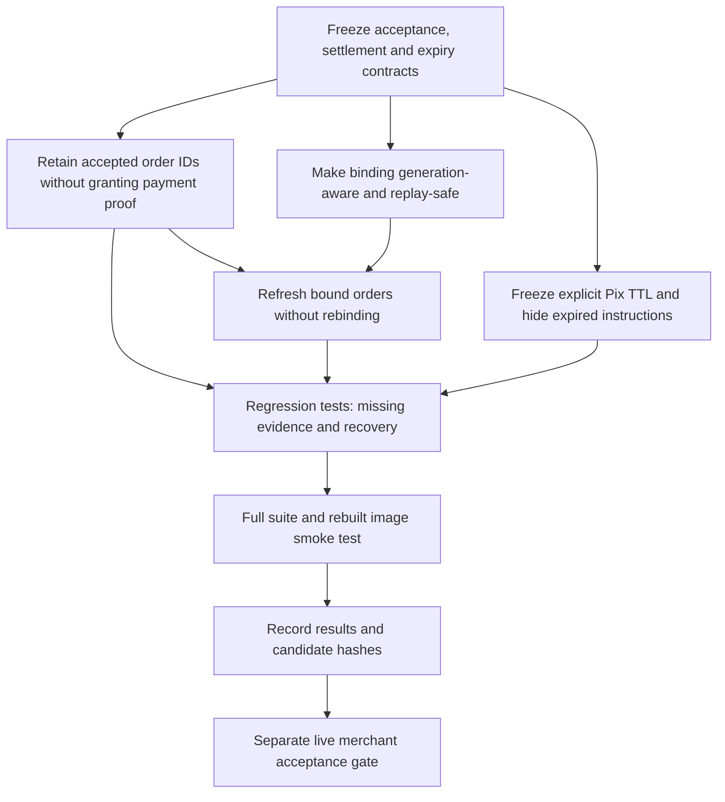

# Orders review repair DAG

Owner-directed D65 construction, 2026-09-18. Scope: the four reviewed local defects;
no merchant calls, credential changes, staging deployment or release admission.

| Task | Acceptance | Owner |
| --- | --- | --- |
| A | Accepted ID is only a lookup reference; missing currency cannot authorize payment. Existing request bodies/keys must not be rewritten. | Agent |
| B | Preserve valid returned ORD IDs and safe validation paths; retry via GET; expose no Pix until verified. | Agent |
| C | Require the active creation generation for first binding; same-ID replay preserves cached response; stale/different-ID writes rejected. | Agent |
| D | Bound operator resume returns success after refresh, without calling the unbound recovery operation. | Agent |
| E | New request version freezes a 30-minute provider TTL and conservative display deadline; allow POST only with enough local reservation remaining plus margin; never recompute the body on retry. Hide instructions on expiry, reload and tab return. | Agent |
| F/G | Real SQLite regressions, SDK request assertions, expiry boundary tests, all existing integrations, source-only image smoke. | Agent |
| H | Keep historical image evidence; identify new candidate and exact checks. | Agent |
| I | Test seller credentials, actual currency/account evidence, real webhook, provider TTL and search behavior. No mocked success closes this gate. | Merchant owner / operator |

Product frontier: A–H are runnable locally. Operational blocker: missing merchant
configuration blocks I only. Provider expiration starts when its payment is issued;
local display uses a conservative fixed deadline and late settlement retains review.
Older Orders request versions remain readable, but cannot be re-created with a new
body under their existing idempotency key. Resolve uncertain old attempts by lookup.

## Open Questions

Merchant response proof, webhook registration, asynchronous provider issuance and
actual expiration behavior remain owned by
[MERCADO-PAGO-ORDERS-IMPLEMENTATION.md](MERCADO-PAGO-ORDERS-IMPLEMENTATION.md#open-questions--blockers).
Results will be added after validation; this DAG is not execution admission.
