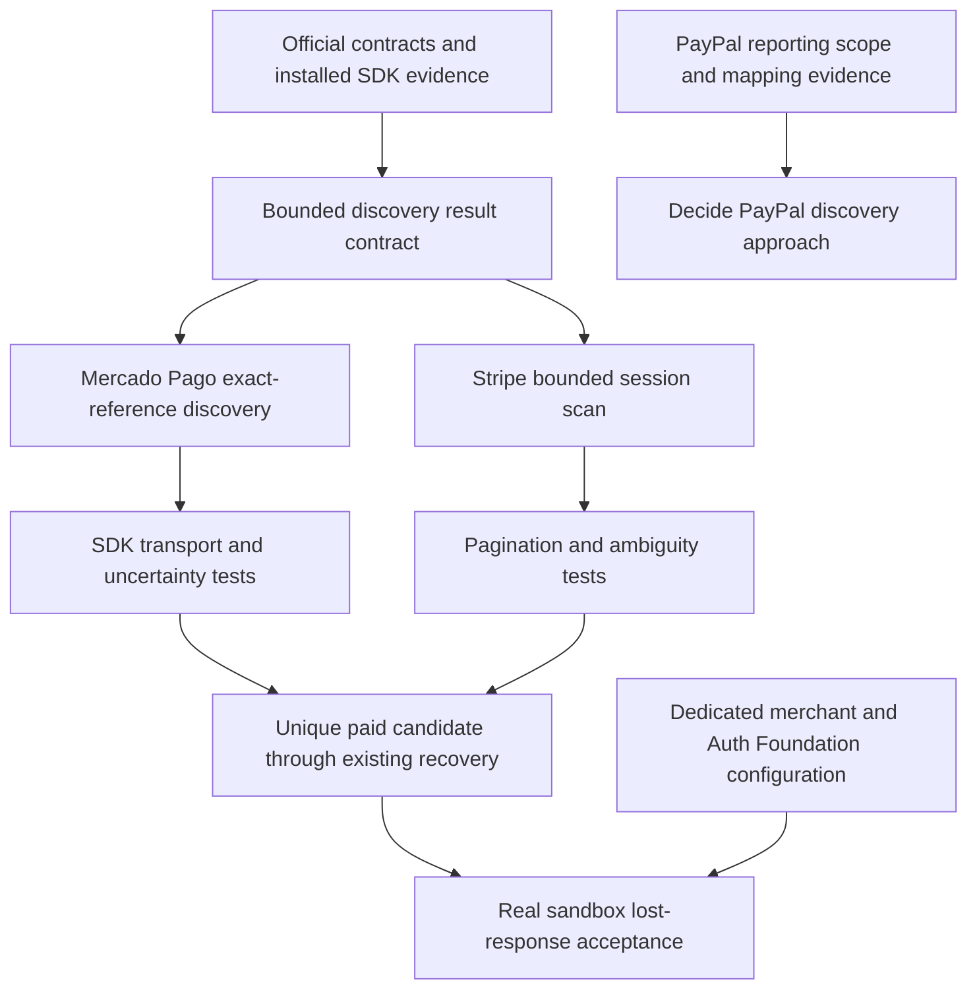

# Existing-payment discovery research and construction DAG

Date: 2026-09-17. Candidate research under `CA2-ROUTE-RESEARCH`, receipt
`keld-discovery-research-111`. No merchant request, production admission or new
implementation authority. This supports the existing objective: sell ARE through
KELD with shared Auth Foundation and Stripe, Mercado Pago Pix and PayPal SDKs.
USDC remains deferred. No ontology runtime record/selector dependencies.

## Evidence and differences

| Provider | Verified discovery surface | Consequence for KELD |
| --- | --- | --- |
| Mercado Pago | `GET /v1/payments/search` accepts `external_reference`, sorting, date range and pagination; installed `Payment.search` forwards options | Search using the exact local order ID already written by KELD, then retrieve and verify each candidate |
| Stripe | Checkout Session listing accepts created interval, cursors and limit up to 100; the documented and installed parameter sets have no `client_reference_id` filter | Scan a bounded interval and compare stored order references locally; report incomplete scans explicitly |
| PayPal | Orders v2 documents get-by-ID but no general list/search operation; installed OrdersController has no list method | Keep known-ID recovery; do not invent a search endpoint or recreate the order as a lookup |

Mercado Pago sources: [official payment search reference](https://www.mercadopago.com.br/developers/pt/reference/online-payments/subscriptions/search-payments/get),
[installed SDK request types](../integrations/node_modules/mercadopago/dist/clients/payment/search/types.d.ts),
[request implementation](../integrations/node_modules/mercadopago/dist/clients/payment/search/index.js).
The SDK describes search results as summaries and recommends `Payment.get` for
full details. The public page marks several fields required while SDK types make
them optional; supply explicit sorting and date bounds and verify actual sandbox
acceptance. Search visibility/consistency for this merchant has not been tested.

Stripe sources: [official Checkout Session listing](https://docs.stripe.com/api/checkout/sessions/list),
[installed SessionListParams](../integrations/node_modules/stripe/esm/resources/Checkout/Sessions.d.ts).
KELD already stores the order ID in `client_reference_id` and release digest in
metadata. Created-time bounds can reduce the scan, but do not establish uniqueness
or absence outside that interval. No search result is payment proof.

PayPal sources: [Orders v2 endpoint inventory](https://developer.paypal.com/api/orders/v2),
[installed controller](../integrations/node_modules/@paypal/paypal-server-sdk/src/controllers/ordersController.ts),
[transaction reporting reference](https://developer.paypal.com/api/transaction-search/v1/search-get).
Reporting is a separate API with reporting-read scope, a maximum 31-day query
range and up to three hours of transaction visibility delay. It exposes transaction
references, invoice ID and custom fields. KELD currently uses `referenceId` for
the order and `customId` for the release digest, so the custom field alone cannot
identify one purchase. Merchant scope availability and reliable report-to-order
mapping remain unverified. Reporting is not proven recovery for an unpaid order.

## Recommended implementation contract

This is engineering synthesis, not a provider guarantee:

1. Start with an exact local uncertain order, its saved merchant and frozen terms.
   Reject an active creation lease before contacting a provider. Discovery must
   never call create, capture, cancel or refund.
2. Return bounded candidate IDs and explicit coverage: searched interval,
   pagination state, and whether the scan finished within its budget. Store/output
   no payer profiles or raw payment bodies. A scan continuation must remain bound
   to the same provider, merchant, order and interval.
3. For Mercado Pago, use exact `external_reference`; fetch full candidate details
   and apply existing merchant, sandbox, order, release, amount and currency checks.
   Treat invalid response envelopes or pagination as failure, not an empty result.
4. Preserve distinct outcomes: no candidate observed, incomplete scan, multiple
   candidates, candidate not paid, provider failure, and verified paid candidate.
   None except fresh verified payment permits the existing recovery path. No empty
   or incomplete result releases a reservation or authorizes another payment.
5. Multiple matching resources require review. Do not choose the first returned
   result or assume idempotency guarantees that the merchant has only one resource.
6. A unique completed candidate can enter [existing paid recovery](SDK-INTEGRATION.md#recover-a-lost-paid-payment-binding),
   which re-verifies payment and performs generation-checked binding. Maintain
   late-payment review and ownership checks. Discovery must not bypass that path.

## DAG and task order



Current product frontier: A and the bounded Mercado Pago B/C/D/E path are
implemented. The local command discovers candidates without a supplied provider ID
and optionally invokes verified recovery. It is not scheduled automatically.
Stripe bounded discovery and its transport tests are also implemented. PayPal reporting is a separate research
dependency; its absence does not block the two supported discovery implementations.

Acceptance cases: zero/one/multiple candidates; wrong order/merchant/release;
unpaid/refunded resource; malformed paging; more pages than budget; provider
timeout; concurrent creation; lost binding/settlement response; replay; no create
or capture requests; no payer data in output. Use actual SDK serialization with
intercepted responses, then separately record genuine sandbox evidence.

Product construction owner: implementing agent under the owner's existing bounded
SDK request, after selecting the implementation route. Operational owner: merchant
and identity configuration owner for real account access and reporting permissions.
Known-ID unpaid resumption is available through the
[resumption command](SDK-INTEGRATION.md#resume-a-lost-unpaid-checkout). Expired or
unlocated attempts, refund policy, retention and deployment supervision remain
visible separate work in [the delivery plan](DELIVERY-PLAN.md).

## Implemented Mercado Pago command

From `integrations`:

```sh
npm run discover-payment -- /absolute/config.json LOCAL_ORDER_ID inspect
npm run discover-payment -- /absolute/config.json LOCAL_ORDER_ID recover
```

`inspect` is the default. It requires an uncertain local Mercado Pago attempt or
an expired creation claim, with no saved provider binding and a matching configured
merchant. It requests the exact external reference, ascending creation order,
explicit creation-time bounds, offset zero and limit 20 through the installed SDK.
The interval is from local creation minus five minutes (floored at zero) to the
earlier of current time and checkout expiry plus five minutes. This clock allowance
is an engineering bound, not proof of exhaustive provider history.

Strict response checks require consistent numeric paging, the expected result
count, matching external references and distinct valid IDs. Numeric IDs must be
safe integers. Output contains candidate IDs, count, interval and coverage, never
payer payloads. A result count over 20 is `incomplete`; this version does not expose
a continuation cursor. Use operator review rather than choosing from a truncated
set. Other outcomes are `not-observed`, `ambiguous`, `not-paid`, `verified-paid`,
and `recovered`. Invalid data or provider errors fail the command safely.

Only one candidate in a complete observed page reaches full SDK verification.
Inspection leaves it unbound. Explicit recovery re-fetches and verifies it through
`recoverPayment`, retaining generation checks, idempotency and late review. No
search outcome creates another payment or releases a reservation. Missing results
remain inconclusive even when `complete` is true for the requested interval.

Two tests exercise actual SDK search serialization, empty/multiple/truncated
results, pending and paid retrieval, inspection without binding, recovery to exact
fixture delivery, active claims, malformed paging, wrong references, unsafe IDs,
duplicates and provider failure. Network responses are intercepted; real merchant
search availability, consistency and date-filter behavior remain unverified.

## Implemented Stripe scan

The same `discover-payment` command supports uncertain Stripe orders. It first
retrieves the account and requires the configured merchant. It lists Checkout
Sessions with the same explicit creation interval described above, up to five
pages of 20 sessions (100 maximum), following `starting_after`. It compares each
session's `client_reference_id` with the saved order ID; no nonexistent server-side
reference filter is sent.

The response must be a valid list with boolean `has_more`, bounded data and valid
sandbox sessions inside the interval. Duplicate IDs, non-advancing pagination,
empty pages claiming more results, and malformed objects fail closed. Returned
coverage includes pages/scanned count, candidate IDs and interval. `total` is the
observed matching count only after reaching the final page; it is null when the
scan is incomplete. The result never contains unrelated session or payer bodies.

A scan ending at the fifth page with `has_more` remains incomplete and cannot
recover automatically, even if one match was already seen. No continuation cursor
is exposed in this version; use known-ID operator review for larger merchant
volumes. Completed scans still prove only observed results in this time interval.
The shared discovery service rejects ambiguity and performs full payment/capture
verification on a unique candidate. Explicit recovery repeats fresh verification
and applies existing generation and late-payment rules.

Two SDK transport tests cover cursor/date parameters, unrelated sessions, unique
paid discovery through exact fixture delivery, bounded scans, duplicate cursors,
malformed pages, wrong merchant, live data and out-of-range sessions. Responses
are simulated. PayPal general historical search remains unsupported. Verified capture events
now resolve provider order and local order references and invoke full paid recovery
when an eligible local binding was lost; see [event recovery](WEBHOOK-DESIGN.md#event-driven-lost-binding-recovery).

## Open Questions

Merchant-specific search availability and consistency; acceptable scan budget and
clock-skew interval; PayPal reporting permissions and order mapping; recovery of
unpaid attempts after checkout expiry. A negative scan remains inconclusive until
there is stronger provider evidence. License/release and commercial policy questions
remain owned by [PROJECT-INTAKE.md](PROJECT-INTAKE.md#open-questions).
