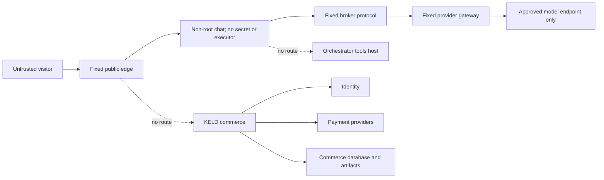

# KELD + ARE security findings and execution result

Date: 2026-09-18. Route: `CA2-ROUTE-IMPLEMENT`. Authority effect: none.
Scope: local source, package, container, browser, and synthetic integration
evidence for [SECURITY-REVIEW-HANDOFF.md](SECURITY-REVIEW-HANDOFF.md).

## Decision

**Public release is BLOCKED.** The locally controllable visitor-chat execution
boundary is remediated and passes its exact-source/exact-image checks. KELD's
custom application, edge, and database images also pass the configured
High/Critical gate. The exact Keycloak image still reports one Critical and one
High in its raw scan; a deployment-specific OpenVEX assessment reduces the
configured-image result to zero, but it remains candidate evidence until the
security owner accepts or replaces it. Release also still lacks product
decisions for abuse identity, the idle-retention value, exact monetary values/provider rates,
the temporary-access review trigger, and remote operational acceptance against
the final deployment. The local KELD production candidate now routes only
`/are` and `/are/*` to the isolated ARE edge; this is tested configuration, not
a deployed service.

This result is not a security certification. No live model request, payment,
merchant webhook, production deployment, source publication, or remote mutation
was performed.

## Threat model and completed surface inventory

Protected assets are the host and orchestrator, operator and merchant secrets,
model credential, commerce/session databases, paid artifacts and entitlements,
visitor conversations, and deployment availability/budget. Attackers include an
anonymous visitor, malicious model/provider response, forged webhook sender,
cross-buyer customer, compromised browser content, and dependency/supply-chain
adversary. Operators and merchant providers are trusted only inside their stated
boundaries; prompts and route receipts are never authority.

Reviewed entry points include the ARE edge/static/chat/broker/provider-gateway
routes and package closure; KELD buyer/auth/checkout/restore/confirm/download/event routes; event
worker/recovery/operator operations; Python ledger/download bridge; secret-file
and child-environment handling; Caddy/Compose/Docker/Keycloak/Postgres; browser
rendering; package locks; and exact container images. Remote VPS state and real
provider control planes were not evaluated in this run.

## Findings

### F-01 — chat process reached subprocess-backed secret resolution

- Severity/status: **High — mitigated**.
- Evidence: the prior chat path imported the credential-bearing GLM/secret
  bridge. The production entry point now imports only `broker-client.mjs`
  ([chat-server.mjs](../are-documentation/server/chat-server.mjs));
  the closure test rejects `node:child_process` and executor/agent paths at
  [closure-policy.test.mjs](../are-documentation/server/closure-policy.test.mjs#L29).
- Attacker prerequisite/reproduction: hostile visitor/model content plus any
  reachable generic executor or secret API. Static closure enumeration now finds
  no such implementation; same-privilege runtime import of child process is
  denied.
- Impact: before the split, “no declared tools” did not establish OS isolation.
- Remediation/regression: separate fixed broker; no chat secret mount; closure
  test; runtime denial probe. **Pass locally.**

### F-02 — provider response protocol was not closed over executable variants

- Severity/status: **High — mitigated**.
- Evidence: [model-protocol.mjs](../are-documentation/server/model-protocol.mjs#L63)
  admits one assistant text response and bounded accounting only. Fixtures at
  [model-protocol.test.mjs](../are-documentation/server/model-protocol.test.mjs#L20)
  reject tool calls, legacy function calls, alternate roles/types, multiplicity,
  unknown fields, and malformed usage.
- Attacker prerequisite/reproduction: compromised/misbehaving provider returns an
  alternate response shape. Every unsupported fixture fails before conversation
  handling.
- Impact: unsupported structured output could otherwise be reinterpreted by a
  future downstream consumer.
- Remediation/regression: fail-closed parser plus validation at the broker and
  provider-gateway boundaries. **Pass: 48/48 ARE server tests.**

### F-03 — process-local chat quotas were restart/scale bypassable

- Severity/status: **High — mitigated locally; product controls incomplete**.
- Evidence: durable atomic reservation state at
  [broker-quota.mjs](../are-documentation/server/broker-quota.mjs)
  charges abandoned work and enforces two active calls, 60 calls/hour, 100,000
  reserved/committed tokens, plus owner-configured hourly and monthly micro-USD
  ceilings. Monetary admission reserves the configured worst-case input/output
  cost before dispatch, charges the full reservation when exact usage is
  unavailable, conservatively migrates v1 state, and refuses startup when a
  ceiling or provider rate is absent. Tests cover restart, concurrency, hourly
  and monthly rollover, migration, and invalid configuration at
  [broker-quota.test.mjs](../are-documentation/server/broker-quota.test.mjs).
- Attacker prerequisite/reproduction: restart or parallel workers under the old
  in-memory counters. The quota-volume restart probe retained its counters.
- Impact: uncontrolled provider load and spend.
- Residue: access identity, source-address policy, exact monetary ceiling/rate
  values, the idle-retention value, and review trigger remain owner decisions. The enforcement
  mechanism passes locally, but the abuse boundary remains **blocked** at
  release level.

### F-04 — production browser/edge boundary was previously a development server

- Severity/status: **High — mitigated locally**.
- Evidence: fixed Node edge and production static server enforce exact Host,
  route/method/body/header allowlists, CSP/framing/referrer/permissions policy,
  traversal denial, timeouts, and no auth/cookie forwarding. See
  [edge-server.mjs](../are-documentation/server/edge-server.mjs#L108)
  and [chat-server.mjs](../are-documentation/server/chat-server.mjs#L20). The
  production chat requires a positive integer idle-retention duration, reports
  it in status, and expires non-busy process-memory sessions at the exact
  configured boundary; missing configuration prevents startup.
- Synthetic browser reproduction: hostile user/model HTML, script, image, and
  link strings remained exact text. Execution globals were null; created
  script/image/link/SVG nodes were zero; requests stayed same-origin; Firefox
  logged zero warnings/errors.
- Impact: XSS or remote-content leakage if hostile content were rendered as raw
  HTML/unsafe Markdown.
- Remediation/regression: React text rendering, restrictive CSP, fixed edge, and
  final-image Firefox proof. **Pass locally.**

### F-05 — model-secret file permission contract was nonfunctional

- Severity/status: **High availability/configuration — mitigated locally**.
- Evidence: the first final-image probe found a mode-0400 host secret unreadable
  by UID 65532. [install-model-secret.sh](../are-documentation/deploy/install-model-secret.sh#L1)
  now accepts one absolute regular non-symlink file, bounds its size, installs
  owner `65532:65532` and mode `0400`, and prints no value. Only the provider
  gateway receives that file; the chat and inference broker have no credential
  mount. Compose declares the same target metadata in
  [compose.security.yaml](../are-documentation/deploy/compose.security.yaml).
- Impact: health appeared ready while the first real inference would fail.
- Remediation/regression: no-value probe confirms valid gateway secret metadata,
  broker secret denial, broker-only quota write, read-only roots, and custom
  seccomp activation. Compose warns that file-secret UID/GID/mode fields are
  ignored locally, so the provisioning helper is mandatory. **Pass locally after
  installation.**

### F-06 — KELD webhook verification admitted unbounded provider work

- Severity/status: **Medium — mitigated locally**.
- Evidence: [events.mjs](../integrations/src/events.mjs#L76) performs durable
  admission before verification. [sdk_bridge.py](../commerce/sdk_bridge.py#L60)
  atomically enforces 120 attempts/provider/minute across workers and restarts;
  over-limit requests return 429. The regression at
  [integrations.test.mjs](../integrations/test/integrations.test.mjs#L320) proves
  the verifier is not called after exhaustion.
- Attacker prerequisite/reproduction: unauthenticated forged webhook traffic,
  especially PayPal verification requiring an outbound call.
- Impact: provider/API exhaustion and availability loss.
- Residue: an infrastructure edge/source-address control may still be desirable;
  the source-level durable gate does not identify clients.

### F-07 — KELD release images contained High/Critical findings

- Severity/status: **High/Critical — remediated locally; Keycloak owner
  disposition pending**.
- Evidence/remediation:
  - KELD app `sha256:9fe3414d…`: OS packages upgraded, runtime npm removed; zero
    fixable High/Critical.
  - Caddy `sha256:4dbb9a6f…`: Caddy 2.11.4 rebuilt with patched Go modules on
    pinned Alpine; zero fixable High/Critical.
  - Postgres `sha256:539c5a17…`: patched `gosu` 1.19, UID 70 startup, read-only
    root, provisioned data directory; zero fixable High/Critical and zero
    High/Critical config failures.
  - Keycloak 26.7.4 exact digest `sha256:82a77884…`: **one Critical**
    `CVE-2026-75595` in `netty-handler` 4.1.136.Final (scanner fixed version
    4.1.137.Final) and **one High** `CVE-2025-59250` in `mssql-jdbc` 13.2.1.
- Reachability assessment: the deployed topology terminates TLS at Caddy and
  configures Keycloak HTTP-only, so the Netty server-side TLS/SNI path is not
  executed. The configured database is PostgreSQL and no MSSQL URL/driver is
  selected. The exact-digest OpenVEX statements and topology verifier are at
  [KEYCLOAK-26.7.4-VEX-ASSESSMENT.md](KEYCLOAK-26.7.4-VEX-ASSESSMENT.md).
- Result: the VEX-adjusted scan has zero High/Critical findings and the separate
  suppressed audit contains exactly those two `not_affected` statements. This is
  evidence, not self-approval: a clean supported image or explicit security-owner
  acceptance is still required for release. No unsupported JAR surgery was used.
  Keycloak's official 26.7.4 release is dated 2026-09-16. Sources:
  <https://www.keycloak.org/2026/09/keycloak-2674-released>,
  <https://www.keycloak.org/downloads>.

### F-08 — egress and syscall containment were absent

- Severity/status: **High — mitigated locally; production acceptance blocked**.
- Evidence: the broker has no external network and reaches a dedicated gateway
  only. The gateway accepts one fixed internal route and connects only to
  `api.z.ai:443`, with TLS hostname verification, no redirects, per-request DNS
  resolution pinned to the actual connection, and rejection of private,
  loopback, metadata, reserved, multicast, mapped, and transition addresses.
  Runtime probes deny external/metadata egress from broker and chat. All four
  services use [seccomp-node.json](../are-documentation/deploy/seccomp-node.json),
  derived from a pinned Moby baseline; exact-container probes prove `ptrace` and
  `process_vm_readv` return `EPERM`.
- Impact: the prior broker had broader egress and the default runtime syscall
  surface. The local candidate closes those paths. Node's permission model is
  defense in depth, not a malicious-code sandbox; network, container, and
  seccomp enforcement remain separate controls.
- Residue: the actual production host/runtime, DNS/firewall enforcement, public
  TLS, real secret rotation, backup/restore, rollback, incident drill, and
  coexistence were not evaluated. **Those operational gates block release.**

### F-09 — independent SAST reported three ambiguous dynamic patterns

- Severity/status: **Low-confidence audit findings — mitigated**.
- Evidence: Semgrep CE `p/default` initially reported two raw-query
  concatenations in [sdk_bridge.py](../commerce/sdk_bridge.py) and one dynamic
  `urllib` use in
  [smoke_infrastructure.py](../deploy/smoke_infrastructure.py). The SQL fragments
  were hard-coded pagination alternatives and all values were already bound
  parameters; the smoke URL was assembled from Docker's loopback port output and
  fixed internal paths. No attacker-controlled SQL or URL scheme was confirmed.
- Remediation: the query branches now select complete fixed statements, while
  the smoke helper strictly parses a `127.0.0.1` port and uses
  `HTTPConnection`. No suppression was added.
- Regression: Semgrep 1.177.0 ran the community ruleset over 193 ARE in-scope files
  at the relocated paths, parsed approximately 100%, and reported zero findings
  and zero parse errors. The full 91-test KELD
  suite and disposable infrastructure smoke both pass. **Pass locally.**

### F-10 — retention disclosure was detached from enforced configuration

- Severity/status: **Low privacy/policy accuracy — mitigated locally; owner
  value pending**.
- Evidence: the visitor UI previously stated a fixed 30-minute idle period while
  the production server accepts an owner-configured positive integer duration.
  A deployment using another value would have enforced one policy and displayed
  another.
- Attacker prerequisite/reproduction: no attacker is required. Configure a
  duration other than 1,800 seconds and inspect the session disclosure.
- Impact: users could make privacy decisions using an inaccurate local-retention
  statement even though server-side expiry itself remained enforced.
- Remediation/regression: [LiveChat.tsx](../are-documentation/src/LiveChat.tsx)
  now validates `idle_retention_seconds` from the status response and formats
  that exact value; absent or invalid status produces a non-numeric
  server-configured fallback. The rebuilt-image Firefox proof shows 5,400
  seconds as 90 minutes, while the container runtime probe independently
  verifies its synthetic 1,800-second value. **Pass locally.** The production
  value and provider-side handling remain owner decisions.

### F-11 — generated KELD prototype outputs retained a loopback ARE URL

- Severity/status: **Low configuration hygiene — mitigated in the local
  production candidate; deployment pending**.
- Evidence: the prior unfiltered scan reported six plaintext-link findings in
  the three generated online prototype pages, all `http://localhost:4193/`.
  The owner then selected `/are/`. The current unfiltered 469-target scan, the
  466-target authored-source scan, and the 193-target ARE scan report zero
  findings and zero parse errors.
- Attacker prerequisite/reproduction: publish the checked-in local-preview HTML
  unchanged and have a visitor follow its ARE link.
- Impact: a public visitor could be directed to an unrelated or attacker-owned
  service on their own loopback interface. This is browser navigation, not
  server-side request forgery or remote access to the operator host.
- Remediation/regression: `build.py` now defaults to `/are/`; all six online and
  standalone editions were regenerated; the ARE Vite base, browser API paths,
  production edge allowlist, runtime status probe, and browser proof use the
  same prefix. KELD Caddy now sends only `/are` and `/are/*` to the ARE edge;
  `/api/are/status` and `/area` remain on the KELD side. The Compose candidate
  adds no ARE host ports, preserves four network-scoped trust zones, requires
  explicit image inputs and owner policy values, and mounts the model secret
  only into the provider gateway. A no-value production-input preflight rejects
  mutable or malformed references, duplicate role-image digests, and numeric
  inputs outside the runtime's syntax and implementation bounds. Every ARE
  service directly depends on successful completion of that hardened,
  networkless one-shot service during ordinary Compose startup. The integrated
  synthetic stack returns the
  page and JSON status beneath `/are/` while rejecting the legacy/sibling
  routes and keeping KELD `/readyz` private. Firefox followed the KELD link to
  `/are/` and returned through browser history. The video preview Range-header
  construction remains parser-unambiguous, and its responsive/range checks
  pass. **The source and integrated local ingress candidate pass; production
  deployment and target-host acceptance remain operator gates.**

## Boundary matrix

| Required boundary | Result | Exact ceiling |
| --- | --- | --- |
| Model output to execution | PASS | Closed response parser, no executor in closure, child-process denial in final chat image |
| Runtime containment | PASS locally / BLOCKED production | Chat and broker lack external egress; fixed provider gateway pins DNS/IP/TLS destination; custom seccomp is active and forbidden syscalls return `EPERM`; target-host acceptance remains |
| Secret isolation | PASS locally | Chat and broker have no secret mount; only the gateway reads the separately installed credential; no values in evidence |
| Conversation ownership | PASS locally / BLOCKED owner value | Cross-session read/reset denied, capability rotation and reset tests pass; chat state is memory-only and configured idle expiry passes; exact duration remains owner-selected |
| Untrusted rendering | PASS locally | Final Firefox DOM/network/CSP proof passes |
| Abuse/resource limits | PARTIAL / BLOCKED release | Temporary anonymous-public access is owner-selected and fails closed for unsupported modes; durable call/concurrency/token/hourly-cost/monthly-cost reservation and webhook admission pass; missing monetary values prevent broker startup and missing retention prevents chat startup; abuse/source-address key and owner values remain unresolved |
| Authentication and commerce | PASS synthetic / BLOCKED real | 91/91 local integration tests; no real OIDC browser or merchant acceptance |
| Webhooks and recovery | PASS synthetic | Signature/replay/merchant/amount/recovery/durable inbox and rate-admission paths pass without real provider calls |
| Downloads | PASS synthetic | Ownership, grant, traversal/hash/stream/cancellation coverage passes |
| Operations | BLOCKED | The integrated synthetic KELD+ARE stack and selected `/are/` route pass locally; production deployment, Keycloak VEX acceptance, public TLS, rotation, restore, rollback, incident and remote coexistence remain |

## Exact artifacts and validation

Source manifests:

- KELD manifest: 97 files; digest
  `77d61372acbbfcb4e1827b53c6576f529cf92c815bed95883820763e770f5b84`.
- ARE manifest: 229 files at `keld-project/are-documentation`; digest
  `003124905d2e94b3c17b6999d8345bb8efeb4828f682efae9fb10f51f6bfa11f`.

Exact local image IDs:

| Image | Docker image ID | High/Critical gate |
| --- | --- | --- |
| ARE edge | `sha256:4acbbe31c2b727d007fa7b6b44655fa1236719284f27c3717899fb903fe77bee` | 0 / 0 |
| ARE chat | `sha256:44be6ae275318f39c855288a30625e21aca164a437f294feb78256e0b4688d02` | 0 / 0 |
| ARE broker | `sha256:4e074f73186640e34e39267865316e1953e9c1019ce18457d765a229e7de0e6b` | 0 / 0 |
| ARE provider gateway | `sha256:6a05847ae4999ecb1aa4a754e3a194f26e4adb5417a1c3d59c378df577536ede` | 0 / 0 |
| KELD app | `sha256:9fe3414dd54e472ea92d767ac6e31ba66bca462ded64fdfd64c5daafac1c7d29` | 0 / 0 |
| KELD Caddy | `sha256:4dbb9a6fb107ccacc33119aeac455287506a503af12c5a319c45183c97570e31` | 0 / 0 |
| KELD Postgres | `sha256:539c5a179ed0b3cb465e3b42cba3b06afc0bf644e12fb627bdbbfa0cb16eeb8e` | 0 / 0 |
| Keycloak 26.7.4 | `sha256:82a77884f3af238beab1e7afd63b5f530e1b5c0590bd7aa60b40a40463e29b2c` | raw 1 / 1; VEX-adjusted 0 / 0; owner acceptance pending |

Scanner: Trivy 0.74.0 image
`aquasec/trivy:0.74.0@sha256:62b1e65e8869bc4b4c6aa4fa2b21595256c7c2f6018a9d9ad61caf87187c1969`,
with `--ignore-unfixed --severity HIGH,CRITICAL`. Its current release is
<https://github.com/aquasecurity/trivy/releases/tag/v0.74.0>.

Independent SAST: Semgrep CE 1.177.0 image
`semgrep/semgrep:1.177.0@sha256:acaac22ffc7b7cc5926de0751b223bce0b2491c33d18422fa72f632c78d81198`
with the community `p/default` ruleset, metrics disabled, and no source upload.

Local checks:

- ARE: 48/48 server tests plus 4/4 repaired particle-flow tests;
  package/security verification; production build; npm audit
  zero; final packages 93/7/5 files with aggregates
  `87124b5808d2a1d0407f94603389e9dff496afc70a60a15e6877f86cebb977ab`,
  `3a17adb4e64bed1b6c06b60e1d75fd765011e21d2e2f29eae67739f91e32b2e6`,
  and `4b702a4a478e0131ccc94d3ea49e14b28fe1cf3d1eb2df3a5ac1710ce5c914fc`;
  four images zero fixable High/Critical; deploy config and source secret scans
  zero; 193-target ARE, 466-target authored-source, and 469-target unfiltered
  Semgrep scans zero;
  browser, runtime, and seccomp probes pass without a live model call.
  The runtime probe's 1,800-second retention value is a synthetic fixture only;
  it does not select the production owner value.
- KELD: 91/91 integration tests; 31/31 copied secret-store tests; 4/4
  provisioning tests; npm audit zero; source secret scan zero; deploy config zero
  High/Critical across three detected Dockerfiles; app/Caddy/Postgres images
  zero fixable High/Critical; integrated synthetic
  PostgreSQL/Keycloak/web/worker/Caddy plus four-service ARE stack smoke and
  merchant-free five-check infrastructure smoke pass. The infrastructure path
  renders and starts without ARE or merchant inputs and rejects an ARE model key
  in its explicit permission mode. The integrated smoke verifies exact
  `/are/` routing, legacy/sibling rejection, the enforced input gate, private network membership,
  public-readiness denial, seccomp/read-only/non-root/capability controls and no ARE backend host ports
  without a model call. Gateway-only secret mounting is fixed in Compose and
  separately covered by the exact-container secret-denial proof. Compose accepts the
  synthetic complete fixture and rejects absent ARE image/policy inputs; the
  production-input preflight passes 7/7 tests covering immutable and distinct
  role images, canonical bounded numeric inputs, no-value output, and the
  rendered Compose dependency/hardening contract; its real one-shot container
  also passes valid inputs and blocks a mutable tag without disclosing it. Caddy
  validation passes. A focused deployment-file Semgrep rerun reports zero
  findings at approximately 100% parsed.
- SBOMs and machine-readable scan reports are under
  `keld-project/evidence/security-review-2026-09-18/` and
  `keld-project/are-documentation/.runtime/security-evidence/`.

## Residual risks and owner decisions

1. Security-owner acceptance or replacement of the exact-digest Keycloak VEX.
2. Anonymous public chat is selected for now; its abuse/source-address key and
   review trigger remain unresolved.
3. Owner-approved hourly/monthly budget values, verified provider rates, the
   idle-retention value, provider-side handling, and user-visible failure
   behavior. Monetary and local-retention enforcement mechanisms are present
   and fail closed without their values.
4. Production-host acceptance of the candidate destination-pinned egress,
   DNS/IPv6/redirect policy, and custom seccomp enforcement.
5. Owner-supplied exact registry digests that pass the local preflight, remote TLS/port proof, real secret rotation,
   backup/restore, rollback, incident response, and orchestrator coexistence.
6. Real OIDC browser and merchant sandbox acceptance, which must stay separate
   from chat privileges.
7. Operator acceptance and deployment of the tested KELD ingress candidate for
   the selected `/are/` page and `/are/api/are/*` API surface without widening
   the reviewed edge boundary.

## Open Questions

The unresolved decisions above are owned by the product, operator, merchant, and
security owners. Until they are answered and executed against the exact deployed
artifacts, keep the chat/KELD release gate closed. A separately approved static
ARE explanation remains technically separable from live chat and commerce.
