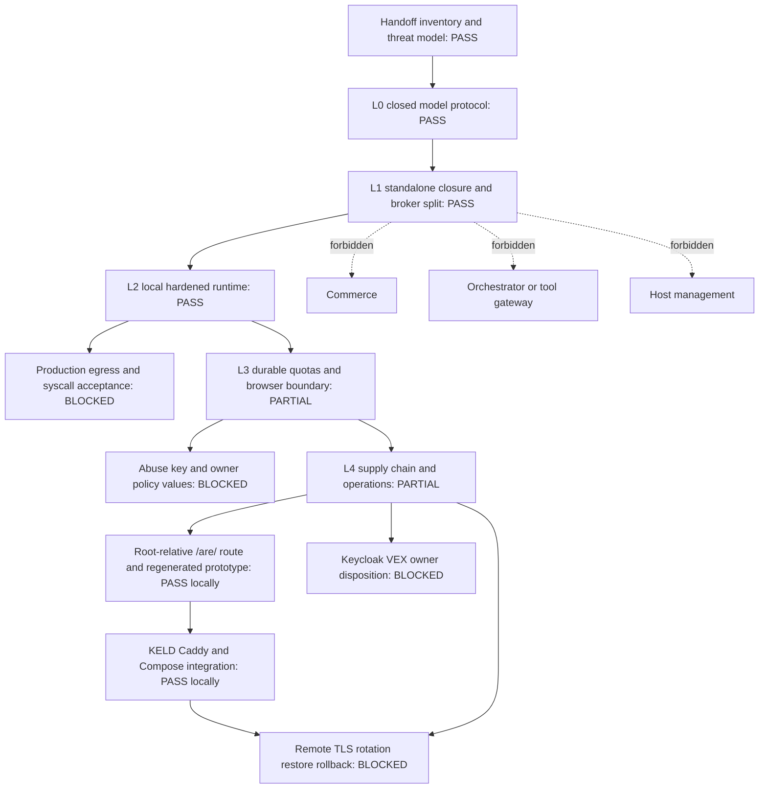

# Public chat security implementation layering and DAG

Date: 2026-09-18. Status: locally executed candidate; operational and owner
gates remain. This is construction and validation evidence, not security
certification, governance admission, deployment approval, or release approval.

## Outcome

The visitor-chat input-to-execution path is closed in the reviewed source and
local container candidate. The deployable chat closure contains no subprocess,
executor, secret-provider, coding-agent, verifier, sandbox, or tool runtime. The
chat has no secret mount or external network; the broker has neither and can
reach only a fixed provider gateway. That gateway alone holds the credential and
can connect only to the approved HTTPS provider destination. Unsupported request
and response variants fail closed. Browser-hostile user and model text remained
inert in the final Firefox proof.

The overall handoff is **BLOCKED for public release**, not failed locally. The
local destination-pinned egress and custom seccomp implementations now pass.
Remaining causal blockers are production-host acceptance of those controls;
product decisions for abuse identity, the idle-retention value, monetary ceiling/rate values, and review trigger; security-owner acceptance or
replacement of the exact Keycloak 26.7.4 VEX disposition; and remote TLS,
deployment of the integrated `/are/` ingress candidate, rotation, restore,
rollback, and real-service acceptance evidence.

## Dependency DAG

The dotted edges remain absent. Passing source and local-container evidence does
not convert any blocked operational node into a pass.

## Layer state

| Layer | State | Evidence ceiling |
| --- | --- | --- |
| L0 — closed provider protocol | PASS | `server/model-protocol.mjs` admits one assistant text choice with bounded accounting; executable and unknown variants fail closed; 48/48 ARE server tests pass. |
| L1 — standalone packages | PASS | Relocated final chat: 93 files, aggregate `87124b5808d2a1d0407f94603389e9dff496afc70a60a15e6877f86cebb977ab`; broker: 7 files, `3a17adb4e64bed1b6c06b60e1d75fd765011e21d2e2f29eae67739f91e32b2e6`; gateway: 5 files, `4b702a4a478e0131ccc94d3ea49e14b28fe1cf3d1eb2df3a5ac1710ce5c914fc`. All manifests bind `keld-project/are-documentation`, and all verifiers report no live model call. |
| L2 — local containment | PASS locally; BLOCKED operationally | Edge, chat, broker, and provider-gateway containers are non-root, read-only, capability-dropped, resource-bounded, custom-seccomp constrained, and High/Critical-clean. Chat and broker have no external network or secret. The gateway pins HTTPS host/port/path, DNS answers, and the actual connection while rejecting private/metadata/reserved ranges and redirects. Runtime probes verify the effective controls; target-host acceptance remains. |
| L3 — abuse/browser | PARTIAL | The owner selected temporary `anonymous-public` access, encoded fail-closed at the edge. Broker call/token and hourly/monthly micro-USD reservations are durable across restart and shared across chat workers; abandoned reservations are charged at worst case, v1 state migrates conservatively, and absent monetary configuration prevents startup. Chat sessions expire from process memory at the configured idle boundary; the production entry point and Compose refuse an absent or invalid retention value. The deployment preflight also rejects non-canonical or out-of-range values without printing them. KELD webhook admission is atomic and durable at 120/provider/minute. Firefox DOM/network proof passes. Numeric ceilings/provider rates, source-address/abuse key, the idle-retention value, provider handling, and review trigger remain owner decisions. |
| L4 — reproducibility/operations | PARTIAL | Source manifests, lockfiles, exact local image IDs, SBOMs, image/config/secret scans, and an integrated synthetic KELD+ARE stack smoke exist. A 7-test preflight suite enforces digest-pinned, content-distinct role images and bounded numeric syntax. Every ARE service directly depends on its hardened, networkless one-shot Compose service. Exact `/are/` routing, legacy/sibling separation, public-readiness denial, private ARE networks, hardened container metadata and absence of backend host ports pass locally. Keycloak's raw scan is 1 Critical/1 High and its exact-topology VEX-adjusted scan is zero; owner acceptance and remote operational gates remain blocked. |

## Execution ledger

| Work item | Result | Evidence |
| --- | --- | --- |
| Strict response parser and adversarial variants | PASS | `server/model-protocol.mjs`, `server/model-protocol.test.mjs` |
| Remove executor/secret bridge from chat closure | PASS | `server/closure-policy.test.mjs`; packaged chat verifier |
| Narrow broker protocol and credential boundary | PASS | `server/broker-client.mjs`, `server/broker-server.mjs`, broker tests |
| Fixed provider gateway and destination policy | PASS locally | Closed `/v1/provider` protocol; fixed `api.z.ai:443` HTTPS transport; DNS-to-connection pin; private/metadata/range and redirect rejection |
| Standalone locked chat, broker, and gateway packages | PASS | Package aggregates above; npm audit reports zero |
| Non-root read-only containers and edge | PASS locally | `deploy/compose.security.yaml`; final runtime probes; Trivy config zero High/Critical |
| Dedicated gateway-secret permission contract | PASS locally | `deploy/install-model-secret.sh`; gateway-only UID 65532/mode 0400 metadata probe; broker read denial |
| Custom syscall policy | PASS locally | Pinned-profile verifier and exact-container probes; `ptrace` and `process_vm_readv` denied with `EPERM` |
| Durable broker quota | PASS locally | Restart persistence, concurrency, token and hourly/monthly micro-USD reservations, conservative v1 migration, window rollover, missing-config startup denial, and failure-closed tests |
| Explicit local retention enforcement | PASS locally / BLOCKED owner value | Idle process-memory sessions expire at the configured boundary; production and Compose fail closed without a positive integer duration; active turns are not discarded; provider retention remains separate |
| Retention disclosure consistency | PASS locally / BLOCKED owner value | The browser validates `idle_retention_seconds` from status and displays the exact duration; invalid/absent status uses a non-numeric server-configured fallback instead of inventing a policy value. Firefox proved 5,400 seconds renders as 90 minutes; the full runtime independently proved its synthetic 1,800-second value. |
| Public access mode | PASS candidate | Owner selected temporary anonymous public access; `ARE_CHAT_ACCESS_MODE=anonymous-public`; unimplemented invited/authenticated modes fail closed; no commerce privileges |
| Browser text/CSP boundary | PASS locally | Firefox: zero script/image/link nodes, zero execution globals, zero external requests, zero console warnings/errors |
| KELD webhook admission | PASS locally | Atomic SQLite minute bucket before verification; 429 before verifier; 91/91 integrations tests |
| KELD application/Caddy/Postgres image remediation | PASS locally | Exact images scan zero fixable High/Critical; full synthetic stack smoke passes |
| Production deployment-input preflight | PASS locally / BLOCKED owner values | 7/7 tests plus real one-shot valid/invalid probes and integrated smoke; four ARE role references require lowercase SHA-256 digests with no digest reuse; retention, ceiling, and rate inputs require canonical positive integers within runtime bounds; every ARE service directly requires successful hardened/networkless preflight completion; output contains no supplied values |
| Public ARE route | PASS staging / BLOCKED production authorization | The canonical public URL is `https://are.keld.studio/`; `/are/` redirects to `/` on that host. Vite assets and API calls retain the internal `/are/*` prefix, while the KELD storefront does not route ARE. The reusable Compose candidate requires a distinct `ARE_DOMAIN`, adds no ARE host ports, preserves network segmentation, requires explicit image/policy inputs, and prevents ordinary ARE startup until the production-input service succeeds. Focused topology tests and Caddy parsing pass; production deployment is not authorized. |
| Independent source analysis | PASS locally | Semgrep CE 1.177.0 `p/default`: 193 ARE, 466 authored-source, and 469 unfiltered targets, approximately 100% parsed, zero findings and zero parse errors. The prior six `http://localhost:4193/` findings are absent after regeneration with `/are/`. A focused rerun over seven deploy targets, including the production-input preflight and tests, also reports zero findings, zero errors, and approximately 100% parsed. |
| Keycloak dependency scan | PASS candidate / BLOCKED owner | Exact 26.7.4 raw scan reports one Critical and one High; topology verifier and OpenVEX adjust both to `not_affected`; no unsafe JAR replacement; security-owner acceptance or replacement remains |
| Production egress/syscall policy | PASS locally / BLOCKED operator | Candidate controls and effective local runtime probes pass; exact target host/runtime/firewall enforcement still needs operator acceptance |
| Remote operational acceptance | BLOCKED | No public TLS, real rotation, restore, rollback, incident drill, or existing-orchestrator coexistence run was authorized |

## Boundary rule

Candidate evidence may support an owner decision, but validation is not
admission, publication, deployment, or release. No prompt, route receipt, model
reply, test result, or scanner result grants those effects.

## Open Questions

- Anonymous public access is selected for now. What address or abuse identity
  key will deployment-wide controls use, and when should the temporary decision
  be reviewed?
- What exact hourly/monthly monetary ceiling and verified provider rates, idle-retention value, provider-side handling,
  and user-visible failure policy does the product owner approve?
- Will the operator accept and independently enforce the candidate gateway's
  DNS/IP/TLS/redirect/range policy on the target host?
- Will the operator accept, maintain, and regression-test the pinned custom
  seccomp profile on the target runtime and architecture?
- Will the security owner accept the exact-digest Keycloak OpenVEX assessment,
  wait for a clean release, or use a supported vendor rebuild?
- Will the operator accept and deploy the tested KELD Caddy/Compose candidate
  for `/are/` and `/are/api/are/*` on the target host without widening the edge
  allowlist or replacing immutable image references with mutable tags?
- Who owns security triage, dependency refresh, secret rotation, backup/restore,
  rollback, incident response, and final release disposition?
