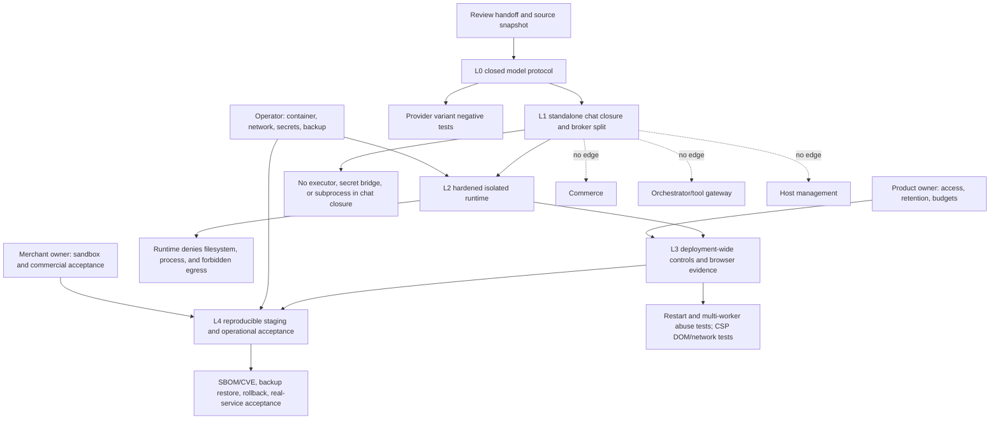

# Public chat security implementation layering and DAG

Status: active candidate implementation plan, last updated 2026-09-18. This
artifact sequences the findings in [SECURITY-REVIEW-HANDOFF.md](SECURITY-REVIEW-HANDOFF.md).
It is not release approval, governance admission, or evidence that an unrun
operational control works.

## Target and boundary

The target is a public documentation chat whose visitor-controlled data can
reach only bounded conversation logic and a fixed inference broker. The chat
must have no path to commerce, the orchestrator, tool gateways, host management,
operator secrets, arbitrary filesystem access, arbitrary network destinations,
or process creation. KELD commerce remains a separate trust domain.

The current product frontier is local source remediation and reproducible
negative tests. Remote deployment, provider calls, live payments, destructive
tests, publication, governance promotion, and release decisions are outside the
authorization for this run.

## Decision questions

| Question | Current decision or owner |
| --- | --- |
| What is the smallest proof that removes a demonstrated input-to-execution ambiguity? | A closed provider response parser that rejects every unsupported message variant before conversation handling. |
| What is the smallest deployable public-chat unit? | A standalone, locked package containing only the reviewed chat closure and a broker client. |
| Where do credentials and secret resolution live? | In a separate fixed inference broker, never in the conversation process. |
| What must survive process restart and worker scaling? | Rate, concurrency, token, and spend accounting at the deployment boundary. |
| Which decisions require owners rather than source changes? | Access mode, retention, hosting topology, budget, incident response, real-service acceptance, and release disposition. |

## Dependency DAG

The dotted edges are forbidden and must remain absent. Product work can advance
through L1 locally. L2 can be constructed locally, but its production-equivalent
network enforcement needs an operator-owned environment. L3 and L4 combine
source work with explicit product/operator decisions.

## Layer 0 — Closed model-output protocol

**Status:** implemented; local validation pending at the time of this update.

- Included: one plain assistant-text response, one choice, `stop` completion,
  bounded token accounting, fail-closed handling of unknown message/choice
  fields, and distinct truncation handling.
- Included evidence: fixtures for `tool_calls` (empty, malformed, and populated),
  legacy `function_call`, alternate roles, audio/refusal/unknown fields,
  multiplicity, malformed text, and invalid accounting.
- Also included: the chat imports hashing from a pure protocol module rather
  than importing the credential-bearing model module.
- Deferred: process separation, dependency packaging, container enforcement.
- Promotion criterion: protocol tests, existing chat tests, frontend build, and
  a static import-closure check all pass without live provider access.

After this layer, we know whether unsupported provider response types are
rejected before any response reaches the conversation runtime.

## Layer 1 — Standalone closure and inference-broker split

**Status:** next product layer.

- Included: replace package barrels with reviewed leaf imports; package only the
  required immutable profiles/modules; create a narrow broker protocol; keep
  credential files, SOPS/age, Python, and provider transport in the broker;
  create and commit an exact dependency lockfile for the standalone chat.
- Required negative proof: static closure from the conversation entry point has
  no `child_process`, coding-agent CLI, tool runtime, verifier, sandbox,
  mutation, commerce, orchestrator, or secret-provider import.
- Deferred: kernel/container and network enforcement.
- Promotion criterion: clean locked install, complete manifest, closure policy
  test, broker schema tests, chat regression suite, and build all pass offline.

After this layer, we know whether the deployable chat source and dependency
closure excludes every known executor and secret-resolution implementation.

## Layer 2 — Hardened runtime containment

**Status:** blocked on L1 artifact; locally constructible, operational proof
requires an operator-owned equivalent environment.

- Included: separate unprivileged chat and broker containers; read-only roots;
  bounded tmpfs; no host mounts, Docker socket, SSH, age identity, merchant
  secret, commerce database, or artifact directory; dropped capabilities;
  `no-new-privileges`; resource limits; reviewed syscall policy.
- Network: chat can reach only the broker; broker can reach only the pinned
  provider destination through an enforcement point that denies loopback,
  host gateway, private ranges, metadata, redirects, and unintended IPv6 paths.
- Required negative proof: disposable equivalent-privilege probes cannot write
  forbidden paths, create processes, or connect to forbidden destinations;
  broker cannot reach commerce/operator services and chat cannot read canary
  secrets.
- Promotion criterion: image/config digest plus repeatable denial receipts for
  every runtime-containment and secret-isolation probe.

After this layer, we know whether OS and network controls enforce the boundary
even when prompts, route labels, or model text are hostile.

## Layer 3 — Durable abuse controls and browser boundary

**Status:** owner decisions and L2 required.

- Included: deployment-wide rate, concurrency, turn, token, and spend budgets;
  conservative reservation for failed calls; durable state shared by workers;
  webhook edge rate limiting; explicit CSP, framing, content-type and cache
  policy; strict text or sanitized-Markdown rendering.
- Required negative proof: limits survive restart and two-worker concurrency;
  slow/oversized/stalled traffic remains bounded; reset cannot evade budget;
  script/HTML/Markdown/link payloads cause no DOM execution or unexpected
  external request; capabilities never enter logs or browser bundles.
- Product decisions: anonymous, invited, or authenticated access; retention and
  provider-side handling; budget values and user-visible failure behavior.
- Promotion criterion: repeatable gateway and browser receipts against the
  exact deployable configuration.

After this layer, we know whether public traffic remains bounded across process
failure/scaling and whether untrusted content is inert in the real browser path.

## Layer 4 — Reproducible staging and operational acceptance

**Status:** operational lane; not authorized for remote execution in this run.

- Included: sanitized source manifest, lockfiles, immutable image digests, SBOM,
  dependency and image vulnerability scans, intended-port inventory, secret
  rotation through real services, backup/restore into separate state, rollback,
  incident ownership, and proof the existing orchestrator remains unaffected.
- Commerce acceptance remains separate: real identity/browser login and genuine
  sandbox checkout/webhook evidence require merchant/operator authorization and
  must not share chat privileges.
- Promotion criterion: the boundary matrix is PASS for exact source and image
  digests, with every residual risk and owner disposition recorded.

After this layer, we know whether the locally proven design remains enforced in
the exact staging artifact and whether operators can recover it safely.

## Cross-layer non-regression constraints

- No chat-to-commerce, chat-to-orchestrator, chat-to-tool-gateway, or
  chat-to-host-management capability may be introduced.
- Route decisions, prompts, remembered preferences, model output, receipts, and
  telemetry never become execution authority.
- Secret values must not be printed, copied into images, returned to browsers,
  or included in evidence. Enumerate names, references, permissions, and canary
  outcomes only.
- Every layer retains the prior layer's tests. A later operational pass cannot
  waive a failed source boundary, and a local source pass cannot stand in for an
  operational denial test.
- KELD authentication, commerce, webhook, and download checks remain separate
  regression suites and cannot be bypassed by the chat deployment.
- Evidence must bind to exact source, lockfile, configuration, and image digests.
  D65 construction evidence remains candidate evidence until separately
  admitted; validation does not authorize publication or release.

## Execution ledger

| Work item | Depends on | Affected stages | Evidence | State |
| --- | --- | --- | --- | --- |
| Strict provider response parser and adversarial fixtures | Handoff | L0 | `server/model-protocol*.mjs` and local tests | Implemented, validation pending |
| Remove pure chat hashing dependency on credential-bearing model module | Strict parser | L0/L1 | static import closure | Implemented, validation pending |
| Leaf-import closure and closure policy test | L0 | L1 | enumerated module graph | Planned |
| Narrow broker protocol and separate entry point | L0 | L1/L2 | schema and integration tests | Planned |
| Standalone package and lockfile | Leaf closure | L1 | clean offline install and manifest | Planned |
| Hardened containers and network policy | Broker split | L2 | disposable denial tests | Planned |
| Durable quotas and webhook edge limit | Runtime topology | L3 | restart/multi-worker tests | Planned |
| CSP and browser network/DOM suite | Deployable gateway | L3 | browser trace and headers | Planned |
| Snapshot, SBOM/CVE, restore and rollback | Immutable artifacts | L4 | operator-owned receipts | Planned |

## Deferred residue and causal blockers

- The present HTTP entry point still imports the credential-bearing GLM module;
  therefore the conversation process still reaches the SOPS subprocess bridge.
  This causally blocks L1 and every isolation claim.
- Process-memory quota state can be bypassed by restart or additional workers;
  this blocks the abuse-control boundary until L3.
- The frontend currently has no project lockfile and reuses a sibling
  `node_modules`; this blocks reproducible standalone packaging.
- A mutable `keld-sandbox:candidate` image reference and absence of an image CVE
  scanner block exact supply-chain evidence.
- Public TLS, production-equivalent egress/syscall enforcement, backup/restore,
  real provider/browser paths, and merchant acceptance need explicit operator or
  merchant execution and are not inferred from local tests.

## Open Questions

- Will the public chat be anonymous, invited, or authenticated, and what durable
  limits apply per identity, address, and deployment?
- Is the inference broker local to the host, on a separate VM, or a managed
  gateway, and which component enforces destination pinning and redirect denial?
- What exact retention and provider-side data policy is approved?
- Which container/runtime policy is the operator prepared to maintain and test?
- Who owns security triage, dependency refresh, incident response, secret
  rotation, backup acceptance, and final release disposition?
