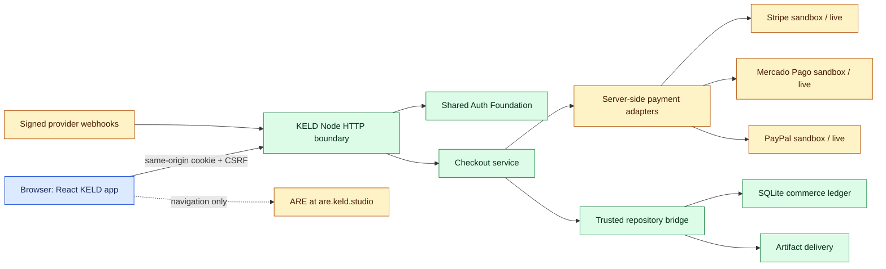
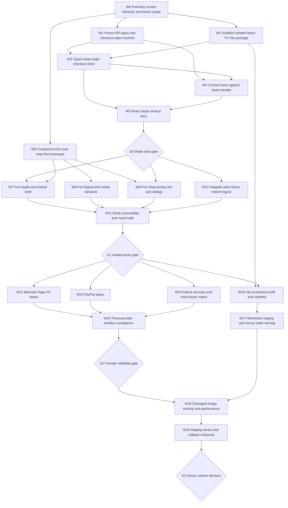

# KELD React and Checkout Integration — Candidate Migration DAG

- **Status:** candidate implementation plan only
- **Date:** 2026-09-18
- **Route:** `CA2-ROUTE-PLAN`
- **Authority effect:** none
**Implementation authority:** not granted by this artifact

## Outcome

Replace the current generated/imperative KELD website with a React and
TypeScript application while preserving the working same-origin authentication,
checkout, payment verification, ledger, entitlement, and artifact-delivery
boundaries. The first useful slice must prove the existing authenticated Stripe
sandbox journey from the React UI. Later layers add full KELD visual parity,
Mercado Pago and PayPal behavior, production packaging, and a reversible cutover.

This is a migration, not a payment-system rewrite.

## Review basis

The review covered these current implementation surfaces:

- `keld-project/prototype/`: Python-generated studio, shop, illustrated legend,
  three hosted HTML pages, three offline standalone editions, CSS, assets, and
  imperative browser scripts.
- `keld-project/integrations/public/`: the minimal buyer UI and the reusable
  browser-side checkout client behavior.
- `keld-project/integrations/src/`: authentication, same-origin HTTP API,
  payment adapters, webhook intake, repository bridge, and delivery.
- `keld-project/integrations/scripts/stage_runtime.py` and
  `keld-project/deploy/`: allowlisted runtime staging and the production image.
- `keld-project/are-documentation/`: an existing repository-local React,
  TypeScript, and Vite precedent. It is a version/tooling reference, not source
  to merge into the KELD storefront.

Current measured shape:

- The prototype has about 103 KB of generated HTML per hosted entry point,
  about 146 KB of authored CSS, about 59 KB of authored JavaScript, and 2.2 MB
  of hosted assets.
- Each standalone offline edition is about 4.6 MB because it embeds the media.
- The integration test tree currently contains 95 Node test declarations across
  11 files.
- A real Stripe sandbox acceptance completed on 2026-09-18: authenticated
  checkout creation, provider completion, server verification, and a 208-byte
  artifact download all succeeded. This proves the existing backend boundary,
  not the React migration.

## Implementation review findings

### F1 — Critical: the prototype checkout contract does not match the working API

The prototype's optional live mode posts:

```json
{
  "productId": "agent-reasoning-engine",
  "offerId": "release",
  "amountCents": 20000,
  "currency": "USD",
  "quantity": 1
}
```

The implemented backend requires an authenticated session, a fresh CSRF token,
a provider, an integer amount, and a stable request key. Mercado Pago also needs
the payer email. The implemented response is a provider-specific frozen order,
not merely `{ "checkoutUrl": "..." }`.

**Decision:** do not enable `prototype/assets/shop.js` live mode. The React UI
must call a typed adapter that preserves `buyer-client.mjs` behavior and the
implemented API contract.

### F2 — High: the current HTTP server cannot serve a React production build

`integrations/src/index.mjs` serves a fixed map containing only three static
files plus `buyer.html` on four page routes. A Vite build creates hashed chunks,
styles, images, and a manifest that this map cannot address.

**Decision:** add an allowlisted static manifest and explicit page routes. Never
use a catch-all fallback for `/api/`, `/auth/`, `/events/`, or `/readyz`. Unknown
asset paths remain 404.

### F3 — High: the runtime packager has no frontend build boundary

`stage_runtime.py` copies only selected `.mjs`, `.html`, and `.css` files from
the current public folder. The production Dockerfile installs runtime
dependencies only; it does not contain a frontend compiler.

**Decision:** build the React application before runtime staging, then copy only
the reviewed `dist` manifest and its referenced files. Alternatively use a
pinned multi-stage image, but the final runtime image must contain no Vite,
TypeScript, source tree, or unreviewed source maps.

### F4 — High: payment and entitlement trust boundaries are already correct

The server owns buyer identity, amount validation, request idempotency, provider
verification, quote/order freezing, webhook verification, reconciliation,
ledger mutation, and download authorization. The browser owns only proposal,
presentation, retry continuity, and navigation.

**Decision:** keep provider SDKs and credentials server-side. React must never
infer payment success from a return URL, provider redirect, Pix display, local
storage, or a browser callback.

### F5 — Medium: two browser state models would drift if copied

The prototype owns cart, pricing, dialog, and preview state. The buyer client
owns checkout request keys, session restoration, provider URL validation,
confirmation, history, download, and logout. Copying both into React components
would produce a third contract.

**Decision:** establish one framework-neutral, typed checkout client and one
explicit checkout state machine. React components consume it; they do not
reimplement transport or payment rules.

### F6 — Medium: the static generator and offline editions need an explicit fate

The Python build produces three nearly identical hosted pages and three embedded
offline editions. React routing can replace the hosted duplication, but an SPA
does not automatically preserve a `file://`-readable 4.6 MB standalone edition.

**Decision:** hosted parity is in scope. Offline standalone export is deferred
unless the owner confirms it remains a product requirement. Keep the legacy
export available until that decision is made.

### F7 — Medium: current documentation describes superseded state

The prototype README and checkout contract still say no server or provider
integration exists, while the authenticated backend and staging sandbox do
exist. Some execution documents also predate merchant configuration and staging.

**Decision:** update the public integration contract and runbooks in the same
layer that establishes the React client contract. Historical evidence remains
historical; it must not be silently rewritten as current status.

### F8 — Medium: visual and accessibility behavior is migration scope

The current site has substantial verified behavior: keyboard navigation,
dialog focus, responsive compositions, reduced-motion behavior, the illustrated
legend, hidden-price discovery, and an alpha/early-supporter offer. A JSX render
that merely resembles the pages is not parity.

**Decision:** use the existing checks and screenshots as migration fixtures,
then add React-focused semantic, browser, and visual checks. Avoid a simultaneous
redesign during the framework migration.

### F9 — Low: the ARE link is now an external product boundary

The prototype defaults to `/are/`, but the selected canonical ARE location is
`https://are.keld.studio/`.

**Decision:** configure an absolute ARE URL in the React application. Do not add
a KELD `/are/` route or embed the ARE application in this migration.

## Target boundary



The React app may display payment state, but only the server can change payment,
order, entitlement, or delivery state.

## Implementation layering

| Layer | Coherent capability | Included | Explicitly deferred | Exit evidence | After this layer we can decide… |
| --- | --- | --- | --- | --- | --- |
| L0 | React Stripe vertical slice | Contract freeze, React/TS/Vite package, typed checkout client, authenticated session, price proposal, Stripe redirect, return/cancel, confirm, download | Full studio/legend port, Mercado Pago, PayPal, production cutover, redesign | Contract tests plus one React-driven Stripe sandbox acceptance | Whether React can replace the buyer shell without weakening idempotency, auth, or verified delivery |
| L1 | Complete hosted KELD experience | Studio, shop, legend, assets, pricing discovery, dialogs, history/restore/logout, canonical ARE link, responsive and accessibility parity | Offline standalone export, provider expansion, production cutover | Existing behavior fixtures ported; browser and visual parity gates pass | Whether the current KELD experience can run entirely on the React shell with a real checkout |
| L2 | Three-provider and failure-state hardening | Mercado Pago Pix, PayPal, pending/expired/review states, retries, recovery, pagination, session loss, cross-buyer denial, webhook/reconciliation visibility | Production traffic switch | Provider matrices and negative-path evidence pass in sandbox | Whether all supported provider and recovery states are understandable and safe for testers |
| L3 | Production packaging and reversible cutover | Hashed build, static manifest, CSP/cache rules, runtime allowlist, image build, security/performance tests, staged canary, rollback | New commerce features or visual redesign | Reproducible bundle, staging acceptance, rollback rehearsal, owner cutover approval | Whether the React build is ready to replace the existing public entry point |

### Layer 0 — React Stripe vertical slice

**Minimum coherent unit**

An authenticated buyer can enter a permitted amount, create or resume one
Stripe checkout, leave for Stripe, return, ask KELD to verify the payment, and
download the already-authorized artifact. Reloading or retrying must preserve
the request key and must not create a second uncertain payment.

**Include**

- Create `keld-project/web/` as a separate React + TypeScript + Vite package.
- Pin repository-reviewed versions; the ARE package can inform the version
  family, but KELD gets its own lockfile and build.
- Define TypeScript request/response types from the implemented endpoint
  behavior, not the stale prototype contract.
- Extract or supersede `buyer-client.mjs` with framework-neutral typed modules:
  session/CSRF, checkout creation, result validation, persistence, confirmation,
  history, download, logout, and normalized error codes.
- Model checkout states explicitly: idle, creating, awaiting-provider,
  verifying, paid, paid-review, expired, failed, and uncertain.
- Keep same-origin credentials, fresh CSRF on every mutation, the persisted
  request key before dispatch, and the exact Stripe checkout host allowlist.
- Serve the slice on an isolated preview route or local server until the gate.

**Defer**

- KELD narrative and shop parity.
- Mercado Pago and PayPal UI.
- Offline export and production routing changes.

**Promotion evidence**

- Unit tests for amount parsing, URL validation, response validation, storage
  corruption, and every state transition.
- Contract tests against the actual Node handler for session, CSRF, checkout,
  confirm, download, cancel, and 401/403 responses.
- A browser test showing reload-safe retry with the same request key.
- A real Stripe sandbox run through the React UI with KELD-side verification
  and digest-checked download.

**After this layer we can decide** whether the typed client and React lifecycle
preserve the proven security and idempotency boundary.

### Layer 1 — Complete hosted KELD experience

**Include**

- Decompose the existing hosted pages into semantic components and routes for
  home/studio, shop, legend, purchase return, purchase cancel, and signed out.
- Preserve the current copy, six illustrated scenes, film behavior, alpha offer,
  price bounds, hidden-shelf discovery, cart/review flow, license disclosure,
  focus restoration, keyboard navigation, responsive behavior, and reduced
  motion before changing their design.
- Replace the preview-only finish with the L0 checkout state machine.
- Add account checkout history, restore, safe logout, and authenticated download
  to the real shop experience.
- Configure the ARE navigation target as `https://are.keld.studio/`.
- Update checkout and deployment documentation to the implemented contract.

**Defer**

- Offline standalone React packaging unless separately confirmed.
- New pricing, offer, entitlement, support, refund, or release-policy decisions.
- Any broad visual redesign.

**Promotion evidence**

- Port the 29 alpha, 51 pricing/discovery, and 58 legend assertions that remain
  valid as semantic React/browser checks.
- Visual comparisons at the existing desktop, laptop, tablet, phone, and zoom
  fixtures, allowing only reviewed intentional differences.
- Keyboard-only and reduced-motion passes; dialog focus and escape behavior;
  useful no-JavaScript failure copy rather than a misleading checkout.
- Asset budget, console-error, broken-link, and external-request reports.

**After this layer we can decide** whether the React application is a complete
replacement for the hosted prototype while retaining the original product
experience.

### Layer 2 — Three-provider and failure-state hardening

**Include**

- Mercado Pago Pix: email input, preparing, verification-required, Pix display,
  expiration, retry/resume, and paid-review states.
- PayPal: exact sandbox/live host validation, approval navigation, server-side
  capture only through the authenticated confirm boundary, cancellation, and
  restoration.
- Shared: provider-unavailable, network timeout, session expiry, lost browser
  state, persisted server history, unknown outcome, delayed webhook,
  reconciliation, pagination, duplicate submission, and cross-buyer denial.
- Present frozen quote/currency clearly. BRL is a server quote result, not a
  browser calculation.
- Preserve a usable order reference and request ID in support/error surfaces
  without exposing credentials, raw provider data, or customer identifiers.

**Promotion evidence**

- Per-provider happy path, cancel path, delayed confirmation, expiration, and
  restore path in sandbox.
- Negative tests for tampered amount, currency, provider URL, order ID, CSRF,
  origin, and buyer identity.
- Event and reconciliation tests showing that browser return is never treated as
  proof of payment.
- Accessibility review of polling/status updates and Pix copy controls.

**After this layer we can decide** whether the unified experience is safe and
clear enough for broader staging testers across all three providers.

### Layer 3 — Production packaging and reversible cutover

**Include**

- Produce a deterministic Vite build with content-hashed assets and a manifest.
- Extend runtime staging to copy only manifest-referenced regular files with
  hashes. Exclude secrets, configuration, databases, tests, caches, source maps,
  and source directories unless separately reviewed.
- Serve exact page routes and manifest assets with correct MIME types. Use
  immutable caching for hashed assets and `no-store` for buyer/session pages.
- Keep CSP self-only unless a measured frontend requirement proves otherwise.
  Keep `frame-ancestors 'none'`, `base-uri 'none'`, `object-src 'none'`, and
  same-origin connect/form boundaries.
- Ensure static routing is evaluated only after reserved API/auth/event/health
  namespaces and cannot shadow them.
- Build before the runtime-only image stage, then run the image as the existing
  non-root user.
- Deploy to staging with a recorded previous image digest and a tested rollback.
- Switch public traffic only after product, security, sandbox-provider, and
  operational gates approve the exact build digest.

**Promotion evidence**

- Clean-checkout build reproducibility and manifest verification.
- Full unit, API contract, integration, browser, accessibility, security, and
  performance suites against the packaged image.
- Staging acceptance for Stripe, Mercado Pago, PayPal, auth renewal/logout,
  webhooks, reconciliation, history, and download.
- Static-handler traversal, MIME confusion, unknown-route, API-shadowing, CSP,
  cache, and source-map tests.
- Canary health and rollback rehearsal restoring the prior image without ledger
  loss or schema reversal.

**After this layer we can decide** whether the reviewed React build digest may
replace the current public KELD entry point.

## Dependency DAG



## Work-unit contract

| ID | Work unit | Depends on | Completion evidence |
| --- | --- | --- | --- |
| W0 | Record authoritative hosted behavior, routes, assets, performance baseline, and accepted intentional changes | — | Reviewed inventory with source paths and hashes |
| W1 | Define typed API schemas, error vocabulary, checkout state machine, and reserved route namespaces | W0 | Schema fixtures and transition table accepted |
| W2 | Create isolated React/TS/Vite package with reproducible scripts and lockfile | W0 | Clean install, typecheck, unit test, and development build pass |
| W3 | Implement framework-neutral session/checkout client | W1, W2 | Unit tests cover request keys, CSRF, validation, storage, and errors |
| W4 | Exercise the client against the actual Node handler | W1, W3 | API contract suite passes without mocked response-shape drift |
| W5 | Build the minimal authenticated Stripe UI flow | W3, W4 | Real React-driven sandbox checkout, verification, and download proof |
| W6 | Map generated DOM, copy, CSS, assets, interactions, and current checks to components | W0 | Every hosted feature has a target owner or explicit deferral |
| W7 | Port shared shell and studio content | W6, G0 | Semantic, responsive, navigation, and motion checks pass |
| W8 | Port legend and film/media behavior | W6 | Chapter, modal, keyboard, touch, and image checks pass |
| W9 | Port product, pricing discovery, bag, review, and checkout presentation | W6, G0 | Pricing and dialog tests pass against the typed client |
| W10 | Add history, restore, logout, return/cancel, and download surfaces | G0 | Session-loss, reload, recovery, and ownership tests pass |
| W11 | Establish hosted visual, accessibility, and interaction parity | W7–W10 | Reviewed parity report with bounded differences |
| W12 | Add Mercado Pago Pix presentation and state transitions | G1 | Pix sandbox happy/expired/delayed paths pass |
| W13 | Add PayPal presentation and state transitions | G1 | PayPal sandbox happy/cancel/delayed paths pass |
| W14 | Complete failure, retry, reconciliation, history, and cross-buyer behavior | G1 | Negative-path matrix passes |
| W15 | Run exact-build three-provider staging acceptance | W12–W14 | Sanitized receipts bind results to build/config digests |
| W16 | Create deterministic production build and asset manifest | W2, G1 | Repeated clean builds match or have explained nondeterminism |
| W17 | Stage and serve only reviewed manifest assets without namespace shadowing | W16 | Portable runtime and static-handler security tests pass |
| W18 | Test the packaged image across functional, security, accessibility, and performance surfaces | G2, W17 | Exact image digest has a complete evidence bundle |
| W19 | Deploy staging canary and rehearse rollback | W18 | Canary acceptance and rollback receipts are complete |

## Gates

### G0 — Stripe slice gate

Pass only when the React UI uses the actual auth/CSRF/idempotency contract and a
server-verified Stripe payment unlocks the expected artifact. A provider return
page alone is a failure.

### G1 — Hosted parity gate

Pass only when the hosted studio, shop, and legend are present, accessible, and
functionally equivalent within reviewed differences. This gate does not require
the standalone offline editions.

### G2 — Provider reliability gate

Pass only when all three providers and the shared failure/recovery matrix are
validated in sandbox. A provider that is not configured must be visibly absent
or unavailable; it must not silently fail after checkout starts.

### G3 — Owner cutover decision

This is an operational authorization boundary, not an automatic consequence of
passing tests. The decision must name the exact image/build digest, environment,
rollback target, monitoring owner, and acceptance evidence.

## Non-regression guardrails

- Never expose Stripe, Mercado Pago, PayPal, OIDC, database, webhook, or artifact
  credentials to the browser bundle or source maps.
- Never accept browser claims about paid status, entitlement, price conversion,
  early-supporter eligibility, download authorization, or provider identity.
- Preserve server-side integer amount bounds of 5,000–100,000 cents.
- Persist the checkout request key before network dispatch; retries reuse it.
- Require authenticated same-origin requests and CSRF on every mutation.
- Validate provider checkout destinations against exact approved HTTPS hosts.
- Keep provider return and cancel paths informational until server verification.
- Keep APIs, auth, events, and health routes outside any SPA fallback.
- Keep webhook verification over original bytes and existing duplicate/conflict
  handling; frontend migration does not alter webhook semantics.
- Preserve cross-buyer isolation in history, restore, confirm, and download.
- Do not migrate or reset the commerce ledger as part of a frontend cutover.
- Do not delete the static prototype or offline editions until hosted parity,
  rollback, and offline-product decisions are complete.

## Cost and risk profile

| Layer | Relative effort | Primary risk | Risk containment |
| --- | --- | --- | --- |
| L0 | Medium | React lifecycle accidentally duplicates checkout or loses retry state | Typed state machine, actual-handler tests, one-provider vertical slice |
| L1 | High | Visual/interaction regressions hidden by a framework rewrite | Freeze copy and behavior; port existing assertions and screenshots |
| L2 | Medium–high | Provider-specific states collapse into misleading generic UX | Explicit state matrix and separate sandbox acceptance per provider |
| L3 | Medium | Asset routing/CSP/packaging breaks the app or shadows protected routes | Manifest allowlist, reserved namespaces, exact image tests, rollback |

The most expensive wrong move is a full visual rewrite plus three-provider
integration plus deployment in one branch. The layers keep each promotion
decision answerable and reversible.

## Recommended first implementation slice

Start with **L0 only**:

1. Freeze the implemented request/response fixtures and state transitions.
2. Scaffold `keld-project/web/` without changing the current served root.
3. Build the typed buyer client and actual-handler contract tests.
4. Implement the smallest Stripe UI.
5. Run one real sandbox acceptance and review G0.

Do not begin the visual port until G0 proves that React can carry the checkout
contract safely. Do not begin production packaging or deployment until a later
implementation request authorizes it.

## Open Questions

1. Must the three offline standalone HTML editions remain supported products, or
   may the legacy generator remain solely as an archived/export path?
2. Should anonymous visitors browse the full site while authentication begins
   only at checkout, or should the current root remain an authenticated buyer
   surface? The recommendation is browse anonymously, authenticate at checkout.
3. Is the first-100 early-supporter allocation fully implemented in the current
   commerce ledger, or must launch copy remain non-authoritative until a separate
   entitlement proof exists?
4. Which terms, privacy, refund, support-contact, and release URLs are approved
   for the production storefront? These are launch inputs, not React defaults.
5. What browser/device support floor is required beyond the current Chromium
   fixtures?
6. Will production use the same Node origin for HTML and API? The recommended
   architecture keeps them same-origin to preserve the existing cookie, CSRF,
   CSP, and redirect model.
7. Who owns G3 and the post-cutover rollback/monitoring window?

These questions do not block L0. Questions 1–5 must close before G1 or G3 as
applicable; questions 6–7 must close before production cutover.
