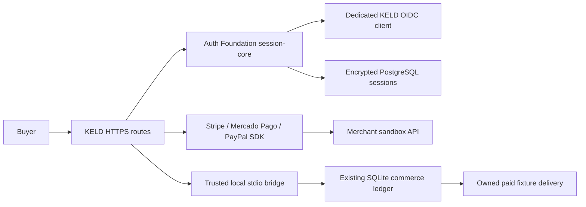

# KELD payment SDK and Auth Foundation integration

Date: 2026-09-17. Status: implemented sandbox candidate, not a deployed store.

## Objective and authority

The owner explicitly requested SDK integrations and reuse of Auth Foundation.
This supersedes the previous hosted-platform-only selection pause. Stripe cards,
Mercado Pago Pix and PayPal are in scope; USDC is deferred. Existing ledger and
delivery code are reused, without adding a cart or another identity provider.
The USD 200 initial offer, USD 50–1,000 range, equal release rights and first-100
benefits remain the product direction from [the intake](PROJECT-INTAKE.md).

Construction chain (CAV2-D65): owner request → bounded KELD integration objective →
CA2-ROUTE-IMPLEMENT receipt `keld-sdk-implement-095` → assessed local code/docs
effects → candidate implementation → isolated validation. This does not promote
an authority definition, admit a production runtime, approve commercial policies,
or grant live payment/publication effects. No ontology runtime records or selectors
are dependencies. Existing source ownership remains unchanged.

## Components



The actual shared package is at
[`domainspec-core/projects/auth-foundation/implementation/session-core`](../../../domainspec-core/projects/auth-foundation/implementation/session-core/README.md).
The local project record under `goals/projects/auth-foundation` describes older
scope; the implementation now includes reusable OIDC sessions. KELD imports that
package through a local file dependency. Its source was not modified.

Official SDKs are pinned in [package.json](../integrations/package.json) and the
lockfile: [Stripe](https://github.com/stripe/stripe-node) 22.6.2,
[Mercado Pago](https://github.com/mercadopago/sdk-nodejs) 3.6.1 and
[PayPal](https://github.com/paypal/PayPal-TypeScript-Server-SDK) 2.5.0.

## Mounting and configuration

Import `createKeldIntegrations` from `integrations/src/index.mjs`. It accepts:

| Input | Required configuration |
| --- | --- |
| `auth.profile` | HTTPS `issuer`, canonical HTTPS `origin`, callback path, dedicated KELD `client`, `audience`, and server-side client `secret` |
| `auth` | Dedicated PostgreSQL `databaseUrl`, session encryption `key` in the shared package's format, namespace `keld` |
| `payments` | `environment: 'sandbox'`; `stripe: {secret, account}`; `mercadopago: {accessToken, account}`; `paypal: {clientId, secret, account}` |
| `ledger` | Absolute SQLite `database`, release SHA-256 `releaseDigest`, optional `reservationSeconds` (default 3600), `delivery: {root, artifacts}` |
| `ledger.delivery.artifacts` | Entries `{sha256, bytes, relative_path}` for a private sandbox artifact of at most 256 MiB |
| `quoteBrl` | Server-owned async function of USD cents returning `{amountCents, currency: 'BRL', reference}`; quote is frozen per checkout |

Keep secrets in server configuration. Do not reuse another consumer's OIDC client,
database credentials, encryption key or demo identities. The shared package's
Keycloak token profile and online introspection requirements apply.

At controlled startup call `initialize()` explicitly to migrate KELD's session
schema, mount `handler` on the trusted HTTPS server, and call `close()` at shutdown.
Construction alone does not migrate the session database. Commerce SQLite tables
initialize on first operation. The local launcher below binds the listener; TLS
certificates, databases and merchant accounts are not provisioned automatically. The local file dependency requires
the sibling checkout during development. The private runtime staging tool now
bundles the unchanged shared source under a local vendor dependency; see below.

| Route | Behavior |
| --- | --- |
| `GET /auth/login` | Shared OIDC login/renewal flow |
| `GET /auth/callback` | Shared callback verification, opaque secure session cookie |
| `POST /auth/logout` | Shared session revocation; exact Origin and CSRF required |
| `GET /api/session` | Authenticated session's CSRF token; no provider access token |
| `POST /api/checkout` | `{provider, amountCents, requestKey, payerEmail?}`; email required only for Pix |
| `GET /api/orders?before=<orderId>` | Up to 20 owned checkouts and a `next` boundary; omit `before` for the newest page; no provider calls |
| `POST /api/restore` | `{orderId}`; restores original request key, price and saved payment details, with ownership/CSRF checks |
| `POST /api/confirm` | `{orderId}`; retrieves provider state and captures approved PayPal orders |
| `POST /api/download` | `{orderId}`; returns exact owned paid test artifact |

All commerce mutations require the authenticated cookie, matching Origin and
`x-csrf-token`. Customer ownership derives from issuer and subject, not submitted
email or identity headers. The handler now serves a sandbox buyer page at `/`, `/purchase/return`,
`/purchase/cancel` and `/signed-out`. It offers Stripe/PayPal links or the Pix code,
retains the request key and order ID in tab-local session storage, and requires
explicit provider confirmation before presenting download. Redirects never prove
payment. Original imported storefront files remain historical preview assets;
the SDK buyer page does not activate their old live/Apache-2.0 configuration.

## Verification and limits

Seventy-four integration cases are covered by a full 72-case run plus two subsequently added passing checks (44 SDK/ledger/auth/worker/inspection/review/recovery/discovery/resumption/archive checks, 10 buyer-client/route checks, 6 event verification/inbox/HTTP checks, 4 maintenance-runner checks, 6 configuration/HTTPS lifecycle checks, and 4 binary-download checks). The 22 existing ledger, delivery and provider-binding
regression tests also pass. They exercise the real SDK requests and response
decoding, durable Python ledger, successful three-provider fixture delivery,
duplicate creation, restart/replay, cross-buyer denial, invalid credentials and
amounts, forged session inputs, CSRF, revoked-session rejection, incorrect Pix
merchant/currency/amount/payment ID, refunds and late payment review.

The external APIs are intercepted and the OIDC/PostgreSQL runtime is substituted.
This proves local integration behavior, not Brazilian account eligibility, Pix
sandbox availability, issuer configuration or a real payment. No credentials were
read and no provider transaction was created during validation.

Payments are re-fetched from the provider with bound merchant, amount, currency,
release and order identities before settlement. BRL quotes preserve the USD offer
in the ledger. Late approval goes to `paid-review` without automatic download.
Retries retain the saved checkout and quote. Authentication is checked before an
operation; no claim is made of cancelling an already in-flight payment request
when a session is revoked mid-operation.

This module intentionally accepts only sandbox configuration and serves small
test fixtures. Optional verified webhook receipt is implemented, but deployment supervision,
refund/dispute revocation after purchase, production file
streaming and delivery of the released ARE archive remain unfinished. Existing Python Stripe webhook code remains
separate. These are explicit remaining lifecycle tasks, not completed features.

## Local launcher and preflight

`integrations/bin/server.mjs` accepts `check|start <config.json>`; package scripts
expose `npm run check-config -- /absolute/config.json` and
`npm start -- /absolute/config.json` from the integrations directory.
[config.example.json](../integrations/config.example.json) is a deliberately
incomplete template. Configuration is JSON data, not executable JavaScript.
Secrets are referenced by `KELD_*` environment names and are never printed.

Preflight collects structural field errors together, rejects unknown fields,
non-loopback origins and live key prefixes, checks the local certificate's host,
validity and matching private key, verifies the fixture hash/length, and checks
the ledger parent directory. It makes no network calls, so it cannot establish
merchant activation, issuer availability or database credentials. Paths resolve
relative to the config file. For this launcher, use a local HTTPS origin with an
explicit port of at least 1024 and a trusted localhost/127.0.0.1 certificate.

The explicit sandbox quote policy is a positive integer numerator/denominator,
reference and future expiry. It converts USD cents to BRL cents with nearest-cent
rounding; the template supplies no default rate. Expired policy blocks new quotes;
saved checkout retries continue using their frozen quote. A live FX/pricing policy
is still a commercial requirement before production.

Starting binds `127.0.0.1`, then explicitly migrates the session schema. Until
initialization completes, the listener answers 503. Port conflicts do not trigger
migration. Startup failure closes allocated resources and emits a safe stage code;
SIGINT/SIGTERM close the server and session pool. The launcher never installs
certificates, modifies trust stores or provisions merchant/identity accounts.

Five tests cover aggregate configuration errors, live/public configuration
rejection, file integrity, real loopback HTTPS using temporary test certificates,
startup failure cleanup and port conflict behavior. Identity/database operations
are stubbed in these lifecycle tests; no actual OIDC login or merchant payment is
claimed. Test certificates and fixtures are removed after each test.

## Sandbox buyer page

The handler serves the public files in `integrations/public` through an exact
route allowlist. A restrictive content security policy, no-store responses and
no-referrer policy apply. Provider return query parameters are ignored as payment
evidence. The page starts at USD 200, permits the retained USD 50–1,000 range,
offers cards/Pix/PayPal and explicitly describes the small test file being delivered.

The browser saves its request key before payment dispatch. If storage is blocked,
no payment request is sent. Refresh/login and uncertain failures reuse the saved
request; changing its amount/provider is refused. Only definite failure or a
verified paid checkout permits resetting the tab for a new request key. Cached
state is convenience data, never authorization: confirmation/download still use
the authenticated server and owned ledger. After clearing browser storage or using
another device, the original buyer can sign in and choose “Find my checkouts”. The server lists owned SDK checkouts in pages of 20
and restores the
selected record, including an uncertain attempt with no provider response. It
never creates/captures a payment while restoring. Expired and paid-review records
remain restricted; recovery does not override payment or reservation rules. A
browser cannot replace a different uncertain checkout through the restore action.
“Load older checkouts” continues through history using an owned order ID as the
boundary. Pages sort by creation time and order ID, so tied timestamps and newer
inserts do not skip or duplicate older rows. The server verifies ownership of the
boundary and rejects unknown/duplicate query fields. Neither a customer ID nor an
unrestricted offset can be supplied through the API.

Seven client/route tests cover refresh after connection loss, unavailable storage,
login-required state, safe reset, unexpected checkout URLs, integer-cent parsing,
return routes that cannot settle payment, and restoration into a fresh browser
without replacing another uncertain request, and paging query validation. Three additional ledger/auth tests
verify account isolation, CSRF, frozen state, recovery of uncertain attempts,
and traversal beyond the first page with tied timestamps and newer inserts. The initial PATH lookup found no browser executable; later inspection found
existing cached Chromium/Playwright installations and the browser check below passed. The launcher is implemented; real TLS trust,
OIDC/database configuration and merchant sandboxes remain operational prerequisites;
no public server was started or external payment made.

## Buyer journey audit and sign-out

The buyer page now exposes the existing shared-auth logout route. It retrieves
the current CSRF token, posts logout and clears this tab's saved checkout only
after server success. A failed revocation leaves uncertain checkout data intact.
The HTTP route revokes the shared session and clears secure session/login cookies.
No ledger order or payment is deleted: after signing in again, account history can
restore the checkout. If local storage cannot be cleared after successful logout,
the page reports that the session ended and asks the buyer to close the tab.
Sign-out and session initialization do not depend on successfully rendering cached
checkout data, so damaged session storage cannot prevent the logout request.

One integrated test connects the actual buyer client, HTTP handler, authentication
adapter, SDK serialization, SQLite ledger and binary download route. It checks
unpaid denial, verified payment, exact fixture bytes, cookie clearing and denied
access after logout. A separate client test checks failed logout preserving an
uncertain checkout. A DOM-stub test checks that damaged storage cannot prevent
sign-out or hide the successful-revocation message. The full suite passed 57 tests;
after the final storage-handling change, all 10 buyer tests passed, including the
new case (58 distinct integration tests in total). Identity runtime and provider responses are substituted; the
test is not evidence of real OIDC/merchant connectivity or browser rendering.

The audit also rechecked operational prerequisites: `config.local.json`, all seven
expected credential environment variables and Chromium/Chrome/Firefox executables
were absent. Presence only was inspected; no credential values were read. That executable
lookup did not inspect browser caches; the later check below resolved that gap.

## Real browser validation with simulated APIs

The optional [browser harness](../integrations/test/browser-check.mjs) uses an
existing Playwright installation and Chromium executable. It serves the actual
KELD handler's static assets and security headers on a temporary loopback listener,
intercepts API responses with explicit fixtures, and blocks external page requests.
It does not create merchant payments or exercise the real identity runtime.
No browser dependency was installed for this check.

From `integrations`:

```sh
npm run test:browser -- /absolute/playwright/index.mjs /absolute/chromium-executable
```

An optional third argument selects the output directory; the default is ignored
`.runtime/browser-check/`. The harness writes a JSON result and five screenshots,
closes the browser/listener on success or failure, and asserts zero horizontal
page overflow. It is separate from the default Node test suite so ordinary tests
do not depend on a browser installation. Download bytes are checked before the
browser's temporary context is removed.

Measured on 2026-09-17 with existing Playwright 1.63.0 and Chromium 153.0.8010.12:

| Check | Result |
| --- | --- |
| Layout widths | 1440, 768, 390, 320 and 240 px: document width equals viewport width |
| Checkout followed by refresh | One create request; saved payment link restored |
| Confirmation and download | Paid UI enabled; exact `ARE sandbox fixture` bytes downloaded |
| Sign-out | Redirected to signed-out page; tab checkout removed; sign-in shown |
| Uncaught page errors | Zero |

The 390 px screenshot was also visually inspected for readable labels, controls
and section layout. The persistent harness was rerun after switching its asset
server to the real handler, so the recorded result includes the actual CSP.
This proves one Chromium UI journey with simulated APIs, not provider pages,
real browser cookie/OIDC renewal behavior, merchant checkout, accessibility
conformance or full cross-browser compatibility. Real HTTPS/OIDC/merchant
configuration remains an operational prerequisite.

## Real PostgreSQL and shared token-verification check

The optional [isolated runner](../integrations/test/auth-postgres-runner.mjs) uses
an already-installed `postgres:16-alpine` Docker image (`--pull=never`). It starts
one uniquely named disposable container with a loopback-only random port, 384 MiB
memory limit and 256 MiB tmpfs database. Credentials and the local HTTPS certificate
are temporary. No existing Auth Foundation runtime configuration/database is read.
The runner removes its container and temporary directory on normal exit/failure;
SIGINT/SIGTERM stops its child before cleanup. Forced termination such as SIGKILL
cannot run cleanup; inspect only the printed/prefixed test resources in that case.

From `integrations`: `npm run test:auth-postgres`. Docker and OpenSSL are required;
the command never installs/pulls images. It does not use KELD's merchant config.

The [consumer check](../integrations/test/auth-postgres-check.mjs) uses the real
shared store and `createOidc` through `createKeldAuth`, with real PostgreSQL and
RS256/JWKS verification. A temporary HTTPS issuer fixture serves discovery and
authenticated token introspection. The initial storage checks seed sessions through the store transaction API.
Additional checks enter through KELD login/callback routes and execute the shared
authorization-code flow against that issuer fixture. The fixture authorizes a
synthetic identity automatically; it is not a real Keycloak deployment. The shared
Auth Foundation source is unchanged.

Measured on 2026-09-17: thirteen check groups passed on PostgreSQL 16.15:

- Signed-token verification and authenticated HTTPS introspection against a real SQL session.
- Rejected CSRF leaves stored activity unchanged.
- Stored custody excludes plaintext handles, tokens and CSRF values.
- Signed wrong-audience and wrong-token-profile credentials fail.
- Closing and reopening the consumer preserves identity/session state.
- Inactive issuer introspection revokes access.
- A different encryption key cannot read the session.
- Logout persists revocation across consumer instances and clears cookies.
- Login/callback exchanges a code using PKCE and verifies signed ID/access tokens and nonce.
- Replaying a callback fails and clears browser cookies.
- Wrong state and signed wrong nonce fail without a session cookie.
- Expired-token renewal rotates the handle while preserving identity and absolute deadline.
- Logout with an older handle and its own CSRF revokes the renewed session.

The issuer fixture observed three discovery requests, three JWKS requests, eight
introspections, four authorization requests and three token exchanges. State
mismatch was rejected before token exchange. The token endpoint checked the
PKCE verifier against the authorization challenge and consumed codes once. The exact test container was removed; no matching test container
remained after validation. This optional test is separate from the 74-case default
suite. It closes the real-storage/shared-verifier and local callback/renewal execution
gaps. Real Keycloak compatibility, browser cookie behavior across real issuer
redirects, merchant connectivity and production admission remain unverified.

## Review remediation and retry contract

The four review findings are addressed in the
[remediation DAG](SDK-REMEDIATION-DAG.md). The `sdk_creation` table is initialized
alongside existing attempt bookkeeping. Legacy unbound attempts are conservatively
marked uncertain; existing orders and payment receipts are preserved.

Creation has explicit ready, inflight, uncertain, bound and failed states. An
atomic claim prevents concurrent dispatch for 60 seconds. After a crashed claim
expires, retries retain the same provider idempotency key and are permanently
classified as potentially dispatched until binding succeeds. A stale worker
cannot mark a newer attempt failed. Provider SDKs have bounded request timeouts.

A pre-creation Stripe account check failure, or explicit provider HTTP rejection
(400/401/403/404/422), can cancel a first attempt and release only its held
supporter reservation. The buyer can then choose another provider with a **new
request key**. The failed key remains terminal. A timeout, connection loss, 409,
429, server error, malformed successful response or any previously uncertain
attempt cannot release the reservation through this failure path. Retry with the
original key. Reconciliation outside the permitted retry window remains future
work; this change does not implement cancellation of an already payable checkout.

Saved Pix attempts are looked up before consulting the quote service. Retries
validate the original provider, merchant, amount and payer email, then reuse the
persisted quote even if the quote service is unavailable or release configuration
has changed. Shared sessions call `touch` after authentication and CSRF checks;
rejected authentication/CSRF cannot refresh activity.

Error responses include a safe `error` code and generated `requestId`. Authentication
uses 401, forbidden access/CSRF 403, missing owned resources 404, checkout conflicts
409 and infrastructure failures 503. Other invalid input uses 400. Optional
`diagnostic(event)` on the integration factory/handler receives only event name,
request ID, safe code and status; the default writes that JSON to stderr. Raw
SDK errors, SQL, credentials, headers and buyer details are never logged here.

Additional tests cover quote outages, provider switching after definite failure,
server errors and lost connections, sticky uncertainty after later rejection,
concurrent creation, abandoned claims and stale workers, idle refresh, and
sanitized diagnostics for unavailable storage. External services remain simulated.

## Optional webhook receipt

The root JSON configuration accepts an optional `webhooks` object. Only configured
providers receive an enabled POST route:

```json
{
  "webhooks": {
    "stripe": {"secretEnv": "KELD_STRIPE_WEBHOOK_SECRET"},
    "mercadopago": {"secretEnv": "KELD_MP_WEBHOOK_SECRET"},
    "paypal": {"webhookId": "YOUR_REGISTERED_SANDBOX_WEBHOOK_ID"}
  }
}
```

Merge this object into the app configuration when the endpoint credentials exist;
the default template leaves routes disabled. Account identities come from the
existing payment configuration; PayPal reuses its SDK OAuth credentials. Paths
are `/events/stripe`, `/events/mercadopago`, and `/events/paypal`. Signature checks
replace buyer-session authentication only on these exact routes. The launcher
remains loopback-only, with no endpoint registration or external ingress configured.

Verified notifications enter a durable minimal inbox before a 202 response. They
never grant downloads, settle orders, issue refunds or trigger PayPal capture at
receipt. Raw payer payloads are not stored. The queue has a 10,000-record cap;
bounded processing and explicit completed-event archival are implemented;
long-term retention policy remains unfinished. See the
[contract and current DAG](WEBHOOK-DESIGN.md#implemented-receipt-boundary) for exact
SDK usage, freshness, deduplication and test limitations. Real registered merchant
webhook delivery has not been exercised; PayPal postback responses are simulated.

## Operator reconciliation

`npm run reconcile -- /absolute/config.json [after-order-id]` explicitly retrieves
existing merchant sandbox payment state and records verified completion in the
local ledger. It is a trusted local command, with no public HTTP endpoint and no
caller-supplied customer identity. Up to 20 bound unpaid SDK orders are selected
per page; output includes counters, safe per-order failures and `next` for the
following page. A failed provider/account does not stop other orders. Start a new
sweep without a cursor so pending/failed records are retried. An optional maintenance runner is available below; no scheduler is
installed and no merchant calls were made while implementing this command.

The runner reloads the owned ledger record, matches the configured merchant,
and uses the same SDK verification rules as buyer confirmation. PayPal always
receives `capture: false`: approved but uncaptured orders still need the buyer's
explicit confirmation. Completed payments settle idempotently; late payments
remain `paid-review`. An expired quote policy is permitted because the amount is
already frozen. Other app configuration and local file checks still apply; no
session database migration or OIDC login occurs during reconciliation.

Two added tests cover a real SDK request with simulated completed Pix payment,
idempotent second sweep, late review, failure isolation, merchant mismatch and
no PayPal capture. Missing provider IDs, post-payment refunds/disputes, deployment supervision and operational monitoring remain unfinished. This command
is one implemented reconciliation path, not proof of a complete payment lifecycle.

## Operator event worker

`npm run process-events -- /absolute/config.json` handles up to 20 due verified
notifications with durable claims, crash recovery and retry backoff. It fetches
current SDK payment state, resolves PayPal captures to orders without capturing,
and reuses frozen payment bindings and idempotent settlement. Missing bindings trigger SDK reference lookup and the existing fully verified
paid-recovery path. Active claims and unpaid resources retry; late payments and
policy-sensitive events require review.
The command has no public route, scheduler or automatic access-revocation policy.
See [worker behavior and five acceptance tests](WEBHOOK-DESIGN.md#implemented-worker-boundary).

`npm run inspect-events -- /absolute/config.json [state] [after-cursor]` reports
whole-queue counts, due/deferred retries, expired leases and capacity, plus a
20-entry page. It does not claim work or contact providers. This complements the
worker's per-batch summary; a successful inspection does not certify queue health.
See [inspection contract](WEBHOOK-DESIGN.md#operator-queue-inspection).

Reviewed events can be retried after repair through
`npm run retry-event -- <config> <provider> <event-id> <generation> <reason>`.
The configured merchant scopes the action; a current review generation is required.
Retries are audited and cannot settle payments or bypass worker verification.
See [exact retry contract](WEBHOOK-DESIGN.md#audited-review-retry).

## Continuous local maintenance

`npm run maintain -- <config> once` runs an event batch, a reconciliation page and
queue inspection. `watch 60` explicitly repeats with a 60-second delay after each
cycle, advances reconciliation pages and restarts completed sweeps. Signals stop
new work and interrupt idle waiting. It does not install a service, provision
accounts, migrate sessions or create/capture payments. Startup configuration and
all existing sandbox checks apply. See [runner behavior and tests](WEBHOOK-DESIGN.md#opt-in-maintenance-runner).

## Recover a lost paid-payment binding

From `integrations`, run:

```sh
npm run recover-payment -- /absolute/config.json LOCAL_ORDER_ID PROVIDER_RESOURCE_ID
```

The trusted operator supplies an existing local order ID and a provider lookup
hint: Stripe Checkout Session ID, Mercado Pago Payment ID, or PayPal Order ID
(not a PayPal capture ID). Obtain the ID from merchant records; this command does
not discover IDs automatically or create a replacement payment. Merchant identity
comes from the order and must match configuration. The shared buyer login is not
used by this local operator command; no public recovery endpoint is exposed.

The same SDK verification used by confirmation must prove an already-completed
payment against frozen merchant, order, release, amount and currency. PayPal capture
is disabled. An unpaid resource, mismatch, never-attempted order, definite failed
attempt, live creation lease or racing creation generation cannot be recovered.
An uncertain attempt or expired creation claim may be bound. An existing audited
recovery may be replayed only for the same remote/payment identity.

The binding transaction stores `sdk_recoveries` proof references and the observed
generation/time, then changes creation state to bound. Settlement is a separate
idempotent operation: a crash between binding and settlement is recoverable by
running the command again or the existing reconciler. Every command replay fetches
fresh provider proof. Late settlement still enters `paid-review`, with no automatic
download. This audit records the trusted local action, not authenticated operator
identity. The CLI reports only the local order ID and resulting status.

Restored buyers see a recovered payment without a checkout URL or Pix code, and
still need authenticated ownership checks for confirmation/download. No new payment
is created during recovery. Tests cover real Mercado Pago SDK responses with a
lost binding, incorrect order, pending payment, settlement failure/replay, exact
fixture delivery and cross-buyer denial; creation races and late review are checked
with a substituted adapter; buyer restoration/download is checked without a provider
link. Provider responses remain simulated. Mercado Pago ID discovery is implemented as described below; discovery for
PayPal and resolution of expired/unlocated attempts remain unfinished. Known-ID
resumption of open unpaid checkouts is implemented below.

## Discover Stripe and Mercado Pago payment IDs

`npm run discover-payment -- <config> <local-order-id> [inspect|recover]` uses the
SDK to search Mercado Pago by exact external reference (20 results), or scan
Stripe Checkout Sessions (five pages of 20), in an explicit creation interval. Empty, multiple, truncated and unpaid results cannot settle or
free an order. A single candidate must pass full payment verification; only
explicit `recover` invokes the existing recovery path with another fresh check.
Inspection is the default and does not bind the result. Output contains minimal
IDs/coverage, without payer bodies. Stripe scans check merchant identity before listing. PayPal general search remains unsupported; verified capture events can now
resolve and recover their local order without an operator-supplied ID.
See [discovery contract, evidence and tests](PAYMENT-DISCOVERY.md#implemented-mercado-pago-command).

## Resume a lost unpaid checkout

From `integrations`:

```sh
npm run resume-checkout -- /absolute/config.json LOCAL_ORDER_ID PROVIDER_RESOURCE_ID
```

Use a Stripe Checkout Session, Mercado Pago Payment, or PayPal Order ID. The command
reads the existing resource and verifies the saved merchant, order, release, amount
and currency. Stripe must remain open/unpaid with the original expiry; Pix must
remain pending with the exact expiry and a valid existing code. PayPal must remain
created, awaiting payer action or approved. Redirect links must use the expected
sandbox provider host. A PayPal order already approved by its buyer returns a
confirmation-only result; this command never captures it.

The local order must still be pending and unexpired. An uncertain attempt or
expired creation lease is eligible; an active claim, definitely failed attempt,
changed generation or conflicting binding is rejected. A SQLite transaction
rechecks order expiry/status after the provider response and records the first
resumption in `sdk_resumptions`, then saves the existing payment response and
marks creation bound. Repeating the same audited resumption is safe while the
checkout remains open. Fresh provider checks run on each invocation.

The buyer restores through account history or resumes the original saved request.
The stored response bypasses creation entirely, including when Stripe's minimum
remaining lifetime prevents replaying the create call. No new payment, capture,
settlement, reservation release or download grant occurs. The normal authenticated
confirmation and payment verifier are still required. Expired checkouts stay
restricted; use completed-payment recovery/review when appropriate.

Four SDK/ledger tests cover Stripe recovery below the create-retry time cutoff,
repeat resumption and reuse without create calls; Pix expiry/reference rejection;
approved PayPal restoration without capture; and atomic rejection when local
expiry is crossed during provider retrieval. The resumption journeys also reject unpaid download access.
Provider responses are simulated. Automatic discovery does not automatically
resume an unpaid candidate; the operator explicitly chooses this command.

## Archive completed events

`npm run archive-events -- <config> <received-before-unix-seconds> [preview|apply]`
previews or archives up to 100 completed receipts per call. The explicit cutoff
uses receipt time, excludes active/review events, and cannot be in the future.
Archival preserves normalized event references/fingerprints and review history;
duplicate/conflict checks continue against archived receipts. No order, payment
or entitlement changes. Inspection reports both the 10,000 active-entry ceiling
and the 100,000 archived-receipt ceiling. No automatic purge or disk shrinking is
claimed. See [atomicity, capacity tests and remaining policy](WEBHOOK-DESIGN.md#completed-event-archival).

## Event-driven payment recovery

The worker now resolves local order references from supported verified event
resources when no saved binding exists. Stripe and Pix use their provider order
reference; PayPal resolves capture → provider order → local order. The local
provider/account must match before full paid-recovery verification. Active claims
retry, definitely failed attempts enter review, and late payments retain existing
restrictions. No payment creation or capture occurs. See [proof boundaries and tests](WEBHOOK-DESIGN.md#event-driven-lost-binding-recovery).

## Private runtime staging

`npm run stage-runtime -- NEW_DIRECTORY` in integrations creates a private sandbox
runtime from allowlisted source files, including the three Python ledger modules.
It rewrites only the staged package/lock dependency reference to
`file:vendor/session-core`; the shared source and development dependency stay
unchanged. The generated manifest records SHA-256 and size for every payload file.
Existing destinations and symlinked source files are rejected.

Operator state, test inputs, node_modules, caches, TLS material and ARE archives
are excluded. Source-owned license/notice files are retained when present.
This does not establish commercial redistribution rights or approve a release.

`npm run test:portable` stages into a temporary directory and defaults to offline
npm installation. An explicit `-- --allow-network` permits missing registry fetches.
It checks manifest hashes, verifies the installed shared package is a copy, runs
the default suite, prunes development dependencies and imports runtime entrypoints.
Lifecycle scripts remain disabled; temporary output is removed on normal/error exit.
A production-only install can use `npm ci --omit=dev --ignore-scripts --install-links`
inside the staged integrations directory.

Validation: a 45-file staged runtime installed outside the repository and passed
all 69 default tests (0 failures/skips). Missing cache entries required registry
access for this first run. A separate production-only installation then passed
offline with 56 packages, no nock, and successful runtime/shared-auth imports.
The packaging boundary test passed secret-exclusion, notice preservation,
deterministic manifests, unchanged source manifests, existing-output refusal and
symlink rejection. Temporary installs were removed. The portable runner now
includes this boundary test and a final dev-dependency prune/import check; those
new wrapper steps were not part of the recorded 69-case run.

Real issuer/merchant connectivity and approved ARE archive delivery remain
separate requirements.

## Verified archive snapshot primitive

The Python delivery core now offers `redeem_snapshot`: it checks buyer ownership,
paid state, grant expiry/mode and release approval, copies the source in at most
64 KiB chunks into a temporary file, verifies its complete size/hash, consumes the
grant transactionally, then returns a rewound file. The caller must close it.
Source replacement after verification cannot change the returned bytes. Copy,
integrity or transaction failures close the snapshot and leave the grant unused.

The existing `redeem` byte-returning interface delegates to this primitive and
remains compatible. Its callers still load the result into memory. The SDK HTTP route now uses the binary streaming transport described below.
The compatibility repository download operation remains limited to 1 MiB base64. Temporary storage can consume up
to the configured archive size (currently bounded at 256 MiB by the core); it may
be tmpfs. The ledger write transaction remains held during verification.

Validation: 22 ledger/delivery/provider-binding tests passed, including a 13 MiB
synthetic archive, source replacement, replay, approval withdrawal, wrong buyer,
temporary-storage failure and corrupted-file cleanup/retry. Three affected SDK
delivery paths also passed after the change (Stripe, event-driven Pix and the
buyer HTTP download/logout journey). No real release was approved or distributed.

## Binary HTTP archive delivery

The authenticated POST download path uses `download-stream` through the private
Python bridge. After full snapshot verification and grant consumption, the bridge
writes a bounded JSON metadata line followed by binary bytes. Node validates the
metadata against the frozen release digest and 256 MiB ceiling, then streams with
backpressure. It verifies byte count, hash and worker exit before ending the HTTP
response; truncated or invalid bodies terminate the connection rather than finish
successfully. Ownership/integrity failures before streaming return sanitized JSON.

Client disconnects abort the worker. Setup has a 15-second timeout and transfer
has a 120-second limit. OS cleanup closes the worker's anonymous temporary snapshot;
successful consumption closes it normally. Configuration preflight also hashes
files incrementally. No public file path or provider redirect authorizes delivery.
A failed transfer consumes that grant; an entitled buyer can request a new download.

Validation: the full 72-case default suite passed, followed by two newly added
checks for HTTP-disconnect cleanup and larger-file configuration. Current default
inventory is 74 cases. New tests include exact hash/size delivery of a 13 MiB
synthetic archive through a loopback HTTP server, wrong-owner/corruption rejection,
truncation failure, cancellation and process termination. The auth identity in
the large-file transport test is substituted; the existing shared-auth consumer
journey passed in the full run. The core snapshot's 22-test evidence is separate.

This path remains `local-test` and retains the sandbox download filename. It does
not implement commercial release admission. Production approval wiring, genuine
merchant/issuer evidence, refund policy and deployment remain unresolved.

## Next task DAG

See the [current execution DAG](CURRENT-EXECUTION-DAG.md) for dependency edges,
owners, close conditions and execution evidence.

1. Configure a dedicated KELD OIDC client and isolated session database; run real
   login, renewal, logout and ownership checks.
2. In parallel, configure the three merchant sandboxes and an explicit BRL quote
   policy; verify actual provider responses, especially Mercado Pago Pix support.
3. The sandbox buyer views are wired locally. After 1 and 2, verify them in a
   real browser and demonstrate authenticated purchase and exact fixture download
   for each provider.
4. Operator reconciliation and verified event receipt are implemented. The bounded inbox worker is implemented. Add
   PayPal ID discovery and expired/unlocated-attempt resolution, deployment supervision, retention and refund/dispute lifecycle.
   Authenticated checkout restoration and paginated history are implemented.
5. After 3 and 4 plus license/release approval, replace fixture delivery with the
   approved release path and perform a separate production-readiness review.

## Open Questions

Dedicated KELD issuer/client/hosting configuration, merchant sandbox connectivity,
BRL quote source and expiry, refund/supporter-slot policy, deployment topology,
shared-package distribution and final license/release approval remain unresolved.
Commercial questions are owned by [PROJECT-INTAKE.md](PROJECT-INTAKE.md#open-questions).
