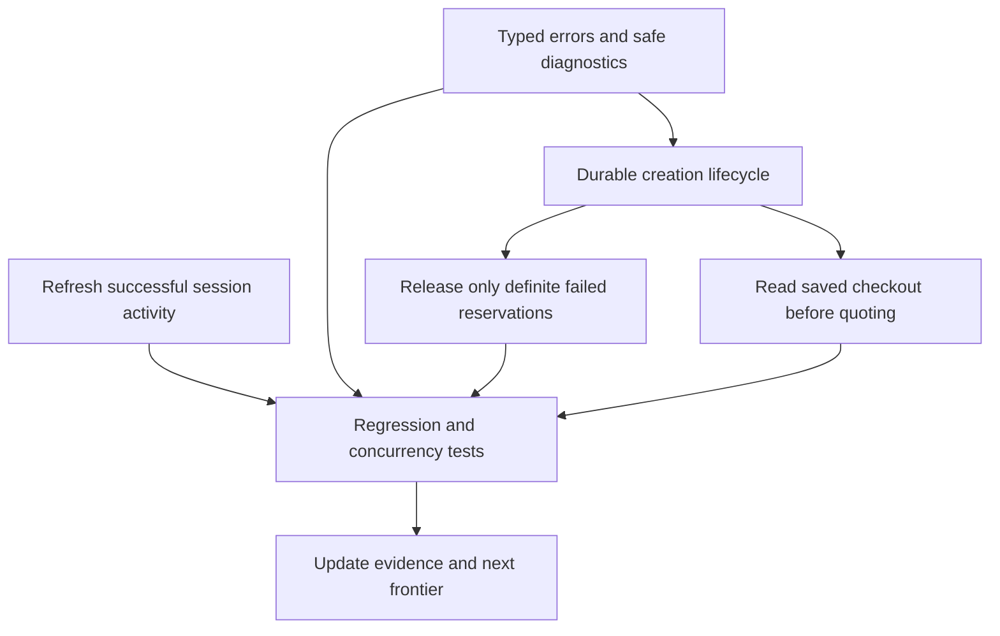

# SDK review remediation DAG

Date: 2026-09-17. Owner-authorized candidate construction under CAV2-D65;
route receipt `keld-sdk-fixes-097`. No deployment or merchant effects.

Objective: fix the four reviewed integration defects without releasing a
reservation when a payment may already exist. Preserve shared authentication,
frozen prices, payment idempotency and buyer ownership.



| Task | Dependency | Close condition | Status |
| --- | --- | --- | --- |
| A | Review evidence | Domain errors and outages differ; logs omit secrets | Complete |
| B/C | A | Definite failure frees held slot; uncertain outcomes and concurrent requests cannot free it | Complete |
| D | B | Saved Pix checkout survives quote-service outage | Complete |
| E | Review evidence | Successful activity touches shared store; rejected mutations do not | Complete |
| F | A–E | New regressions and existing SDK/ledger checks pass | Complete |
| G | F | Integration contract matches tested behavior | Complete |

Completed frontier: local implementation and isolated tests, owned by the coding
agent under the requesting product owner's direction. No ontology runtime record
or selector dependencies. Existing Auth Foundation and ledger authority remains
unchanged; new attempt bookkeeping belongs to KELD's adapter.

Operational residue: merchant sandbox credentials, dedicated OIDC/PostgreSQL
configuration, storefront integration, event reconciliation/refund lifecycle and
release approval remain separately owned deployment/product work. They block a
live buyer journey, not this local remediation stage.

## Historical validation evidence

14 SDK integration tests and 19 existing ledger/delivery/provider-binding tests
pass. The added lost-connection case and logout CSRF classification were also
checked after their final edits. Tests exercise real SDK serialization with
intercepted responses and temporary SQLite state; external OIDC/PostgreSQL and
merchant connectivity are not claimed. No merchant credentials were accessed.

Commands from the checkout root:

```sh
npm --prefix keld-project/integrations test
(cd keld-project/commerce && python3 -m unittest test_ledger test_delivery test_provider_bindings)
```

This is the historical remediation record. Storefront wiring and recovery have
since been implemented. The [current execution DAG](CURRENT-EXECUTION-DAG.md)
owns the remaining task order, dependencies and live-service proof requirements.

## Open Questions

Automatic reconciliation of ambiguous attempts beyond the reservation window
remains future work. Do not infer failure from a timeout or blindly release a
possibly payable checkout. Commercial and runtime configuration questions remain
in [SDK-INTEGRATION.md](SDK-INTEGRATION.md#open-questions).
