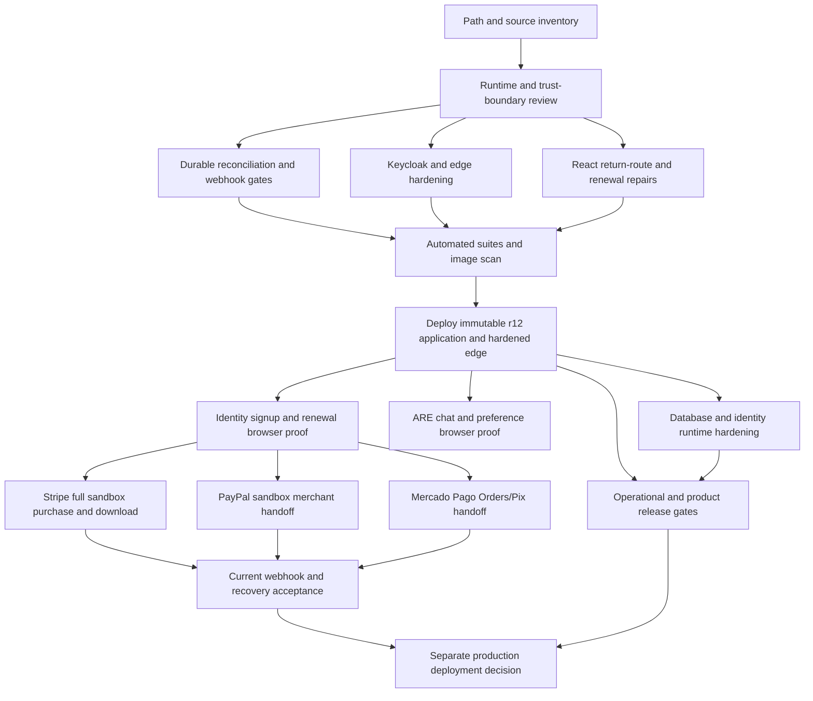

# KELD + ARE staging security-plan execution

Date: 2026-09-20
Environment: public staging and public ARE presentation
Deployed candidate: `keld-sandbox:fixed-brl-5.10-20260920-r12`
Exact image ID: `sha256:ce4f9a238238d2a36ec0c1a5c97f3eccd24fd2b13e7415bcedb7f9430e4fee3e`
Exact web Compose config hash: `34238e06e027c306b961621282de4c72559fe40336eb2d7786bdbe3a887115cc`

This report records implementation and staging evidence. It is not production
approval, a security certification, or authorization to enable live payments.

## Outcome

The reviewed plan is technically sound after three browser-discovered repairs
and five implementation-review repairs:

1. legacy artwork references are now rooted at `/assets/`, so provider returns
   such as `/purchase/return` do not request nonexistent `/purchase/assets/*`;
2. an expired OIDC provider token now starts the durable `/auth/login` renewal
   flow instead of flattening `session_renewal_required` into a signed-out UI;
3. anonymous session discovery now returns an explicit signed-out result instead
   of generating a harmless but presentation-noisy 401 console error. Protected
   mutations still require an authenticated session and fresh CSRF token; and
4. worker health now fails closed when the durable event inbox has no remaining
   capacity. The first heartbeat implementation accidentally dropped this
   existing safety condition while separating healthy from degraded state; and
5. the reusable deployment topology now matches staging: storefront, issuer,
   and ARE use separate hosts, ARE is canonical at `/`, and only its internal
   runtime/API contract retains the `/are/*` prefix. The generic Compose file,
   Caddyfile, smoke proof, environment example, and guide had still encoded the
   superseded storefront `/are/` topology;
6. account-service failure is no longer flattened into an anonymous session.
   Checkout stays closed with explicit retry until the session check succeeds;
7. logout failure is visible and does not navigate to a false signed-out state;
   and
8. every React ARE link uses one validated `VITE_ARE_PUBLIC_ORIGIN`. The build
   rejects non-HTTPS, credentialed, path-bearing, query-bearing, fragmented, or
   custom-port destinations before the candidate can be packaged.
9. the staging edge now uses the scanned non-root Caddy 2.11.4 candidate with a
   read-only root, one required bind capability, no-new-privileges, and bounded
   PID/memory resources. Its root-owned persistent volumes were backed up and
   migrated through a narrow, verified UID/GID 1001 ownership workflow. The
   failed first start proved rollback before the hardened retry passed. A
   complete verified Go module lock and `-mod=readonly` now make subsequent
   builds dependency-reproducible.

The r12 application candidate is active on staging. It preserves the reviewed
r11 application behavior and makes the merchant-owned conversion an explicit
5.10 BRL/USD (`510/100`) fixed quote, reference `merchant-fixed-5.10`, with no
expiry. New checkout attempts use that value; existing attempts retain their
creation-time frozen quote. The
storefront, issuer, worker, and ARE
chat are reachable; the application and worker report healthy. Stripe and
Mercado Pago each passed a complete sandbox purchase-to-download journey.
The live ledger also retains one provider-confirmed PayPal BRL purchase with one
consumed grant for the exact 208-byte artifact; a privacy-safe evidence receipt
records that state without customer or provider identifiers. Stripe also passed genuine signed webhook delivery, provider-requested
redelivery, and an interrupted-worker recovery: the event persisted while the
worker was stopped, settled exactly once after restart, and a later redelivery
created neither new work nor a duplicate grant. Two later PayPal regression
attempts reached the genuine sandbox approval page. Both local windows expired before buyer action. A
bounded 36-check watcher preserved the second result as
`approval-window-expired`, paid false, with no page errors. Those unpaid review
records do not erase the completed PayPal purchase proof. A new attempt is needed
only for an optional current-fixed-rate browser regression; genuine PayPal
webhook recovery remains unproven.

The follow-up infrastructure review hardened PostgreSQL to a scanned, non-root,
read-only candidate and completed an isolated restore of all three current state
stores. It also found a source/live parity defect before deployment: the shared
Keycloak entrypoint had been changed to `start --optimized` while Compose still
selected the stock image. The entrypoint is restored to the stock startup mode
and a regression check now binds that invariant. An experimental pre-built
Keycloak image remains unpromoted: its fresh raw scan contains unresolved Bouncy
Castle findings that are not covered by the existing two-statement VEX.

## Reviewed implementation details

| Layer | Implementation and observed behavior | Review result |
| --- | --- | --- |
| React storefront | The React application preserves the reviewed HTML experience while owning authentication and checkout state. Root-relative assets now survive provider-return routes. The root and `/react-preview` serve the same build. The r12 image preserves the reviewed r11 application behavior and uses the explicit fixed-rate runtime policy. It distinguishes account-service failure from an anonymous session, exposes retry, reports logout failure without pretending revocation succeeded, and uses one build-time validated `VITE_ARE_PUBLIC_ORIGIN` instead of hard-coded React links. | PASS for deployed r12 staging, the prior 15/15 local React tests, portable-package validation, production builds, 96/96 integration tests, and the constrained fixed-rate runtime smoke. A headless real-Chrome flow observed the unavailable-account message inside the human checkout dialog, recovered to anonymous sign-in after Retry, surfaced a failed logout, and recorded zero page errors. The earlier live application smoke confirmed anonymous checkout closure, exact ARE links, and KELD-realm signup entry with zero console/page errors; the current route/semantic/quote monitor also passes. Unsafe or malformed ARE origins fail the build. The raw legacy-body transform remains migration scaffolding and should eventually become components rather than more string rewrites. |
| Identity | Keycloak 26.7.4 is digest-pinned, has an internal readiness check, brute-force protection is applied, and web startup waits for issuer health. OIDC uses the existing PKCE/session boundary. Signup and silent renewal passed in a real browser. The live container runs as UID `1000:0`, drops all capabilities, enables no-new-privileges, and has a PID limit. A reversible migration now disables both unused WebAuthn registration actions and verifies zero identity providers, OIDC-only enabled clients, no X.509-configured client, the expected seven active-flow bindings, and no enabled X.509/WebAuthn execution outside the guarded built-in client flow; the signup form still passes with zero browser console errors. | PASS for bounded staging. The live stock image remains raw-affected. A separate, non-live Bouncy Castle 1.85 candidate removes both BC findings and passes restored-state plus candidate-backed Chromium registration, PKCE callback, renewal, logout, and two-buyer isolation. An exact-SBOM-subject OpenVEX proposal preserves all three retained findings as two proposed `not_affected` and one `under_investigation`; guards prove it is unapproved and unused by Compose/scanning. Production promotion is on HOLD pending exact-image security/license acceptance or a clean supported update. Email verification and password recovery remain disabled until SMTP and account policy are chosen. |
| Buyer isolation | Checkout, history, confirmation, and download remain authenticated server operations. Browser storage carries retry identity, not payment authority. | PASS in automated coverage and prior two-buyer staging acceptance. |
| Provider creation | Stripe, Mercado Pago Orders/Pix, and PayPal use account-bound adapters and retry-safe local attempts. USD input and frozen BRL presentment evidence are retained for Pix and the configured PayPal merchant. | PASS for all provider handoffs and for completed provider-confirmed purchases across Stripe, Mercado Pago, and PayPal. |
| Paid-state proof | Provider returns do not mark an order paid. Server verification is required before entitlement and digest-checked artifact delivery. | PASS for all three providers. The privacy-safe live-ledger receipt records five complete Stripe journeys, two Mercado Pago journeys, and one PayPal journey, each with a consumed exact-artifact grant. It does not substitute for separate webhook-delivery proof. |
| Reconciliation | Bound unpaid attempts enter a durable SQLite queue. Claims are generation-bound, leased, retried with capped exponential backoff, and moved to review after expiry or exhaustion. Worker health exposes aggregate state and fails closed if the durable event inbox is full; privileged local operator commands list bounded metadata and resolve only generation-matched, expired, unpaid review items with provider-matched reasons and an audit row. PayPal order-level 404s are classified as `paypal-order-missing`; the `paypal-missing-unpaid` action additionally requires that exact queue reason. | PASS in 96 integration tests and live r12 worker health. Five terminal unpaid items were closed through audited provider-specific paths: one Stripe, one Mercado Pago, and three PayPal missing orders. A live attempt to apply the missing-order action to the original `PAYER_ACTION_REQUIRED` review was rejected without changing queue state. Both expired buyer-action attempts now remain in review; existing PayPal work leaves the worker `degraded`, not unhealthy. |
| Webhooks | Expensive signature/provider verification is protected by a per-process pre-auth rate/concurrency gate. Only authenticated provider traffic consumes the durable admission allowance. A phased read-only verifier now binds one exact worker across a healthy baseline, an explicit stopped checkpoint before delivery, stopped receipt, healthy processing/redelivery observations, privacy-safe ledger deltas, artifact delivery, and an external redelivery receipt hash. | PASS locally and live for Stripe: signed delivery, durable receipt with the worker stopped, restart processing, and provider-requested duplicate delivery all passed without a duplicate payment or grant. PayPal's configured webhook ID resolves read-only to the exact staging endpoint and currently subscribes to `*`. Only `PAYMENT.CAPTURE.COMPLETED` can drive settlement; other authenticated events go to operator review. Replace the wildcard with an explicit allowlist only after refund/dispute policy defines which review events must remain visible. Genuine Mercado Pago settlement recovery and PayPal signed idempotent replay remain operational gates. Because PayPal capture is initiated only by authenticated KELD confirmation, the separate post-capture/pre-ledger crash window requires an explicit fault-injection decision and is not claimed by ordinary webhook replay. |
| Edge | Staging, issuer, and ARE hosts emit host-only HSTS. The edge removes Keycloak's downstream HSTS to avoid duplicate policy. `/readyz` remains private. The issuer route rejects public `/realms/keld/clients-registrations/*` before the broader realm proxy while preserving ordinary OIDC signup. The reusable Compose/Caddy candidate requires a distinct `ARE_DOMAIN`, gives the ARE services that host/origin, and prevents the storefront host from routing ARE. The live edge now runs the exact scanned Caddy 2.11.4 candidate as UID/GID 1001 with a read-only root, all capabilities dropped except `CAP_NET_BIND_SERVICE`, no-new-privileges, a 128-PID limit, and a 256 MiB memory limit. | PASS against the live public hosts and in the current 70-test deployment/security suite. The exact edge scan reports zero High/Critical findings and zero secrets; the configuration and low-port runtime passed in isolation before deployment. The first live start exposed root-owned certificate volumes and was rolled back; after verified ownership migration, all seven route probes and the real-Chrome smoke passed. Dynamic client registration returns 404. |
| Monitoring | A hardened systemd oneshot verifies the newest immutable release manifest, all expected live container configuration/health, service-specific storefront/issuer/ARE content, semantic no-model-call chat availability and 1,800-second retention, private readiness denial, dynamic-client-registration denial, and the BRL quote contract. It treats `expiresAt: null` as fixed only when the reference is nonempty and the status reports no expiry, remaining time, or refresh requirement. Every probe is limited to the three explicit HTTPS hosts and refuses redirects, credentials, fragments, and custom ports. A persistent timer runs it every five minutes and stores only bounded mode-`0600` state. A credential-safe HTTPS success-heartbeat sender and inactive drop-in are staged. | PASS for local fail-closed detection and code-side heartbeat validation. The final unit retains only `CAP_DAC_READ_SEARCH`, and scheduled runs complete successfully against r23. Selecting the external receiver and missed-heartbeat recipient, observing delivery, and testing escalation remain production gates. |
| ARE chat | `are.keld.studio/` is canonical and `/are/` redirects to `/`. The anonymous chat remains isolated from commerce and host tools. A fresh isolated Chromium journey passed 37 storefront, PKCE signup-entry, route-isolation, live-chat, preference/forget/reset, reload-isolation, and 320 px layout checks without `intent-output-invalid`, console errors, failed KELD-origin requests, or browser authorization headers. All four live roles are healthy, non-root, read-only, capability-free, no-new-privileges and custom-seccomp constrained with no published ports. Live probes deny chat-to-gateway, chat/broker-to-metadata and chat/broker secret access; broker-to-gateway health is the only tested allowed hop. | PASS for bounded public staging use. The local browser receipt does not create an account, checkout, payment, entitlement, or deployment claim. Deployment-wide source-address/WAF policy and final spend/retention policy remain release gates. |
| Supply chain | The r13 evidence set recorded the old r10 Debian application inventory alongside the unchanged Caddy, PostgreSQL, Keycloak, and ARE images. The r11 Alpine application image has zero raw vulnerability records and zero secrets in the digest-pinned Trivy 0.74.0 scan, a 93-component CycloneDX SBOM, and a 109-match license-classifier report. Its zero-secret preserved build context and all 82 runtime-source files are bound by byte-for-byte evidence. The r12 fixed-rate successor, exact image `sha256:ce4f9a238238d2a36ec0c1a5c97f3eccd24fd2b13e7415bcedb7f9430e4fee3e`, has zero High/Critical and zero secret findings in its exact Trivy 0.74.0 scan and is bound by schema-v3 r23. r17 exposed a second `dist/` overlay in public chat; the r18 source-clean replacement keeps all 96 declared payload files byte-identical, removes four stale unreferenced chunks, and makes every ARE declared package match its independently observed tree. Its context has zero secret findings and its exact image has zero High/Critical or secret findings. The current archive covers all seven custom image IDs and verifies 91 OCI blobs plus seven manifest entries. Caddy, PostgreSQL, and all four ARE images remain empty in the complete High/Critical inventory; live stock Keycloak has five unique findings. The non-live BC 1.85 candidate reduces those to three, has zero secrets, a 556-component CycloneDX SBOM, matching off-VPS copies, and a schema-valid but explicitly unapproved exact-subject VEX proposal. Corrected like-for-like Trivy 0.74.0 full-license scans contain 52 matches in both the stock and candidate images with zero normalized delta; the earlier 44-match candidate-only report was incomplete and is superseded. A focused Bandit 1.9.4 scan reports zero High and one dispositioned Medium finding for the intentional private listener. | PASS for the exact r12 application evidence, live r23 integrity, and private Keycloak candidate evidence; not a legal clearance, clean-room rebuild, or clean whole-product dependency claim. HOLD production identity promotion pending accepted candidate dispositions and owner/legal approval of unchanged notices, artifact rights, and support terms. See [LIVE-IMAGE-SBOM-LICENSE-REVIEW.md](LIVE-IMAGE-SBOM-LICENSE-REVIEW.md), [ALPINE-APPLICATION-PROMOTION-2026-09-20.md](ALPINE-APPLICATION-PROMOTION-2026-09-20.md), and [KEYCLOAK-BC185-CANDIDATE-2026-09-20.md](KEYCLOAK-BC185-CANDIDATE-2026-09-20.md). |
| Image recovery | The mode-`0600` current archive binds all seven custom image IDs, verifies 91 OCI blobs and seven manifest entries, and has matching off-VPS hashes. Its empty Docker 29.8.1 containerd-snapshotter load completed in 28.78 seconds with seven exact IDs and zero containers. Schema-v3 r23 binds the capture/recovery receipts and tools. A classic `vfs` load exposed config IDs and was rejected; the reusable verifier requires the containerd snapshotter. | PASS for current image capture, off-VPS custody, and exact-ID load recovery. PARTIAL for full recovery: retag/service startup where required, state/configuration admission, post-restore release manifest, RTO/RPO, and public rollback remain open. See [CUSTOM-IMAGE-RECOVERY.md](CUSTOM-IMAGE-RECOVERY.md). |

## Reviewed dependency DAG

### Node state

| Nodes | State | Close evidence or blocker |
| --- | --- | --- |
| A-E | Complete | Source review plus implemented queue, webhook, identity, edge, return-route, and renewal changes. |
| F | Complete for staging admission | Integration 96/96; portable runtime 81-file independence plus 96/96; React 15/15 plus current production build, earlier explicit-origin build, and rejected unsafe-origin build; real-Chrome local error/retry/logout proof, current Firefox chat/refresh/reset proof, and prior live application/edge smoke; commerce 47/47; deployment/security 67/67 including the canonical Alpine Dockerfile, KELD build-context binding, ARE source-provenance, explicit fixed-quote semantics, exact-image archive assertions, and empty-engine exact-ID recovery verifier; ARE server 51/51 plus current package/security verification; copied secret store 31/31; production-input gate 7/7. The exact r12 application scan has zero High/Critical and zero secret findings, and its constrained non-root fixed-rate runtime smoke passes. |
| G | Complete | r12 is the live staging application image and the source-clean public-chat image is live. The verified pre-r12 full-state backup is `/opt/keld-staging/backups/full-state-pre-fixed-brl-r12-20260920T1510Z`; prior images and recovery points were retained. Schema-v3 r23 binds 43 deployment/evidence inputs, the complete 84-file KELD application build context, matching declared/observed ARE source evidence, current archive/recovery receipts/tools, and the privacy-safe provider-paid-delivery receipt/tool; all 82 KELD runtime-source files match the image and the full monitor plus real-browser chat journey pass. |
| H | Complete | Real signup, authenticated session, expiry-driven renewal, and return to the authenticated storefront. |
| I | Complete | Two chat turns, learned preference, reload persistence, language forget, context exclusion, and routing reset. |
| J | Complete | Genuine Stripe sandbox card payment, server-side confirmation, and `are-sandbox-fixture.bin` download. |
| K | Complete for provider purchase | The live ledger retains one provider-confirmed PayPal BRL payment with one consumed grant for the exact 208-byte artifact; the privacy-safe receipt is hash-bound by r23 and copied off-VPS. Two later approval attempts expired unpaid and remain review records. Create another only for a deliberate current-5.10 browser regression when the sandbox buyer is ready. |
| L | Complete | The genuine Orders/Pix attempt transitioned to paid, server verification granted the entitlement, and the exact verified artifact downloaded after the r4 deployment. |
| M | Partial; Stripe complete; provider-specific harness ready | Local signature, replay, retry, lease, and recovery coverage passes. Live Stripe signed delivery, duplicate delivery, stopped-worker persistence, restart recovery, single settlement, and exact download pass. The new phased verifier and runbook fail closed on concurrent commerce and distinguish Mercado Pago settlement recovery from PayPal idempotent replay. Genuine runs remain required; any PayPal post-capture/pre-ledger fault-injection claim needs separate approval. |
| N | Partial; owner/operator inputs required | The r4 commerce restore, a current full-state isolated restore, scripted current-state backup, encrypted off-VPS full-state copy, private rollback boot preflight, and standalone secret-silent recovery verification pass. The mode-`0600` current archive covers seven custom images with 91 verified blobs and matching off-VPS hashes; its empty-engine load recovered seven exact IDs in 28.78 seconds, and r23 binds the receipts/tools. SMTP/account recovery, public-signup abuse controls, refund/dispute policy, production artifact/license admission, approved second backup destination, independent backup-key custody/retention, public full-service rollback with a fresh manifest, and final anonymous-chat retention/spend limits remain open. |
| P | PostgreSQL complete; Keycloak technical rehearsal complete, decision pending | PostgreSQL is deployed non-root/read-only/capability-free from an exact image with a complete zero-High/Critical scan and unchanged database counts. Live Keycloak is non-root/capability-free/no-new-privileges; unused WebAuthn registration is disabled with private rollback state; every bound flow and enabled client authenticator is checked; and public dynamic client registration is blocked. The stock image has five raw findings. A separate BC 1.85 candidate removes the two BC CVEs and passes restored-state plus candidate-backed Chromium registration, PKCE callback, renewal, logout, and two-buyer isolation, leaving two existing configuration-bound findings plus a Red Hat-rejected OpenJDK scanner record. Production remains held for exact security/license-owner acceptance or a clean supported image. |
| O | Preparation partial; not authorized | The schema-v3 r23 secret-free immutable staging release/drift manifest binds 43 allowlisted deployment/evidence inputs, the complete 84-file KELD application build context, matching ARE declared/observed source evidence, current image archive/recovery receipts, privacy-safe provider-paid-delivery evidence, the explicit fixed-rate quote semantics, plus all nine live KELD/ARE containers, added capabilities, and memory limits. Scheduled local source/config/runtime/public-route/quote verification is healthy, the current-image archive/load and off-VPS hash proof pass, a non-applying official-API PTAX fetcher is staged, and an inactive external-heartbeat integration is staged. Receiver delivery/escalation, canary, rollback trigger/drill, approved production inputs, and owner authorization remain separate required evidence. |

## Current live evidence

- `https://staging.keld.studio/`: HTTP 200, HSTS, noindex.
- `https://staging.keld.studio/purchase/return`: HTTP 200 with zero browser
  console errors after the asset repair.
- `https://auth.staging.keld.studio/realms/keld/.well-known/openid-configuration`:
  HTTP 200; Keycloak container healthy.
- `https://auth.staging.keld.studio/realms/keld/clients-registrations/openid-connect`:
  HTTP 404 at the public edge for a synthetic POST; no client was created.
- `https://are.keld.studio/`: HTTP 200; `https://are.keld.studio/are/`
  returns 308 to `/`. The intentionally namespaced runtime status at
  `/are/api/are/status` reports live `glm-5.3-flash`, conversation-only scope,
  process-memory persistence, and 1,800-second idle retention; the prefixless
  `/api/are/status` remains closed with HTTP 404.
- The active anonymous-chat ceilings are 120 turns and 500,000 tokens/hour at
  the chat boundary, plus 240 calls, 500,000 tokens and 5,000,000 micro-USD/hour
  at the inference broker; the broker monthly ceiling is 50,000,000 micro-USD.
  These are enforced staging settings, not evidence of owner approval for
  production retention or spend policy.
- The four live ARE image IDs are edge
  `sha256:3d8180cbb76ab755e113e5c8da571c2438edb9ea3cfb470ef96fde45fd2a29bc`,
  public chat
  `sha256:9d361225dd408fe9143a0e8584b359cc14e7c22ef4c910c007c39151d28a2327`,
  inference broker
  `sha256:c97781ae0ee05e69fd0ab8fe145c154c62c7ec807591dd58dcc0bdaa41fd96a3`,
  and provider gateway
  `sha256:dbaf783163a0d1b1e6ea7cd693f1145803df7bfaa1d23d31c41c4ffd447e3361`.
  Read-only runtime inspection confirms each uses UID/GID `65532`, a read-only
  root, `cap_drop: ALL`, no-new-privileges, an active custom seccomp profile and
  no published port. Chat and broker have no model-secret mount and no shell;
  the gateway alone has a regular non-symlink model-secret file owned by
  `65532:65532` with mode `0400`. The chat cannot connect to the provider
  gateway or metadata, the broker cannot connect to metadata, and the broker's
  fixed gateway health request succeeds. An exact public-chat-image seccomp
  probe independently received `EPERM` for both `process_vm_readv` and `ptrace`.
- Current source verification passes 51 ARE server tests, all three closed
  package builders/verifiers, the default-deny seccomp profile check, 31 copied
  secret-store tests and seven production-input tests. The package aggregate
  hashes are public chat
  `81cfb00d15fccf922a108781ea3f9c77c10b2509d2797cd78428c706da9ed13a`,
  broker `f87bbb8e418aa64d2a0a88d8bc656569e86e862960adc29d382a825578229904`,
  and gateway
  `2945722ca193f3ab5dd9c61dc262e90914c783ee0d530b5649528dbe9a226883`;
  all verifiers report `live_model_invoked:false`. These source-package hashes
  do not replace the deployed image IDs above.
- Web and worker containers run the exact r10 image and are healthy. The worker
  heartbeat is healthy but degraded: event counts are `done=5` with no active
  work; reconciliation counts are `queued=0`, `review=2`, `done=8`, with no due
  or deferred work. Both review items are locally expired PayPal buyer-action
  attempts; neither has a verified payment or resolution. Three older
  PayPal items reached their scheduled r8 claims, returned order-level 404s,
  entered `paypal-order-missing`, and were closed through three generation-8
  `paypal-missing-unpaid` audit actions. The former Stripe and Mercado Pago
  review items were likewise closed only after provider-state inspection and
  generation-bound audited resolutions. No customer identity or provider
  response payload is exposed by inspection.
- The exact r10 image was scanned with
  `aquasec/trivy:0.74.0@sha256:62b1e65e8869bc4b4c6aa4fa2b21595256c7c2f6018a9d9ad61caf87187c1969`
  using `--ignore-unfixed --severity HIGH,CRITICAL --scanners vuln,secret`.
  Both result groups contain zero High/Critical vulnerabilities and zero
  detected secrets. The mode-`0600` JSON evidence is
  `/opt/keld-staging/security-evidence/trivy-r10-20260920T100311Z.json`, SHA-256
  `c2cfd471046d3bc29245343873df6413751a24e1adf078ca5166b9b88a8de464`.
- Anonymous `GET /api/session` returns HTTP 200 with
  `{"authenticated":false}`. An r9 Playwright load rendered the signed-out
  checkout and account controls with zero console errors or warnings. This
  change does not authorize any operation: mutation paths obtain a new session
  result, require `authenticated:true`, and use its CSRF token.
- A read-only PayPal Webhooks Management lookup returned HTTP 200 for configured
  ID `4W859304D6425863A` and exact URL
  `https://staging.keld.studio/events/paypal`. Its current event subscription is
  `*`; this proves registration metadata, not delivery. The worker only accepts
  `PAYMENT.CAPTURE.COMPLETED` as a settlement trigger and sends other
  authenticated event types to review. The production subscription must become
  an explicit allowlist derived from the still-open refund/dispute policy.
- The pre-r4 online SQLite backup restored into
  `/opt/keld-staging/backups/restore-rehearsal-r4-20260920T0500Z`. With network
  access disabled and the production read-only/non-root/capability restrictions
  retained, the exact r4 image reported database integrity `ok`, 13 tables, 13
  orders, four event receipts, and the expected reconciliation queue.
- The same private backup was streamed off the VPS directly into age encryption
  at
  `/home/vlad_/.local/share/keld-staging-operator/backups/keld-staging-pre-r4-20260920T0436Z.tar.age`.
  Decryption and archive membership passed; its SHA-256 is
  `7f6dc85b17a0c4893890cc82aaf3b41394c3be110bde79f08b974be03071c630`.
  The private identity is outside the repository with mode `0600`; an
  independent recovery copy and owner-approved retention schedule are still
  required.
- The immediate pre-r8 online backup at
  `/opt/keld-staging/backups/pre-r8-20260920T053621Z` passed SQLite integrity
  checking. Its directory is mode `0700`; the database, environment file and
  Compose file are mode `0600`. It is a private same-host rollback input, not a
  substitute for the encrypted off-host copy or a complete restore rehearsal.
- Immediately before the three PayPal missing-order resolutions, the online
  ledger was backed up to
  `/opt/keld-staging/backups/pre-paypal-missing-resolution-20260920T055630Z`;
  SQLite integrity was `ok`, the directory is mode `0700`, and the database is
  mode `0600`.
- Immediately before r9 deployment, an online SQLite/configuration backup was
  written to `/opt/keld-staging/backups/pre-r9-health-20260920T0615Z`.
  SQLite integrity was `ok`, the directory is mode `0700`, and the database and
  copied deployment inputs are mode `0600`.
- The current full-state backup at
  `/opt/keld-staging/backups/full-state-r9-20260920T0630Z` contains the commerce
  SQLite database, custom-format Keycloak and session PostgreSQL dumps, and
  private deployment inputs under mode `0700`/`0600`; its checksum manifest
  verifies. An isolated internal-only restore reproduced seven Keycloak users,
  two realms, the current session-table counts, 14 commerce orders, eight
  payment events, issuer discovery, the anonymous session response, and an r9
  worker cycle. The disposable rehearsal containers, network, volume, and copy
  were removed. This proves isolated full-state restore, not public cutover or
  independent recovery-key custody. The encrypted off-VPS copy is separate
  evidence below.
- The repeatable operator command in `deploy/backup-full-state.sh` produced
  `/opt/keld-staging/backups/full-state-r9-scripted-20260920T065025Z` in explicit
  `online` mode. SQLite integrity, both PostgreSQL custom-format dump catalogs,
  private permissions, image metadata, and the complete checksum manifest passed.
  The directory was streamed directly from the VPS into the age-encrypted
  operator archive
  `/home/vlad_/.local/share/keld-staging-operator/backups/keld-staging-full-state-r9-20260920T065043Z.tar.age`.
  It is mode `0600`, 461,112 bytes, with SHA-256
  `b75dce0ae1ea8eafea4c74a21d5a3da700e38a560c40f9497d4d47e249d61d2c`;
  every expected member was streamed back through age and matched the embedded
  manifest. This proves an encrypted off-VPS full-state copy, not a second
  approved storage destination or independent identity custody.
- After Keycloak crypto-surface hardening, the script produced
  `/opt/keld-staging/backups/full-state-r9-post-kc-hardening-20260920T070335Z`.
  Its mode-`0600` encrypted operator copy is
  `/home/vlad_/.local/share/keld-staging-operator/backups/keld-staging-full-state-r9-post-kc-hardening-20260920T070335Z.tar.age`,
  461,112 bytes, SHA-256
  `e2baadb87a504405b4daffd1aa50c6765b63e4e8483e093b6245007529b5d51d`.
  All seven manifest members passed stream-only decryption and digest checks.
- The hardened backup path now invokes the standalone verifier before publishing
  a partial directory. Its first live run produced
  `/opt/keld-staging/backups/full-state-r9-verified-20260920T0815Z` in two
  seconds and passed exact membership, private modes, seven checksums, two
  PostgreSQL custom-dump signatures, image-ID syntax, runtime JSON, and SQLite
  integrity. The streamed mode-`0600` age archive is
  `/home/vlad_/.local/share/keld-staging-operator/backups/keld-staging-full-state-r9-verified-20260920T0815Z.tar.age`,
  461,112 bytes, SHA-256
  `a32ae61256231c24de6da8476c65480221cc3c464347e6599c51e7f4332e1659`.
  Its exact tar membership and all seven embedded member hashes passed
  stream-only decryption. The two-second observation is backup runtime, not RTO.
- `deploy/capture_release_manifest.py` captured
  `/opt/keld-staging/release-manifests/staging-r9-post-hardening-20260920T0730Z.json`
  with SHA-256
  `5c3afb82f780bfd95a2882d763577a0e87f08cc30f8b42b47bbdad3d7b7fce4a`.
  Immediate live verification matched 13 allowlisted input hashes and all nine
  expected running KELD/ARE services, including exact image IDs, Compose config
  hashes, runtime restrictions, networks, ports, and healthy-or-no-probe state.
  A mode-`0600` off-VPS copy at
  `/home/vlad_/.local/share/keld-staging-operator/release-manifests/staging-r9-post-hardening-20260920T0730Z.json`
  has the same digest and passes the secret-free schema/marker check. This is an
  immutable staging baseline; any change requires a new manifest rather than an
  edit to this evidence.
- After adding the monitor, quote validator/fetcher, inactive external-heartbeat
  integration, and offline full-state verifier to the release closure, requiring
  positive service-content matches, and enforcing quote refresh before the final
  24 hours, the monitor was further constrained to three explicit HTTPS hosts
  with redirects, URL credentials, fragments, and custom ports rejected. The
  resulting no-redirect manifest was
  `/opt/keld-staging/release-manifests/staging-r9-monitor-no-redirect-20260920T083313Z.json`,
  SHA-256 `9024c9092f36af5be7d20f5bfc71b6c5db0d2ffa3c435639350463a23665448c`.
  It binds 22 inputs and nine containers; its mode-`0600` off-VPS copy has the
  same digest. `keld-staging-monitor.timer` is enabled and active on a five-minute
  interval. Timer-triggered runs completed successfully at
  `2026-09-20T07:43:04Z`, `2026-09-20T07:50:16Z`, and—after quote monitoring
  was deployed—`2026-09-20T07:56:12Z`; the current exact-release state reports the
  expected manifest digest, service-content matches with HTTP 200 for
  storefront/issuer/ARE, HTTP 404 for public readiness and dynamic registration,
  semantic chat state configured/live/available with 1,800-second process-memory
  retention and no model invocation, a BRL quote outside its refresh window,
  and no failures. The staged sender
  refuses unhealthy state, non-HTTPS/redirecting destinations, and non-2xx
  responses while emitting only bounded non-secret health metadata. It is not
  active because no external receiver or incident recipient has been approved.
  The exact deployed sender also passed a live negative test: an HTTP-only
  credential was rejected with `heartbeat-url-https-required` before any network
  delivery. After the heartbeat package entered the manifest, its first
  timer-triggered verification completed successfully at
  `2026-09-20T08:05:23Z` and scheduled the next run.
  After the backup verifier entered the current manifest, the scheduled run at
  `2026-09-20T08:17:14Z` also completed healthy with the exact new digest and
  quote outside its refresh window. After the no-redirect hardening was deployed,
  the exact-release run at `2026-09-20T08:34:15Z` reported five passing public
  probes, available semantic ARE state without a model invocation, the expected
  manifest digest, a quote outside its refresh window, and no failures.
  The next autonomous timer-triggered run at `2026-09-20T08:39:21Z` also
  completed successfully against digest
  `9024c9092f36af5be7d20f5bfc71b6c5db0d2ffa3c435639350463a23665448c`
  with no failures.
  The route-topology review then added two fail-closed probes: storefront
  `/are/` must remain HTTP 404, and ARE `/are/` must remain an unfollowed HTTP
  308 redirect to `/`. Deployment coverage at that point was 42/42. The updated monitor
  was installed without recreating an application container, and the new
  immutable manifest
  `/opt/keld-staging/release-manifests/staging-r9-route-isolation-monitor-20260920T093626Z.json`
  has SHA-256
  `0918522a6b7a45921b2f8a03b0fb139d5099ec99e849e1505982ee36f0ad0ee4`.
  Its mode-`0600` off-VPS copy matches. The manual run at
  `2026-09-20T09:36:34Z` passed all seven public probes, semantic ARE state,
  quote freshness, and the exact nine-container/22-input release check.
  After r10 replaced only `web` and `worker`, the old manifest correctly failed
  with `release-manifest-drift`. The new immutable manifest
  `/opt/keld-staging/release-manifests/staging-r10-react-auth-hardening-20260920T100641Z.json`
  has SHA-256
  `ebeca1d64ad237d1896fbc60b193b1f7764016c9607d0a48a3d8fa05eb55be9d`;
  its mode-`0600` off-VPS copy matches. The manual r10 run at
  `2026-09-20T10:07:01Z` passed the exact release check, all seven public probes,
  semantic ARE state, and quote freshness. The first autonomous timer-triggered
  r10 run at `2026-09-20T10:12:32Z` repeated the same passing result with no
  failures.
- The edge-hardening review found that the live public edge still used the
  stock image's default root/writable/unbounded posture. The exact replacement,
  `keld-caddy:2.11.4-security-plan-20260920-r2` / image ID
  `sha256:4fbbaefe963f14a59e86b752440ca8644a73f69d15c1798544547d24a9026273`,
  reports zero High/Critical vulnerabilities and zero secrets under the same
  Trivy 0.74.0 gate. The mode-`0600` report is
  `/opt/keld-staging/security-evidence/trivy-edge-r12-locked-20260920T1040Z.json`,
  SHA-256
  `09ae8ff3eb6c551ce78afc9928248b8b9c56e1d84d76c342f3ad0fa9073dea4e`.
  Its isolated config/low-port rehearsal proved UID/GID 1001, a read-only root,
  only `CAP_NET_BIND_SERVICE`, no-new-privileges, a 128-PID limit, and a 256 MiB
  memory limit. The first live start could not read the existing root-owned
  certificate volumes; the preserved compose restored the prior edge and TLS.
  After verified full-state and Caddy-volume backups, the bounded migration
  changed the two exact volumes to UID/GID 1001 and the retry passed all seven
  route probes, error-log inspection, and the live Chrome smoke. The scheduled
  monitor detected `release-manifest-drift` at `2026-09-20T10:28:51Z`; the new
  mode-`0600` manifest
  `/opt/keld-staging/release-manifests/staging-r11-edge-hardening-20260920T1029Z.json`
  has SHA-256
  `f08aab771037e675391852edbf943945e686f286579f8576895a17cbf0184264`,
  matches its off-VPS copy, and passes the manual exact-release monitor. The
  deployment suite now passes 45/45. The subsequent locked build verified all
  recorded modules and produced the same `/usr/bin/caddy` SHA-256,
  `4fa2bf0b7c128fa469899695de07a633f640b591a43e6813001bb27bb9ec16c1`,
  as the r1 rehearsal. It independently passed the scan and route checks. The
  r11 manifest detected the image-identity change; the current mode-`0600`
  manifest
  `/opt/keld-staging/release-manifests/staging-r12-locked-edge-20260920T1039Z.json`
  has SHA-256
  `56ed2c115db54407b804c1cf6784d61784123769feb6253388347b763fc5b666`,
  matches its off-VPS copy, and passes both the manual exact-release monitor and
  the timer-triggered run at `2026-09-20T10:39:32Z`.
  A final coverage audit promoted the manifest to schema v2 so the Caddy
  Dockerfile, `go.mod`, `go.sum`, storage migration, added capabilities, and
  memory limits cannot drift silently. The current mode-`0600` manifest
  `/opt/keld-staging/release-manifests/staging-r13-manifest-v2-20260920T1042Z.json`
  contains 26 allowlisted inputs and nine containers, has SHA-256
  `aae430997ed1ffae13ab56dcd801faf513f454da4de93174ca7d13c818de1458`,
  matches its off-VPS copy, and passes both the manual monitor and the
  timer-triggered run at `2026-09-20T10:44:57Z`.
- The Alpine application replacement intentionally invalidated r13 after only
  `web` and `worker` were recreated. A verified online full-state backup was
  captured first, and the previous r10 image remains available. The current
  mode-`0600` schema-v2 manifest is
  `/opt/keld-staging/release-manifests/staging-r14-alpine-app-20260920T1132Z.json`,
  SHA-256
  `d834e7bca432670ddeca321caad5eee2b552095b646a2ac7da990443b5e10073`.
  Its verified off-VPS copy matches. The manual monitor passed at
  `2026-09-20T11:31:15Z` with all seven HTTP checks, semantic ARE status,
  quote validation, and no failures. See
  [ALPINE-APPLICATION-PROMOTION-2026-09-20.md](ALPINE-APPLICATION-PROMOTION-2026-09-20.md).
- A follow-up rebuild-provenance review found that the canonical application
  Dockerfile still selected Debian and was absent from the manifest allowlist.
  The exact tested Alpine Dockerfile was promoted to the canonical path with
  the same SHA-256, and the manifest now binds it explicitly. The r14 manifest
  detected that intentional source drift. The resulting 27-input,
  nine-container mode-`0600` r15 manifest was
  `/opt/keld-staging/release-manifests/staging-r15-app-provenance-20260920T1137Z.json`,
  SHA-256
  `79e3fffe248492b0d6be9974f4844b386d360847c0b278be0f8b28be9848bf1e`.
  Its verified off-VPS copy matches, and the full monitor passed at
  `2026-09-20T11:36:58Z` with all seven HTTP checks and no failures.
- A final provenance audit found that r15 bound the canonical Dockerfile but
  not the application build context. The preserved context passed a Trivy
  0.74.0 secret scan with zero findings (report SHA-256
  `a150678ac2eed3912f926b335fa99f417fe23b40e3211f1b4962f8968870ff48`).
  All 82 runtime-source files and 2,670,629 bytes match the exact r11 image
  byte-for-byte; the provenance receipt SHA-256 is
  `4533955908caee63f2aae67276ae316e0d54df0c988c25a075417b7758e22c93`.
  The backward-compatible schema-v3 verifier now rejects unexpected layout,
  symlinks, dependency directories, credential-like files, unbounded trees,
  and any per-file mode/size/hash drift. The immutable current manifest is
  `/opt/keld-staging/release-manifests/staging-r16-app-source-provenance-20260920T1255Z.json`,
  SHA-256
  `10cd917694eb71401b083e668d910eeabe5f8af3a4cc369a02b856946c83577e`.
  It binds 27 deployment inputs, all nine containers, and all 84 context files
  (2,671,362 bytes; tree SHA-256
  `708f1b62f9c9ab53e338654c6bb440a67233d174f94a166db5fbd67dd54d1b7b`).
  Matching mode-`0600` copies are off-VPS. The monitor passed the r16 manifest,
  semantic ARE, quote, and seven public route checks at
  `2026-09-20T12:55:07Z`; the persistent timer is active. No application
  container was rebuilt or restarted for this manifest-only upgrade.
- A follow-up ARE provenance capture inspected the exact four live image IDs
  with `docker create` plus `docker cp`; it did not start an image or read a
  runtime-mounted secret. It independently hashed 116 `/srv` files and retained
  the three declared package manifests. Broker and gateway match their declared
  payloads. Public chat has no missing declared files and records two changed
  plus four additional generated build artifacts. The private receipt SHA-256 is
  `21e3dd7c7c92375f203c2b4432eddde34da91596e965b3b5ed9be05ff4ab670f`,
  with a matching mode-`0600` off-VPS copy. The current immutable manifest is
  `/opt/keld-staging/release-manifests/staging-r17-are-source-provenance-20260920T1313Z.json`,
  SHA-256
  `2b71e78032aabbd0c8c0487ed6eeaa2b941ee04a212c9d42851768b72d784ab3`.
  It binds 36 deployment/evidence inputs, all nine containers, the unchanged
  84-file KELD build context, and all eight ARE provenance files. The monitor
  passed r17 at `2026-09-20T13:13:02Z`; the timer is active and no application
  container was rebuilt or restarted. This binds observed image contents but
  does not prove an independent clean-room rebuild or authorize production.
- Live image history proved the r17 public-chat discrepancy came from a second
  `COPY dist/` layer applied after the package was created. The current reviewed
  Dockerfile has one package copy only. A source-clean candidate built from the
  current verified package preserves all 96 declared payload files byte-for-byte
  and removes only four stale unreferenced JavaScript chunks. Its Trivy 0.74.0
  context scan has zero secrets; its exact-image scan has zero High/Critical
  vulnerabilities and zero secrets. A `network=none` disposable run passed as
  UID/GID 65532 with a read-only root, all capabilities dropped, no-new-
  privileges, the custom seccomp profile, a 64-PID limit, and 384 MiB memory.
  Health and semantic status were 200, retention was 1,800 seconds, and provider
  calls remained zero. Independent extraction then reported zero missing,
  additional, or changed files for all three ARE packages. Only public chat was
  recreated on staging, with rollback inputs preserved. The r18 manifest is
  `/opt/keld-staging/release-manifests/staging-r18-public-chat-source-clean-20260920T1332Z.json`,
  SHA-256
  `443e64e8ca52a9b282d458559c8130d2e5e1f3df8d36f13374ab54f502cc63f5`.
  The monitor passed r18 at `2026-09-20T13:37:48Z`. A fresh Firefox journey
  loaded `/`, opened preferences, completed one live GLM turn without
  `intent-output-invalid`, retained conversation/preferences across refresh,
  cleared them through Start fresh, and recorded zero warnings or errors.
- The earlier seven-image recovery archive contained the old r10 application
  and pre-r18 public chat, so it no longer represented the complete live custom
  image set. `capture_custom_image_archive.py` now requires unique exact image
  IDs, refuses existing outputs, verifies each local ID, validates every OCI
  blob digest and the exact Docker manifest image set, permits only explicit
  BuildKit attestation descriptors, and writes a deterministic private gzip
  archive plus receipt without reading runtime secrets. The r20 archive
  covers all seven custom image IDs from that baseline, verifies 91 blob digests, seven
  image entries, and one attestation descriptor, and has SHA-256
  `485dc62239636f1fc7ded7dbb4d3f2be1033481641ff19ade52afd59b5a8412c`.
  Its receipt SHA-256 is
  `52095c562c324327f101f142245fffcfd4fedac6491ea0c38f2cf3fb249584d6`;
  both files have matching mode-`0600` off-VPS copies. An automated verifier
  loaded the archive into an empty Docker 29.8.1 containerd-snapshotter image
  store in 15.566 seconds, preserved all seven exact manifest IDs, and observed
  zero containers before and after. Its recovery-receipt SHA-256 is
  `d60e3d0302075e213becd995b51b7cdf1c475a8bb404287f0f64d88b1672e004`.
  A classic `vfs` load returned zero but exposed config IDs and was rejected.
  That archive remains valid rollback evidence. The fresh r21 archive verifies
  the current seven image IDs and 91 blobs, SHA-256
  `811cf5e1e6557fb024079516c79b4cb6274a1aca3977174ff812636aa4b8e18c`.
  Its receipt SHA-256 is
  `96b06bfde0faed53f151c345c8f1759428d47b281adbc9f47b433b060fcc0f16`.
  An equivalent empty-engine load recovered all seven exact IDs in 28.78
  seconds with zero containers; recovery-receipt SHA-256 is
  `1c69b4f9b4cafc9ab1d95ea0fa82e0c29972f03f394c9ca70fa5e9fa1f85f928`.
  The archive and both receipts have matching mode-`0600` off-VPS copies. The
  current immutable release is
  `/opt/keld-staging/release-manifests/staging-r23-provider-paid-delivery-evidence-20260920T162129Z.json`,
  SHA-256
  `6906d38c7457f1cb4aaa3d56d5d28df1e0bdfbaf975435689ef1894c2f3b0c96`.
  It binds 43 deployment/evidence inputs including the current recovery
  receipts and a privacy-safe provider-paid-delivery receipt, SHA-256
  `3111ba20f7cbbbea4c920d3a164b85ca6dec75bd864cfc850165db779f370cbb`,
  covering five Stripe, two Mercado Pago, and one PayPal provider-confirmed paid
  journey with consumed exact-artifact grants. It passed the full monitor at
  `2026-09-20T16:27:33.163342Z` with
  the fixed 5.10 quote, null expiry, and no
  refresh requirement.
- The focused Bandit 1.9.4 scan of seven deployment Python tools reports zero
  High, one Medium, and six Low findings. The two prior medium URL-opening
  findings were removed by the HTTPS allowlist and no-redirect opener. The one
  remaining Medium is B104 for the deliberate `0.0.0.0:8080` application
  listener generated by `prepare.py`; Compose keeps it on private networks and
  publishes no backend host port. The six Low findings are the reviewed explicit-
  argv, `shell=False` subprocess calls in the manifest and monitor tools. The
  quote fetcher, heartbeat sender, quote validator, and backup verifier have no
  findings under this scan. The private mode-`0600` JSON evidence is
  `/home/vlad_/.local/share/keld-staging-operator/scans/deployment-tools-bandit-20260920T0832Z.json`,
  SHA-256 `4835f6f16070b46614b5ed25b5e859159f3015ac6bffaaca04b65096617050fa`.
- PostgreSQL now runs the exact local candidate
  `sha256:fffd52c85e8d145bdac81838d13190c34676deadf9f59fff95a823b788928fb5`
  as UID/GID `70:70` with a read-only root, all capabilities dropped,
  no-new-privileges, and the existing named data volume preserved. The exact
  Trivy policy used for r9 reports zero High/Critical vulnerabilities and zero
  secrets; the scan JSON SHA-256 is
  `ce52cc8ae76e185425879d2eb6da50c1fffba2d62d1c0f073bf3179fb1ced0c8`.
  Keycloak and session database counts were unchanged after deployment.
- The live stock Keycloak container runs as UID `1000:0`, drops all
  capabilities, enables no-new-privileges, and limits PIDs, but its root remains
  writable. An experimental pre-built optimized image
  `sha256:9cc3333fe49d657bd1b84f10732c4e333ebd5fc49f145067b90f4b41da1a6f3d`
  was built but not deployed. Its raw Trivy report SHA-256 is
  `64301a0b3640732191018e792706f81b0804fa59b7c160083c26211f40c4c950`.
  The six report records represent four distinct findings: the previously
  reviewed Netty and unused SQL Server driver findings, plus
  `CVE-2026-8763` and `CVE-2026-13506` against Bouncy Castle 1.84 in both the
  client and server jar paths. The stock and optimized images contain identical
  Bouncy Castle jar hashes, so this is a newly observed dependency gate, not a
  vulnerability introduced by the optimization layer. The existing VEX does
  not cover the Bouncy Castle findings; no suppression or production promotion
  is claimed.
- A later complete no-ignore scan bound to the live r13 manifest covers all
  eight distinct runtime images. The exact stock Keycloak image now reports
  seven records representing five unique High/Critical CVEs: the same four
  dependency findings above plus unsuppressed `CVE-2026-22020` against OpenJDK
  21, currently `affected` with no fixed version in Trivy. The KELD r10 image
  reports 31 unique unfixed CVEs; Caddy r12, PostgreSQL r2, and each exact ARE
  role report zero High/Critical records. The private receipt is
  `/opt/keld-staging/security-evidence/vuln-live-r13-full-20260920T1111Z.receipt.json`,
  SHA-256
  `6d91fd3e26853d6d167ca0473cda84100294073272f9b7ad271bf3da80c061f2`.
  Its eight reports and the separate SBOM/license set have verified off-VPS
  copies. See
  [LIVE-IMAGE-SBOM-LICENSE-REVIEW.md](LIVE-IMAGE-SBOM-LICENSE-REVIEW.md).
- That r13 KELD result is now rollback-image history. The exact Alpine r11
  successor has a full no-ignore report with zero vulnerability records and
  zero secret records, plus a fresh 93-component SBOM and 109-match license
  triage report. The scan and reports are bound to image ID
  `sha256:426ccdeb6c033a5f21f9bb841e2fd9d5e0b384373a2934059ab63138f5b337d3`
  and copied off the VPS. The unchanged exact Keycloak result remains the live
  High/Critical dependency gate.
- A separate, non-live Bouncy Castle 1.85 remediation candidate was built from
  the exact stock Keycloak input. Candidate r1 was rejected after file
  enumeration and raw scanning exposed Docker's final-stage merge retaining the
  stock client-side 1.84 JAR. Candidate r2 deletes the destination tree before
  copying the optimized build, and a regression test enforces that ordering.
  Exact image
  `sha256:603f818e915dfe80145608dfc22468fcc10b4751744b2bb79f63f42c427a927f`
  contains only the expected BC locations with verified 1.85 bytes. Its raw
  scan drops from five unique CVEs to three and reports zero secrets; both BC
  CVEs are absent. A disposable internal-only restore of the current backup
  reproduced 9 users and 2 realms, returned 200 for readiness and issuer
  discovery, used a read-only root with no host-bound ports, and removed all
  temporary Docker objects. A 556-component SBOM, scan, restore receipt, and
  exact Dockerfile have matching mode-`0600` off-VPS copies. A corrected
  like-for-like full-license scan now finds the same 52 classifier entries in
  stock and candidate images, with zero normalized delta; the earlier 44-match
  candidate-only report omitted loose-file classification and is superseded.
  Red Hat records the remaining OpenJDK CVE as rejected/not-a-
  bug, but the raw record remains and no candidate-specific VEX is approved.
  A schema-valid exact-subject proposal now records the two topology findings as
  proposed `not_affected` and the OpenJDK finding as `under_investigation`;
  SHA-256
  `7073338abf27def956604052ccb1ae8acba30f764a8959fbfc24aba33f3adfd0`.
  Its verifier requires the unapproved marker and proves that no Compose or
  operational deployment input consumes it, so the raw three-finding scan
  remains authoritative pending security-owner review.
  Private Chromium registration created exactly one disposable user, fresh
  login issued a second authorization code, and logout completed with zero
  candidate-page console errors. The live callback correctly rejected the
  synthetic state/localhost issuer. A second private stack then restored both
  databases and ran the exact r11 app behind a private TLS proxy with the
  candidate still HTTP-only. Two Chromium users completed real PKCE callback
  exchanges; forced five-second token expiry exercised renewal; buyer A saw one
  synthetic local order, buyer B saw zero and received `404 not-owned` for a
  cross-buyer restore; and buyer A logout left buyer B active. Evidence records
  9 to 11 users, two session families, maximum generation 6, one active and one
  revoked session, zero published ports, no provider invocation, no live
  mutation, and complete cleanup. The downstream candidate is not deployed;
  exact security/license-owner acceptance remains a gate. See
  [KEYCLOAK-BC185-CANDIDATE-2026-09-20.md](KEYCLOAK-BC185-CANDIDATE-2026-09-20.md).
- A read-only live realm audit found no external identity providers and only
  enabled OIDC clients; its browser flow already disabled X.509 and WebAuthn
  authentication. Both optional WebAuthn registration required actions were
  nevertheless enabled. The reversible
  `harden-keycloak-crypto-surface.sh apply` migration saved their prior state in
  a private mode-`0600` rollback file, disabled both actions, and now verifies
  all seven active flow bindings, every enabled client protocol/authenticator,
  zero external identity providers, and no enabled certificate/WebAuthn path
  outside the guarded built-in client flow. Caddy separately blocks the public
  dynamic-client-registration route. A new browser visit still reached the normal
  email/password registration form with PKCE S256 and zero console errors or
  warnings. Whole-source inspection of exact Keycloak commit
  `aa9fe3fba0c6cd5770f19a49378c55f4378cf544` confirms that the affected BC PKIX
  builder is reached through X.509 certificate validation/proxy lookup and that
  runtime CRL parsing is in the X.509 validator. This supports a bounded
  not-in-execute-path candidate disposition for the current configuration but
  does not clear the raw findings, change the current VEX, or authorize optimized-
  image promotion without security-owner acceptance.
- The retained r3 image accepted the current configuration and restored ledger,
  then booted privately on the staging backend/egress networks with no published
  port. Its internal `/readyz` returned HTTP 200. The disposable rehearsal
  container was stopped and automatically removed; this proves rollback
  compatibility, not a public traffic cutover or full stateful-service restore.
- The BRL quote is current, reference
  `BCB-PTAX-venda-2026-09-18T13:03:34-03:00`, expiring at Unix
  `1790013600` (2026-09-21 15:00 BRT). Refresh it before further Pix/BRL
  acceptance if it approaches its one-day warning window.
  The deployed official-API fetcher reproduced that exact source timestamp and
  rational sell rate `51575/10000` again at `2026-09-20T12:39:44Z`; it reported
  `applyRequired:true` and `expiresAtChosen:false`, so no runtime quote changed.

## Browser acceptance performed on the deployed security-plan candidates

### Stripe

1. Registered a clearly synthetic staging buyer.
2. Created a USD 50 Stripe checkout.
3. Completed Stripe's sandbox card form.
4. Returned to KELD without trusting the redirect as payment proof.
5. Asked KELD to verify the payment from Stripe.
6. Downloaded the verified sandbox artifact.

The recovery rehearsal then created another synthetic Stripe sandbox checkout:

1. Stopped the worker while leaving the healthy web/event receiver active.
2. Completed the hosted sandbox card payment in a real browser.
3. Observed the new signed event durably queued while the order remained pending
   and had no payment or download grant.
4. Restarted the existing worker and observed it become healthy, move the event
   to `done` with reason `payment-verified`, record one payment, and mark the
   order paid.
5. Verified and downloaded the 208-byte artifact with SHA-256
   `233a65486c8f3ef9ecae954704be8b55c6bca5827c8f2b0cd309123a51b88769`;
   the authenticated browser console contained zero errors or warnings.
6. Requested a genuine redelivery through Stripe CLI 1.51.0. Stripe reported no
   pending webhook delivery afterward; the inbox stayed at five Stripe events,
   the work item stayed generation 1 / attempt 1, and the order retained exactly
   one payment event and one consumed download grant.

### PayPal

1. Created a separate USD 50 PayPal attempt.
2. Confirmed the frozen BRL presentation, quote reference, and pending state.
3. Opened the exact PayPal sandbox approval URL successfully.
4. Stopped before authentication because a sandbox personal-buyer credential is
   an external operator input.
5. The local checkout window subsequently expired and reconciliation moved the
   attempt to review as unpaid. Its last read-only provider state was
   `PAYER_ACTION_REQUIRED`, so it is not eligible for the
   `paypal-missing-unpaid` resolution.
6. Created a fresh USD 50 r9 checkout with a separate clearly synthetic buyer.
   Its exact PayPal sandbox approval URL passed the client allowlist and the
   server recorded a bound, pending attempt with queued reconciliation.
7. Reauthenticated that buyer after the original test session expired. The
   first operator-side password-reset attempt had not satisfied the realm policy;
   the corrected reset was accepted, and a clean browser session reached the
   authenticated storefront. No application authentication rule was weakened.
8. POSTed `/api/confirm` for the existing order with a fresh CSRF token. The
   server returned `awaiting-payment`; no capture, entitlement, or download was
   inferred from the approval URL. The mode-`0600` private receipt is
   `/home/vlad_/.local/share/keld-staging-operator/paypal/paypal-confirmation-r9-20260920T091701Z.json`,
   SHA-256 `7159597ecc597a973b415fb35b89f4d0fafc52eefdba3e48208166a5373da920`.
9. A bounded watcher rechecked that same order 36 times through its local
   deadline. It terminated at `2026-09-20T09:54:47Z` with
   `approval-window-expired`, paid false, and zero page errors. Its private
   mode-`0600` receipt is
   `/home/vlad_/.local/share/keld-staging-operator/paypal/paypal-watch-r9-20260920T093041Z.json`,
   SHA-256 `28625adcd3a565f62b2733e433696f7726a447038e4c835c1f20d56046793677`.
10. Read-only queue inspection after the deadline shows two PayPal review items,
    zero queued/processing items, and no resolution. Sandbox personal-buyer
    approval remains required; create one replacement only when the buyer is
    ready, then verify one server-side capture/grant and the exact 208-byte
    download before marking this journey complete.

### Mercado Pago

1. Registered a second clearly synthetic staging buyer to avoid replacing the
   pending PayPal attempt.
2. Created a USD 50 Mercado Pago Orders/Pix attempt.
3. Confirmed BRL 257.88, the frozen quote reference, and a bounded Pix
   copy-and-paste payload.
4. Observed the genuine provider transition to paid and restored the attempt
   from authenticated checkout history.
5. Verified the paid state server-side on r4 and downloaded
   `are-sandbox-fixture.bin`: 208 bytes, SHA-256
   `233a65486c8f3ef9ecae954704be8b55c6bca5827c8f2b0cd309123a51b88769`.
6. Repeated the download after the r4 rollout; the hash was identical and the
   authenticated browser console contained zero errors or warnings.

### ARE

1. Sent a preference-bearing question and received a valid answer.
2. Sent a follow-up and observed the concise response preference applied.
3. Reloaded and confirmed conversation/preference persistence.
4. Used **Forget language** and confirmed the learned preference and active
   model context were cleared while the visible transcript was retained and
   marked excluded.
5. Reset routing history and confirmed a fresh automatic route state.

## Path-change impact

The repository move from `/home/vrondelli/...` to `/home/vlad_/...` does not
affect the production bundle, Compose deployment, React runtime, checkout API,
or ARE public runtime; those paths are repository-relative or container paths,
and the live r10 deployment proves the active chain.

It does affect optional historical browser/prototype proof scripts that embed
the old user's Playwright installation and Chromium cache path. Those scripts
are not invoked by the production build or deployment preflight, but they can
fail if run directly on this workstation without `ARE_PLAYWRIGHT_ROOT`,
`ARE_CHROMIUM`, `KELD_PLAYWRIGHT_MODULE`, or `KELD_CHROMIUM`. Treat that as
local QA portability debt: migrate a script before making it a CI gate. The
active `test:chat-ui` regression script now resolves Playwright locally first,
accepts an explicit trusted `ARE_PLAYWRIGHT_ROOT`, and has no old-user fallback;
its build and 11 browser checks pass from the moved checkout. Historical proof
scripts, evidence JSON, and documentation may retain old absolute paths as
provenance and should not be rewritten as current evidence.

The path review did expose a separate topology drift: the reusable integrated
deployment still attached ARE to `KELD_DOMAIN` at `/are/` even though live
staging uses `are.keld.studio/`. That was configuration drift, not a filesystem
move failure. The generic Compose/Caddy/smoke/docs now use a required distinct
`ARE_DOMAIN`; a regression test binds the public host/origin and legacy redirect
rules. The reusable source and immutable live r12 baseline now agree on the
three-host topology; the deployed staging override already had the correct edge
behavior before r10.

## Remaining release risks

1. The provider-paid/download gate is complete for the current r23 staging
   baseline: five Stripe, two Mercado Pago, and one PayPal journey each have one
   consumed exact-artifact grant in the privacy-safe receipt. Two earlier
   expired PayPal buyer-action attempts remain review items and are not evidence
   of a failed paid journey.
2. Mercado Pago and PayPal still need sanitized genuine webhook deliveries.
   Mercado Pago must prove stopped-worker settlement recovery without a
   duplicate payment or grant. PayPal must prove stopped-worker signed receipt,
   provider-verified idempotent processing, and redelivery without local
   commerce mutation. Its separate post-capture/pre-ledger crash window requires
   an explicitly approved fault-injection test and is not claimed by ordinary
   webhook replay. Stripe now passes the complete webhook/recovery gate without
   duplicate grants. PayPal's current
   wildcard subscription needs an explicit production allowlist that retains
   every refund/dispute event required by the eventual policy.
3. Public signup lacks email verification, password recovery, and an approved
   abuse-control policy.
4. Anonymous ARE needs owner-approved address/rate identity, monetary ceilings,
   retention duration, provider handling statement, and a review date.
5. Worker `degraded` state contains two expired PayPal buyer-action review items.
   A fresh provider lookup at `2026-09-20T07:53Z` still reports HTTP 200,
   `PAYER_ACTION_REQUIRED`, intent `CAPTURE`, and zero captures, so it must not
   be mislabeled as missing. The three historical missing orders have completed
   their scheduled r8 classification and guarded audit resolution.
6. A verified encrypted current full-state backup now exists off the VPS; the
   isolated full-state restore and private prior-image boot also pass. Independent
   recovery-key custody, an approved second destination/retention schedule,
   RTO/RPO, and a public rollback rehearsal remain open.
7. The downloadable production ARE artifact, notices, refund/dispute rules, and
   customer support/onboarding terms still need explicit product approval.

## Recommended next sequence

1. Coordinate a Mercado Pago sandbox event window and run the phased verifier
   through stopped-worker receipt, restart settlement, exact-artifact delivery,
   and genuine redelivery without a duplicate payment or grant.
2. Coordinate a separate PayPal sandbox event window and prove stopped-worker
   signed receipt, provider-verified idempotent processing, and genuine
   redelivery with no new order, payment, or grant. Do not represent this as the
   separate post-capture/pre-ledger crash-window proof.
3. Define the operator disposition for an expired but still
   `PAYER_ACTION_REQUIRED` PayPal order. Keep the current item in review until
   that policy exists; do not reuse the missing-order action merely to make the
   worker non-degraded. Require an explicitly accepted queue state for the
   release rehearsal.
4. Configure SMTP, email verification, recovery, and public-signup abuse
   controls; rerun signup, renewal, logout, and two-buyer isolation.
5. Establish independent recovery-key custody and an owner-approved backup
   destination/retention schedule; then rehearse a complete stateful-service
   restore and observed public rollback.
6. Admit the exact production artifact/license/policy set and run one final
   immutable candidate test and scan.
7. Resolve the identity-image gate: have the security/license owners choose the
   fully scanned and rehearsed exact BC 1.85 candidate with candidate-specific
   dispositions, retain stock with an
   exact-subject assessment, or wait for a clean supported image. Any selected
   image still requires raw scan and full identity regression before promotion.
9. Make a separate go/no-go decision for production.

Items 4-8 are independent owner/operator lanes and should proceed in parallel
with the sandbox work in items 1 and 3. They all converge before the final
candidate freeze; none should delay the time-bounded PayPal or quote work in
items 1-2.
