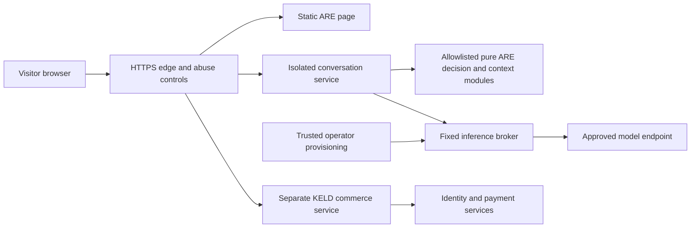
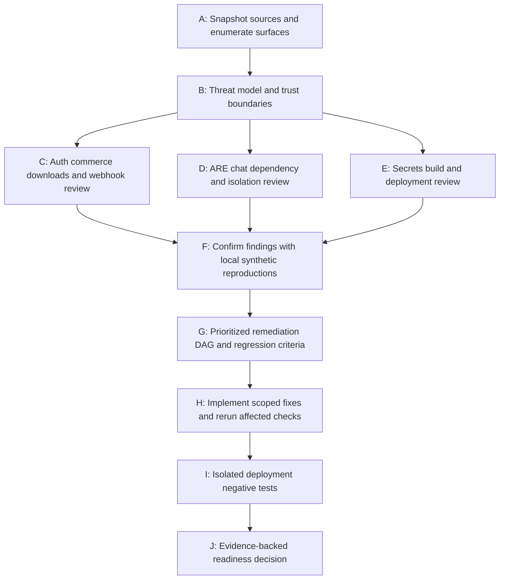

# KELD + ARE security review handoff

Prepared 2026-09-18 for a fresh owner-authorized security-review session.
Status: review specification and source inventory, **not a security certification or release approval**. Private project; do not publish source, transcripts, credentials or infrastructure evidence.

## Start here

Open `/home/vrondelli/projects/cyberAlchemy-v2` in the new account/session. Read root `AGENTS.md` and follow its routing contract, then this document. A change of account does not transfer local files, credentials, tools or prior conversation automatically. Use this checkout, or transfer a sanitized source snapshot containing the untracked work and required shared packages. Never include `.runtime`, personal credential configurations, vaults, age identities, SSH private keys, browser session capabilities or raw customer data.

Suggested starting instruction:

> Read keld-project/docs/SECURITY-REVIEW-HANDOFF.md and repository instructions. Perform an evidence-based security review of KELD, the ARE documentation/live chat, their runtime dependencies and deployment boundaries. Begin with a source inventory and threat model, then reproduce issues using synthetic local fixtures. Distinguish confirmed defects from untested requirements. Prioritize proving that visitor/model input cannot invoke tools, execute commands, access host files or reach privileged services. Produce findings with file/line evidence, a dependency-ordered remediation plan and executable regression tests. Preserve existing services and unrelated work. Do not expose the prototype publicly, use real payments, export secrets or run destructive remote tests as part of this review.

## Objective and claim boundary

KELD will distribute commercial ARE software, with Auth Foundation/Keycloak authentication, Stripe cards, Mercado Pago Pix and PayPal. USDC is deferred. ARE's public-facing page explains the reasoning engine and already has a **local live GLM chat**, not just a planned mockup.

The owner's mandatory requirement: **the visitor chat must never gain tools or OS access**. Enforce this through software capabilities and deployment isolation. A system prompt, a route receipt, a model refusal or a `tools_executed: 0` field is not proof of isolation. ARE may maintain conversational intent, language preferences, selected context and reasoning state; none may become execution authority.

Software necessarily uses OS facilities internally. Here the requirement means no visitor/model-controlled shell, subprocess, file access, network destination, tool dispatch or privileged operation. Only fixed, reviewed internal operations needed for conversation are permitted. An unbounded guarantee against every future vulnerability is not an acceptable release claim; document precisely the tested boundaries.

## Source inventory

Paths below are relative to checkout root unless stated otherwise. Follow imports and enumerate all reachable HTTP endpoints, workers and administrative commands before declaring coverage complete.

| Surface | Starting sources | Review focus |
| --- | --- | --- |
| KELD product and pages | `keld-project/README.md`, `keld-project/prototype/`, `keld-project/integrations/public/` | Which pages actually ship; links, scripts, forms, rendering and security headers |
| HTTP runtime | `keld-project/integrations/src/index.mjs`, `runtime.mjs`, `config.mjs` | Routing, Host/Origin, body limits, proxy trust, startup, shutdown, configuration |
| Authentication | `keld-project/integrations/src/auth.mjs`; sibling `../domainspec-core/projects/auth-foundation/implementation/session-core` | OIDC/PKCE, cookies, CSRF, session renewal/revocation, customer identity and ownership |
| Commerce and providers | `keld-project/integrations/src/payments.mjs`, `repository.mjs`; `keld-project/commerce/` | Price/merchant binding, idempotency, races, paid proof, entitlements and subprocess bridge |
| Events and recovery | `keld-project/integrations/src/events.mjs`, `event-worker.mjs`, operator commands | Signatures, replay, durable receipt, retries, leases, recovery and review queues |
| Downloads | `keld-project/integrations/src/download-stream.mjs`; `keld-project/commerce/delivery.py` | Ownership, path constraints, exact artifact hash, redemption atomicity, streaming and cancellation |
| Credentials | `keld-project/integrations/src/secret-files.mjs`, `child-environment.mjs`; `keld-project/vendor/secret-management/` | File permissions, symlinks, child environment, logging, copied-source provenance |
| Deployment | `keld-project/deploy/` | Compose/Docker/Caddy, service networks, privileges, secret provisioning, realm import, supply chain |
| ARE page and UI | `workspace/experiments/are-documentation/src/LiveChat.tsx`, `main.tsx`, `Hero.tsx`, `data.ts`, `vite.config.mjs` | User/model text rendering, capability custody, reset semantics, asset/build exposure |
| ARE chat backend | `workspace/experiments/are-documentation/server/http.mjs`, `chat.mjs`, `glm.mjs`, `chat.test.mjs` | All `/api/are/` routes, input validation, session separation, budgets, model protocol and transitive imports |
| ARE runtime dependency closure | `implementation/agent-reasoning-engine/packages/` imports from the chat server | Conversation, request intent, routing, native semantic adapter, context selection and reasoning state; distinguish decisions from executors |
| ARE model/secret transport | `implementation/agent-reasoning-engine/packages/coding-agent-runtime/glm-flash-v1/cli.mjs`, `transport.mjs`, `sops-age-secret-provider.mjs` | Filesystem/config reads, subprocess creation, fixed egress, redirects, inherited environment and response parsing |
| ARE gateway security reference | `implementation/agent-reasoning-engine/docs/GATEWAY-AND-AGENTS.md`, `OPERATIONS-AND-SECURITY.md`, `SECURITY-POLICY.md` | Identify privileged capabilities that must remain unreachable from the public chat |

Context documents: [SDK integration](SDK-INTEGRATION.md), [execution DAG](CURRENT-EXECUTION-DAG.md), [staging plan](STAGING-PLAN.md), [VPS/secrets design](VPS-AND-SECRETS.md), [deployment package](../deploy/README.md), [ARE prototype](../../workspace/experiments/are-documentation/README.md), [visitor chat plan](../../workspace/experiments/are-documentation/VISITOR-CHAT-PLAN.md), [live chat plan](../../workspace/experiments/are-documentation/LIVE-CHAT-PLAN.md).

## Snapshot and deployment facts

- Checkout HEAD during preparation: `2d482cef9ed15340821550c1b3da05a138c22ca8`. Both `keld-project/` and `workspace/experiments/are-documentation/` are **untracked**. HEAD alone cannot reproduce this application. Record a sanitized source manifest and dependency/image digests before testing or transferring it. Preserve unrelated dirty work.
- KELD deployment is prepared locally; these documents do not establish a remote KELD deployment or production readiness. Payments remain sandbox-only. Real public TLS, browser Keycloak login, genuine provider checkout/webhook delivery and restoration acceptance remain separate proof obligations.
- VPS: `187.77.163.194`; storefront `keld.studio`; proposed/configured staging identity host `auth.keld.studio`. Latest staging plan records both domains resolving to the VPS; recheck at execution, rather than trusting historical DNS results.
- Prior SSH inspection found Ubuntu 26.04.1, about 16 GB RAM, 191 GB free and no Docker in PATH. It also found an existing `cyberalchemy-orchestrator.service` on **127.0.0.1:18080**, plus `/opt/cyberalchemy-orchestrator` and `/opt/cyberalchemy-are-tools`. Revalidate; do not treat this as a fresh VPS. A GLM deployment was not independently established by that inventory.
- Existing SSH key authentication worked as root using `~/.ssh/id_ed25519` with strict host verification. Do not copy that key into chat, application images or handoff attachments. Root SSH is an operator capability, never a chat capability.
- Some older deployment prose still says “fresh VPS” or lists already-resolved questions. Use dated evidence and flag contradictions; do not silently interpret old documentation as current machine state.

## Existing chat: protections and unresolved boundary

Source inspection during handoff preparation found:

- A loopback Vite middleware on port 4193, with `/api/are/status`, `/chat`, `/state`, `/reset` and `/session` under the same prefix. This is a local development integration, not a production chat service.
- Random per-conversation capabilities, exact local Host/Origin checks, closed request shapes, bounded request/response sizes, cancellation and process-memory state. Current limits include 32 sessions, two active turns, 20 attempts per conversation, 30 turns/hour and 100,000 tokens/hour shared within one process. Review reset, expiration, failed dispatch accounting and multi-process/restart bypasses.
- `glm.mjs` builds a fixed provider request without a tools field and rejects nonempty `message.tool_calls` in successful responses. Review all alternate/malformed response forms, including legacy function calls; rejection of one field is not complete protocol proof.
- `chat.mjs` invokes actual ARE modules with a small curated context catalog. It loads a verified decision profile from the checkout. Routes such as Implement and Publish currently describe intent; they must never dispatch an executor in this visitor adapter.
- The server reads credential-reference configuration and uses `createSopsAgeProcessSecretProvider`; its dependency calls `spawn` to run a Python secret bridge. This is fixed internal credential retrieval, **not demonstrated model-controlled command execution**, but it means the current process is not an OS-isolated public chat runtime.
- Browser capabilities remain in memory and the existing UI uses React rendering. Review the full render/import path rather than assuming all future Markdown or links are safe.

These are inventory observations, not a completed vulnerability audit. In particular, do not report the secret subprocess as exploitable without tracing attacker-controlled input into it. Conversely, do not claim “no OS access” merely because the model has no declared tools.

## Required target architecture for public chat



There must be **no chat-to-commerce, chat-to-orchestrator, chat-to-tool-gateway or chat-to-host-management edge**. Shared ingress is not shared privilege. A broker is a proposed way to keep provider credentials and secret resolution outside the conversation process; validate it as a separate narrow trust boundary.

1. Build a standalone production chat package with an explicit dependency closure. Ship only required, immutable ARE data/modules, not the whole checkout or generic coding-agent CLI. Do not publish Vite's development server.
2. Use a separate unprivileged process/container. No shell/tool executor, runtime subprocess secret bridge, Docker socket, SSH material, host mounts, vault/age identity, commerce artifact directory, payment credentials or commerce/session database access. Drop capabilities, use a read-only root, bounded ephemeral storage/resources and a reviewed syscall policy. Verify enforcement; removing a shell binary alone is insufficient.
3. Provision secrets outside the visitor request path. Prefer a fixed inference broker holding only a dedicated model credential, with no filesystem/command/URL-selection API. The chat may submit only validated inference inputs. The broker must not inherit operator or merchant credentials.
4. Enforce egress independently of model instructions: chat reaches only its broker; broker reaches only the approved provider. Deny host gateway, loopback services, private networks, cloud metadata and other containers except the explicitly required broker path. Account for IPv6, DNS changes and redirects. A normal Docker egress network alone does not establish this policy.
5. No tool definitions, MCP connections, remote agent delegation, code evaluation, terminal sessions, browser tools, arbitrary URL fetching, runtime repository search, uploads with executable processing or “helpful” fallback agents. Reject executable/unsupported model response types before downstream handling. Never promote model text, learned preferences or route labels into commands, paths, policy or authorization.
6. Render model/user content as text or strictly sanitized Markdown. No raw HTML, automatic code execution, unsafe URL schemes or remote image loading that can leak conversation data. Test DOM and network effects.
7. Keep conversation state isolated and minimal. Specify retention, deletion and provider-side handling separately: clearing local state cannot promise deletion from provider logs. Redact capabilities and private content in logs/errors; never present hidden reasoning as product telemetry.
8. Add deployment-wide rate, concurrency, token and spend limits that survive worker scaling/restarts. Origin checks are not authentication and do not stop scripted clients. Choose anonymous access or invited/authenticated access explicitly without giving the chat access to privileged commerce operations.

## Review execution DAG



Current product frontier: A–G, followed by explicitly scoped fixes. The present task creates this handoff; it does not implement the proposed architecture or certify release. No new ontology-runtime dependencies are introduced. D65 construction evidence and product approval remain distinct from operational deployment and commercial release authority.

Operational owners: operator owns VPS isolation/firewall/backup/secret custody; merchant owner owns sandbox account configuration; product owner owns access, retention, licensing and refund policies. Missing merchant credentials block genuine payment acceptance, **not** local source review or chat isolation work. Preserve previous deployment authorization without treating it as permission for destructive tests against existing services.

## Required negative tests and release evidence

| Boundary | Tests and required observable result |
| --- | --- |
| Model output to execution | Inject tool calls, legacy function calls, shell/code requests, encoded instructions, forged route receipts and malicious preference text. No dispatcher invocation, subprocess creation or unauthorized file/network side effect; unsupported protocol responses rejected. Verify with instrumentation, not the model's answer. |
| Runtime containment | From a disposable instance with equivalent chat privileges, attempt host/private-network/metadata/orchestrator access, filesystem writes and forbidden process operations. Enforcement denies them. Test broker separately; never aim probes at third-party infrastructure. |
| Secret isolation | Enumerate mounted paths, image layers, effective environment names, permissions and reachable services without dumping values. Canary secrets outside the chat remain unreadable and absent from browser bundles, errors and logs. |
| Conversation ownership | Two visitors cannot read/reset/delete each other's state, reuse rotated capabilities or contaminate preferences. Test reset/delete during active turns, expiry, disconnect and restart. |
| Untrusted rendering | Script/HTML/Markdown/link payloads produce no DOM execution, credential exposure or unexpected external request. CSP and framing restrictions hold on deployed responses. |
| Abuse and resource limits | Oversized/slow requests, stalled streams, repeated reset, concurrent sessions, provider errors and scaled workers remain bounded; failed billable calls consume budget conservatively. |
| Authentication and commerce | Cross-buyer access denied; invalid CSRF/OIDC/replayed session rejected; client price or redirect cannot grant paid status; duplicates/races cannot double-grant. |
| Webhooks and recovery | Invalid signature, stale/replayed/conflicting event, wrong merchant/amount/currency and worker crash cannot mint an entitlement. Receipt durability and operator recovery remain traceable. |
| Downloads | Wrong buyer, unpaid/expired grant, traversal/symlink, changed/corrupt archive and interrupted stream fail safely without leaking arbitrary files or bypassing grant accounting. |
| Operations | Only intended public ports; admin surface restricted; secrets rotated through real services; backup/restore and rollback proven in separate state; existing orchestrator unaffected. |

A passing prompt-injection conversation is insufficient. Require source call-graph evidence plus runtime denial evidence. If chat isolation is incomplete, keep the live chat disabled on the public deployment; a static explanation can ship separately if approved.

## Existing evidence and how to reproduce

Previously recorded evidence: 78 KELD application tests, 31 copied secret-store tests, three provisioning tests and a real local PostgreSQL/Keycloak/Caddy startup smoke. These are bounded local checks, not real merchant acceptance or a security certification. The prototype README also records 13 chat backend tests and live browser/reset proofs; inspect exact receipts and current source before carrying those claims forward.

Handoff preparation reran the current chat fixture suite: **13 passed, zero failed**, with no live provider calls. Relative documentation links were also checked. No broader audit or deployment test was performed in this handoff task.

Useful commands, from checkout root:

```sh
npm --prefix keld-project/integrations test
node --test workspace/experiments/are-documentation/server/chat.test.mjs
npm --prefix workspace/experiments/are-documentation run build
PYTHONDONTWRITEBYTECODE=1 python3 -m unittest discover -s keld-project/vendor/secret-management/tests -p 'test_*.py'
PYTHONDONTWRITEBYTECODE=1 python3 keld-project/deploy/test_prepare.py
```

Optional deployment smoke: `python3 keld-project/deploy/smoke.py`, after reviewing its disposable project/volume cleanup and checking disk capacity. Do not copy cleanup commands onto production volumes. Browser proofs need the local server and installed browser dependencies. Explicit `ARE_LIVE_CHAT_TEST=1` calls the real provider and spends tokens; fixture tests are the default for security reproduction.

Build caveat: ARE currently reuses `workspace/runtime/node_modules` via a local symlink. A standalone lockfile and reproducible install are still a review requirement. Test evidence must identify the actual source snapshot, dependency versions, configuration and image digest, with secrets excluded.

## Deliverables and completion criteria

Produce a threat model and complete surface inventory; a findings report with severity, affected file/line, attacker prerequisites, synthetic reproduction, impact, remediation and regression test; and a DAG separating runnable fixes from operational prerequisites. Label each finding **confirmed**, **suspected**, **mitigated** or **not evaluated**. Do not turn incomplete evidence into either a vulnerability claim or a pass.

End with a pass/fail/blocked matrix for the boundaries above, exact source/image references, residual risks and owner decisions. Any unresolved path from visitor/model input to privileged execution blocks public chat. Critical/high findings require fixes and verification or an explicit owner disposition; chat execution access cannot be waived by a prompt change. Public release still requires the separate commercial and real-service acceptance gates.

## Open Questions

- Will public chat be anonymous, invited or authenticated, and what is its deployment-wide budget?
- Will its service run on a separate VM or a hardened isolated workload on the existing VPS? What enforces egress and syscall policy?
- Which minimal ARE module/profile closure is required without mounting the repository or importing executor/secret-process code?
- Which broker/provider credential, retention policy and abuse controls will be used?
- What is the final routing relationship between the ARE site and KELD, including cookie, CSP and origin boundaries?
- Who owns security triage, backups, incident response, key rotation and periodic dependency review?
- Which prior local receipts remain reproducible against the sanitized review snapshot? Which staging-plan tasks have actually executed since this document?

Commercial, merchant and infrastructure questions additionally remain in the linked staging and SDK plans. This handoff does not resolve them by assumption.
