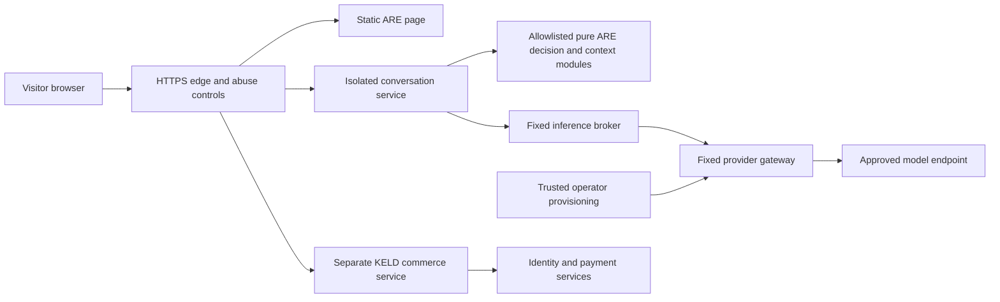
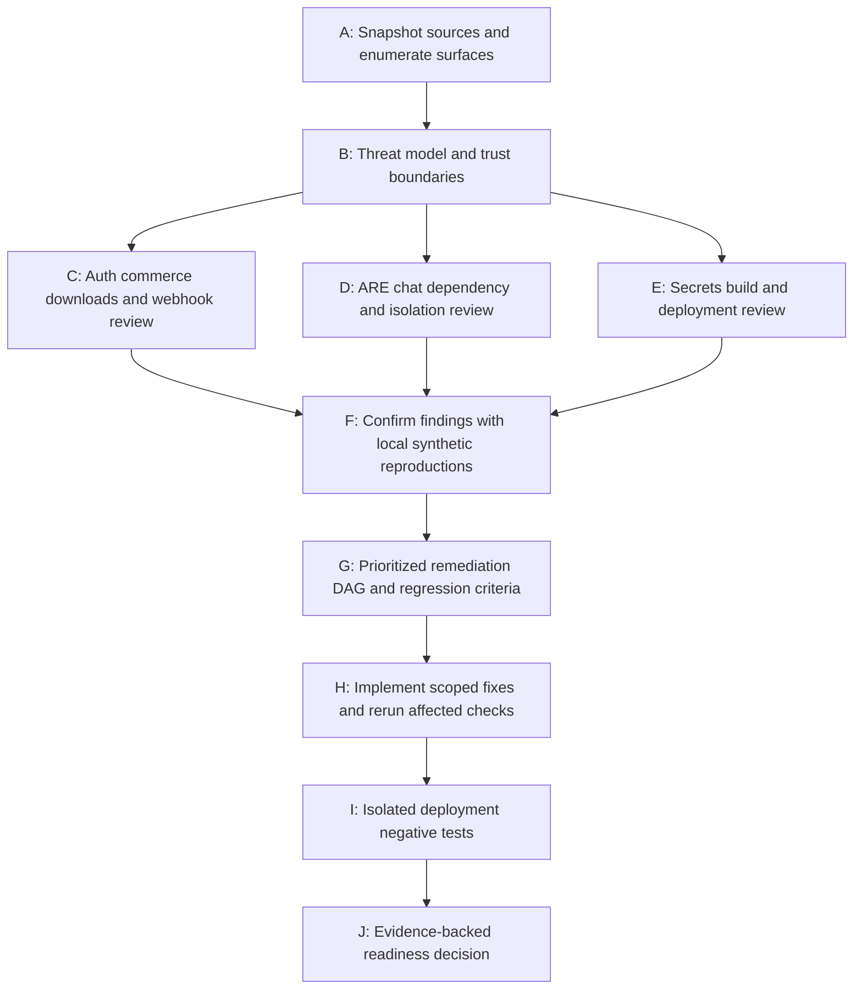

# KELD + ARE security review handoff

Prepared 2026-09-18 for a fresh owner-authorized security-review session.
Status: review specification and source inventory, **not a security certification or release approval**. Private project; do not publish source, transcripts, credentials or infrastructure evidence.

Current execution update, 2026-09-20: see
[SECURITY-PLAN-EXECUTION-2026-09-20.md](SECURITY-PLAN-EXECUTION-2026-09-20.md)
for the deployment history through the current r12 fixed-rate application image,
reviewed
implementation DAG, real-browser Stripe,
Mercado Pago, storefront, and ARE evidence, the genuine Stripe
delivery/redelivery and stopped-worker recovery proof, audited reconciliation
resolution and PayPal missing-order classification, PayPal handoff evidence,
path-move impact, and the remaining operational and product gates. That staging
evidence advances this handoff; it does not convert it into production approval.
The r12 Alpine application candidate and source-clean ARE public-chat image are
now live on staging and bound by the current schema-v3 r23 manifest; r11 and r9
remain rollback history. The conversion policy is fixed at 5.10 BRL/USD with
reference `merchant-fixed-5.10` and no expiry; existing checkout attempts keep
their creation-time frozen quote.
The repeatable backup and recovery boundary is in
[FULL-STATE-BACKUP-RESTORE.md](FULL-STATE-BACKUP-RESTORE.md).
The live exact-release/drift manifest now covers the exact KELD/ARE containers,
43 explicitly allowlisted non-secret deployment/evidence inputs, and all 84
files in the preserved KELD application build context. All 82 KELD runtime-source
files match the deployed image byte-for-byte and the context secret scan is
empty. The ARE evidence binds exact image IDs, declared package manifests, and
independently observed `/srv` trees. r17 exposed a second public-chat `dist/`
overlay; r18 replaces it with an image whose 96 declared payload files match the
prior live content while removing four stale unreferenced chunks. All three ARE
package trees now match their declarations. The replacement has zero context
secrets, zero exact-image High/Critical or secret findings, a constrained
isolated smoke, and a passing Firefox chat/refresh/reset journey. This is
image-content provenance, not a clean-room rebuild.
A private archive covers all seven custom image IDs from the preceding r20
baseline, verifies 91 OCI blob digests and seven manifest entries, and has
matching off-VPS hashes. That exact set passed an automated 15.566-second load into an empty Docker
29.8.1 containerd-snapshotter image store with all seven manifest IDs preserved
and zero containers before and after. A classic `vfs` load was rejected because
it exposed config IDs instead. r21 binds the r20 archive and recovery receipts
as previous-baseline recovery evidence plus both reusable tools. The fresh r21
archive verifies 91 blobs and passed a 28.78-second empty-engine load with all
seven exact IDs and zero containers. The archive and both receipts have matching
off-VPS copies, and schema-v3 r23 binds the current receipts and tools. r23 also
binds a privacy-safe receipt for five Stripe, two Mercado Pago, and one PayPal
provider-confirmed paid journey with one consumed exact-artifact grant per
journey. The receipt omits customer, account, order, remote-payment, and payer-
email identifiers. It proves current ledger/artifact state, not browser rendering
or genuine webhook delivery; Mercado Pago and PayPal webhook restart/replay
proof therefore remains open.
Service/state restore and public cutover are separate.
A hardened systemd timer
re-verifies it plus service-specific public response content, semantic no-model-
call chat availability/retention state, and the public allow/deny probes every
five minutes, validates the fixed quote's reference/null-expiry/no-refresh
semantics, accepts only the three explicit HTTPS hosts, refuses redirects
and ambiguous URL forms, and writes a private bounded state. Its
first scheduled run passed. A credential-safe external success-heartbeat sender
and inactive systemd drop-in are staged, but no receiver was selected or tested.
The current state is local detection and release evidence, not external alert
delivery, production authorization, or a substitute for a rollback drill.
The current backup workflow also runs a standalone secret-silent structural and
integrity verifier before publishing a recovery point; all three retained r9
full-state backups pass it.
An official-API BCB PTAX fetcher is also staged. It emits a reviewable exact
sell-rate proposal but deliberately cannot override or apply the merchant-fixed
quote.

Execution update, 2026-09-18: the local review/remediation run is recorded in
[PUBLIC-CHAT-SECURITY-FINDINGS.md](PUBLIC-CHAT-SECURITY-FINDINGS.md) and the
[implementation DAG](PUBLIC-CHAT-SECURITY-IMPLEMENTATION-DAG.md). The
[completion audit](SECURITY-COMPLETION-AUDIT.md) maps every original obligation
to current evidence or its remaining owner gate. Local chat and
custom KELD image gates pass. The original two exact Keycloak raw findings have
a topology-bound OpenVEX assessment. A fresh 2026-09-20 database scan also
reports two Bouncy Castle CVEs in duplicate client/server jar paths; the existing
VEX does not cover them and no current zero-finding Keycloak claim is made. The
experimental optimized/read-only image remains unpromoted pending remediation or
a configuration-bound affectedness assessment and security-owner acceptance.
The live realm now has a separate reversible crypto-surface migration: both
unused WebAuthn registration actions are disabled, identity providers are empty,
enabled clients are OIDC-only with no X.509 client authenticator, all seven bound
authentication flows are checked, and X.509/WebAuthn executions outside the
guarded built-in client flow are disabled. The public edge also blocks dynamic
client registration. Exact-source tracing supports deployment-specific
not-in-execute-path candidate dispositions for the two Bouncy Castle findings,
but the machine-readable VEX remains unchanged pending security-owner acceptance
or a clean dependency update.
A later complete Bouncy Castle 1.85 overlay removes both BC findings and retains
three raw findings. The exact downstream image passes an isolated restored-state
rehearsal and a candidate-backed application/browser regression covering two
registrations, PKCE callback exchange, forced renewal, logout, and two-buyer
order isolation. An exact-SBOM-subject OpenVEX proposal records Netty and the
unused SQL Server driver as proposed `not_affected` and keeps the disputed
OpenJDK record `under_investigation`. It passes the official OpenVEX 0.2.0
schema, is explicitly unapproved, and is absent from every Compose and scanner
input. The raw scan therefore remains authoritative and live staging remains on
the stock Keycloak image. Corrected like-for-like Trivy 0.74.0 full-license
scans produce the same 52 classifier entries for stock and candidate images,
with zero normalized delta. The changed 1.85 Bouncy Castle JARs each retain the
same embedded MIT license file. This reduces the candidate-specific license
question but does not approve the unchanged stock-image notices, source offers,
artifact rights, or distribution terms.
The product owner subsequently selected the dedicated `are.keld.studio` root as
the public ARE URL. Generated KELD pages and the live edge use `/`; public
`/are/` is a legacy redirect, while the isolated runtime/API contract retains
`/are/*` internally. A follow-up review found and repaired the reusable
KELD Caddy/Compose candidate, smoke proof, and guide that still encoded ARE on
the storefront `/are/` route. The corrected candidate requires a distinct
`ARE_DOMAIN` and passes the focused deployment suite and Caddy parsing. This is
source validation; the immutable live r9 override was already correct.
The combined public-release decision also remains blocked by unexecuted product,
operator, and real-service acceptance gates.

## Start here

Open `/home/vlad_/projects/cyberAlchemy-v2` in the new account/session. Read root `AGENTS.md` and follow its routing contract, then this document. A change of account does not transfer local files, credentials, tools or prior conversation automatically. Use this checkout, or transfer a sanitized source snapshot containing the untracked work and required shared packages. Never include `.runtime`, personal credential configurations, vaults, age identities, SSH private keys, browser session capabilities or raw customer data.

Suggested starting instruction:

> Read keld-project/docs/SECURITY-REVIEW-HANDOFF.md and repository instructions. Perform an evidence-based security review of KELD, the ARE documentation/live chat, their runtime dependencies and deployment boundaries. Begin with a source inventory and threat model, then reproduce issues using synthetic local fixtures. Distinguish confirmed defects from untested requirements. Prioritize proving that visitor/model input cannot invoke tools, execute commands, access host files or reach privileged services. Produce findings with file/line evidence, a dependency-ordered remediation plan and executable regression tests. Preserve existing services and unrelated work. Do not expose the prototype publicly, use real payments, export secrets or run destructive remote tests as part of this review.

## Objective and claim boundary

KELD will distribute commercial ARE software, with Auth Foundation/Keycloak authentication, Stripe cards, Mercado Pago Pix and PayPal. USDC is deferred. ARE's public-facing page explains the reasoning engine and already has a **local live GLM chat**, not just a planned mockup.

The owner's mandatory requirement: **the visitor chat must never gain tools or OS access**. Enforce this through software capabilities and deployment isolation. A system prompt, a route receipt, a model refusal or a `tools_executed: 0` field is not proof of isolation. ARE may maintain conversational intent, language preferences, selected context and reasoning state; none may become execution authority.

Software necessarily uses OS facilities internally. Here the requirement means no visitor/model-controlled shell, subprocess, file access, network destination, tool dispatch or privileged operation. Only fixed, reviewed internal operations needed for conversation are permitted. An unbounded guarantee against every future vulnerability is not an acceptable release claim; document precisely the tested boundaries.

## Source inventory

Paths below are relative to checkout root unless stated otherwise. Follow imports and enumerate all reachable HTTP endpoints, workers and administrative commands before declaring coverage complete.

| Surface | Starting sources | Review focus |
| --- | --- | --- |
| KELD product and pages | `keld-project/README.md`, `keld-project/prototype/`, `keld-project/integrations/public/` | Which pages actually ship; links, scripts, forms, rendering and security headers |
| HTTP runtime | `keld-project/integrations/src/index.mjs`, `runtime.mjs`, `config.mjs` | Routing, Host/Origin, body limits, proxy trust, startup, shutdown, configuration |
| Authentication | `keld-project/integrations/src/auth.mjs`; sibling `../domainspec-core/projects/auth-foundation/implementation/session-core` | OIDC/PKCE, cookies, CSRF, session renewal/revocation, customer identity and ownership |
| Commerce and providers | `keld-project/integrations/src/payments.mjs`, `repository.mjs`; `keld-project/commerce/` | Price/merchant binding, idempotency, races, paid proof, entitlements and subprocess bridge |
| Events and recovery | `keld-project/integrations/src/events.mjs`, `event-worker.mjs`, operator commands | Signatures, replay, durable receipt, retries, leases, recovery and review queues |
| Downloads | `keld-project/integrations/src/download-stream.mjs`; `keld-project/commerce/delivery.py` | Ownership, path constraints, exact artifact hash, redemption atomicity, streaming and cancellation |
| Credentials | `keld-project/integrations/src/secret-files.mjs`, `child-environment.mjs`; `keld-project/vendor/secret-management/` | File permissions, symlinks, child environment, logging, copied-source provenance |
| Deployment | `keld-project/deploy/` | Compose/Docker/Caddy, service networks, privileges, secret provisioning, realm import, supply chain |
| ARE page and UI | `keld-project/are-documentation/src/LiveChat.tsx`, `main.tsx`, `Hero.tsx`, `data.ts`, `vite.config.mjs` | User/model text rendering, capability custody, reset semantics, asset/build exposure |
| ARE chat backend | `keld-project/are-documentation/server/http.mjs`, `chat.mjs`, `glm.mjs`, `chat.test.mjs` | Public `/are/api/are/` routes and normalized internal `/api/are/` routes, input validation, session separation, budgets, model protocol and transitive imports |
| ARE runtime dependency closure | `implementation/agent-reasoning-engine/packages/` imports from the chat server | Conversation, request intent, routing, native semantic adapter, context selection and reasoning state; distinguish decisions from executors |
| ARE model/secret transport | `implementation/agent-reasoning-engine/packages/coding-agent-runtime/glm-flash-v1/cli.mjs`, `transport.mjs`, `sops-age-secret-provider.mjs` | Filesystem/config reads, subprocess creation, fixed egress, redirects, inherited environment and response parsing |
| ARE gateway security reference | `implementation/agent-reasoning-engine/docs/GATEWAY-AND-AGENTS.md`, `OPERATIONS-AND-SECURITY.md`, `SECURITY-POLICY.md` | Identify privileged capabilities that must remain unreachable from the public chat |

Context documents: [SDK integration](SDK-INTEGRATION.md), [execution DAG](CURRENT-EXECUTION-DAG.md), [staging plan](STAGING-PLAN.md), [VPS/secrets design](VPS-AND-SECRETS.md), [deployment package](../deploy/README.md), [ARE prototype](../are-documentation/README.md), [visitor chat plan](../are-documentation/VISITOR-CHAT-PLAN.md), [live chat plan](../are-documentation/LIVE-CHAT-PLAN.md).

## Snapshot and deployment facts

- Checkout HEAD during preparation: `2d482cef9ed15340821550c1b3da05a138c22ca8`. The ARE page/runtime package was subsequently relocated under `keld-project/are-documentation/`; the current worktree still contains uncommitted tracked and untracked candidate material. HEAD alone cannot reproduce this application. Record a sanitized source manifest and dependency/image digests before testing or transferring it. Preserve unrelated dirty work.
- KELD deployment is prepared locally, including a fail-closed `/are/` ingress
  candidate backed by four isolated ARE services. These documents do not
  establish a remote KELD deployment or production readiness. Payments remain
  sandbox-only. Exact registry image references and owner retention/spend/rate
  values are still required before Compose will start outside the synthetic
  smoke. A local preflight now rejects mutable/malformed or reused role-image
  digests and malformed/out-of-range numeric inputs without printing supplied
  values; every ARE service directly depends on its hardened, networkless
  one-shot execution during ordinary Compose startup. It does not choose or
  approve those inputs. Real public TLS, browser Keycloak login, genuine provider
  checkout/webhook delivery and restoration acceptance remain separate proof
  obligations.
- VPS: `187.77.163.194`; staging storefront `staging.keld.studio`; current
  staging identity host `auth.staging.keld.studio`; ARE host `are.keld.studio`.
  All three public probes passed on 2026-09-20; recheck at execution rather than
  trusting historical DNS results. Reserve the apex identity names for a later
  owner-authorized production cutover.
- Prior SSH inspection found Ubuntu 26.04.1, about 16 GB RAM, 191 GB free and no Docker in PATH. It also found an existing `cyberalchemy-orchestrator.service` on **127.0.0.1:18080**, plus `/opt/cyberalchemy-orchestrator` and `/opt/cyberalchemy-are-tools`. Revalidate; do not treat this as a fresh VPS. A GLM deployment was not independently established by that inventory.
- Existing SSH key authentication worked as root using `~/.ssh/id_ed25519` with strict host verification. Do not copy that key into chat, application images or handoff attachments. Root SSH is an operator capability, never a chat capability.
- Some older deployment prose still says “fresh VPS” or lists already-resolved questions. Use dated evidence and flag contradictions; do not silently interpret old documentation as current machine state.

## Existing chat: protections and unresolved boundary

Source inspection during handoff preparation found:

- A loopback Vite middleware on port 4193, now rooted at `/are/`, with
  `/are/api/are/status`, `/chat`, `/state`, `/reset` and `/session` under the
  same prefix. This is a local development integration, not a production chat
  service.
- Random per-conversation capabilities, exact local Host/Origin checks, closed request shapes, bounded request/response sizes, cancellation and process-memory state. Current limits include 32 sessions, two active turns, 20 attempts per conversation, 30 turns/hour and 100,000 tokens/hour shared within one process. Review reset, expiration, failed dispatch accounting and multi-process/restart bypasses.
- `glm.mjs` builds a fixed provider request without a tools field and rejects nonempty `message.tool_calls` in successful responses. Review all alternate/malformed response forms, including legacy function calls; rejection of one field is not complete protocol proof.
- `chat.mjs` invokes actual ARE modules with a small curated context catalog. It loads a verified decision profile from the checkout. Routes such as Implement and Publish currently describe intent; they must never dispatch an executor in this visitor adapter.
- The server reads credential-reference configuration and uses `createSopsAgeProcessSecretProvider`; its dependency calls `spawn` to run a Python secret bridge. This is fixed internal credential retrieval, **not demonstrated model-controlled command execution**, but it means the current process is not an OS-isolated public chat runtime.
- Browser capabilities remain in memory and the existing UI uses React rendering. Review the full render/import path rather than assuming all future Markdown or links are safe.

These are inventory observations, not a completed vulnerability audit. In particular, do not report the secret subprocess as exploitable without tracing attacker-controlled input into it. Conversely, do not claim “no OS access” merely because the model has no declared tools.

Execution note: this section records the pre-remediation baseline. The reviewed
candidate now uses separate chat, inference-broker, and provider-gateway packages;
the gateway alone holds the model credential and external network. Current facts
and exact hashes are in the linked findings and implementation DAG.

## Required target architecture for public chat



There must be **no chat-to-commerce, chat-to-orchestrator, chat-to-tool-gateway
or chat-to-host-management edge**. Shared ingress is not shared privilege. The
current local candidate implements separate broker and provider-gateway trust
boundaries; production acceptance must validate the same separation.

1. Build a standalone production chat package with an explicit dependency closure. Ship only required, immutable ARE data/modules, not the whole checkout or generic coding-agent CLI. Do not publish Vite's development server.
2. Use a separate unprivileged process/container. No shell/tool executor, runtime subprocess secret bridge, Docker socket, SSH material, host mounts, vault/age identity, commerce artifact directory, payment credentials or commerce/session database access. Drop capabilities, use a read-only root, bounded ephemeral storage/resources and a reviewed syscall policy. Verify enforcement; removing a shell binary alone is insufficient.
3. Provision secrets outside the visitor request path. Use a fixed provider
   gateway holding only a dedicated model credential, with no
   filesystem/command/URL-selection API. The chat submits validated inference
   inputs to a credential-free broker, which can reach only that gateway. Neither
   component may inherit operator or merchant credentials.
4. Enforce egress independently of model instructions: chat reaches only its
   broker; broker reaches only its provider gateway; the gateway reaches only the
   approved provider. Deny host gateway, loopback services, private networks,
   cloud metadata and other containers except the explicitly required internal
   path. Account for IPv6, DNS changes and redirects. A normal Docker egress
   network alone does not establish this policy.
5. No tool definitions, MCP connections, remote agent delegation, code evaluation, terminal sessions, browser tools, arbitrary URL fetching, runtime repository search, uploads with executable processing or “helpful” fallback agents. Reject executable/unsupported model response types before downstream handling. Never promote model text, learned preferences or route labels into commands, paths, policy or authorization.
6. Render model/user content as text or strictly sanitized Markdown. No raw HTML, automatic code execution, unsafe URL schemes or remote image loading that can leak conversation data. Test DOM and network effects.
7. Keep conversation state isolated and minimal. Specify retention, deletion and provider-side handling separately: clearing local state cannot promise deletion from provider logs. Redact capabilities and private content in logs/errors; never present hidden reasoning as product telemetry.
8. Add deployment-wide rate, concurrency, token and spend limits that survive worker scaling/restarts. Origin checks are not authentication and do not stop scripted clients. The owner selected temporary anonymous public access; encode it explicitly, fail closed for unsupported modes, and never give the chat privileged commerce operations.

## Review execution DAG



Execution reached A–J for the bounded local candidate: scoped fixes, isolated
negative tests, exact-image scans, and the local readiness decision are recorded
in the linked findings. J is **blocked for public release** at owner and remote
acceptance gates. This does not certify release. No new ontology-runtime
dependencies are introduced. D65 construction evidence and product approval
remain distinct from operational deployment and commercial release authority.

Operational owners: operator owns VPS isolation/firewall/backup/secret custody; merchant owner owns sandbox account configuration; product owner owns access, retention, licensing and refund policies. Missing merchant credentials block genuine payment acceptance, **not** local source review or chat isolation work. Preserve previous deployment authorization without treating it as permission for destructive tests against existing services.

## Required negative tests and release evidence

| Boundary | Tests and required observable result |
| --- | --- |
| Model output to execution | Inject tool calls, legacy function calls, shell/code requests, encoded instructions, forged route receipts and malicious preference text. No dispatcher invocation, subprocess creation or unauthorized file/network side effect; unsupported protocol responses rejected. Verify with instrumentation, not the model's answer. |
| Runtime containment | From a disposable instance with equivalent chat privileges, attempt host/private-network/metadata/orchestrator access, filesystem writes and forbidden process operations. Enforcement denies them. Test broker separately; never aim probes at third-party infrastructure. |
| Secret isolation | Enumerate mounted paths, image layers, effective environment names, permissions and reachable services without dumping values. Canary secrets outside the chat remain unreadable and absent from browser bundles, errors and logs. |
| Conversation ownership | Two visitors cannot read/reset/delete each other's state, reuse rotated capabilities or contaminate preferences. Test reset/delete during active turns, expiry, disconnect and restart. |
| Untrusted rendering | Script/HTML/Markdown/link payloads produce no DOM execution, credential exposure or unexpected external request. CSP and framing restrictions hold on deployed responses. |
| Abuse and resource limits | Oversized/slow requests, stalled streams, repeated reset, concurrent sessions, provider errors and scaled workers remain bounded; failed billable calls consume budget conservatively. |
| Authentication and commerce | Cross-buyer access denied; invalid CSRF/OIDC/replayed session rejected; client price or redirect cannot grant paid status; duplicates/races cannot double-grant. |
| Webhooks and recovery | Invalid signature, stale/replayed/conflicting event, wrong merchant/amount/currency and worker crash cannot mint an entitlement. Receipt durability and operator recovery remain traceable. |
| Downloads | Wrong buyer, unpaid/expired grant, traversal/symlink, changed/corrupt archive and interrupted stream fail safely without leaking arbitrary files or bypassing grant accounting. |
| Operations | Only intended public ports; admin surface restricted; secrets rotated through real services; backup/restore and rollback proven in separate state; existing orchestrator unaffected. |

A passing prompt-injection conversation is insufficient. Require source call-graph evidence plus runtime denial evidence. If chat isolation is incomplete, keep the live chat disabled on the public deployment; a static explanation can ship separately if approved.

## Existing evidence and how to reproduce

The completed local run records 91/91 KELD integration tests, 31/31 copied
secret-store tests, 4/4 provisioning tests, 48/48 ARE server tests, package-closure
verification, an integrated synthetic PostgreSQL/Keycloak/web/worker/Caddy plus
four-service ARE smoke, exact-image
SBOM/vulnerability scans, configuration and secret scans, runtime network/secret
denial probes, custom-seccomp syscall probes, and a hostile-rendering Firefox
proof. The current full ARE hero/browser suite also passes, including the
particle-worker fallback, pause, reduced-motion, navigation, and visibility
checks. Independent Semgrep CE `p/default` passes cover 193 ARE targets, 466
authored-source targets, and 469 unfiltered source targets with zero findings
and zero parse errors. The former six generated
`http://localhost:4193/` findings are absent after the owner selected `/are/`
and all six prototype editions were regenerated. The exact-container edge,
Firefox proof, and integrated KELD ingress smoke validate `/are/` assets and
`/are/api/are/*` while rejecting `/api/are/*` and `/area` and keeping `/readyz`
private. Production was not
deployed. No live model or payment call was made. These
remain bounded local checks, not real merchant acceptance or a security
certification; use the exact hashes in the findings rather than older counts in
narrative files.

Useful commands, from checkout root:

```sh
npm --prefix keld-project/integrations test
npm --prefix keld-project/are-documentation test
npm --prefix keld-project/are-documentation run package:security
PYTHONDONTWRITEBYTECODE=1 python3 -m unittest discover -s keld-project/vendor/secret-management/tests -p 'test_*.py'
PYTHONDONTWRITEBYTECODE=1 python3 keld-project/deploy/test_prepare.py
node --test keld-project/deploy/test-production-inputs.mjs
```

Optional deployment smoke: `python3 keld-project/deploy/smoke.py`, after reviewing its disposable project/volume cleanup and checking disk capacity. Do not copy cleanup commands onto production volumes. Browser proofs need the local server and installed browser dependencies. Explicit `ARE_LIVE_CHAT_TEST=1` calls the real provider and spends tokens; fixture tests are the default for security reproduction.

Build caveat: the local source build reuses the repository workspace dependency
installation. The shipped runtime packages contain explicit manifests and the
project has its own lockfile, but a clean-room build on the target CI/runtime is
still an operational acceptance obligation. Evidence must identify the actual
source snapshot, dependency versions, configuration, and image digest, with
secrets excluded.

## Deliverables and completion criteria

Produce a threat model and complete surface inventory; a findings report with severity, affected file/line, attacker prerequisites, synthetic reproduction, impact, remediation and regression test; and a DAG separating runnable fixes from operational prerequisites. Label each finding **confirmed**, **suspected**, **mitigated** or **not evaluated**. Do not turn incomplete evidence into either a vulnerability claim or a pass.

End with a pass/fail/blocked matrix for the boundaries above, exact source/image references, residual risks and owner decisions. Any unresolved path from visitor/model input to privileged execution blocks public chat. Critical/high findings require fixes and verification or an explicit owner disposition; chat execution access cannot be waived by a prompt change. Public release still requires the separate commercial and real-service acceptance gates.

## Open Questions

- Anonymous public chat is selected for now. The broker now enforces durable
  hourly/monthly monetary reservations and refuses missing configuration. The
  chat enforces configured process-memory idle expiry and refuses missing
  production retention configuration. What abuse/source-address key, numeric
  ceilings, verified provider rates, idle-retention value, and review trigger
  will govern it?
- Will its service run on a separate VM or a hardened isolated workload on the
  existing VPS, and will the operator accept the candidate egress and seccomp
  controls there?
- Will the security and license owners approve, revise, or reject the fully
  rehearsed downstream Keycloak candidate and its exact-subject OpenVEX
  proposal, or require a clean supported replacement image?
- Which idle-retention value, provider-side handling, exact monetary values, and
  abuse controls will be used?
- Will the operator accept and deploy the tested KELD ingress candidate for the
  selected `/are/` page and `/are/api/are/*` API while preserving the reviewed
  cookie-free, CSP, origin, host, method, immutable-image, secret, and network
  boundaries and supplying four content-distinct digest-pinned images that pass
  the production-input preflight?
- Who owns security triage, backups, incident response, key rotation and periodic dependency review?
- Which prior local receipts remain reproducible against the sanitized review snapshot? Which staging-plan tasks have actually executed since this document?

Commercial, merchant and infrastructure questions additionally remain in the linked staging and SDK plans. This handoff does not resolve them by assumption.
