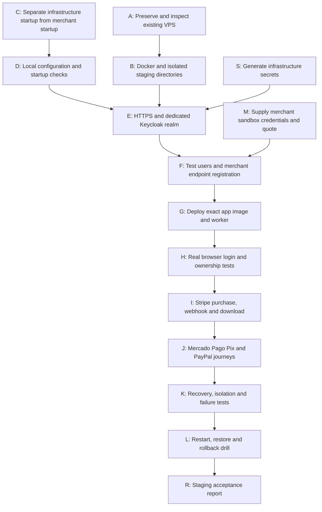

# KELD staging execution plan

Date: 2026-09-18. Candidate planning under CAV2-D65; no deployment performed
by this document. Goals validation remains blocked; this is not admitted
execution state. No ontology runtime record or selector dependency.

## Objective and boundaries

Prove that a real browser user can log in, buy through a merchant sandbox,
receive a verified entitlement, and download the exact synthetic artifact.
Repeat for Stripe cards, Mercado Pago Pix and PayPal. Preserve the existing
ARE/orchestrator service throughout. Commercial release remains a separate gate.

Use VPS `187.77.163.194`, with `https://staging.keld.studio` as the staging
storefront and `https://auth.staging.keld.studio` as its dedicated test identity service.
The user selected separate staging hostnames after the initial plan; both now resolve.
Mark the UI STAGING / TEST PAYMENTS; use only invited test users, sandbox merchant
accounts and synthetic downloads. Reserve `keld.studio` and `auth.keld.studio`
for production with distinct credentials, realm, databases and volumes.
Never promote test data.

## Evidence available

- Both domains resolve to the VPS; no AAAA records in the latest public lookup.
- Existing SSH key works. Prior read-only inspection found Ubuntu 26.04.1,
  about 16 GB RAM, 191 GB free, no Docker, and the orchestrator on
  `127.0.0.1:18080`. Recheck these before mutation.
- [Deployment package](../deploy/README.md): pinned images, file secrets,
  private database/app listeners, worker and bounded logs are implemented.
- Latest recorded local evidence: 78 application tests, 31 copied secret-store
  tests, 3 provisioning tests and a real local Compose startup smoke passed.
  This does not prove public TLS, browser authentication or merchant payments.
- Docker currently lists Ubuntu 26.04 as supported. Use its
  [official apt installation](https://docs.docker.com/engine/install/ubuntu/),
  selecting and recording versions at execution. Published Docker ports require
  explicit exposure review; host UFW rules alone are insufficient.

## Dependency graph

## Tasks and exit criteria

| ID | Work | Owner | Exit evidence |
| --- | --- | --- | --- |
| A | Record service state, listeners, resource use, firewall and package conflicts; preserve existing service definitions and identify recovery procedure | Agent/operator | Baseline recorded without reading or logging secret values; no collision on 80/443; existing service recovery available |
| B | Install pinned Docker/Compose through official repository; create `/opt/keld-staging`; use an explicit `keld-staging` Compose project and dedicated persistent state | Agent/operator | Docker works; only intended public ports; existing orchestrator still healthy; no deletion of existing packages/services without dependency review |
| C | Remove edge dependency on merchant web startup; provide maintenance response until app is ready; separate infrastructure secret provisioning from all-provider preparation; add noindex header and restrict Keycloak administration to operator access | Agent | HTTPS/issuer can start without merchant keys; webhook paths stay reachable without an interactive access challenge; no synthetic credentials used as deployed substitutes |
| D | Validate changed Compose/Caddy configuration, permission ownership and cold-start behavior; bind source manifest and image digest to evidence | Agent | Targeted tests and infrastructure-only smoke pass; startup without app works; app activation switches routing correctly |
| S | Create dedicated staging encrypted vault and generated infrastructure secrets on trusted workstation; transfer only required runtime files | Agent/operator | Private file ownership verified; key/vault recovery verified; age identity stays off VPS and secrets stay out of Git/chat/logs |
| E | Start edge, PostgreSQL and Keycloak; issue trusted certificates for both domains; configure exact issuer, client callback and audience | Agent/operator | HTTPS and issuer discovery succeed externally; database and internal HTTP ports are not public; original ARE service remains healthy |
| M | Supply test merchant identities, six provider secret inputs, PayPal sandbox app, and valid BRL quote with expiry | Merchant owner | Inputs stored through secret store; providers positively identified as sandbox/test; no production money required |
| F | Create two invited test buyers; register actual provider endpoints `/events/stripe`, `/events/mercadopago`, `/events/paypal`; store returned signing values and PayPal webhook ID | Operator/merchant owner with agent support | Exact endpoint configuration recorded without credentials; provider-specific test procedure confirmed; no public self-registration or SMTP needed for first test |
| G | Prepare complete private runtime settings with synthetic artifact/hash; deploy immutable app image and worker; activate routes | Agent/operator | App readiness, issuer availability, worker and database checked separately; quote current; actual image/config manifest recorded |
| H | Browser login, callback, renewal, logout and second-buyer isolation at public HTTPS origins | Agent/test operator | Secure cookies and ownership checks pass; logout invalidates session; other buyer cannot access orders/downloads |
| I | Complete one Stripe test-card checkout, receive genuine signed event, reconcile and download | Agent/test operator | Server verifies paid amount/currency/merchant/order; one entitlement; downloaded hash matches fixture; timestamps and sanitized IDs recorded |
| J | Repeat using Mercado Pago Pix and PayPal sandbox accounts | Agent/test operator | Same proof per provider; any sandbox limitation explicitly recorded rather than treated as a passing payment |
| K | Exercise duplicate/invalid webhook, checkout cancellation, lost browser return, delayed event, worker restart, unpaid and cross-buyer download denial | Agent | No duplicate grants or callback-only paid state; recovery succeeds; local simulated cases distinguished from genuine provider delivery |
| L | Restart staging services; take consistent PostgreSQL and SQLite backups, restore in isolated volumes, and roll back app to retained digest | Agent/operator | Orders/entitlements survive restart; restored data and artifact references verified; schema-compatible rollback proven; ARE unaffected |
| R | Produce evidence matrix and remaining issue list tied to exact deployed candidate | Agent; owner reviews | All mandatory cases have pass/fail/blocked evidence; staging accepted only when all three provider journeys and safety cases pass |

First useful milestone is **I**: one complete public-HTTPS Stripe sandbox journey.
That is a demonstrable result, not completion of the three-provider staging goal.

## Current product frontier and causal blockers

Mercado Pago now has an explicit prerequisite: implement and test the
[Orders migration](MERCADO-PAGO-ORDERS-PLAN.md) before its stage J journey.
Prior `payment` webhook topic and `TEST-` prefix guidance describe the legacy
implementation; Orders needs its own verified setup. Stripe and PayPal guidance
is unaffected. The migration is planned, not deployed.

Runnable product work: C/D, test-runner preparation and evidence templates.
The existing app configuration requires all three providers; enabling only Stripe
would require an explicit implementation change. Do not assume provider-by-provider
configuration already works. The planned first Stripe test follows full provisioning.

Operational tasks A/B/S can proceed independently of merchant credentials. E needs
DNS (already checked), infrastructure secrets and a certificate contact email under
the current Caddy configuration. F/G need actual merchant inputs; placeholders do
not satisfy this gate. H needs invited users. I/J need merchant sandbox access.

D65 chain: existing candidate implementation and local tests -> exact staging
candidate with changed bootstrap tested -> review product evidence and deployment
envelope -> authorized staging deployment -> real-service acceptance evidence.
Retain earlier user deployment authorization where applicable; the plan itself
grants no new effects and does not imply commercial product approval.

## Operational safeguards and cleanup

- Keep existing `/opt/cyberalchemy-orchestrator`, `/opt/cyberalchemy-are-tools`
  and their systemd configuration outside the deployment write scope.
- Scope every Compose command to the staging project. Never use global prune or
  `down --volumes` against retained state. Stop only the new stack on failed rollout.
- Separate release files from persistent data so an image rollback cannot replace
  the ledger, database, secrets or artifact. Existing relative mounts need a stable
  deployment directory or explicit stable state paths before versioned rollouts.
- Keycloak import and initial SQL apply only to empty state. Restarting with new
  files does not rotate credentials or update an existing realm.
- Record disk and memory before/after deployment. Retain current and previous app
  image; remove only named obsolete staging build artifacts. Existing logs are
  capped at 10 MB x 3 per service. Investigate at 80% disk use; pause new runs
  at 90% or below 10 GB free. Keep receipts, not repeated build/cache copies.
- Use consistent database backups, not live SQLite file copies. A temporary local
  backup supports the staging restore drill; off-server encrypted retention and
  alerting remain required before production.
- Any future staging hostname migration must update OIDC callbacks, issuer,
  cookie origin, provider redirects and webhook registrations together.

## Open Questions

Needed for this plan: certificate contact email; merchant sandbox credentials,
merchant IDs and webhook configuration; test buyer identities; BRL quote value,
source and expiry. Supply credentials only through the secret store.

Production-only residue: license and approved release, refund/dispute policy,
customer registration/recovery/SMTP, backup destination and retention, alert
recipient, production domains and credentials. These do not block synthetic
staging tests. USDC stays deferred. Commercial questions remain owned by
[SDK-INTEGRATION.md](SDK-INTEGRATION.md#open-questions).
