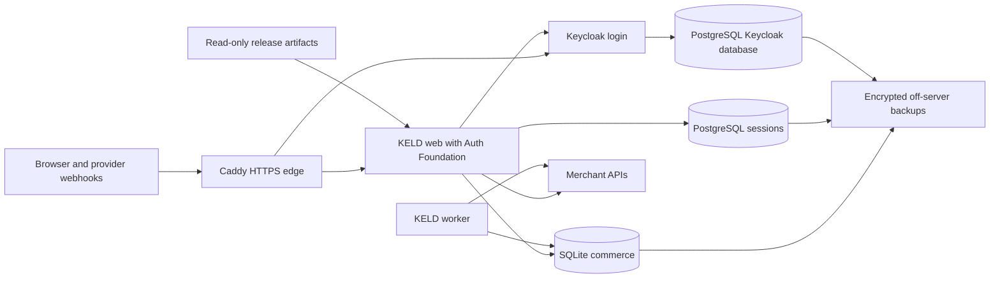
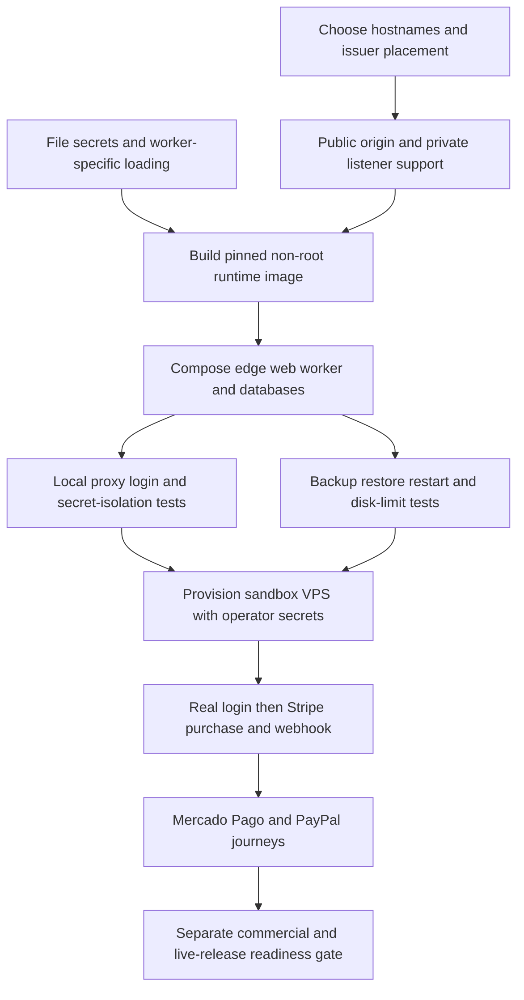

# KELD VPS and secrets design

Date: 2026-09-17. Candidate research/design, not a deployed configuration.
Owner direction: a new VPS can be created for this setup.
Objective: operate KELD's ARE sales/download service using shared Auth Foundation,
Stripe, Mercado Pago Pix and PayPal. USDC remains deferred.
This supplies operational design to the [execution DAG](CURRENT-EXECUTION-DAG.md).
No server, account, credential, DNS record or payment endpoint was changed.

## Implemented preparation

The owner subsequently selected reuse of the existing secret store and authorized
copying it and preparing deployment. The source/test copy and digest inventory are
in [vendor/secret-management](../vendor/secret-management/UPSTREAM.json).
The [deployment package](../deploy/README.md) now provides source-only image
staging, store-backed provisioning, file secrets, worker-specific loading,
minimal child environments, proxy listener support and the Compose stack.

The application suite passed 78 tests; the copied store passed 31. A real,
disposable PostgreSQL/Keycloak/Caddy/KELD stack passed initialization, issuer
discovery, readiness, routing, wrong-Host rejection and worker secret isolation.
That check used synthetic secrets and a loopback HTTP edge, not public TLS or
real browser/merchant acceptance. Original design/gap notes below record the
pre-implementation audit; the deployment README owns current commands and limits.

## Recommended starting topology

Use Ubuntu 24.04 LTS and Docker Compose on one new VPS. An initial planning
allowance is 4 vCPU, 8 GiB RAM and 80 GiB SSD; this is not a measured capacity
guarantee. Validate actual memory, archive concurrency and retention before buying
a larger plan. Ubuntu lists 24.04 standard security maintenance through May 2029:
[release lifecycle](https://ubuntu.com/about/release-cycle).

Use Caddy for the public edge, one KELD web process, one maintenance worker and
PostgreSQL. Reuse an existing suitable Keycloak issuer if there is one; otherwise
deploy Keycloak with its own database and role. Auth Foundation session-core is
embedded in KELD, not an additional identity service to invent.

Keep the commerce ledger in its existing local SQLite volume initially, shared
only by web and worker. No replicated web tier or network-mounted SQLite volume.
PostgreSQL hosts separate databases/roles for Keycloak and KELD session custody.
ARE is an authenticated downloadable artifact in this offering, not a new
public engine daemon. Mount release artifacts read-only and never serve their
directory directly from the proxy.

Only the edge publishes HTTP/HTTPS; administrative SSH is key-based and restricted.
No public database or KELD backend port. Keep database, edge and merchant-egress
network needs explicit; an isolated internal network alone cannot reach merchant
APIs. Use fixed public HTTPS origins for the storefront and issuer.
Caddy handles certificate renewal. Keycloak proxy/hostname settings must match
the actual edge, with forwarded headers overwritten by that proxy:
[Caddy HTTPS](https://caddyserver.com/docs/automatic-https),
[Keycloak proxy guidance](https://www.keycloak.org/server/reverseproxy).

Start with merchant sandbox credentials and a sandbox hostname. Live payments
require separate configuration, data/credential isolation and tested live adapters;
the current implementation deliberately rejects live keys.

## Secret storage and delivery

Recommended first-VPS arrangement:

1. Keep the durable recovery copy encrypted with SOPS and age. Store only ciphertext
   in a private operations repository or encrypted backup. Keep the age private
   identity outside the application repository and off the VPS, with an independent
   recovery copy. SOPS supports age recipients:
   [official documentation](https://getsops.io/docs/).
2. An operator decrypts on a trusted workstation and provisions secret files over
   authenticated SSH/SFTP. Do not put secret values in shell arguments, chat,
   source files, image layers or CI build arguments.
3. Store runtime copies beneath a root-controlled directory such as
   /etc/keld/secrets/sandbox. Mount individual files read-only into only the
   containers that require them, under /run/secrets.
4. KELD reads the files directly at startup. Restart the affected services after
   replacement and verify the new credentials before retiring the old ones.

Compose secrets are file bind mounts, not an encrypted server-side vault.
The runtime copies remain plaintext on the host; root and the authorized process
can read them. The purpose is controlled distribution and avoiding unnecessary
environment-variable exposure:
[Compose secret delivery](https://docs.docker.com/compose/how-tos/use-secrets/).

Use restrictive host file ownership/modes matching the non-root container UID.
For file-backed Compose secrets, do not rely on Compose uid/gid/mode fields to
remap access; host permissions must be correct and tested:
[Compose service reference](https://docs.docker.com/reference/compose-file/services/#secrets).
A managed secrets service can replace provisioning later if team access, auditing
or automatic rotation justify it. It still needs a bootstrap identity and cannot
protect a secret from a compromised process legitimately using that secret.

| Material | Required consumer | Handling |
| --- | --- | --- |
| Stripe API key, MP access token, PayPal client secret | Web and payment worker | Separate sandbox/live values; rotate using provider capabilities |
| Stripe and MP webhook signing secrets | Web only | Endpoint-specific; rotate with tested delivery overlap where supported |
| KELD OIDC client secret | Web only | Dedicated client; not Keycloak admin credentials |
| KELD session database credential/URL | Web and explicit migration operation | Dedicated database role; worker should not need it |
| Session encryption key | Web only | Preserve across restarts; secure recovery copy; rotation needs migration or deliberate session invalidation |
| Keycloak database credential | Keycloak only | Distinct from KELD database credential |
| Keycloak bootstrap/admin credential | Administration only | Do not give to KELD web or worker |
| Backup credential and recovery key | Backup operator/job | Separate from application; recovery copy outside VPS |

Domains, merchant account IDs, OIDC client/audience IDs, PayPal client ID and
webhook ID are configuration identifiers, not secrets. Their integrity still
matters. The current config treats PayPal client ID as an environment input;
that does not make it a password.

## Gaps found in current source

- [config.mjs](../integrations/src/config.mjs) loads secrets exclusively through
  environment references. Add explicit file references, bounded reads, closed
  validation, missing/ambiguous-source rejection and value-free diagnostics.
- [runtime.mjs](../integrations/src/runtime.mjs) binds HTTPS to 127.0.0.1;
  configuration also restricts origin to localhost. Separate public origin,
  bind address/port and internal transport. In Compose, bind to the container
  interface on a private network without publishing that port. Keep Secure
  cookies and exact public Host/Origin checks at the application boundary.
- [index.mjs](../integrations/src/index.mjs) checks Host against the configured
  origin. Do not solve proxy integration by weakening that check or trusting
  caller-supplied forwarded identity headers. Use explicit edge host rules.
- [maintain.mjs](../integrations/bin/maintain.mjs) currently uses the full web
  config loader, demanding auth/TLS inputs it does not use. Introduce a worker
  configuration profile before claiming least-privilege secret mounts.
- Python children currently inherit the parent's environment through spawn.
  Add an explicit minimal child environment; file-secret values must not be
  re-exported into environment variables just for compatibility.
- Shared session-core currently accepts one encryption key. Replacing it is not
  seamless rotation: existing encrypted session data will become unreadable.
- The web launcher migrates session schema at startup and closes active
  connections during shutdown. Define controlled migration and graceful draining
  for the VPS; include archive-transfer deadlines in shutdown/proxy timeouts.
- Private source staging exists, but a tested container image, Compose topology,
  edge configuration, health/readiness endpoints and restore workflow do not.

## Preparation DAG and acceptance criteria

The coding agent can prepare B–G using synthetic secrets and test identities.
The operator owns A's domain/account choices and H's machine/secret provisioning.
No real credentials are needed to start the local implementation. External
deployment remains a later exact action on a concrete, reviewed configuration.

For B, test file readability as the actual service UID, no secret values in errors
or subprocess environments, and worker startup without auth secrets.
For C/F, test public callbacks, Secure cookies, wrong Host/Origin rejection,
forged forwarding headers, webhook signatures and large downloads through the
actual proxy. For E, pin tested image versions/digests, avoid privileged containers
and Docker socket mounts, bound logs, and separate writable state from code.
For G, test reboot/startup ordering, readiness, interrupted downloads, worker
restart and restoration onto an empty environment.

Budget archive scratch space and concurrent downloads explicitly: each request
can temporarily require a complete 256 MiB snapshot. Bounded RAM per copy does
not bound total disk usage or concurrency. Add admission limits and disk alerts
before public access. Retain only a bounded number of release images/backups.

Use a SQLite-aware consistent snapshot, not a blind copy of the active database:
[SQLite backup API](https://www.sqlite.org/c3ref/backup_finish.html).
Back up PostgreSQL through its supported database backup mechanism. Encrypt and
send backups off-server; verify a restore before accepting payments. Preserve
release hashes and necessary encryption keys separately. Define acceptable loss
and recovery time with the owner; restored payment state must be reconciled with
providers before resuming checkout.

## Open Questions

- Which provider, region and domains will be used for storefront and issuer?
- Is an existing real Keycloak issuer suitable, or should this VPS host a new one?
- Who holds the age recovery key and performs provisioning/rotation?
- Required backup recovery point/time, retention and expected traffic/download size?
- Separate production VPS when leaving sandbox, or another explicit isolation plan?
- Refund/dispute policy, BRL quote ownership and license/release approval remain in
  [SDK-INTEGRATION.md](SDK-INTEGRATION.md#open-questions).
