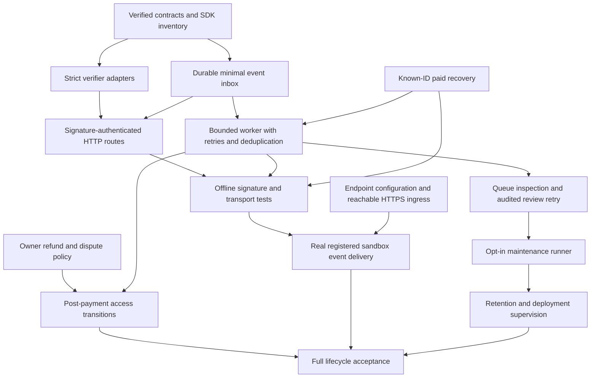

# Payment event ingestion: source contracts and construction DAG

Date: 2026-09-17. Candidate contract. Verifier adapters, durable inbox and optional
HTTP receipt routes and a bounded inbox worker are implemented; no production admission or external delivery proof.
Owner objective: finish KELD's SDK-backed Stripe, Mercado Pago Pix and PayPal
integration using shared Auth Foundation. USDC remains deferred. This research
closes a prerequisite for the event-ingestion frontier; it does not replace the
release objective or authorize endpoint publication. No merchant calls occurred.

## Verified provider contracts

| Provider | Available verification | Consequence for KELD |
| --- | --- | --- |
| Stripe | Official Node SDK `webhooks.constructEvent`/async variant verifies raw bytes with the endpoint secret and signature header | Preserve original bytes; verify freshness, sandbox mode and configured account before accepting any event fields |
| Mercado Pago | Installed SDK 3.6.1 exports `WebhookSignatureValidator.validate` | Reuse the SDK with explicit tolerance; use the signed `data.id` query value as a lookup hint, never treat arbitrary JSON status/amount as signed evidence |
| PayPal | Verification API accepts the event, transmission headers and configured webhook ID; SDK 2.5.0 exposes OAuth management but no webhook verification controller | Reuse SDK OAuth; add a bounded call to the fixed sandbox verification API, requiring `verification_status: SUCCESS` |

Stripe requires the original request body. Events may be duplicated or delivered
out of order, so timestamps do not establish processing order. Durable receipt
and idempotent processing are separate from signature checks. Sources:
[signature verification](https://docs.stripe.com/webhooks/signature?lang=node),
[event delivery and best practices](https://docs.stripe.com/webhooks).

Mercado Pago's manifest binds the notification data ID, request ID and timestamp.
It does not bind all JSON fields. The installed validator treats timestamps as
seconds, permits an explicit tolerance, chooses the first array value, and omits
missing manifest components. KELD must reject ambiguous/duplicate or missing
required input fields before invoking it. The SDK documents unsigned QR Code
product notifications; do not confuse that product with the Pix payment code
returned by our Payments API flow. Confirm real Payments API notifications during
merchant testing. Sources: [official webhook schema](https://github.com/mercadopago/openapi/blob/main/schemas/webhooks.yaml),
[SDK source](../integrations/node_modules/mercadopago/dist/utils/webhook/index.js),
[SDK types](../integrations/node_modules/mercadopago/dist/utils/webhook/index.d.ts).

PayPal's postback verification cannot verify simulator mock events. It requires
the configured webhook ID, not a value supplied by the notification. The guide
also requires preserving original event formatting when posting it back, and
specifies a reachable HTTPS listener on port 443. The current loopback application
is not such a delivery endpoint. Real sandbox App events must eventually be
verified; intercepted API responses prove only client behavior. Source:
[PayPal integration guide](https://developer.paypal.com/api/rest/webhooks/rest/).
The pinned SDK's public `clientCredentialsAuthManager.updateToken` can supply
OAuth without implementing another token exchange/cache:
[installed source](../integrations/node_modules/@paypal/paypal-server-sdk/src/clientCredentialsAuthManager.ts).

## Existing code to reuse

- [StripeInbox](../commerce/stripe_webhook.py): Python prototype already verifies
  signatures, environment/account binding, deduplication and conflicting event IDs.
  Reuse those invariants in the Node path; do not maintain two independently active
  inboxes for the same endpoint. The Node route can use the installed Stripe SDK.
- [SDK adapters](../integrations/src/payments.mjs): authoritative merchant, amount,
  currency, release and capture checks remain necessary after event reception.
- [Reconciler](../integrations/src/reconcile.mjs): currently handles only unpaid,
  already-bound payments. It cannot handle refunds/disputes on paid orders or
  locate missing provider IDs by itself.
- [HTTP handler](../integrations/src/index.mjs): currently routes buyer requests
  through cookies/CSRF. Provider endpoints require a distinct signature-authenticated
  route before buyer middleware, without weakening buyer protections.

## Candidate design decisions (engineering synthesis)

1. Explicit configuration for each provider's endpoint secret or webhook ID;
   absent configuration disables that route. Secrets stay server-side.
2. Read bounded raw bodies and headers. Verify before persisting trusted records.
   PayPal verification uses a fixed API origin, bounded timeout and no redirects;
   KELD must not fetch an arbitrary certificate URL from a request.
3. Store minimal normalized provider/account/environment/event/resource references,
   digests, receipt time and processing state. Avoid retaining payer payloads by
   default. For Mercado Pago, do not include unsigned body fields in trusted
   identity or status decisions; treat its signed resource ID as a fetch hint.
4. Deduplicate by provider/account/environment plus verified event identity;
   distinguish legitimate retries from conflicting verified content. An event
   timestamp is not a unique ID. Acknowledge success only after durable receipt.
5. A bounded worker retrieves current provider state and performs existing payment
   binding checks before settlement. Never execute an event's requested action,
   trust its browser identity, or capture PayPal merely because an event arrived.
6. Missing local binding remains retryable/reviewable. Do not discard an event
   that arrives before the checkout response is saved. Persistence must survive
   worker failure and duplicate delivery, with safe diagnostics and bounded storage.
7. Record refund/dispute observations separately from commercial access decisions.
   The requested owner decision on future downloads/support/first-100 places is
   still pending. Observing an event does not authorize inventing that policy.

## Construction DAG



Implemented frontier: B/C/D/E, six verifier/inbox/HTTP tests and five worker
acceptance tests under F. Queue inspection, audited review retry and the opt-in maintenance runner are implemented. Completed-event archival is also implemented. Runnable next frontier: long-term
receipt retention and deployment supervision; genuine delivery H requires merchant configuration. CAV2-D65 product construction remains owner-directed local
candidate work; no ontology record/selector dependency is required. Operational
owner: merchant/deployment owner for endpoint registration, secrets and HTTPS
routing. Policy owner: requesting product owner for refund/supporter benefits.
Those decisions block their respective stages, not the independent verifier work.

Validation must cover real Stripe/MP SDK signature acceptance and rejection,
raw-body changes, missing/duplicate fields, stale timestamps, environment/account
mismatch, duplicate delivery, conflicting identity, failed durable writes, crash
recovery, event-before-binding, provider outages and absence of implicit capture.
PayPal postback fixtures must remain labeled simulated; real App-event verification
is a separate acceptance condition. No simulator success may substitute for it.

## Implemented receipt boundary

[events.mjs](../integrations/src/events.mjs) uses the installed Stripe and Mercado
Pago validators. Stripe and MP require a 300-second receipt tolerance. Required
signature fields and duplicate HTTP headers are checked before SDK invocation.
PayPal uses SDK OAuth and a fixed sandbox postback endpoint, preserves the original
JSON bytes within its verification request, accepts only SUCCESS, and bounds its
response size/time. No arbitrary certificate URL is fetched by KELD. PayPal has no
additional local age cutoff; verified repeated deliveries are handled by deduplication.

The optional `/events/stripe`, `/events/mercadopago`, `/events/paypal` routes bypass
buyer cookies/CSRF only through their separate provider verifier. Body limit is
64 KiB. They return 202 after durable receipt, 403 for failed verification, and
503 if verification infrastructure/storage fails. Missing provider configuration
disables its route. The loopback launcher is not public webhook ingress.

The SQLite `sdk_event_inbox` stores provider/account/sandbox identity, normalized
event and resource references, fingerprint, receipt time and queued status. No
raw payer payload is persisted. Fingerprints compare normalized references, not
ignored body details: Mercado Pago JSON body fields never become trusted identity
or status. Conflicting normalized identities reject; valid duplicate receipts
survive restart. The inbox rejects new entries at 10,000 records, while duplicates
remain accepted. Terminal records count toward the active cap until explicitly archived. Completed
receipts can now be archived with duplicate protection retained, as described below. Receipt alone never grants access.

Six tests cover SDK signature vectors and rejection, ignored MP body tampering,
durable duplicate/conflict behavior, minimal storage, PayPal postback serialization
and failure, disabled routes, duplicate headers and storage failure. PayPal's API
verification response is simulated; no genuine merchant webhook was received.

## Implemented worker boundary

[`event-worker.mjs`](../integrations/src/event-worker.mjs) processes up to 20 due
records per invocation. SQLite claims are atomic, carry a 60-second lease and an
incrementing generation, and reject stale completion after another worker claims
the record. Failed attempts retry after 30 seconds with exponential backoff capped
at one hour. Missing checkout bindings now trigger provider-reference recovery; active claims
and unpaid resources remain retryable.

Stripe Checkout completion, Mercado Pago payment notifications and PayPal capture
completion trigger fresh SDK verification against the saved order. PayPal capture
IDs are resolved to orders through the SDK; verification always disables capture.
Settlement reuses existing idempotent ledger rules. Late payments and unsupported
or policy-sensitive events enter review, without inventing refund/access rules.
Provider failures return sanitized retry diagnostics. No worker is scheduled automatically; the optional maintenance command below can run it.

Five tests cover signed Pix receipt through verified fixture delivery, duplicate
processing, event-before-binding retry, expired lease recovery and stale completion,
PayPal SDK capture-to-order resolution without capture requests, and policy review
with provider outage/error sanitization. Provider responses remain simulated.

## Operator queue inspection

From `integrations`, run `npm run inspect-events -- /absolute/config.json`.
Optional arguments are a state (`all`, `queued`, `processing`, `review`, `done`)
and the returned numeric `next` cursor. The command returns at most 20 entries,
whole-inbox state counts, due/deferred retries, expired leases, earliest queued
retry time and remaining capacity. Counts remain global when the list is filtered.
Times are Unix seconds; a zero next-attempt time means immediately eligible.
Start each new sweep without a cursor. Counts and rows share one transaction;
separate pages are not a cross-command snapshot when processing changes states.

Inspection never claims events or changes their processing state. It initializes
missing local bookkeeping tables through the existing bridge, but contacts no
provider and does not initialize OIDC sessions. Output contains minimal stored
provider references and safe reasons, without payer bodies, customer identity or
payment credentials. Exit zero means inspection succeeded, not that the queue is
healthy or empty. Review/done entries consume active inbox capacity until eligible completed entries
are explicitly archived. Inspection also reports archive count/capacity.

The local test exercises 23 events, pagination, review filtering, capacity counts,
deferred retries, lease expiry, invalid filters and repeated inspection preserving
state. Audited retry is available below; other review resolutions, retention and deployment supervision remain separate work.

## Audited review retry

After inspecting and fixing an event's underlying problem, run from `integrations`:

```sh
npm run retry-event -- /absolute/config.json stripe evt_REPLACE GENERATION configuration-corrected
```

Replace the event ID and generation with current inspection values. Allowed reasons
are `configuration-corrected`, `binding-restored` and `provider-recovered`. The
configured merchant account and sandbox environment determine the target; neither
is accepted as an arbitrary CLI override. A generation is required, and only an
event currently in `review` can be requeued. Concurrent/stale requests conflict.
Do not retry an unresolved commercial-policy event expecting a different result.

A single SQLite transaction records the original review reason, generation,
operator-supplied reason and time in `sdk_event_review_actions`, increments the
generation and queues the event. Attempt counts remain intact. Inspection includes
generation and the number of requeues. A lost command response can be resolved
by inspecting current state; repeating the old action cannot enqueue it twice.
This audit records actions by a trusted local operator, not independently verified
operator identity. There is no public review API or new administrator account.

The command does not contact providers, grant delivery, capture payments or mark
an event done. Run the existing worker afterward: all provider/payment checks
still apply, and unsupported events return to review. The test verifies competing
retry requests, invalid identity/environment/reason, stale generation, preserved
attempts, durable audit contents and no override of refund policy.

## Opt-in maintenance runner

From `integrations`:

```sh
npm run maintain -- /absolute/config.json once
npm run maintain -- /absolute/config.json watch 60
```

`once` is the default. `watch` explicitly repeats cycles, waiting 30–3,600 seconds
(default 60) after each completed cycle. Each cycle processes at most 20 events,
reconciles one page of at most 20 bound unpaid orders, then reports queue counts.
The next reconciliation cursor is retained between cycles; reaching the end starts
a new sweep next cycle. Restarting starts a new sweep safely using idempotent
settlement. No timer overlap occurs within a runner. Run one maintenance process
per ledger to avoid redundant provider lookups; event leases and settlement
idempotency remain safeguards, not a distributed scheduler.

Stage failures are reported with fixed safe codes and do not prevent independent
stages from running. Provider verification and frozen order binding are reused;
PayPal capture stays disabled. SIGINT/SIGTERM interrupts idle waiting and stops
new work after the current item completes. Existing SDK/bridge timeouts apply to
that item; shutdown does not cancel it halfway through settlement. No listener,
OIDC session migration, new payment, refund, retention purge or service installation
is performed. Configuration is loaded at startup; restart after configuration changes.

Cycle output includes batch outcomes and queue summary. `ok` is a cycle diagnostic,
not proof that every payment is resolved; examine deferred/due counts, pending
orders and `reconciliation.next`. A failing `once` cycle exits nonzero. In watch
mode ordinary per-cycle failures are reported while later cycles continue; fatal
configuration or runner errors exit nonzero. Graceful watch shutdown exits normally.

Four tests exercise serial cycles, pagination and sweep restart, stage failure
isolation and sanitized output, shutdown after a claimed event, cancellation of
idle waiting and invalid interval bounds. Real service-manager supervision and
merchant connectivity are still unverified.

## Known-ID paid recovery

The [operator recovery command](SDK-INTEGRATION.md#recover-a-lost-paid-payment-binding)
can bind an already-paid provider resource to its matching uncertain local order
after fresh SDK verification. Events that were waiting for that binding become
processable on their next due retry. Recovery does not change inbox backoff,
perform automatic resource discovery or override late-payment review.

## Completed-event archival

From `integrations`, supply an explicit receipt-time cutoff in Unix seconds:

```sh
npm run archive-events -- /absolute/config.json RECEIVED_BEFORE_SECONDS preview
npm run archive-events -- /absolute/config.json RECEIVED_BEFORE_SECONDS apply
```

Preview is the default and reports eligible count, next batch size and remaining
archive slots. Apply moves at most 100 `done` events received strictly before the
cutoff. The cutoff cannot be in the future. Pending, processing, review and newer
completed entries remain active. This is receipt age, not time since processing
completed; choose the cutoff accordingly. No cutoff is chosen automatically and
maintenance never invokes archival on its own.

In one SQLite transaction, each completed record moves to `sdk_event_archive` with
its provider/account/environment/event identity, normalized resource references,
fingerprint, receipt time and archival time. Its work/lease row is removed. Review
action history and all order/payment/entitlement records remain unchanged.
Receipt verification consults both active and archived identities: an identical
repeat is accepted without requeuing, and conflicting normalized content fails.
A database error rolls back both sides of the move.

The active inbox retains its 10,000-entry ceiling. The archive has a separate
100,000-receipt ceiling; a full archive rejects further moves while preserving
active records. Inspection and maintenance summaries expose archive counts.
Preview can show zero available slots even with eligible work; it is not an
approval or proof of healthy capacity. Apply returns remaining eligible count so
operators can repeat bounded batches. No automatic receipt expiry or archive
purge is implemented. Review audit history is retained independently, so these
entry ceilings are not a total byte limit for the commerce database.

This moves completed work out of the active queue; it does not promise smaller
host disk allocation or run SQLite VACUUM. SQLite may reuse freed pages. Long-term
receipt/audit retention, backup and final capacity policy still require an
operational decision before production.

Two real SQLite tests cover preview, protected states/cutoff, duplicate/conflict
checks after archival, retained review audit, transaction rollback on insert
failure, 100-entry batching, and the full 100,000-receipt ceiling. Only temporary
fixture databases were archived; no existing ledger was changed.

## Event-driven lost-binding recovery

A verified supported payment event can now recover a completed payment without an
operator supplying its ID. The worker first tries the saved remote binding. If
missing, the SDK retrieves the provider resource and extracts the local reference:
Stripe `client_reference_id`, Mercado Pago `external_reference`, or PayPal's single
purchase-unit `referenceId`. PayPal capture events first resolve their order ID.
The configured merchant and sandbox identity are checked before using these hints.

The referenced local attempt must also belong to the event's provider/account.
The existing recovery command logic then performs full fresh merchant, order,
release, amount, currency and completion verification before generation-checked
binding and settlement. Local references alone never grant access. No create,
capture or refund call is issued. Active/racing creation claims and payments not
yet complete retry through existing backoff. Definitely failed creations go to
review; unknown orders, mismatched references and invalid proof also remain review
cases. Late payment preserves `paid-review`.

This is event-driven discovery, including PayPal; it is not general historical
PayPal order search. If no event arrives and no provider ID is known, that reporting
and discovery gap remains. Real registered merchant event delivery is still untested.

Five added tests cover Pix event-to-recovery-to-delivery through real SDK requests,
PayPal capture/order/local-reference recovery without capture, cross-provider
reference rejection, active-claim retry followed by recovery, Stripe hint validation,
and definitely failed attempts entering review. The existing event-before-binding
regression now exercises the SDK reference lookup. The full suite passed 68 cases;
after adding the definite-failure guard, all six affected event-recovery cases
passed (69 distinct default-suite cases now). Provider responses are simulated.

## Open Questions

Endpoint secrets/IDs and ingress topology; real Mercado Pago Payments API event
shape; PayPal registered sandbox App event delivery; event retention/backpressure;
automatic missing-ID lookup strategy (manual paid recovery is implemented); deployment supervision/monitoring; and owner refund/dispute policy.
The original release/license and configuration questions remain in
[SDK-INTEGRATION.md](SDK-INTEGRATION.md#open-questions) and
[PROJECT-INTAKE.md](PROJECT-INTAKE.md#open-questions).
