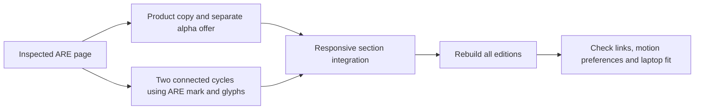

# ARE section: source-backed copy and visual

Status: implemented.

Owner approved the proposal after inspection of the current ARE page. Scope: KELD product introduction, not ARE runtime or commerce behavior.

Sources: `workspace/experiments/are-documentation/src/Hero.tsx` (two cycles), `Capabilities.tsx` (capability boundaries), `ComponentIcon.tsx` (reused glyph geometry) and `public/assets/are-mark.svg` (selected mark). Paths resolve from repository root. The illustration shows Work and Improve around the ARE mark, with blue/silver accents in the existing KELD layout. It depicts a concept, not live engine telemetry. Improvement means testing alternatives and recommending evidence-backed refinements, not automatic deployment or model-weight learning.

Only two visible diagram labels. Full cycle meaning is available through SVG title/description; reduced-motion preference and the existing site motion control stop the subtle tracing animation. Text separates product explanation from the existing early-supporter offer and license facts. Both ARE-page links and the independent shop action are preserved.

D65: bounded owner-directed implementation, request `keld-are-cycles-110`; no ontology dependency. Product frontier: completed section and local checks. Deferred operations: deployment and hosted ARE destination, owned by the product owner.

## Verification

Copy, two visible graphic labels, retained ARE links and reduced-motion behavior passed at1366px and390px. Evidence: `are-cycles-validation.json`. The existing vertical-fit suite checks all landing sections and six story scenes across ten viewports; current measurements are in `layout-results.json`.

## Visual refinement

The follow-up adds directional traces, fine orbit detail and a larger layered central hub. The native SVG keeps the same viewBox and height limits; only Work and Improve remain visible text. Rebuilt static and offline editions, inspected the rendered graphic, and preserved reduced-motion CSS.

## Open Questions

Owner visual acceptance and final hosted ARE URL remain open. Nothing is deployed. The connected ARE page owns detailed capabilities and limitations.

## Narrative animation — 2026-09-18

Owner request `keld-motion-114` authorizes this bounded prototype update. Product
frontier: implemented and locally verified; no ontology record or selector dependency.
D65 chain: existing ARE capability descriptions → two-cycle storyboard → native SVG
candidate → rebuilt editions → responsive and playback evidence → owner visual review.
Deployment and final ARE destination remain product-owner operational residue and do
not block this local prototype. WSL compaction remains separate operational work.

Construction order: visual story → composed SVG → finite timeline and responsive
integration → motion/accessibility controls → generated editions → browser checks.
The timeline connects the core (0–1.2s), work (1.2–4.8s), improvement (4.8–8.6s),
and a quiet settled state (8.6–10s). A secondary candidate connection appears and
fades during improvement. This is a conceptual narrative, not automatic deployment.

The central mark now sits in three translucent geometric layers. Redundant rings,
grid and arrowheads are removed. Icons respond as the signal passes. Native SVG
geometry and requestAnimationFrame implement the finite timeline without adding an
animation dependency to this standalone page. The previous Anime.js recommendation
was unnecessary for two paths. Existing manual motion preference and OS preference
both yield a still; offscreen and hidden-document playback pauses. Replay is available
when the sequence finishes. The SVG retains an accessible title and description.

References: [Linear hierarchy](https://linear.app/now/behind-the-latest-design-refresh),
[Anime.js motion paths](https://animejs.com/documentation/svg/createmotionpath/),
[Rive responsive composition](https://rive.app/blog/introducing-layouts).

Verification: `check-are-motion.mjs` and `are-motion-validation.json` record the actual
work/improve/completion sequence, replay, offscreen pause, reduced-motion fallback,
no page errors, and narrow-screen overflow checks. `check-layout.mjs` passed all ten
existing viewports. Desktop work/improve/settled keyframes and 320/390px stills were
captured for visual review in `/tmp/are-motion-*.png` (ephemeral, not release assets).
All three standard and offline editions rebuilt. Hardware frame-rate profiling is
not covered by these functional checks. Open questions remain owned by the section
above: owner visual acceptance and final hosted ARE URL.

## Selected Light Sculptures — 2026-09-18

Owner selected concept family 01; bounded implementation request `keld-light-icons-117`.
Product frontier: five generated transparent icon assets integrated into the six existing
cycle positions. Evidence is reused to make the two-cycle connection explicit. Images
replace the line glyphs and circular badges, while the finite native timeline continues
to control activation, replay, offscreen pause and reduced motion. No new dependency or
ontology selector. Publication remains deferred; the existing owner authorization covers
this local visual implementation only.

Asset paths and exact generation prompt template/subjects are documented in
`../assets/are-icons/README.md`. The built-in imagegen tool produced the artwork;
256px WebP exports retain alpha. All five assets total approximately 124 KiB on disk.
The build embeds SVG image hrefs in all three offline editions. Browser decode checks
confirmed all six image instances; motion validation passed with no page errors and
no narrow-screen overflow. Desktop and 320px rendered compositions were inspected.
The full-layout check timed out during page navigation on both the concurrent run
and an isolated rerun. The server and icon requests subsequently returned HTTP 200;
the broader layout suite is not recorded as passed for this update. The earlier
ten-viewport pass predates these raster icons; direct 320/390/1366 motion checks
passed for the current build. Owner visual acceptance remains
an open question owned by this plan's Open Questions section.

## Labels and continuous playback — 2026-09-18

Owner request `keld-loop-labels-118` supersedes the earlier finite-playback and two-label
requirements. The six icon captions are Goal, Action, Results, Evidence, Compare and
Refine. Work/Improve continue to identify the two cycles. Mobile captions increase in
SVG-relative size to preserve readability. The viewBox gains a small caption margin.

Playback repeats the ten-second narrative with a two-second rest. A visible native
button pauses and resumes the current position, including keyboard activation. Existing
site-wide and operating-system reduced-motion preferences stop playback; offscreen and
hidden-document suspension remains. No ontology dependencies or deployment effects.
The construction boundary remains the local prototype and generated editions. Updated
`check-are-motion.mjs` checks a second cycle, captions, explicit pause/resume, offscreen
pause, reduced motion and narrow-screen overflow. Open questions remain visual owner
acceptance and the hosted ARE destination as recorded above.
