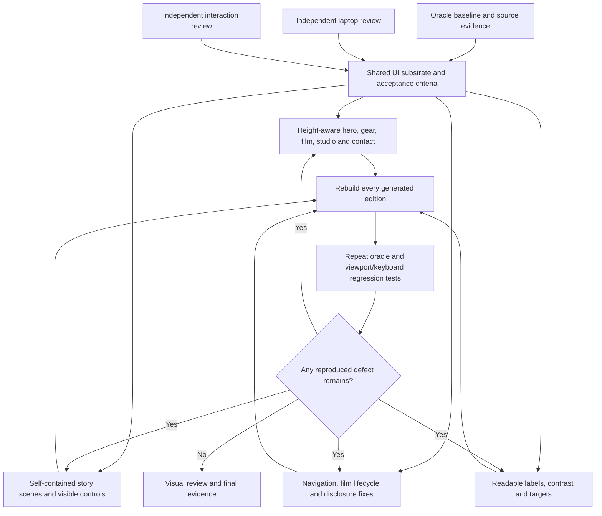

# UI repair DAG

Status: implemented; final evidence in `RESULTS.md`. Owner authorized audit, two independent reviewers, planning and implementation. Scope: KELD prototype only; preserve existing commercial behavior, source artwork and story. No deployment or publication.

## Ordered work and gates

1. **A/B/C → D:** archive measured baseline and independent findings. Build `SUBSTRATE.md`. Do not conflate cold-load CLEAN with a product pass.
2. **E:** remove width-driven excessive heights and margins. Film frame+controls fit below header on laptop viewports. Hero/workbench/studio/contact become compact complete compositions where readable content permits; natural reflow is the fallback at phone/zoom.
3. **F:** artwork/prose side by side at laptop width; navigation above content; keep exact full chapter text. Expanded viewer retains Close and arrows. Explicit chapter selection reveals the new scene when necessary; no initialization jumps.
4. **G:** short mobile menu bounded to available height; stop film on blocking dialogs and shop switch; correct YouTube disclosure.
5. **H:** larger useful labels/body copy/targets, darker light-surface secondary ink; explicit dark fallback behind contact gradient. Preserve identity.
6. **I/J:** rebuild static and offline editions; test all six scenes and dialog navigation at laptop sizes, short landscape, 320px reflow, keyboard, reduced motion, focus and media lifecycle. Repeat actual TasteCheck functions and browser audits. Verify unchanged story content.
7. **K/L:** inspect screenshots and fix remaining failures; publish a measured comparison and explicit limitations.

## Construction and operations

Current product frontier: viewport-aware UI repair. Runnable work E–H uses owner-directed native edits; ontology dependencies none. Operational owner: project owner for visual approval and eventual deployment. Deferred operational residue: production deployment, YouTube/network playback and external checkout; none is required to fix local UI. ARE route/context104 succeeded; effect reevaluation later failed from an unrelated missing imported module (`representation-preferences.mjs`). The effect call succeeded on retry after the unrelated source reappeared (routine consequence gate, covered by existing owner authorization). No unrelated engine edits or routing fallback.

## Open Questions

See `SUBSTRATE.md`. Owner review determines aesthetic acceptance; automated geometry alone cannot certify taste or accessibility. Result ledger must identify untested screen-reader/browser areas.
