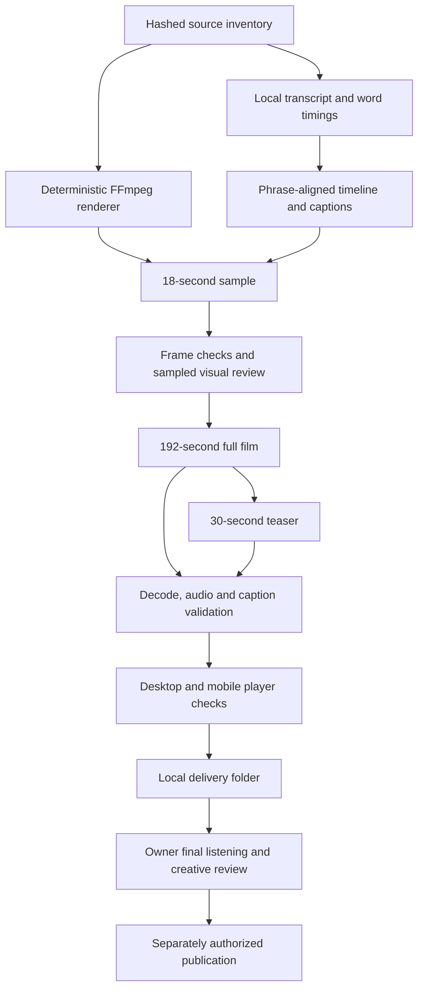

# KELD legend film

Local, deterministic editing of the owner's 18 illustrations and supplied
ElevenLabs recording. No AI video generation, new voice generation, paid service
or uploaded media. The editable source of the film is `timeline.json`.

## Transcript and subtitle revision

The owner subsequently supplied [NARRATION.md](NARRATION.md), imported byte-for-byte
from the cited temporary preview directory. It now owns caption wording;
`transcript-words.json` supplies timing only. `align-subtitles.mjs` extracts the six
spoken code blocks, excludes performance directions, aligns 438 recorded words,
and produces 65 cues. [SUBTITLE-ALIGNMENT.json](SUBTITLE-ALIGNMENT.json) records
source hashes and differences. The script's final “Agent gear.” is absent from
the recording and is excluded from spoken captions; the full script is retained.

The player enables captions by default and adds explicit sound/caption controls.
Browser tests verify default captions, mute/unmute, caption toggles and non-silent
audio decoding. Playwright's **headless** Chromium launch normally includes
`--mute-audio`; the tests now remove that launch argument. A web page cannot
override browser-level or WSL/host output-device muting. Use a normal Windows
browser for listening to `http://localhost:4398`.

`burn-subtitles.mjs` also produces `keld-legend-full-subtitled.mp4` and
`keld-legend-teaser-subtitled.mp4`, with permanent visible captions. It copies the
original AAC stream without re-encoding. `verify-subtitles.mjs` checks audio packet
identity, full decoding, frame counts, subtitle pixels and timing. The updated
delivery goes to `exports/legend-v2`; the prior `legend-v1` is preserved.

To rebuild the revision:

```sh
node align-subtitles.mjs
node remux-captions.mjs
node verify.mjs
node burn-subtitles.mjs
node verify-subtitles.mjs
node preview.test.mjs
node export.mjs
node export.test.mjs
```

`prepare-delivery.mjs` defers to the supplied script when present, so running the
original preparation command cannot replace canonical caption wording with ASR.
`KELD_VIDEO_EXPORT_VERSION` selects a new numbered delivery directory; differing
existing exports are not silently overwritten. Open question: the supplied
recording does not contain the script's final tagline, and physical speaker output
is outside browser decoding checks.

**Initial delivery (v1):** 18-second sample, 192-second full film, 30-second
teaser, English captions/transcript, thumbnail and an offline player are exported
to `keld-video/exports/legend-v1` beside the supplied assets. The full film is
129,250,147 bytes. Exact frame counts, full decoding, black-gap/peak checks and
player tests at three widths passed. Export hashes and offline playback/captions
also passed. Current revision checks are in [VALIDATION.json](VALIDATION.json) and
[EXPORT-VALIDATION.json](EXPORT-VALIDATION.json).

## Plan review and implementation

The owner authorized review and execution of the video DAG. FFmpeg replaces the
proposed Remotion composition layer for this version: the film needs camera
movement, short dissolves, titles, audio and captions, all directly scriptable.
This avoids a second rendering framework while retaining an editable timeline.
Local speech recognition is used only for transcript/timing evidence.

The implementation follows the CAV2-D65 owner-directed candidate construction
chain under `CA2-ROUTE-IMPLEMENT`, request `keld-video-implement-098`: requested
local film → source inventory → sample → media checks → full edit → deliverable
and preview checks. No ontology runtime dependency or authority promotion.



## Source and output

`assets.json` binds full source filenames, SHA-256 hashes, dimensions and decoded
audio metadata. Originals remain in `/mnt/c/Users/vlad_/Downloads/keld-video`.
Set `KELD_VIDEO_SOURCE` to use another directory containing those same files.
Source hashes are checked before rendering. Both numbered image batches are
preserved; numeric suffixes alone are not used as identities.

The recording is 189.466 seconds. The full film lasts 192 seconds, with a short
ending hold. The sample lasts 18 seconds and the teaser 30 seconds. All are
1920 × 1080, 24 fps, H.264/AAC MP4 with fast-start metadata. Original illustrations
are 1672 × 941; output entails a modest upscale, not new image detail.

The film uses restrained 1–5.5% zooms, with one slightly closer detail shot,
half-second dissolves, temporary chapter titles and the supplied voice. There is
no added music or simulated sound-effects bed. The audio is high-pass filtered at
65 Hz and normalized toward -16 LUFS / -1.5 dBTP. Actual measurements live in
`output/validation.json`; these are creative targets, not platform mandates.

## Run

Validated environment: Node 26.8.1 on Linux x64. Pinned dependencies are in
`package-lock.json`. Installation downloads media binaries. Skip optional CUDA
binaries when installing for this CPU workflow:

```sh
ONNXRUNTIME_NODE_INSTALL=skip npm ci --no-audit --no-fund
npm run inventory
node transcribe.mjs
node transcribe.mjs --words
node prepare-delivery.mjs
npm run render -- sample
npm run verify -- sample
npm run render -- full
node teaser.mjs
npm run verify
node preview.test.mjs
node export.mjs
node export.test.mjs
node cleanup.mjs
node preview.mjs
```

Open `http://127.0.0.1:4398`. `KELD_VIDEO_PORT` overrides the port.
Browser validation uses an existing Chromium executable; set `KELD_CHROMIUM` on
another machine. No browser download is implicit in the test. Editing and export
do not require the browser or speech model once timing files are prepared.

The local ASR model is `Xenova/whisper-base.en`, run on CPU through Transformers.js.
It downloads weights, then processes the recording locally. Raw recognition is
retained in `transcript-raw.json` and `transcript-words.json`; corrections are
explicit in `prepare-delivery.mjs` (Keld, intentions, patient sound). Proper nouns
were checked against the existing KELD chapter definitions. Word timings remain
model estimates; a final human listening pass is still part of publication review.

## Validation and recovery

Each rendered segment must have its exact expected frame count. Partial renders
use temporary filenames and are renamed only after encoding succeeds; media
checks reject mismatched segments. Cache keys bind source hashes and render
arguments. Re-running resumes matching segments. Complete outputs are decoded to
check for corruption, inspected for correct duration, resolution, codec, rate and
fast-start layout, and measured for audio peaks. Caption timestamps must be
ordered and contained in the original recording.

`preview.test.mjs` checks actual full/teaser playback, no premature video requests,
transcript loading, range responses and layout at 1440, 390 and 280 px widths.
The preview uses native controls and external captions; no autoplay or external
player scripts. The exported offline page embeds caption/transcript text so it
does not rely on fetching those files from a `file:` origin.

## Storage and delivery

Generated renders are ignored by Git under `output/`. Scratch files and downloaded
speech models use only `../../.cache/keld-video-098`; no global cache is deleted.
The renderer refuses to start with less than 3 GiB free on the source/host volume.
It emits compressed segments, not frame-image sequences. Retain sources, timeline,
captions, lockfile, validation records and final delivery; scratch segments and
ASR model downloads can be removed after delivery. `export.mjs` copies only known
deliverables to the owner's source folder under `exports/`, with a hash manifest.

## Operations and Open Questions

Current construction scope is local video delivery and a landing-page preview.
The requesting owner owns creative review; a channel owner and publication decision
are needed only for YouTube upload. The canonical KELD landing page is unchanged.
Upload, public player integration and deployment are separate operational work.
Existing commerce integration is not a dependency of this film.

Before publication: listen through final narration/captions, choose any desired
music, confirm applicable usage rights for the supplied assets/recording, and
select the channel and final thumbnail. No software activation, license promotion
or public upload is claimed by the local checks.

Sources: [production research](../docs/LEGEND-VIDEO-RESEARCH.md),
[existing chapter definitions](../prototype/assets/legend/chapters.json),
[FFmpeg filters](https://ffmpeg.org/ffmpeg-filters.html),
[Transformers.js audio processing](https://huggingface.co/docs/transformers.js/tutorials/node-audio-processing).
