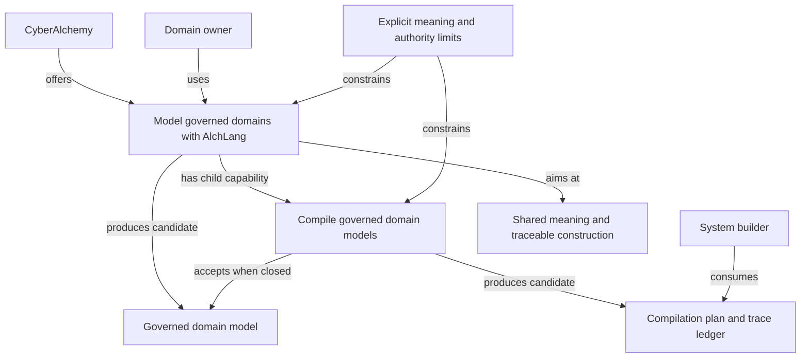
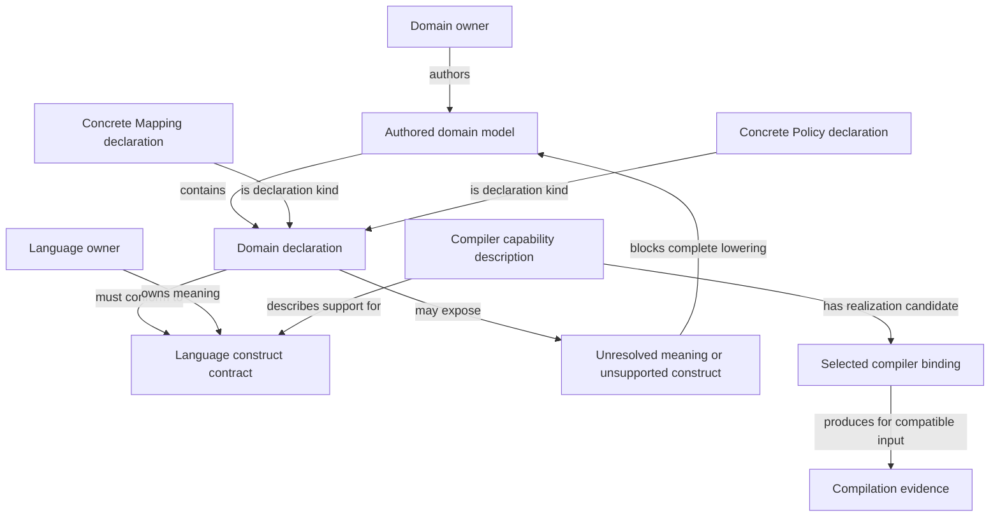

# AlchLang compiler and domain definitions

Status: candidate definitions and proposed ontology views. Private; authority effect: none.

Define compiler capability versus concrete domain declaration and present the resulting AlchLang product/business ontology views.

**Central distinction:** a compiler capability describes support for construct contracts; a domain declaration supplies concrete meaning under one contract. Neither is a runtime invocation.

This is a native conversation draft. No saved Define Session or context-evaluator receipt is fabricated. It is not a session-admitted or canonical Definition Pack.

## Definitions

### Compiler Capability Description — ALCH-CD-D-COMPILER-CAPABILITY

Disposition: **propose**. Owner: CyberAlchemy v2 Language Project owner plus CyberAlchemy v2 product owner. Candidate; canonical target unassigned.

**Normative:** A Compiler Capability Description shall state the supported families of domain declarations, expected compilation outcomes, rejection conditions and limits, without standing in for a concrete domain declaration.

**Formal:** `Capability = (supported_contracts, input_requirements, promised_outputs, rejection_rules, limits); describes(Capability, Contract) does not imply instance_of(Capability, Contract).`

**Plain language:** It says what the compiler can do for many domains.

**Domain context:** AlchLang supports explicit mappings and policies; that statement is not itself an Order-to-Message mapping or a strategy-selection policy.

**Boundary:** A capability promise does not prove implementation coverage, approval or conformance, and is not an executable Mapping or Policy node.

### Language Construct Contract — ALCH-CD-D-CONSTRUCT-CONTRACT

Disposition: **propose**. Owner: CyberAlchemy v2 Language Project owner plus CyberAlchemy v2 product owner. Candidate; canonical target unassigned.

**Normative:** A Language Construct Contract shall define a kind of declaration through its required information, type/reference rules, semantics, failure behavior and authority limits, independently of any one domain instance.

**Formal:** `K = (kind, required_fields, well_formedness, meaning, failures, limits); conforms(d,K) checks an individual declaration against that contract.`

**Plain language:** It is the rulebook for writing one kind of domain instruction.

**Domain context:** The Mapping contract requires explicit field clauses and missing-value behavior; the AlchLang Policy contract requires ordered cases and a declared default.

**Boundary:** A contract is not an individual declaration, a provider binding or evidence that every compiler version supports it.

### Domain Construct Declaration — ALCH-CD-D-DOMAIN-DECLARATION

Disposition: **propose**. Owner: CyberAlchemy v2 Language Project owner plus CyberAlchemy v2 product owner. Candidate; canonical target unassigned.

**Normative:** A Domain Construct Declaration shall bind one language construct contract to an explicit bounded domain, identity, owner, operands and references. Missing required semantics shall remain unresolved and prevent successful lowering.

**Formal:** `d = (id, domain, owner, contract_ref, operands, references); lower(d,B) is eligible only when required meaning and references are closed and B supports the selected contract.`

**Plain language:** It is one actual instruction written for a particular domain.

**Domain context:** OrderToMessage and ChooseDeliveryStrategy would be two different declarations, each with its own inputs and rules. They are illustrative examples, not existing approved artifacts.

**Boundary:** A declaration describes behavior; it is not a runtime invocation, owner approval or authorization to act.

### Concrete Mapping Declaration — ALCH-CD-D-CONCRETE-MAPPING

Disposition: **propose**. Owner: CyberAlchemy v2 Language Project owner plus CyberAlchemy v2 product owner. Candidate; canonical target unassigned.

**Normative:** A Concrete Mapping Declaration shall bind source and target shapes to explicit, uniquely named target-field clauses and total/partial missing-value behavior. It shall construct only declared output values from supplied input and typed defaults.

**Formal:** `M = (S,T,clauses,totality); evaluate_M(x) -> Result<declared fields of T,MappingError>. Use each declared source value when present, otherwise its declared typed default; unresolved total output rejects, while partial output may omit the field.`

**Plain language:** It specifies exactly how to build a new value from another value.

**Domain context:** Illustration: Order.orderId -> OrderMessage.orderId; Order.total -> OrderMessage.amount; typed default GBP -> OrderMessage.currency. These clauses are authored examples, not inferred domain requirements.

**Boundary:** No implicit copy-through, persistence or transport. Value semantics do not establish that a particular untyped DomainSpec representation accepts a Value Object endpoint; the selected typed profile must be checked separately.

### Concrete Policy Declaration — ALCH-CD-D-CONCRETE-POLICY

Disposition: **propose**. Owner: CyberAlchemy v2 Language Project owner plus CyberAlchemy v2 product owner. Candidate; canonical target unassigned.

**Normative:** A Concrete Policy Declaration in the AlchLang typed-policy profile shall bind declared inputs to a nonempty ordered case list and an explicit default, returning one declared strategy selector without executing it.

**Formal:** `P = (inputs,[(p1,t1),...,(pn,tn)],td); evaluate_P(x)=t_i for the least i with p_i(x)=true, otherwise td. Invalid inputs or predicates reject.`

**Plain language:** It chooses a named strategy using an explicit order and fallback.

**Domain context:** Illustration: if an order is urgent select ExpressDelivery; otherwise select StandardDelivery. Both are declared example targets, and selection alone performs no delivery.

**Boundary:** First-match behavior is scoped to this AlchLang profile, not all policies. A compiler representation with different overlap semantics must not silently replace it; selection grants no execution authority.

### DomainSpec Compiler Binding — ALCH-CD-D-COMPILER-BINDING

Disposition: **propose**. Owner: CyberAlchemy v2 Language Project owner plus CyberAlchemy v2 product owner. Candidate; canonical target unassigned.

**Normative:** A DomainSpec Compiler Binding shall identify the selected compiler package/version, public interface, supported source contract/profile and evidence scope. It shall keep package version, source-schema version and AlchLang version distinct.

**Formal:** `B=(package,version,public_interface,source_contract,profile,evidence_scope); selected package=@domainspec-v2/cli and version=1.0.0. Successful use requires a matching built API and a compatible authored project.`

**Plain language:** It says exactly which compiler processes the model and which inputs it understands.

**Domain context:** The existing bridge selects @domainspec-v2/cli@1.0.0; domainspec.project/v1 and carrier-v2 are separate format versions. General .alch-to-DomainSpec lowering remains unimplemented.

**Boundary:** A version match is not whole-package provenance, complete language compatibility, semantic acceptance, a ConstructionBinding or runtime authorization.

## Product ontology

Subject: AlchLang within CyberAlchemy.

Machine view: [product-ontology.json](product-ontology.json). Status: unregistered definition scaffold. All edges below are proposed meaning; they are not runtime availability or implementation claims.

CLI, compiler versions and generated code belong to a realization view; they do not replace product capability identity.

| Relation | Business sentence |
|---|---|
| P1: offers | CyberAlchemy offers AlchLang governed domain modeling as candidate product meaning. |
| P2: has_child_capability | The existing compiler capability names governed modeling as its parent. |
| P3: uses | A domain owner uses modeling to express bounded domain meaning. |
| P4: produces_candidate | Modeling produces a governed domain model candidate. |
| P5: accepts_when_closed | Compilation requires the selected model meaning and references to be closed. |
| P6: produces_candidate | Compilation yields traceable plans plus explicit unsupported residue. |
| P7: consumes | System builders consume the plan and its evidence limits. |
| P8: aims_at | Modeling aims at shared meaning and traceable construction. |
| P9: constrains | The modeling promise preserves ambiguity and authority limits. |
| P10: constrains | Compilation cannot invent semantics or grant effects. |

## Business ontology

Subject: The business domain of authoring and compiling governed models, not the commerce domain of an example.

Machine view: [business-ontology.json](business-ontology.json). Status: unregistered definition scaffold. All edges below are proposed meaning; they are not runtime availability or implementation claims.

All roles and edges here are business/proposal roles, not DomainSpec executable meta-types. Mapping and Policy are declarations; input values, evaluation and runtime invocations remain distinct.

| Relation | Business sentence |
|---|---|
| B1: authors | The domain owner supplies or reviews the authored model. |
| B2: contains | A model contains its domain declarations. |
| B3: must_conform_to | A declaration must satisfy its selected construct contract. |
| B4: owns_meaning | The language owner controls the meaning of each construct contract. |
| B5: is_declaration_kind | A concrete Mapping is one kind of domain declaration. |
| B6: is_declaration_kind | A concrete Policy is another kind of domain declaration. |
| B7: describes_support_for | The compiler description promises support for bounded construct contracts. |
| B8: may_expose | A declaration may expose missing or unsupported meaning. |
| B9: blocks_complete_lowering | Unresolved required meaning blocks successful complete lowering of that model. |
| B10: has_realization_candidate | A compiler capability may have a selected compiler realization candidate. |
| B11: produces_for_compatible_input | The selected compiler produces evidence only for inputs it actually accepts. |

## What this changes in the proposed model

The product anchor stays CyberAlchemy -> Model Governed Domains With AlchLang -> Compile Governed Domain Models. This pack registers neither a new Product nor a new Product Capability.

The compiler self-model should describe Mapping and Policy contracts and their compilation responsibilities. Concrete user models contain actual Mapping and Policy declarations. A future self-model migration must preserve meaningful references; blindly relabeling executable nodes or inserting arbitrary defaults is not the proposal.

The current DomainSpec 1.0.0 bridge accepts authored DomainSpec projects. The full .alch lowering path is future work. Compatibility of the existing typed Mapping and ordered Policy semantics with a selected target profile still needs explicit tests.

## Cross-view alignment

The business-view compiler capability description documents the existing product-view compilation capability. Language contracts say what counts as a valid declaration; individual models provide the domain-specific declarations. The compiler binding belongs at the realization boundary and does not replace the product identity.

## Source bindings

| Source | Path and selector | SHA-256 |
|---|---|---|
| S-PACK-CONTRACT | `cyberAlchemy-v2/define/docs/DEFINITION-PACK.md` — whole-file | `d52378ceb47691a2a854ef23a32f319e1536c82113861fac9e32b1c3f1bcd609` |
| S-RECORD-SCHEMA | `cyberAlchemy-v2/define/schemas/define-package.schema.json` — whole-file | `d6503f658ab410be59c359cf79cb4dc2116b7fcd6410b942c136424d43f5c25c` |
| S-ALCH-PRODUCT | `cyberAlchemy-v2/language/capabilities/alchlang/product-capability.json` — whole-file | `478695ce8437085fef5c7f9a2f1ab10d91ee78b8dcbff3d4dfafe9d3fca4ce4b` |
| S-ALCH-DEFINITIONS | `cyberAlchemy-v2/language/capabilities/alchlang/definitions.json` — whole-file | `12d9f0af4379af42303cad0b34ada36f75201f82baabc08f037ee0f8a9dfb234` |
| S-ALCH-NODES | `cyberAlchemy-v2/language/capabilities/alchlang/nodes.json` — whole-file | `433876c517bbcaa32f9417f0c84cb52719929000db59911ef2de71f3da9d151d` |
| S-ALCH-RELATIONS | `cyberAlchemy-v2/language/capabilities/alchlang/relations.json` — whole-file | `a04eaaef926945c12fcddbed203c42d04fbd89c3301538b35c45b8a52d517ea8` |
| S-COMPILER-PRODUCT | `cyberAlchemy-v2/language/capabilities/alchlang/plans/general-compiler-v1/product-capability.json` — whole-file | `7ba9d530dc0adae5099f36d28660b1539148743c8a365491c5071e78b48172bf` |
| S-COMPILER-NODES | `cyberAlchemy-v2/language/capabilities/alchlang/plans/general-compiler-v1/nodes.json` — whole-file | `32dfa9bf9155257cb17f0b80ad85efcac64b8cd10dfa9df3a753dc00f589291a` |
| S-TYPED-DEFINITIONS | `cyberAlchemy-v2/language/capabilities/alchlang/plans/general-compiler-v1/definitions/DEFINITIONS.md` — whole-file | `be3aaed88148e46b2f6e0fb6d9a0180b945397f55855b9b16f8e0e1d934bd751` |
| S-MAPPING-SOURCE | `cyberAlchemy-v2/language/capabilities/alchlang/plans/general-compiler-v1/domainspec/specs/typed-backend/nodes/typed-mapping.json` — whole-file | `617be19dc426fa3573ba52faf1e71659a50b752dca021c51a1422ee72cd0d19b` |
| S-POLICY-SOURCE | `cyberAlchemy-v2/language/capabilities/alchlang/plans/general-compiler-v1/domainspec/specs/typed-backend/nodes/typed-policy.json` — whole-file | `e00c688c364fa0bc9a258f35a3323c1fff514c60aa98b4629d1a20e7b21f46b5` |
| S-CLI-PACKAGE | `projects/domainspec-v2/impl/cli/package.json` — whole-file | `6811fb86cfa18a69a49cf370cb55f31c221ac66b7b5a08910be2d4fef058fd60` |
| S-INTEGRATION-RESULT | `cyberAlchemy-v2/language/capabilities/alchlang/plans/general-compiler-v1/extensions/domainspec-cli-1.0.0/README.md` — whole-file | `22e0ad0f667ef637d4e9c106c4f29b5faa4187f3ec40316ed8597ffa48685a19` |

## Checks

- definition_record_schema: PASS: six records against Define handledDefinitionRecord
- source_currency: PASS: 13 whole-file source digests
- graph_references: PASS: 20 nodes, 21 intra-view edges and one cross-view link
- human_projection: PASS: README generated directly from the saved records and graph views
- saved_session_and_context_evaluator: not_evaluable
- implementation_conformance: not_evaluable

Source confirmation: 2026-09-05T19:27:17.817095+00:00.

These checks cover records, source currency and graph links. They do not prove semantic agreement, compiler compatibility, ontology admission or product approval.

## Construction and operational work

Product-construction frontier: prototype definitions and ontology scaffolds. This draft and its graph checks are complete; later work selects a lowering scope, designs a self-model migration and tests an exact candidate. No construction blocker prevents review of this proposal.

Operational residue: the Define runtime owner owns future durable-session/evaluator integration; publication and runtime operators own later publication/activation. Neither is a prerequisite for this native draft.

## Open questions

- **Q-LOWERING:** Which AlchLang construct families and exact DomainSpec 1.0.0 typed profiles belong to the first source-lowering candidate? Owner: CyberAlchemy v2 Language Project owner plus CyberAlchemy v2 product owner. Blocks: A complete .alch-to-DomainSpec compatibility claim; does not block this definition proposal. Next action: Select an exact lowering scope and compare supported semantics.
- **Q-MIGRATION:** How will the existing generic typed-mapping and typed-policy self-model nodes become explicit contract descriptions without losing their references and evidence? Owner: CyberAlchemy v2 Language Project owner plus CyberAlchemy v2 product owner. Blocks: Changing existing DomainSpec source bytes. Next action: Design a candidate representation and migration after this meaning proposal is reviewed; do not merely relabel nodes or invent defaults.
- **Q-PROFILE:** Which exact target contracts preserve Mapping totality/default behavior and Policy ordered-first-match behavior? Owner: AlchLang language owner plus DomainSpec compiler/profile owner. Blocks: Successful lowering for a profile whose semantics differ or are unverified. Next action: Compare typed-contract semantics and test parity, including overlapping policy cases and missing mapping fields.
- **Q-SESSION:** No durable Define Session or context-evaluator receipt exists for this native conversation draft. Owner: CyberAlchemy v2 Define runtime owner. Blocks: Claiming a saved-session-derived or fully admitted Definition Pack; does not block native candidate definitions. Next action: Retain null session and evaluator references; use a future admitted session route if required.

## Allowed uses and boundaries

Allowed uses: Review and challenge these candidate definitions; Inspect the proposed ontology views; Prepare a separately scoped representation/lowering design.

Blocked actions: Canonical definition promotion; Ontology registration/admission; Changing existing DomainSpec source or compiler implementation under this pack alone; Refreshing historical acceptance digests; Product approval by structural validation; Publication, release, deployment or external effects.

Candidate definitions and unregistered ontology views only; structural checks do not prove semantic acceptance, compilation, product approval or authority.

Refresh route: CA2-ROUTE-DEFINE with exact changed concepts and source bytes; canonical changes require their owning route.
