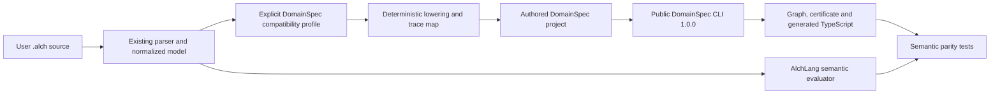

# AlchLang: explicit domain lowering to DomainSpec 1.0.0

Status: proposed design, private, authority effect none.
Owner: CyberAlchemy v2 Language Project owner plus product owner.
Route: CA2-ROUTE-PLAN. This is a planning candidate, not admitted execution state.

## Recommendation

Keep AlchLang as the language users author. Make DomainSpec 1.0.0 the proposed
compiler backend for one explicit supported profile. Add a deterministic lowering
layer that translates declared semantics into a real authored DomainSpec project.
Keep the compiler's self-description in a separate project from application models.

The product promise remains governed domain modeling and traceable construction.
The existing product and business ontology proposals remain the meaning scaffolds;
this document proposes the next system design rather than editing those records.



This is the proposed path. Today's bridge accepts existing DomainSpec projects;
it does not yet implement the .alch lowering shown here.

## 1. Separate the two modeled subjects

**Compiler self-model:** describes the contracts and work of compiling models.
Proposed records include ConstructContract, DomainDeclaration, CompilerBinding and
CompilationEvidence. Identity-bearing, versioned contract documents may be modeled
as Entities because the system manages their identity and revisions, with explicit
fields and validation rules. They are not renamed executable Mapping or Policy
nodes. Compilation work may be represented by Operations only after its actual
input/output/guard/failure contract is authored.

A MappingContract record describes required source/target shapes, clauses and
missing-value behavior. A PolicyContract record describes ordered cases and an
explicit default requirement. Neither record invents one application's mapping
fields or default strategy.

Create a successor self-model candidate in a new source root. Inventory all old
selectors and inbound/outbound edges before migration. Each must receive an explicit
preserve, replace, split or retire disposition with its reason and successor.
Old generated artifacts and approvals remain historical. A corrected compiler
self-model does not prove that application lowering is implemented.

**Application model:** contains the domain owner's actual Entity, Mapping, Policy
and other declarations. OrderToMessage is a Mapping; ChooseDeliveryFee is a Policy.
Compiler contract metadata and application objects never share an identity namespace.
This first design supports one domain/feature per input file; multi-file composition
and cross-feature ownership are later profile work.

## 2. Reuse the existing front end

Reuse source-file.ts, parser.ts, validate.ts and the normalized model in model.ts.
Add a backend-specific eligibility pass after normalization. Do not build a second
parser or redefine the existing AlchLang typed semantics merely to satisfy a target.

The compatibility profile selects supported constructs, types, predicates and exact
DomainSpec contract versions. Every input construct receives a supported or rejected
classification; no declaration disappears silently. Unsupported constructs produce
source-linked diagnostics and prevent a successful complete build. A diagnostic
report may be written explicitly, but partial output cannot look like a valid build.

All identifiers need a deterministic source-to-target symbol table: AlchLang names,
DomainSpec kebab-case selectors and typed lower-snake-case field names are different
namespaces. Detect collisions before output. Preserve the original spelling in the
trace map, rewrite every reference consistently and never derive business semantics
from names. Ontology selectors must resolve to explicit fixture/domain scaffold
records with source bindings; do not fabricate canonical identifiers from labels.

## 3. Select typed target contracts

DomainSpec already supplies domainspec.typed-mapping/v1 and
 domainspec.typed-policy/v1 in its 1.0.0 source. The old self-model uses untyped nodes;
that is not the required representation for new concrete application declarations.

| AlchLang construct | Proposed DomainSpec target | Preservation obligation |
|---|---|---|
| Entity | Entity with an explicit supported typed record | Identity, required fields, types and ownership |
| Value Object | Value Object with typed record and explicit invariant references | No Entity identity; no invented invariants |
| Mapping | Mapping with domainspec.typed-mapping/v1 | Clauses, defaults, source/target references and totality |
| Policy | Policy with domainspec.typed-policy/v1 | Authored case order, explicit default and selection-only behavior |
| Constant Calculation used as a policy target | Calculation with domainspec.typed-calculation/v1 | Explicit constant and numeric representability |
| Rule required by a record invariant | Rule with supported typed Boolean semantics | Authored meaning; no always-true filler to pass validation |

The full authored node body and required relationship closure must accompany the
typed contract. Emit required maps/applies and other applicable edges according to
the selected compiler's actual rules. A matching contract schema alone is insufficient.

Mapping totality deserves an explicit eligibility check: current DomainSpec requires
all target fields to be covered for a total mapping. Reject a mismatch with the
AlchLang declaration; do not add clauses or defaults. Typed record support does not
waive Value Object invariants or reference closure.

Policy lowering must preserve first-match semantics. Use overlapping true conditions
in the parity suite so accidental sorting, ambiguity rejection or last-match behavior
cannot pass unnoticed. Never evaluate or execute the selected target during selection.

## 4. First testable product candidate

Use a small illustrative Order domain, separate from production or accepted examples:

- Order has an explicitly designated string identity and String/Bool fields.
- OrderToMessage copies explicitly named fields into a declared message shape,
  uses one typed string default and exercises total versus partial behavior.
- ChooseDeliveryFee uses Boolean inputs, two ordered cases and an explicit default.
- The policy targets authored constant Calculations, such as 500 and 1000, but only
  returns their selectors. The test never executes a delivery or external effect.
- A separate fixture covers a Value Object with a meaningful authored invariant.

Initial eligibility is String/Bool record fields, simple typed Boolean predicates,
Mapping and Policy, plus the minimal explicit Rule/constant-Calculation support
needed by these fixtures. Every unsupported declaration rejects. Large integers,
arbitrary arithmetic, Query, Workflow, Interface, state machines, effects, Outbox and
provider integrations remain outside this first target profile.

AlchLang evaluates UInt64 calculations using bigint; DomainSpec's inspected typed
backend contract carries numeric literals as numbers. Permit only exactly
representable nonnegative constant literals in this first profile and reject values
above Number.MAX_SAFE_INTEGER before conversion. This is an explicit eligibility
limit, not a redefinition of UInt64. Full UInt64 compatibility needs a separate proof
and possibly a target-contract revision; do not claim it from this candidate.

Generate TypeScript first. Python and Rust remain later target parity work. The
candidate proves only the selected constructs and profile, not all thirteen types.

## 5. Proposed command surface

Existing check/build behavior remains until a separately reviewed replacement.
Add explicit commands/options for the new candidate backend:

```text
alchlang check order.alch --profile domainspec-1.0.0
alchlang emit-domainspec order.alch --profile domainspec-1.0.0 --out <new-directory>
alchlang build order.alch --backend domainspec --language typescript --out <new-directory>
```

These command forms are proposals, not currently implemented instructions.
The existing alchlang domainspec command remains the direct public CLI bridge.

New adapter responsibilities: validate the requested profile; emit authored source;
call public compile/build/verify APIs through the exact 1.0.0 binding; propagate
upstream failure; join source, generated artifact and certificate identities.
Read-only checks and effect-free code generation never invoke runtime providers.

## 6. Proposed artifacts and implementation placement

All following implementation paths are proposed beneath implementation/:

- src/domainspec-profile.ts: explicit capability and eligibility checks.
- src/lower-domainspec.ts: deterministic authored project and trace-map construction.
- src/domainspec-project-writer.ts: publish only a complete new output directory.
- src/domainspec-cli.ts and src/cli.ts: extend the existing public bridge and CLI.
- test/domainspec-lowering.test.ts and test/domainspec-parity.test.ts: end-to-end
  success/failure and cross-evaluator semantics.

A build bundle contains the emitted project source, symbol/trace map, exact source
and compiler identities, compiler certificate and generated TypeScript artifacts.
Keep adapter metadata outside the upstream target directory whenever that directory
has exact membership rules. Inspect the current upstream output contract before
fixing filenames. The manifest must bind every consumed source and packaged compiler
file; two entry-file digests alone are not complete compiler provenance.

Use exclusive staging and a new-directory publication boundary. Reject existing
outputs; do not inherit the local writer's --force replacement behavior. Clean only
staging owned by this invocation. Deterministic semantic outputs must not depend on
timestamps or absolute checkout paths; observational receipts may record those
separately. Drift between input capture and publication invalidates the candidate.

## 7. Product tests and done criteria

1. The same explicit .alch input produces identical source and trace bytes twice.
2. DomainSpec 1.0.0 compiles that emitted project and produces its own certificate.
3. Generated TypeScript is typechecked and evaluated in an isolated local harness.
4. Mapping results match AlchLang for copied fields, typed defaults, absent values,
   total/partial behavior and input immutability. Missing fields and bad types reject.
5. Policy results match for first/second/default branches and overlapping matches;
   selecting a target never executes it.
6. Unknown references, incomplete contracts, symbol collisions, unsupported types,
   wrong compiler versions and unsafe numeric conversion fail before final output.
7. Every emitted construct traces to authored meaning; unsupported residue cannot
   be mistaken for a complete build. No source or accepted artifact is overwritten.
8. A successor self-model independently passes full project compilation and verifies
   all declared selector/edge migration dispositions.

Report checks as PASS, BLOCK or not_evaluable with causal dependencies. Items 2-5
cannot pass when emitted source fails item 1 or compilation. Current status of all
implementation/product tests in this design is not_evaluable: they have not been run.
Only after an exact combined candidate has current product-test evidence should it
be presented for product approval. Approval itself grants no operational authority.

## 8. Construction frontier and operational residue

| Lane / unit | Dependencies | Current posture | Owner / affected stage |
|---|---|---|---|
| Product: definition and ontology scaffold | Existing candidate pack | Authored proposal; not approved | Language/product owners; prototype meaning |
| Product A: successor compiler self-model | Exact definition/scaffold meanings and old selector inventory | Ready to prototype under explicit implementation scope | Language owner; DomainSpec/system prototype |
| Product B: minimal typed lowering | Explicit profile, fixture meanings, pinned compiler contract | Ready to prototype under explicit implementation scope | Compiler owner; implementation prototype |
| Product C: semantic parity and combined candidate | A/B outputs, compatible target contracts | Later; no PASS yet | Product-test owner; testable candidate |
| Operational: durable session/evaluator integration | Its owning runtime | Deferred, not a prototype dependency | Define/runtime owner; session lifecycle only |
| Operational: package publication, global installation, activation | Tested product and separate exact decisions | Deferred | Publication/runtime owners; operational stages |

Tracks A and B are independent development units; this does not dispatch agents or
require parallel execution. A stale historical conformance receipt is retained as
residue and does not block an unrelated new fixture. A missing selected contract,
unknown semantic mapping or unresolved meaning blocks only the dependent action.

## Alternatives and decision rationale

- Merely add Mapping direction and Policy defaults to the old self-model: rejected
  as the design direction because it invents application behavior for compiler descriptions.
- Keep only a version-checked CLI wrapper: useful existing infrastructure, but it
  does not translate .alch source and cannot complete the intended integration.
- Replace parser, evaluator and all target generators immediately: deferred because
  it bundles unrelated semantic migrations and weakens the first proof of parity.
- Recommended: explicit typed lowering profile plus a separate self-model successor.

## Open questions

- Exact fixture invariants, ontology selectors and source metadata syntax must be
  authored before their lowering, with no inferred meaning or fake canonical IDs.
- The current target generator's Mapping error behavior and Policy ordering still
  need executable comparison; inspecting schemas is not evidence of semantic parity.
- Full UInt64 and multi-language parity remain unproven and outside this first profile.
- The precise replacement inventory for the current 50-node self-model remains to
  be designed; no blanket metatype relabeling or historical digest refresh is authorized.

## Sources and claim ceiling

sources.json pins the exact definition pack, its graph views, selected compiler
contracts, local normalized model/evaluator and integration evidence used here.
No registered ontology runtime is used for routing or admission. The selected
ontology dependencies are the two unregistered definition views, all of their
nodes/relations, and the six concepts named in the pack.

This design is reviewable planning material. It does not implement lowering,
admit an ontology, prove runtime conformance, approve a product or authorize
publication, deployment or external effects.
