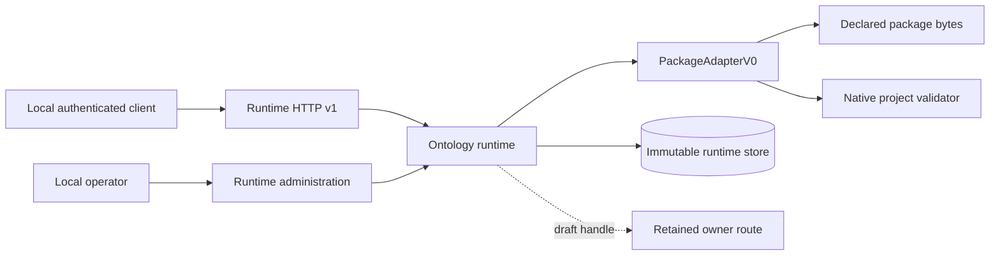
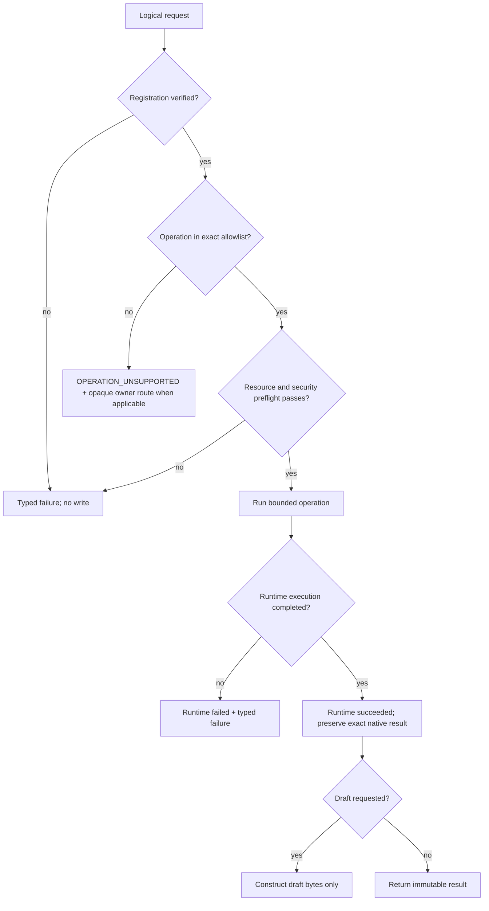

# Architecture Bundle: Ontology Vault Runtime API

## Design Intent

Create the smallest private runtime boundary that can compile one explicitly
configured ontology package into immutable, lossless read models and offer
bounded logical-ID operations without taking ownership of source meaning,
validation semantics, ontology promotion, owner review, or agents.

## 1. Context View



Trust boundary: client and operator can request only enumerated logical-ID
contracts. The runtime cannot select a package or owner.

## 2. High-Level Structure View

```text
startup config verifier
  -> registration lock/identity service
  -> adapter host
  -> snapshot compiler/publisher
  -> immutable store
  -> query service
  -> bounded run worker
  -> draft artifact constructor
  -> loopback gateway
  -> exact-owned lifecycle controller
```

The compiler—not the adapter—owns envelopes, canonicalization, snapshot IDs,
collision decisions, publication, and receipts.

## 3. Low-Level Components View

| Component | Owns | Must not own |
| --- | --- | --- |
| Config verifier | schema, digest, containment checks | discovery, owner selection |
| Adapter host | lossless local extraction, optional native child invocation | snapshot identity/publication |
| Envelope compiler | qualified facets/aliases/confidence/source bindings | generic ontology meaning |
| Identity service | complete pre/post package identity | source identity mutation |
| Publisher | create-only runtime bytes; receipt last | source writes or retention policy |
| Query service | bounded snapshot reads, ETag/cursor | semantic equivalence |
| Run worker | exact operation allowlist and status | conformance or agent lifecycle |
| Proposal constructor | immutable compatible draft bytes | delivery/review/decision |
| Gateway | loopback auth/method/path bounds | public exposure |
| Lifecycle controller | exact owned PID/port/temp teardown | arbitrary cleanup |

## 4. Workflow Process View

### Significant behavior scenario: deterministic snapshot admission

Preconditions: selected owners and implementation root exist; one registration
is configured; fixture caps are approved; source is immutable for the attempt.

1. Client posts logical package/profile IDs with an idempotency key.
2. Runtime verifies registration and acquires its lock.
3. Runtime calculates complete pre-identity.
4. Adapter extracts twice in separate clean owned roots.
5. Runtime constructs and canonicalizes envelopes.
6. Runtime compares bytes and recomputes post-identity.
7. Runtime proves source preservation and caps.
8. Runtime create-only publishes bytes and writes receipt last, or reuses an
   identical snapshot.

Failure: any drift, nondeterminism, collision, cap, or contract violation
publishes nothing and cleans only owned temporary state.

Observable evidence: snapshot/teardown receipts, exact hashes and measurements.
Acceptance owner: currently absent; this scenario is planned, not executed.

## 5. Decision Flow View



No branch reaches promotion, owner review, deployment, release, or agent
execution.

## 6. Dependency Interface View

| Interface | Direction | Version/binding | Failure boundary |
| --- | --- | --- | --- |
| startup configured registration | inbound | schema + exact digests | reject before service readiness |
| PackageAdapterV0 | internal bidirectional | adapter/code/profile/schema versions | contract violation |
| native validator | child-process bidirectional | command identity digest | preserve exit/result; timeout typed |
| Runtime HTTP v1 | inbound | request/response/error v0 | logical IDs and allowlist only |
| immutable runtime store | internal | canonicalizer + content ID | create-only collision check |
| PromotionRequest compatibility | outbound artifact handle | draft schema target | no delivery |

## Concern-To-View Trace

The deterministic result is
[`DESIGN-SELECTION-RESULT.json`](DESIGN-SELECTION-RESULT.json). Required
concerns map as follows:

| Concern | View/extension | Design treatment |
| --- | --- | --- |
| authority | authority/trust | invariant none; unresolved owners block |
| security | security/abuse | loopback, token, path, child, teardown controls |
| state-event | state/event | separate runtime state machines; no owner states |
| persistence | persistence/concurrency | lock, identity, create-only store |
| failure | failure/compensation | no partial publication; exact cleanup |
| integration | integration/versioning | versioned adapter/API/native/draft boundaries |
| privacy-data | data lifecycle | private bytes, redaction, retention blocked |
| rollout | migration/rollout | v0 fixture then later adapters; no release claim |
| validation | validation contracts | planned positive/negative witnesses |
| performance | recommended only | unapproved caps remain hypotheses |

## Triggered Architecture Extensions

### Authority And Trust

Every record/response/receipt fixes runtime authority to `none`. Role-bearing
owner refs are opaque. Missing owner bindings block implementation; service
health cannot satisfy them.

### Security And Abuse

Bind to loopback, require an ephemeral bearer token, accept logical IDs only,
deny uploads/URLs/traversal/symlinks/protocol upgrades, minimize child
environment, enforce caps, redact errors, and prove exact-owned teardown.

### State, Persistence, And Failure

The state machines in [STATES.md](STATES.md) are disjoint. Publication is
create-only and atomic; the receipt is last. Failure leaves no published
partial object and never deletes unowned state.

### Integration And Versioning

Registration binds exact adapter, canonicalizer, profile, local-schema, and
command identities. Same-adapter diff is rejected across unequal adapter
identity. Compatibility changes require a new version; no implicit migration.

### Data Lifecycle

Source bytes stay package-owned. Runtime store, temp roots, receipts, logs, and
artifacts are separately owned. Retention and GC remain unavailable until an
owner defines eligibility and deletion.

### Migration And Rollout

v0 is fixture-only. Augmentor and Body War are later adapter candidates; CAV2
profile/Markdown adapter is later still. No slice implies registry release,
deployment, or production.

### Validation

Planned witness contracts are in
[`DESIGN-PLANNED-WITNESSES.json`](DESIGN-PLANNED-WITNESSES.json). They are not
executed Plan evidence.

## Design Rules

- Use only Concept Registry IDs from [SPEC.md](SPEC.md).
- Preserve source-local meaning and both confidence axes.
- Never convert runtime or native evidence into authority.
- Never describe planned witnesses as measurements.
- Plan begins at `plan-evidence-pending`.

