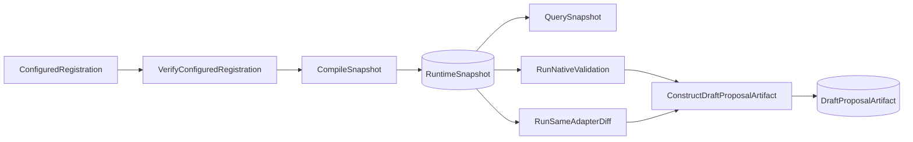

# Ontology Vault Runtime API

## What This Module Owns

The candidate module owns only configured package admission, lossless
adapter extraction, immutable runtime snapshots, bounded logical-ID reads,
native-validation wrapping, same-adapter byte/local-ID diff, and immutable
draft proposal-byte construction. It owns runtime read-model bytes and
operational receipts, never source meaning, ontology truth, promotion, owner
review, release, or agent lifecycle.

The contract is authored but owner-blocked. No runtime implementation, profile,
adapter, fixture witness, or measurement exists.

## Module Map

## Capabilities

| Capability | What | Key aspects |
| --- | --- | --- |
| Configured Admission | Verify one startup-selected package/profile/adapter tuple | registration states; containment; owner refs preserved |
| Snapshot Compilation | Produce one immutable content-addressed runtime read model | double extraction; pre/post identity; create-only publication |
| Bounded Query | Read snapshots by logical IDs | ETag; paging; caps; no arbitrary paths |
| Bounded Operations | Wrap native validation and byte/local-ID diff | execution/result separation; same-adapter only |
| Draft Construction | Construct immutable PromotionRequest-compatible bytes | draft bytes only; no delivery/review/decision |
| Owned Lifecycle | Start, observe, and exactly stop the local process | loopback/token; zero outbound; owned teardown |

## Domain Concepts

| Concept | Type | Key constraints |
| --- | --- | --- |
| ConfiguredRegistrationV0 | Entity | startup-only root; role-bearing opaque owner refs |
| AdapterDescriptorV0 | Entity | code identity and extraction capability only |
| RuntimeRecordEnvelopeV0 | Entity | `runtime_authority_effect:"none"` |
| RuntimeSnapshotV0 | Entity | immutable, content-addressed, runtime-owned read model |
| RuntimeRunV0 | Entity | runtime execution status distinct from native result |
| DraftProposalArtifactV0 | Entity | immutable draft bytes; no owner lifecycle |
| RuntimeReceiptV0 | Evidence | operational evidence only |
| ResourceCapsV0 | Policy | provisional, explicit, measured-or-fail witness caps |

## Concept Registry

| Concept | ID | Type |
| --- | --- | --- |
| ConfiguredRegistration | `ontology-runtime.ConfiguredRegistration` | Entity |
| RuntimeSnapshot | `ontology-runtime.RuntimeSnapshot` | Entity |
| RuntimeRecordEnvelope | `ontology-runtime.RuntimeRecordEnvelope` | Entity |
| RuntimeRun | `ontology-runtime.RuntimeRun` | Entity |
| DraftProposalArtifact | `ontology-runtime.DraftProposalArtifact` | Entity |
| RuntimeReceipt | `ontology-runtime.RuntimeReceipt` | Evidence |
| VerifyConfiguredRegistration | `ontology-runtime.VerifyConfiguredRegistration` | Operation |
| CompileSnapshot | `ontology-runtime.CompileSnapshot` | Operation |
| RunNativeValidation | `ontology-runtime.RunNativeValidation` | Operation |
| RunSameAdapterDiff | `ontology-runtime.RunSameAdapterDiff` | Operation |
| ConstructDraftProposalArtifact | `ontology-runtime.ConstructDraftProposalArtifact` | Operation |
| GetSnapshot | `ontology-runtime.GetSnapshot` | Query |
| ListSnapshotRecords | `ontology-runtime.ListSnapshotRecords` | Query |
| GetRuntimeRun | `ontology-runtime.GetRuntimeRun` | Query |
| RuntimeHttpV1 | `ontology-runtime.RuntimeHttpV1` | Interface |

## Feature Concept Graph

| From | Edge | To | Evidence |
| --- | --- | --- | --- |
| `ontology-runtime.VerifyConfiguredRegistration` | produces | `ontology-runtime.ConfiguredRegistration` | [OPERATIONS.md](OPERATIONS.md#verify-configured-registration) |
| `ontology-runtime.CompileSnapshot` | produces | `ontology-runtime.RuntimeSnapshot` | [OPERATIONS.md](OPERATIONS.md#compile-snapshot) |
| `ontology-runtime.RuntimeSnapshot` | contains | `ontology-runtime.RuntimeRecordEnvelope` | [MAPPINGS.md](MAPPINGS.md#local-extraction-item-to-runtime-record-envelope) |
| `ontology-runtime.RunNativeValidation` | produces | `ontology-runtime.RuntimeRun` | [OPERATIONS.md](OPERATIONS.md#run-native-validation) |
| `ontology-runtime.ConstructDraftProposalArtifact` | produces | `ontology-runtime.DraftProposalArtifact` | [OPERATIONS.md](OPERATIONS.md#construct-draft-proposal-artifact) |
| `ontology-runtime.RuntimeHttpV1` | exposes | `ontology-runtime.GetSnapshot` | [INTERFACES.md](INTERFACES.md#get-v1snapshotssnapshot_id) |

## Aspect Docs

| Aspect | Contains |
| --- | --- |
| [Glossary](GLOSSARY.md) | feature-local terms and link status |
| [States](STATES.md) | owner-gated lifecycle state machines |
| [Operations](OPERATIONS.md) | state-creating behavior and failure rules |
| [Queries](QUERIES.md) | immutable bounded read models |
| [Interfaces](INTERFACES.md) | loopback HTTP and administration boundary |
| [Events](EVENTS.md) | runtime-local operational events |
| [Mappings](MAPPINGS.md) | lossless source-to-envelope transformations |

## Cross-Feature Dependencies

| Capability | Depends on | Via | Why |
| --- | --- | --- | --- |
| Configured Admission | source package/profile owner | exact configured registration | runtime cannot discover or select |
| Snapshot Compilation | PackageAdapterV0 | lossless extraction interface | package structure remains local |
| Bounded Operations | native validator | exact child result and receipt | native semantics remain retained |
| Draft Construction | PromotionRequest owner route | compatibility target only | runtime cannot deliver or decide |
| Agent-backed requests | Orchestrate | unsupported route | runtime never executes agents |

## Produces For

| Consumer | Consumes capability | Via | What |
| --- | --- | --- | --- |
| local operator/tooling | Bounded Query | authenticated loopback GET | immutable runtime read model |
| native project owner | Bounded Operations | run receipt | exact wrapped native result |
| promotion-request route | Draft Construction | immutable artifact handle | draft bytes, not delivery |

## Non-goals And Claim Ceiling

No discovery, Inventory replacement, ontology CRUD, semantic inference,
cross-adapter equivalence, owner review, promotion, publication, deployment,
release, registration-over-HTTP, arbitrary path, upload, cancellation, or
agent execution is admitted. `authority_effect: none`.

## References

- Accepted research: [`../findings.md`](../findings.md)
- Design: [ARCHITECTURE-BUNDLE.md](ARCHITECTURE-BUNDLE.md)
- Plan: [WORK-PACK.md](WORK-PACK.md)
- Decisions and gaps: [DESIGN-LEDGER.md](DESIGN-LEDGER.md)

