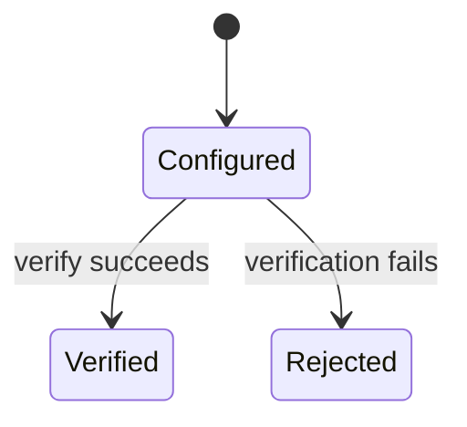
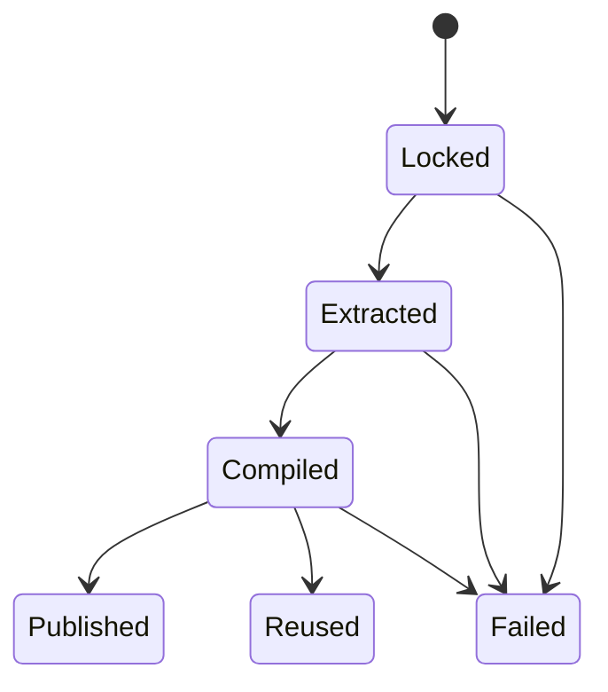
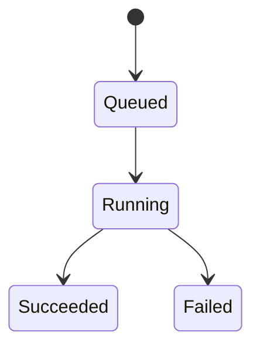
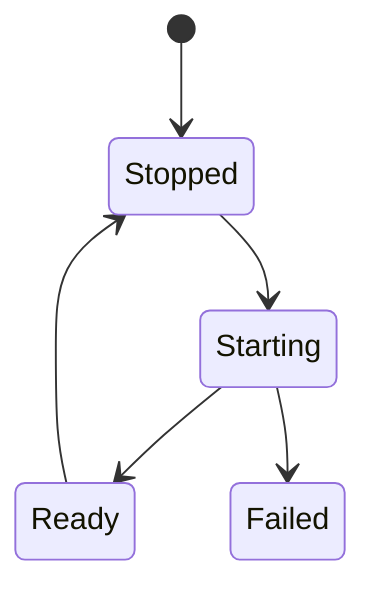

# State Machines: Ontology Vault Runtime API

All transitions are designed and owner-blocked.

## Configured Registration

| From | Event | To | Guard | Effect |
| --- | --- | --- | --- | --- |
| Configured | RegistrationVerified | Verified | exact profile/manifest/adapter bindings match | emit receipt |
| Configured | RegistrationRejected | Rejected | any binding or containment failure | publish nothing |

## Snapshot Build

| From | Event | To | Guard | Effect |
| --- | --- | --- | --- | --- |
| Locked | ExtractionCompleted | Extracted | complete pre-identity fixed | hold temporary owned bytes |
| Extracted | CompilationCompleted | Compiled | double extraction byte-identical | construct runtime identity |
| Compiled | SnapshotPublished | Published | create-only path absent | receipt written last |
| Compiled | SnapshotReused | Reused | identity and bytes equal | return existing handle |
| any non-terminal | SnapshotFailed | Failed | typed failure | publish nothing; clean owned temp |

## Runtime Run

Native rejection is a `Succeeded` runtime execution with a negative native
result. It is not a runtime failure.

## Service

There is no cancellation state. Retention/GC remains blocked until its owner
defines `retained -> eligible -> deleted`.

## Invariants

| ID | Invariant | Formal |
| --- | --- | --- |
| I1 | Runtime never changes authority | `runtime_authority_effect = "none"` |
| I2 | Failed compilation publishes no snapshot | `failed => published_bytes = 0` |
| I3 | Native result never rewrites runtime status | `native_rejection && child_completed => runtime_status = succeeded` |
| I4 | Teardown affects only exact owned handles | `target ∈ owned_handles` |
| I5 | No hidden owner lifecycle state is represented | `runtime_state ∩ owner_review_states = ∅` |

