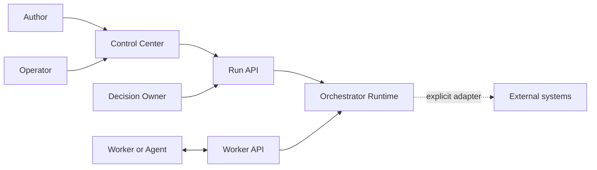
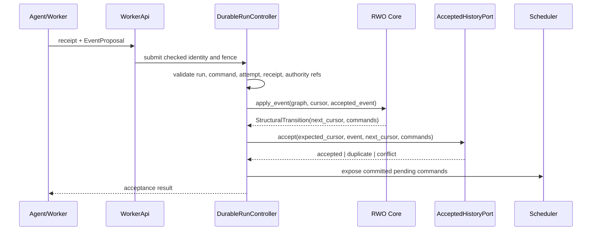
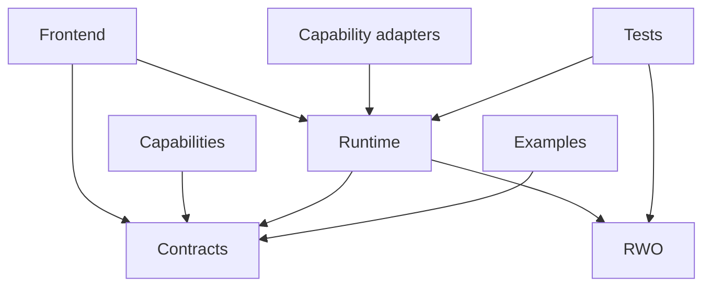

# CyberAlchemy Orchestrator Architecture

Status: candidate construction architecture  
Authority effect: none

## Context

CyberAlchemy Orchestrator is one product inside CyberAlchemy v2. Authors create
strategies and templates; operators review and supervise runs; Workers execute
commands; decision owners retain admission, reconciliation, truth, acceptance,
promotion, and effect authority.



## Structural rule

There is one structural transition engine: the evolved `DagEngine` becomes the
implementation inside `rwo-core`. Historical reducers may remain as differential
test fixtures, but one run never passes through two production reducers.

There is one accepted structural-history writer: the runtime commits through
`AcceptedHistoryPort`. A transition is stored atomically as the accepted event,
next cursor, and complete immutable command batch.

## Components and ownership

| Component | Owns | Does not own |
| --- | --- | --- |
| Strategy compiler | Template/strategy validation and deterministic Work Graph compilation | Admission or execution |
| RWO Core | Work definitions, composition, graph validation, release rules, event reduction, cursor, command generation, replay version | Storage, workers, providers, lifecycle acceptance, domain truth |
| Durable Run Controller | Identity checks, event acceptance procedure, attempts, receipts, cancellation, recovery coordination | Structural semantics or external authority |
| Accepted-History Port | Atomic event/cursor/command-batch persistence | A second reducer or lifecycle decisions |
| Scheduler | Capacity-aware selection of pending commands | Structural readiness |
| Capability Adapter | Transport to a concrete local, Gateway, model, tool, or human executor | Contract or graph mutation |
| Worker or Agent | Executes one addressed command and returns a receipt plus proposed event | Direct DAG mutation or admission |
| Current-State Projector | Provenance-bearing operator view | Writes or authority decisions |
| Control Center | Authoring, review, observation, and explicit proposals | A second state machine or history writer |

## Event and command flow



The agent emits a proposal; agents return receipts and proposals, and they do not mutate the graph. The controller decides whether it satisfies the
runtime contract. RWO computes only from an accepted fact. Scheduling starts
only after the atomic history transaction succeeds.

## State separation

```text
Product state = admitted Run Bundle
              + accepted structural history
              + coordination and attempt records
              + immutable artifacts and receipts
              + lifecycle ledger
              + current-state projection
```

These records share identities but remain separate. An execution completion is
not result acceptance; a receipt is not proof of truth; event deduplication is
not exactly-once external effect.

## Dependency rules



`rwo-core` has no dependency on runtime, storage, scheduler, frontend, ARE,
model provider, deployment, or domain consumers. Runtime may call RWO through
its public API. ARE is one optional capability adapter and never a second
scheduler.

## Recovery

Recovery reads accepted history, coordination state, receipts, and effect
dispositions. It produces `execute`, `reconcile`, `blocked_unknown_effect`, or
`accept_recorded_event`. An event stored in a valid receipt still crosses the
same controller and RWO boundary. Unknown external effect blocks blind retry.

## Versioning and migration

Every Run Bundle pins compiler, graph, contract, and engine versions. Old
histories replay with their recorded engine version. Semantic upgrades create a
new version and never rewrite existing history or digests. M3 keeps historical
RWO fixtures for differential testing; M9 proves a clean checkout without live
legacy paths before any retirement stage.

## Product journey

Both chat-authored strategies and saved-template buttons produce a Dispatch
Proposal. Review and Run Admission create the exact Run Bundle. Local and
Gateway-backed agents then use the same command, receipt, event, and history
contracts. Robot Talks and Robot World are ordinary examples using this path.

## Evidence boundary

The business, system, and bridge ontologies under `../ontology/` are candidate
read models. This architecture constrains implementation but does not prove
runtime conformance, product acceptance, deployment readiness, or authority.

## Open Questions

See `../authority/definitions/DEFINITIONS.md#open-questions`.
