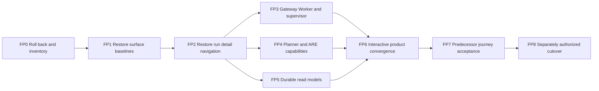

# Functional Convergence DAG

Status: construction plan candidate  
Authority effect: none

| Stage | Status | Product result | Verification boundary |
| --- | --- | --- | --- |
| FP0 | complete | Public predecessor restored; old/new behavior inventoried | Rollback receipt and remote health |
| FP1 | complete | General Lab, run DAG, ontology, and Operations baselines | Unit, API, browser, and clean-copy checks |
| FP2 | complete | Overview, graph, results, trace, workers, evidence, recovery, and lifecycle tabs | Browser tab and keyboard checks |
| FP3 | in progress | HTTP `WorkerApi` plus checked `supervise_once`; Gateway transport and host loop remain | HTTP journey proves poll, lease, begin, receipt, `accept_event`, and terminal projection |
| FP4 | runnable | Natural-language planner, ARE route/context, and Gateway thread-read strategies | Each capability produces a reviewable proposal and consumes no undeclared effect |
| FP5 | in progress | Lease, fence, receipt, accepted-event, verified result, and capacity projections; Agent Turn and Gateway provenance remain | Projection replay matches durable records and result previews require run ownership plus exact digest |
| FP6 | waiting on FP3-FP5 | Search/filter, provenance inspection, ontology portal/navigation, run controls, and domain extension contract | Predecessor task matrix passes against generic records |
| FP7 | waiting on FP6 | One automated and human-reviewed acceptance journey covers every retained capability | No critical or major parity gap remains |
| FP8 | separate publication route | Rebuilt candidate can replace the predecessor with retained rollback | Exact deployment authorization, smoke test, and rollback drill |

FP3, FP4, and FP5 can proceed in parallel as product construction. Monitoring
history, backups, and deployment automation remain operational tasks unless an
exact FP3-FP7 test depends on them.

## Open Questions

See `FEATURE-PARITY.md#open-questions`.
