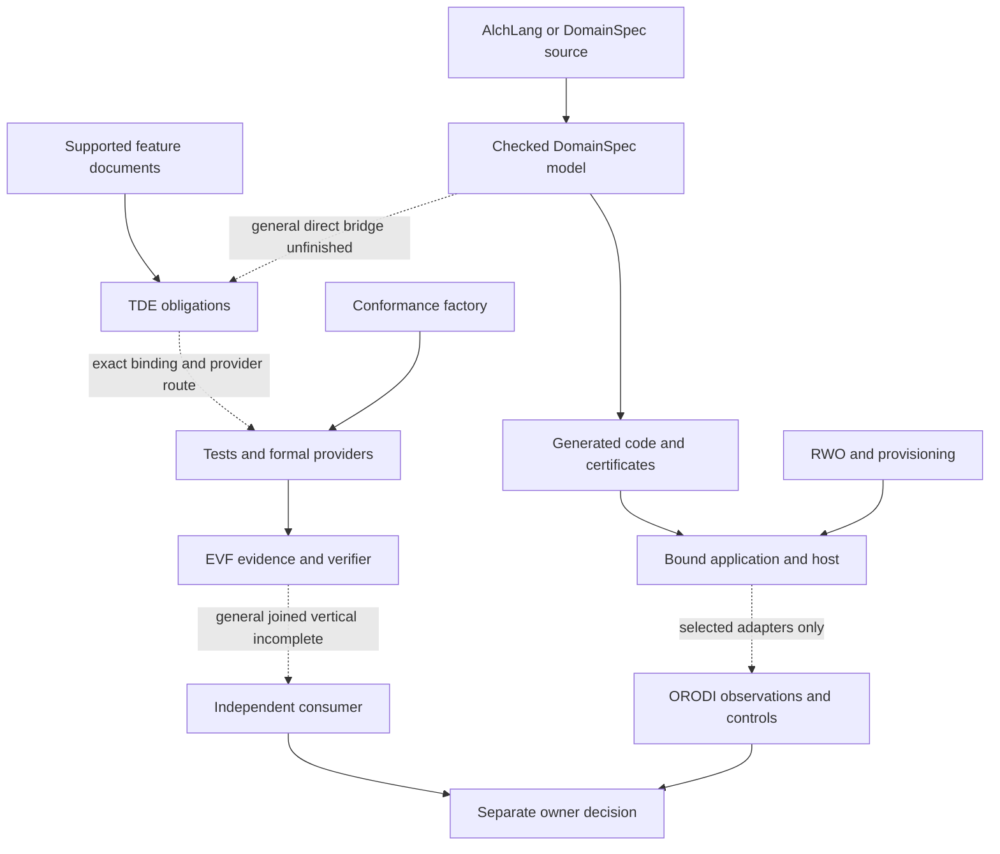

# Enterprise application coverage audit

Date: 2026-09-07. Status: research evidence. Authority effect: none.
Scope: current local CyberAlchemy-v2 and sibling DomainSpec-core sources, including
AlchLang, DomainSpec, ORODI, EVF, TDE and the linked application/evidence/runtime flow.
No implementation, old receipt, owner decision, deployment or admission was changed.

## Finding

The system has a broad enterprise-oriented set of building blocks: typed backend
compilation, application functions, durable transactions/events, local hosting,
upgrades/migration, evidence evaluation, formal adapters and recovery mechanisms.
My earlier compiler-only answer understated that breadth. ORODI, EVF and TDE belong
in the assessment, and EVF is more than the older architecture overview alone suggests.

However, **“covers most enterprise standards” is not established**. We have neither
an agreed enterprise requirement denominator nor one current, independently checked
application spanning the full generation, assurance and operational chain. Many
capabilities exist as bounded or separately versioned implementations. Their presence
cannot be counted as automatic coverage for every `.alch` file or CLI-generated project.

The defensible claim is: **enterprise-oriented application generation and assurance
building blocks, with tested bounded verticals; general end-to-end enterprise readiness
remains unverified.** This is about integration, scope and evidence currentness, not
an assertion that all the missing connections require inventing new components.

## How the parts fit

This diagram is audit synthesis, not an admitted architecture. EVF's portable kit can
run explicitly authored formal checks without surrounding TDE. Some connections work
for selected fixtures; dotted connections are not a claim of a general proven pipeline.

The compiler declares its stable and experimental surfaces in [compiler](../../../domainspec-core/projects/domainspec-v2/impl/cli/src/product/capabilities.ts). [architecture](../../../domainspec-core/projects/domainspec-v2/ARCHITECTURE.md) explicitly distinguishes JSON compilation from the Markdown TDE route and records the general factory/EVF join as unfinished. The public Alch CLI selects several specialized host/function profiles before ordinary DomainSpec lowering ([alch-cli](../../language/capabilities/alchlang/plans/general-compiler-v1/implementation/src/cli.ts)); sharing the CLI does not mean every path traverses every assurance stage.

## Enterprise coverage matrix

Statuses describe the selected evidence, not deployment approval. “Not established”
means this audit did not demonstrate the capability in the generated-application flow;
it does not prove that no repository component offers it. The 26 rows are a review
checklist, not 26 equally weighted enterprise requirements or a coverage percentage.

| Area | Status | Existing evidence | Remaining boundary |
| --- | --- | --- | --- |
| C01 Typed model and deterministic compilation | bounded-tested | 13 backend meta-types; TypeScript/Python/Rust outputs; compiler certificates and source binding. Earlier 71-test reconciliation epoch passed. [compiler](../../../domainspec-core/projects/domainspec-v2/impl/cli/src/product/capabilities.ts), [reconciliation](../../../domainspec-core/projects/domainspec-v2/development/compilation-reconciliation/validation/container/evidence.json), [alch-cli](../../language/capabilities/alchlang/plans/general-compiler-v1/implementation/src/cli.ts) | Current Alch checkout has 3 changed bound source files; repeat an exact candidate check before carrying that result forward. |
| C02 Business logic, rules, policies, mappings | bounded-tested | Typed contracts, explicit guards, exact numeric profiles and Node/Rust portable function evidence. [compiler](../../../domainspec-core/projects/domainspec-v2/impl/cli/src/product/capabilities.ts), [portable](../../language/capabilities/alchlang/plans/general-compiler-v1/extensions/portable-conformance-v1/README.md), [portable-report](../../language/capabilities/alchlang/plans/general-compiler-v1/extensions/portable-conformance-v1/validation/report.json), [semantic-host](../../language/capabilities/alchlang/plans/general-compiler-v1/extensions/semantic-corrections-v1/README.md) | Supported profiles differ; arbitrary business semantics and universal language parity are not established. Older portable manifest has drift. |
| C03 Application/API generation | partial | Generated Node/Rust functions and loopback HTTP host; input, actor and grant checks. [semantic-host](../../language/capabilities/alchlang/plans/general-compiler-v1/extensions/semantic-corrections-v1/README.md), [semantic-source](../../language/capabilities/alchlang/plans/general-compiler-v1/implementation/src/semantic-host.ts) | Semantic host supports one producer, one consumer, one transition and optional scalar assignment per operation. Not arbitrary service topology or a generated UI. |
| C04 Persistence and transactions | partial | SQLite atomic state/outbox and projection/inbox; experimental Postgres transactional outbox APIs. [semantic-host](../../language/capabilities/alchlang/plans/general-compiler-v1/extensions/semantic-corrections-v1/README.md), [runtime](../../../domainspec-core/projects/domainspec-v2/impl/cli/src/experimental/runtime.ts), [integration](../../../domainspec-core/projects/domainspec-v2/impl/system-integration/README.md) | Provider-neutral declarations do not implement a database. Cross-service transactions and production database topology need exact adapters and tests. |
| C05 Events, retries and deduplication | partial | Durable local delivery, retry limits, leases, fenced settlement, inbox deduplication and local dead letters. [semantic-host](../../language/capabilities/alchlang/plans/general-compiler-v1/extensions/semantic-corrections-v1/README.md), [isolation](../../language/capabilities/alchlang/plans/general-compiler-v1/extensions/local-host-events-v1/README.md), [integration](../../../domainspec-core/projects/domainspec-v2/impl/system-integration/README.md) | Remote broker semantics and dead-letter publication remain separate; no exactly-once transport claim. |
| C06 Workflow recovery and compensation | partial | Durable recovery runtime, independent observer, adapter and ORODI campaign: recorded 30 scenarios x 2. [architecture](../../../domainspec-core/projects/domainspec-v2/ARCHITECTURE.md), [orodi-recovery](../../../domainspec-core/projects/domainspec-v2/development/recovery-orodi-binding/v1/b05-v1/README.md), [orodi-recovery-candidate](../../../domainspec-core/projects/domainspec-v2/development/recovery-orodi-binding/v1/b05-v1/CANDIDATE.json) | B05 has one missing source and expired freshness window; current adapter test fails on that source. No universal distributed recovery claim. |
| C07 Schema migration, upgrade and rollback | partial | Version-bound plans, generated default mappings, snapshot rehearsal, separate storage generations, route recovery. [semantic-host](../../language/capabilities/alchlang/plans/general-compiler-v1/extensions/semantic-corrections-v1/README.md), [semantic-execution](../../language/capabilities/alchlang/plans/general-compiler-v1/extensions/semantic-corrections-v1/execution.json) | Bounded additive/explicit ownership changes; arbitrary destructive transforms, online rolling migrations and multi-node cutover are not established. |
| C08 Integration contracts and providers | partial | Repository/UoW/failure bindings and message/transport/delivery contracts are modeled and validated. [integration](../../../domainspec-core/projects/domainspec-v2/impl/system-integration/README.md), [runtime](../../../domainspec-core/projects/domainspec-v2/impl/cli/src/experimental/runtime.ts) | External resource, adapter and provider identity must be supplied and proven; declaration is not execution. |
| C09 Host provisioning and control plane | partial | RWO/Ansible local host; persistent revision registry; asynchronous tenant-turn build queue and explicit activation. [async](../../language/capabilities/alchlang/plans/general-compiler-v1/extensions/async-control-plane-v1/README.md), [host-evidence](../../work-orchestration-implementation/extensions/alch-host-evidence-v1/README.md), [semantic-host](../../language/capabilities/alchlang/plans/general-compiler-v1/extensions/semantic-corrections-v1/README.md) | Loopback and single-host candidate. Remote allocation, public DNS/TLS and multi-host coordination remain external. |
| C10 Tenant and resource isolation | partial | Tenant-scoped revision access, admission limits and Bubblewrap per-invocation isolation. [isolation](../../language/capabilities/alchlang/plans/general-compiler-v1/extensions/local-host-events-v1/README.md), [async](../../language/capabilities/alchlang/plans/general-compiler-v1/extensions/async-control-plane-v1/README.md) | No aggregate cgroup/process/disk quota guarantees, complete seccomp policy or independent public-hosting security result. |
| C11 Authentication and authorization | external-binding | Reusable auth package provides login/token/session/authorization use cases; Auth Foundation has generated deny-by-default Rust decisions. [auth](../../../domainspec-core/projects/auth-user-management/README.md), [auth-foundation](../../../domainspec-core/projects/auth-foundation/README.md), [semantic-host](../../language/capabilities/alchlang/plans/general-compiler-v1/extensions/semantic-corrections-v1/README.md) | These are separate components; full generated-app identity-service integration, browser sessions and CSRF behavior require consumer bindings. |
| C12 Enterprise identity federation | not-established | Scoped operator tokens and auth ports exist. [auth](../../../domainspec-core/projects/auth-user-management/README.md), [semantic-host](../../language/capabilities/alchlang/plans/general-compiler-v1/extensions/semantic-corrections-v1/README.md) | End-to-end SAML/OIDC federation, MFA, provisioning/SCIM and enterprise identity lifecycle are not demonstrated by this selected flow. |
| C13 Secrets and credential lifecycle | external-binding | Local single-user SOPS/age store and bounded consumption interface. [secrets](../../../domainspec-core/projects/secret-management/README.md) | Shared production secrets service, CI identities, rotation automation and cloud backends are separate work. |
| C14 Operational evidence and telemetry | partial | ORODI contracts, controls, eligibility, snapshot projection, Grafana alerts and host-history observations. [orodi-runtime](../../../domainspec-core/projects/domainspec-v2/impl/operational-resilience/README.md), [orodi-alert](../../../domainspec-core/projects/domainspec-v2/impl/operational-resilience/orodi-alert-profile/README.md), [host-evidence](../../work-orchestration-implementation/extensions/alch-host-evidence-v1/README.md) | Alch host evidence remains workflow/simulation; no full live product-control verdict or acknowledged telemetry export follows. |
| C15 Canary, workload, rollback and lab | partial | Body War canary routing/workload/evaluator/controller, rollback, observer, pinned lab and commissioning interface exist. [orodi-records](../../product/craft/capabilities/orodi/product-capabilities.json), [orodi-canary](../../../domainspec-core/projects/domainspec-v2/impl/operational-resilience/BODY-WAR-CANARY-VALIDATION.md) | Application-specific lab; independent live generated-Alch service readiness, production actuation and teardown evidence require their own exact runs. |
| C16 TDE obligation derivation | partial | Active deterministic Markdown/normalized SPEC parser and emitter; fresh fixture derivation yields 263 obligations. [TDE](../../../domainspec-core/projects/domainspec-v2/impl/test-derivation-engine/README.md), [TDE-cli](../../../domainspec-core/projects/domainspec-v2/impl/test-derivation-engine/src/cli.ts), [TDE-emitter](../../../domainspec-core/projects/domainspec-v2/impl/test-derivation-engine/src/emit/tests.ts), [architecture](../../../domainspec-core/projects/domainspec-v2/ARCHITECTURE.md) | 47 fixture obligations need formalization; generic binding-free output uses todo, hybrid output can skip. No direct shared-graph/general TDE join demonstrated. |
| C17 EVF evidence execution and verification | partial | Portable 0.4 kit with Rust core, verifier and Souffle/Alloy/CBMC/Lean/TLC adapters; archive matches recorded 104-test validation. [EVF-kit](../../../domainspec-core/projects/domainspec-v2/development/evolvable-validation-framework/distribution/portable-audit-v4/README.md), [EVF-kit-validation](../../../domainspec-core/projects/domainspec-v2/development/evolvable-validation-framework/distribution/portable-audit-v4/VALIDATION.json), [EVF-kit-interface](../../../domainspec-core/projects/domainspec-v2/development/evolvable-validation-framework/distribution/portable-audit-v4/template/README.md) | Bundled examples and exact bounds, not automatic TDE integration or arbitrary app correctness; tools need separate installations and TLC caveat remains. |
| C18 Conformance factory and BTE | partial | Factory locks provider inputs, repeats isolated processes and rejects inconsistent evidence; BTE implementation remains present. [factory](../../../domainspec-core/projects/domainspec-v2/impl/architecture-conformance/factory/README.md), [BTE](../../../domainspec-core/projects/domainspec-v2/impl/test-derivation-engine/src/bte/development-engine.ts), [EVF-streams](../../../domainspec-core/projects/domainspec-v2/development/evolvable-validation-framework/THREAD-MAP.md) | General EVF adapter and BTE absorption are distinct unfinished/gated streams; same-host bounded proof is not production conformance. |
| C19 Formal assurance | partial | DomainSpec certifier binds finite projection, independent Lean decoder and proof unit; EVF has multiple formal adapters. [certification](../../../domainspec-core/projects/domainspec-v2/impl/cli/src/assurance/certify.ts), [formal-bridge](../../../domainspec-core/projects/domainspec-v2/formalization/docs/TDE-EVF-INTEGRATION.md), [EVF-kit](../../../domainspec-core/projects/domainspec-v2/development/evolvable-validation-framework/distribution/portable-audit-v4/README.md) | A proof of a selected model does not prove source preservation, all generated application behavior or production runtime correspondence. |
| C20 Independent consumption and owner decisions | partial | Separate evidence consumer and authority roles are explicit; source-bound acceptance exists for selected historical candidates. [EVF-streams](../../../domainspec-core/projects/domainspec-v2/development/evolvable-validation-framework/THREAD-MAP.md), [EVF-guide](../../../domainspec-core/projects/domainspec-v2/development/evolvable-validation-framework/COMPLETE-GUIDE.md), [orodi](../../product/craft/capabilities/orodi/README.md) | General independently consumed source-to-TDE-to-EVF chain is not closed. IOLM is one named independent consumer, not a requirement for every application. |
| C21 Build provenance and release artifacts | partial | Compiler package inventory, SBOM, unsigned in-toto/SLSA-shaped provenance, qualification and offline verifier. [release](../../../domainspec-core/projects/domainspec-v2/development/stable-1-release-candidate/IMPLEMENTATION-LAYERING.md), [compiler-compatibility](../../../domainspec-core/projects/domainspec-v2/impl/cli/COMPATIBILITY.md) | Clean candidate/CI qualification still required; no signing identity or SLSA level follows from schema shape or checksums. |
| C22 Deployment recipes | partial | ECS/Fargate/Postgres target and SQS candidate recipe; plan/generate/verify/qualification commands. [compiler](../../../domainspec-core/projects/domainspec-v2/impl/cli/src/product/capabilities.ts), [compiler-compatibility](../../../domainspec-core/projects/domainspec-v2/impl/cli/COMPATIBILITY.md) | Recipe generation/qualification does not deploy or establish cloud-provider behavior; consumer app and migration inventory remain inputs. |
| C23 Production availability and recovery objectives | not-established | Local restart, fault, retry, canary and recovery evidence supplies useful building blocks. [orodi-canary](../../../domainspec-core/projects/domainspec-v2/impl/operational-resilience/BODY-WAR-CANARY-VALIDATION.md), [orodi-recovery](../../../domainspec-core/projects/domainspec-v2/development/recovery-orodi-binding/v1/b05-v1/README.md), [isolation](../../language/capabilities/alchlang/plans/general-compiler-v1/extensions/local-host-events-v1/README.md) | No joined production SLO/load/capacity evidence, cross-region HA, backup restoration RPO/RTO or disaster-recovery acceptance for the generated-app flow. |
| C24 Frontend and accessibility | not-established | Current stable compiler denominator is backend types; UI candidates are separately retained. [architecture](../../../domainspec-core/projects/domainspec-v2/ARCHITECTURE.md), [compiler](../../../domainspec-core/projects/domainspec-v2/impl/cli/src/product/capabilities.ts) | General generated frontend, accessibility, browser compatibility and complete user workflows are not demonstrated by this compiler path. |
| C25 Privacy, audit retention and data governance | not-established | Source provenance and durable application history exist. [semantic-host](../../language/capabilities/alchlang/plans/general-compiler-v1/extensions/semantic-corrections-v1/README.md), [host-evidence](../../work-orchestration-implementation/extensions/alch-host-evidence-v1/README.md) | Operational evidence is not a compliance audit trail; retention/deletion, data-subject workflows, residency and tenant privacy need explicit requirements and tests. Semantic host retains outbox/inbox indefinitely. |
| C26 Security and lifecycle standard coverage | not-established | Typed rejection, exact input identities, tests and bounded isolation address portions of secure development. [isolation](../../language/capabilities/alchlang/plans/general-compiler-v1/extensions/local-host-events-v1/README.md), [release](../../../domainspec-core/projects/domainspec-v2/development/stable-1-release-candidate/IMPLEMENTATION-LAYERING.md), [EVF-kit-validation](../../../domainspec-core/projects/domainspec-v2/development/evolvable-validation-framework/distribution/portable-audit-v4/VALIDATION.json) | No requirement-by-requirement ASVS/SSDF/SLSA mapping or full vulnerability/incident-response evidence was established. A percentage or compliance claim is unsupported. |

## ORODI: six capabilities, not one checkbox

ORODI is Operational Resilience, Observability and Deployment Integration. The six
Craft-owned capability identities cover:

1. Offline operational-evidence evaluation.
2. Runtime-snapshot projection while retaining denied runtime admission.
3. Canary evaluation.
4. Rollback verification.
5. Materialization of a run-ready local lab.
6. Separately authorized local commissioning.

The immutable capability records retain historical candidate-time statuses. Their
own README explains that adoption is recorded separately. Likewise, the generic
runtime README describes an earlier offline scope: later canary, projector, alert
and recovery sources are present. Do not use either historical snapshot to erase
those implementations or to infer fresh operational readiness.

Sources: [orodi-records](../../product/craft/capabilities/orodi/product-capabilities.json), [orodi](../../product/craft/capabilities/orodi/README.md), [orodi-related](../../product/craft/capabilities/orodi/RELATED-WORK.md), [orodi-canary](../../../domainspec-core/projects/domainspec-v2/impl/operational-resilience/BODY-WAR-CANARY-VALIDATION.md), [orodi-alert](../../../domainspec-core/projects/domainspec-v2/impl/operational-resilience/orodi-alert-profile/README.md).

The RWO-to-ORODI adapter is a real connection: it verifies accepted provisioning
history and emits five schema-valid observations. Its scope is historical local
fixture evidence, with `plane=workflow`, `mode=simulation`,
`independently_observed=false`, and telemetry still pending. It deliberately does
not claim live host readiness or a full C01-C16 product verdict.

The recovery B05 campaign reports 30 scenarios in two repetitions, with 60 ORODI
assertion slots, 106 authored tests and 224 observer captures. That is meaningful
integrated recovery evidence. It is also historical: its candidate freshness window
ended at **2026-09-07 04:56:49.859 UTC**, before this audit's observed time of
14:14:57 UTC. One of 135 bound source files is absent here. Replaying historical
integrity cannot make it fresh. The package also records two older broad-regression
harness failures; those are separate from today's two test failures below.

Sources: [host-evidence](../../work-orchestration-implementation/extensions/alch-host-evidence-v1/README.md), [host-evidence-result](../../work-orchestration-implementation/extensions/alch-host-evidence-v1/validation.json), [orodi-recovery](../../../domainspec-core/projects/domainspec-v2/development/recovery-orodi-binding/v1/b05-v1/README.md), [orodi-recovery-candidate](../../../domainspec-core/projects/domainspec-v2/development/recovery-orodi-binding/v1/b05-v1/CANDIDATE.json).

## EVF and TDE: implemented roles, incomplete general handoff

**TDE** is the active deterministic derivation engine. It parses supported aspect
Markdown or normalized `SPEC.md`, derives source-anchored obligations, and emits
specifications or test scaffolds. This audit ran its CLI on the repository's
agent-execution-orchestrator fixture: **263 obligations, 47 `needs-formal`**.
That result is derivation, not execution. The emitter explicitly uses `it.todo`
without bindings and `it.skip`/coverage gaps for unsupported hybrid checks.
The planned neutral multiformalism epoch must not be confused with that current engine.

Sources: [TDE](../../../domainspec-core/projects/domainspec-v2/impl/test-derivation-engine/README.md), [TDE-guide](../../../domainspec-core/projects/domainspec-v2/impl/test-derivation-engine/COMPLETE-GUIDE.md), [TDE-emitter](../../../domainspec-core/projects/domainspec-v2/impl/test-derivation-engine/src/emit/tests.ts); [fresh derivation](checks/tde-derive.json).

**EVF** has both earlier candidate-local evidence chains and a newer portable
0.4.0 audit kit with a Rust core, independent verifier, containment, and Souffle,
Alloy, CBMC, Lean and TLA+/TLC adapters. The kit's validation records **104 passing
tests and five supported/verified example claims**. This audit verified the archive
SHA-256 against that record; it did not rerun the five native toolchains.
The kit explicitly excludes surrounding TDE, broad application correctness, resource
exhaustion protection and an explanation of an intermittent TLC setup failure.
Thus “EVF is only planned” would be false, while “every DomainSpec build automatically
gets full EVF evidence” would also be false.

Sources: [EVF-kit](../../../domainspec-core/projects/domainspec-v2/development/evolvable-validation-framework/distribution/portable-audit-v4/README.md), [EVF-kit-validation](../../../domainspec-core/projects/domainspec-v2/development/evolvable-validation-framework/distribution/portable-audit-v4/VALIDATION.json), [EVF-kit-interface](../../../domainspec-core/projects/domainspec-v2/development/evolvable-validation-framework/distribution/portable-audit-v4/template/README.md), [EVF-guide](../../../domainspec-core/projects/domainspec-v2/development/evolvable-validation-framework/COMPLETE-GUIDE.md), [formal-bridge](../../../domainspec-core/projects/domainspec-v2/formalization/docs/TDE-EVF-INTEGRATION.md); [archive check](checks/evf-archive.json).

## Other capabilities to keep in the flow

- **System integration and durable recovery:** responsibility-specific repository,
  unit-of-work, failure and transport bindings; coordination, leases, retries,
  operation invocation identity and observer-backed recovery.
- **Conformance factory and BTE:** exact-input locking, repeatable provider execution,
  negative controls and backend-type evidence. BTE's presence under TDE does not
  merge their ownership or mean its EVF absorption is complete.
- **FormalClaim/projection preservation and providers:** the compiler's Lean
  certification, EVF formal adapters, and FMP's distinct TLA/TLC provider lineage.
  The portable TLC implementation does not automatically close the separately
  governed FMP-to-factory/EVF adapter plan.
- **Independent consumers:** IOLM is one documented consumer lane, alongside
  application owners and other validation consumers. Its receipt cannot be authored
  by EVF on its behalf; IOLM itself need not be mandatory for every application.
- **RWO, Alch Host and control plane:** durable work, provisioning, isolation,
  accepted build queues, explicit revision activation, schema migration and restart.
- **Auth and secrets:** reusable components with their own consumer/security bindings,
  not services automatically realized by an actor or permission declaration.
- **Recipe qualification and release preparation:** executable recipe checks,
  packed-consumer verification, SBOM and provenance; separate from actual deployment.
- **Define/authority and owner gates:** business meaning, candidate acceptance and
  effect decisions remain distinct from compiler and evaluator results.

Selected ownership evidence: [integration](../../../domainspec-core/projects/domainspec-v2/impl/system-integration/README.md), [factory](../../../domainspec-core/projects/domainspec-v2/impl/architecture-conformance/factory/README.md), [FMP](../../../domainspec-core/projects/domainspec-v2/development/decisions/fmp-evf-boundary/FMP-EVF-BOUNDARY-DECISION.md), [EVF-streams](../../../domainspec-core/projects/domainspec-v2/development/evolvable-validation-framework/THREAD-MAP.md), [host-evidence](../../work-orchestration-implementation/extensions/alch-host-evidence-v1/README.md), [auth](../../../domainspec-core/projects/auth-user-management/README.md), [secrets](../../../domainspec-core/projects/secret-management/README.md), [release](../../../domainspec-core/projects/domainspec-v2/development/stable-1-release-candidate/IMPLEMENTATION-LAYERING.md).

## Current checks and evidence freshness

| Check | Observed result | Interpretation |
| --- | --- | --- |
| Earlier compiler reconciliation | Recorded 71 passes, no skips; 656/659 listed inputs still match | Three source files changed since that run. Historical passing result, not current whole-checkout verification. |
| Semantic-host manifest | 297/403 entries match; 106 differ; none missing | Includes generated and source files. Drift is not itself a functional defect; a new exact candidate needs its own regression evidence. |
| Portable-conformance manifest | 362/515 match; 153 differ; none missing | Its recorded 73 cases are historical evidence, not renewed coverage for current bytes. |
| RWO/ORODI host adapter source entries | 12/12 match | Listed-entry currentness only; not independent validation of every predecessor or live readiness. |
| Recovery B05 source entries | 134/135 match; one missing | Fresh driver cannot run its exact source-bound campaign. Candidate freshness also expired. |
| EVF 0.4 archive | SHA-256 matches validation record | Artifact integrity established; historical native test results retained. |
| Fresh ORODI focused tests | 65 tests: 63 pass, 2 fail, zero skipped | Suite is not passing. Missing `tsx` child resolution and missing recovery evidence file are explicit causes. |
| Fresh TDE derivation | Exit 0; 263 obligations including 47 `needs-formal` | Supported fixture derivation succeeds; no emitted tests or general compiler bridge executed. |

The three changed reconciliation sources are `implementation/src/boundary-runtime.ts`,
`implementation/src/cli.ts`, and `implementation/src/query-iteration.ts` under the
Alch general-compiler package. These changes were observed, not made by this audit.
No old source manifest was refreshed to hide them.

The missing recovery source is
`projects/domainspec-v2/development/refinement-runs/20260813T153029Z-system-integration-contract-layer-revision-2/RESULT.md`.
The eligibility CLI child resolves `tsx` from the sibling `impl/` package, where
its dependency installation is absent. The pure eligibility checks passed.

Full diagnostics: [manifest currentness](checks/manifest-currentness.json),
[ORODI test log](checks/orodi-offline.log), [TDE output](checks/tde-derive.log).
Currentness checks map the old umbrella paths to the two explicit current checkouts;
they compare listed bytes and do not manufacture new authority or trust.

## Standards interpretation

“Enterprise” is not one standard. For this audit, OWASP ASVS 5.0 supplies a public
application-security reference, NIST SSDF 1.1 a secure-development reference, and
SLSA 1.2 a supply-chain reference. They are separate from business feature breadth.
This is a category-level gap review, not a requirement-by-requirement assessment,
a certification, or an assertion that these are the only applicable standards.

- [OWASP ASVS](https://owasp.org/www-project-application-security-verification-standard/):
  application security requirements need application-specific verification.
- [NIST SP 800-218 SSDF](https://csrc.nist.gov/pubs/sp/800/218/final):
  secure development includes organizational and lifecycle practices, not only code generation.
- [SLSA 1.2](https://slsa.dev/spec/v1.2/):
  provenance formatting and an SBOM alone do not establish a supply-chain level.

No “most” percentage is defensible until the target application class, applicable
requirements, evidence method and responsibility for external services are selected.

## Next bounded milestone

Audit recommendation, not implementation admission: define one exact backend
application slice that joins the existing pieces. Include an authenticated command,
transactional state and outbox, consumer deduplication, one recovery fault, one additive
migration and rollback, then bind obligations, runtime tests, EVF verification and
independent ORODI observations to the same immutable source/build/runtime identities.
Use negative tests for stale identity, wrong tenant, missing evidence, denied grants,
unknown outcomes and observer failure. A passing build alone must not complete the run.

Product-construction frontier: the generated backend and several assurance/runtime
candidates exist; the direct graph-to-TDE/provider/EVF integration and generated-host
to-independent-ORODI evaluation need exact supported contracts and an integrated test.
Runnable construction work: author/reconcile those bounded contracts and independent
oracles without waiting for public deployment.

Operational support: toolchain owner restores the exact test dependency environment;
recovery evidence owner resolves the missing B05 input or issues a successor; application
owner freezes a current candidate and reruns changed-source regressions. These affect
current verification, not the existence of independently runnable prototype work.
Cloud credentials, public TLS/DNS, commissioning, release and production operations
remain separately owned residue. This audit performs none of those effects.

## Open Questions

1. Which enterprise target comes first: a single-tenant internal backend, multi-tenant
   hosted APIs, or a full application including UI?
2. Which explicit requirements and levels define acceptance, including identity,
   privacy, availability, recovery and supply-chain responsibilities?
3. What versioned contract joins the selected compiled graph to TDE and then to
   the current EVF kit/factory, without deriving semantics from incidental prose?
4. Which independent live observation adapter should bind generated Alch hosts to
   ORODI, including freshness and acknowledged telemetry?
5. Which owner resolves the missing recovery evidence and chooses the successor
   candidate after its freshness window and source changes?
6. Which specialized Alch profiles should be covered by one common integrated
   qualification run, while preserving their actual differences and limits?
