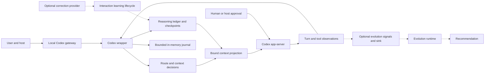
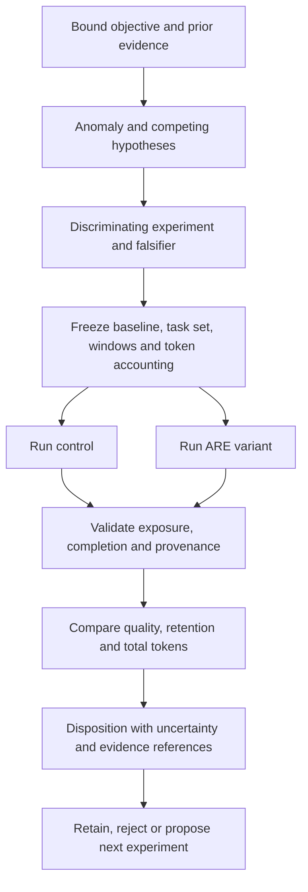

# ARE architecture documentation inventory and proposal

Status: research proposal, 2026-09-16. Owner: architecture proposer/reviewer pair.
This document inventories implementation surfaces and proposes documentation;
it does not admit a new architecture or certify a release. Proposed page names
below are navigation destinations, not claims that those pages already exist.

## Documentation examples and what to reuse

Use progressively narrower architecture views: system context for a new reader,
process/container view for an operator, component view for an integrator, and
code only where a contract needs it. Add dynamic and deployment views separately.
This applies the [C4 diagram guidance](https://c4model.com/diagrams), which presents
those distinct levels and supporting views; it does not imply C4 conformance.

Explain feedback with a concrete desired state, observed state, controller,
requested change, and fresh observation. The [Kubernetes controller explanation](https://kubernetes.io/docs/concepts/architecture/controller/)
is useful because it distinguishes a controller requesting changes from the
component that actually performs them. Apply that distinction to ARE's
non-authorizing decisions and the host's approved execution. ARE is not a
Kubernetes controller, and the analogy supplies no convergence guarantee.

Separate participants, semantic contracts, and transport before presenting API
methods. The [MCP architecture overview](https://modelcontextprotocol.io/docs/learn/architecture)
provides this presentation pattern. Reuse the explanatory structure, not an
unimplemented compatibility claim. A Unix socket carrying JSON-RPC does not
make ARE an MCP server, nor does an HTTP model provider make it a remote agent
gateway. Sources were consulted on the date above; protocol implementation
work must pin its own version and conformance evidence.

## Vocabulary and authority

These are documentation explanations; canonical meanings remain in
[DEFINITIONS.md](../../authority/definitions/DEFINITIONS.md) and the owning
contracts. Each published definition should cite its canonical ID or explicitly
be marked a candidate explanatory term.

| Term | Explanation the documentation must provide | Boundary to preserve |
|---|---|---|
| Product | The composed engine, entrypoints, profiles and declared release sources | A source inventory is not release approval |
| Layer | An explanatory grouping by responsibility | Not a new runtime or authority hierarchy |
| Module | An exact capability provider with a manifest and invocation contract | Module Port does not discover or prioritize providers |
| Adapter | Translation at one named boundary | State which side owns lifecycle, policy and effects |
| Gateway | Session/transport mediation for a declared agent protocol | Current persistent gateway speaks Codex app-server semantics |
| Model transport | A provider call yielding final bytes and a receipt | Does not supply a universal host/session protocol |
| Context Basis / Envelope | Selected definitions, evidence and bound context prepared for a request | Inclusion does not promote facts or authorize effects |
| Reasoning State | Explicit inspectable products, events, epochs and frontiers | Never hidden model chain of thought |
| Observation | A measured or captured input with provenance | Distinguish observed failure from inferred cause |
| Intent / objective | The request interpretation and maintained desired outcome | Interpretation is not routing or completion evidence |
| Feedback | Observations used to select a later action or revision | A logged event alone is not a closed feedback loop |
| Research DAG | A finite dependency structure for one experiment cycle | The multi-round learning process may be cyclic |
| Learning | Retained, controllable correction or evidence-backed improvement | Not model-weight training; live activation must be explicit |

## Layer map

| Layer | Responsibility | Documentation presentation |
|---|---|---|
| Purpose and authority | Objective, definitions, claim ceilings, approvals | `concepts/objective-and-authority`: annotated request and decision |
| Interpretation and routing | Intent, objective transition, route and continuation | `architecture/request-lifecycle`: sequence with ask/block/direct outcomes |
| Context and state | Evidence selection, projection, epochs, checkpoints, reuse | `architecture/context-and-state`: data lifecycle and restart example |
| Decision and semantics | Optional semantic input/evaluation; deterministic policy | `architecture/decision-plane`: verified inputs and typed outcomes |
| Agent execution | Controller, provider, tools, bounded executor and verifier | `architecture/execution`: actuator/observer graph and failure trace |
| Integration | Host callbacks, Codex gateway, provider and domain adapters | `integrations/index`: adapter taxonomy and compatibility matrix |
| Learning and research | Corrections, signals, hypotheses, variants, comparisons | `architecture/learning-loops`: slow feedback and experiment DAG |
| Operations and delivery | Journal, durable stores, diagnostics, closure, signing | `operations/index`: deployment, storage, lifecycle and release gates |

These are logical responsibilities. They are not eight separately deployed
services. A process diagram must identify actual CLI processes, gateway,
Codex app-server, provider endpoint and file stores.

## Complete declared component inventory

The source of composition is [product.json](../../implementation/agent-reasoning-engine/product.json):
17 components and six integrations. Package links below are source evidence;
the description is bounded by each package's implementation/README, not a
claim that all optional features are enabled. Tests from prior audits are not
rerun by this documentation proposal.

| Component and source | Responsibility / limit | Proposed page and presentation |
|---|---|---|
| [module-port](../../implementation/agent-reasoning-engine/packages/module-port) | Immutable exact capability set; available/unavailable/blocked; no discovery or fallback | `reference/modules/module-port`: manifest, invocation and absence example |
| [intent-route-resolver](../../implementation/agent-reasoning-engine/packages/intent-route-resolver) | Intent-to-route seam | `reference/modules/intent-route-resolver`: input/disposition contract and lineage |
| [request-decision-router](../../implementation/agent-reasoning-engine/packages/request-decision-router) | Verified profile chooses direct/gate/block; continuation decision | `reference/modules/request-decision-router`: decision table and fail-closed example |
| [request-intent-runtime](../../implementation/agent-reasoning-engine/packages/request-intent-runtime) | Intent contracts, reference binding, corrections, objective and requirement lifecycle | `reference/modules/request-intent`: lifecycle/state transitions and user control |
| [context-basis-runtime](../../implementation/agent-reasoning-engine/packages/context-basis-runtime) | Context assembly and verified request binding | `reference/modules/context-basis`: source-to-envelope provenance diagram |
| [reasoning-state-runtime](../../implementation/agent-reasoning-engine/packages/reasoning-state-runtime) | Append-only events, epochs, checkpoints, frontiers; memory/file sinks | `reference/modules/reasoning-state`: append/recover/replay example and ownership |
| [reasoning-policy-runtime](../../implementation/agent-reasoning-engine/packages/reasoning-policy-runtime) | Reuse, successor, branch and non-destructive reduction; no model summary | `reference/modules/reasoning-policy`: decision table, overflow/drift behavior |
| [evolution-runtime](../../implementation/agent-reasoning-engine/packages/evolution-runtime) | Signals, research records, variants, comparisons, recommend-only decisions | `reference/modules/evolution`: research DAG, retention currentness and promotion ceiling |
| [runtime-journal](../../implementation/agent-reasoning-engine/packages/runtime-journal) | Bounded in-memory hash-chained diagnostics and selector cuts | `reference/modules/runtime-journal`: replay/eviction; distinguish durable state ledger |
| [semantic-input-runtime](../../implementation/agent-reasoning-engine/packages/semantic-input-runtime) | Exact domain/source binding and observation eligibility | `reference/modules/semantic-input`: selected provider to frozen request |
| [semantic-judgment-evaluator](../../implementation/agent-reasoning-engine/packages/semantic-judgment-evaluator) | Bounded deterministic reducer and receipt; not general reasoning | `reference/modules/semantic-judgment`: one worked judgment and claim ceiling |
| [module-port-governance-cutover](../../implementation/agent-reasoning-engine/packages/module-port-governance-cutover) | Verifies activation/admission/authorization and packaged Rust receipt before composition | `reference/modules/governance-cutover`: exact startup sequence and blocked paths |
| [module-port-distribution-envelope](../../implementation/agent-reasoning-engine/packages/module-port-distribution-envelope) | Offline artifact envelope verification; test key is not release identity | `reference/modules/distribution-envelope`: trust chain and test-vs-release example |
| [aci-binding-contract](../../implementation/agent-reasoning-engine/packages/aci-binding-contract) | Candidate-local immutable intent-route references only | `reference/modules/aci-lineage`: explicit non-integrated subset and unimplemented ACI work |
| [codex-app-server-wrapper](../../implementation/agent-reasoning-engine/packages/codex-app-server-wrapper) | Host request/context/state/approval lifecycle and persistent Codex gateway | `integrations/codex`: handshake, dispatch, reconnect and profile matrix |
| [coding-agent-runtime](../../implementation/agent-reasoning-engine/packages/coding-agent-runtime) | Model-driven bounded coding loop, provider transports, tool/execution controls | `reference/modules/coding-agent`: complete turn trace plus provider-specific pages |
| [real-reasoning-benchmark](../../implementation/agent-reasoning-engine/benchmarks/real-reasoning-v1) | Declared benchmark component | `evaluation/real-reasoning`: protocol, fixture provenance, metrics and limits |

## All six declared integrations

| Integration and source | Proposed documentation treatment |
|---|---|
| [Define CLI (define-cli)](../../implementation/define-cli) | `integrations/define`: domain-language intake, candidate outputs and handoff boundaries |
| [Codex integration package (codex-desktop-bridge)](../../development/agent-reasoning-engine/codex-integration) | `integrations/codex-host`: interface contract, observations and native hook ownership; do not equate canary with installed Desktop service |
| [ARE product package (are-product-package)](../../agent-reasoning-engine) | `concepts/product-model`: product thesis, ontology, bridge/evidence and source-of-truth map |
| [Alch cutover (module-port-cutover-alch)](../../language/capabilities/alchlang/plans/general-compiler-v1/extensions/are-module-port-cutover-v1) | `reference/governance/cutover`: source-to-projection dependency and exact selection |
| [Alch packaged verifier (module-port-packaged-verifier-alch)](../../language/capabilities/alchlang/plans/general-compiler-v1/extensions/are-module-port-packaged-verifier-v1) | `reference/governance/verifier`: build/artifact identity and runtime verification |
| [Alch signed envelope (module-port-signed-envelope-alch)](../../language/capabilities/alchlang/plans/general-compiler-v1/extensions/are-module-port-signed-envelope-v1) | `reference/governance/envelope`: signature mechanics, trust inputs and release eligibility |

## Additional packages and external dependencies

| Surface | Evidence and documentation disposition |
|---|---|
| [conversation-runtime](../../implementation/agent-reasoning-engine/packages/conversation-runtime) | Extra package outside declared component list. README explicitly defers transport, complete handlers and durable storage. `experimental/conversation`: candidate command/event flow and tracked repair/retirement decision; do not advertise supported universal facade |
| [Rust binding](../../implementation/agent-reasoning-engine/packages/module-port-governance-binding-rust) | Extra native package, packaged Linux x64 verifier consumed by cutover. `reference/governance/rust-binding`: source/artifact boundaries and required closure inputs |
| [Alch semantic contract runtime](../../language/capabilities/alchlang/plans/general-compiler-v1/extensions/semantic-contract-v1/consumer-runtime.mjs) | Runtime imported by optional Alch adapter and Define language quality. `reference/dependencies`: direct dependency to include in release closure verification |
| [Repository CLI contract](../../agent-routing/capabilities/are-cli) | `reference/cli/decide`: route/context/effect/continue schemas, receipt propagation and nonauthorization |
| GLM, external-context, ContextBench and fitting research directories | `evaluation/index`: separate benchmark identity/protocol/results from package tests; closure excludes several research directories |
| Generated DomainSpec/Alch projections, ontology/product and capability roots | `architecture/source-authority`: distinguish canonical sources, generated runtime projections and evidence mirrors |

Important correction to the earlier audit: the Rust verifier's
`binding_admitted:false` and `enforcement_active:false` are its intentional
non-authorizing receipt posture. They do not establish that the whole cutover
is inactive. [cutover implementation](../../implementation/agent-reasoning-engine/packages/module-port-governance-cutover/index.mjs)
checks separate selected admission/operational/activation records and returns
`enforcement_active:true` on successful realization, while still granting no
effects. Documentation must show both boundaries. Missing release dependencies
remain a separate closure question.

## Adapter inventory: never collapse these into one universal adapter

| Kind | Existing source / scope | Proposed page and example |
|---|---|---|
| Host lifecycle | [Codex integration](../../development/agent-reasoning-engine/codex-integration), wrapper prompt/tool/completion seams | `integrations/host-hooks`: event sequence, who invokes callbacks and who grants actions |
| Gateway/session | [gateway.mjs](../../implementation/agent-reasoning-engine/packages/codex-app-server-wrapper/src/gateway.mjs), [session client](../../implementation/agent-reasoning-engine/src/gateway-session-client.mjs) | `integrations/codex-gateway`: participant diagram, JSON-line handshake, resume/ack and pinned protocol |
| Gateway upstream transport | [wrapper package](../../implementation/agent-reasoning-engine/packages/codex-app-server-wrapper) | Same gateway page: distinguish stdio/daemon/WebSocket channel from Codex method semantics |
| Model provider | [OpenAI-compatible transport](../../implementation/agent-reasoning-engine/packages/coding-agent-runtime/openai-compatible-transport.mjs), [native provider transports](../../implementation/agent-reasoning-engine/packages/coding-agent-runtime/native-provider-transports.mjs) | `integrations/model-providers`: injected generate boundary, OpenAI/Anthropic/Google support, credentials, usage and fixture/live matrix |
| GLM model fitting | [GLM transport](../../implementation/agent-reasoning-engine/packages/coding-agent-runtime/glm-flash-v1/transport.mjs) | `integrations/glm`: endpoint/configuration, response grammar, window budget and evidence ceiling |
| Retrieval | [Kite adapter](../../implementation/agent-reasoning-engine/packages/coding-agent-runtime/kite-retrieval-v1/adapter.mjs) | `integrations/retrieval/kite`: exact corpus/span binding, additive retrieval, fallback/qualification limits |
| Semantic capability/domain | [Alch adapter](../../implementation/agent-reasoning-engine/packages/module-port/alch-semantic-adapter.mjs), semantic-input profiles | `integrations/domain-modules`: capability contract versus observation provider; exact source identity |
| Learning provider/sink | [interaction lifecycle](../../implementation/agent-reasoning-engine/packages/codex-app-server-wrapper/src/interaction-learning-lifecycle.mjs) | `integrations/learning`: correction input, evolution provider/sink, persistence and activation checklist with explicit disabled defaults |
| Secret provider | [secret-provider](../../implementation/agent-reasoning-engine/packages/coding-agent-runtime/secret-provider.mjs), [SOPS-age](../../implementation/agent-reasoning-engine/packages/coding-agent-runtime/sops-age-secret-provider.mjs) | `operations/secrets`: configuration, lifetime and redacted receipts |
| Storage sink | reasoning-state memory/file sinks; gateway session store | `operations/state`: persistence versus diagnostic eviction, single writer, recovery and limits |
| Universal agent contract / SDK | No declared universal gateway component in product | `roadmap/agent-interoperability`: proposed neutral lifecycle, capability negotiation, conformance and two-host acceptance proof |
| MCP/ACP/remote HTTP | Not established by the declared composition | Same roadmap with explicit proposed status; do not publish runnable onboarding until implemented and qualified |

Provider neutrality already exists at the coding model transport boundary.
The gap is connecting arbitrary agent hosts through a supported session and
lifecycle contract; it is not absence of every non-Codex model adapter.

## Cybernetic graph: target product explanation

This is a target feedback model, not a claim of a fully wired autonomous
service. Solid arrows describe responsibilities; dashed arrows describe
disturbances, limits or optional/proposed feedback. No convergence or quality
gain is asserted by drawing the cycle.

```mermaid
flowchart LR
  H[Human: objective and authority] --> R[Reference: objective and acceptance criteria]
  R --> CMP[Compare expected outcome and attributable observations]
  E[Estimated state: ledger and bound evidence] --> CMP
  CMP -->|supported, contradicted or unknown| DEC[Bounded disposition]
  DEC -->|permitted continuation| C[Controller: ARE policy plus agent planning]
  DEC -->|complete, ask or blocked| STOP[Stop or await input]
  C --> P[Proposed action]
  P --> G[Host effect gate]
  H --> G
  G --> A[Actuator: approved tool or executor]
  A --> W[System and environment: task artifacts]
  W --> S[Sensors: tool results and independent verification]
  S --> E
  D[Disturbances: provider variance and source drift] -.-> W
  D -.-> S
  T[Delays: calls, delivery and stale observations] -.-> E
  B[Limits: context capacity and total token budget] -.-> C
  U[Uncertainty: missing or conflicting evidence] -.-> E
  S -.-> Q[Measured quality and token use]
  Q -.-> L[Slow loop: hypothesis and experiment]
  L -.-> V[Reviewed policy variant recommendation]
  V -.-> SEL[Separate selection and activation check]
  SEL -.->|selected and canary passed| C
  SEL -.->|rejected or failed canary| KEEP[Retain or restore current policy]
```

The model is part of the controller, not the world and not an authority owner.
Deterministic capture reduces the need to ask the model to reproduce state;
it does not eliminate prompt tokens. Measure total comparable input/output
tokens, counting retries and ARE/model-generated state work. Keep the user's
token objective separate from operational disk limits and latency telemetry.

## Current wiring view: Codex path and optional learning

The [repository profile](../../implementation/agent-reasoning-engine/packages/codex-app-server-wrapper/profiles/repository-v1.json)
disables intent compilation, semantic evaluation and evolution signals. It
does not opt into interaction learning. Gateway consumers have file-backed
state, while direct profile reasoning storage is process memory. Dashed edges
therefore must not be presented as an always-on production learning loop.
The production gateway's specific provider bindings need a separate integration
acceptance trace before publication of a live-learning tutorial.

## Research method view: finite DAG inside a recurring feedback process

One run is acyclic. The slow loop creates a new DAG with a new identity from
the previous disposition; it does not edit the old result into success. The
docs must retain initial objective, hypothesis, competing explanations,
falsifier, control, run identity, window sizes, raw evidence, gate results and
decision together. A coding task is one environment for testing the broader
state-retention thesis; it cannot alone prove transfer to every domain.

## Local process diagram writing task

Planned page: `architecture/local-deployment`. Its first qualified example must show the owning host/client process, ARE gateway executable, permission-restricted Unix socket, wrapper inside the gateway, selected Codex upstream process/backend, provider-facing network connection and per-consumer file ownership. It must label the pinned platform and protocol version and explain startup failure on version mismatch. Logical layers are not separate processes or Docker containers. This diagram remains an authoring task until its exact launch configuration is tested.

## Page contract and review acceptance

Every module/adapter page should answer: what user problem it serves; owning
definition/contract; layer and inputs/outputs; current implementation and
profile activation; state/authority/effect ownership; a success trace; an
unavailable or failed trace; exact tests/evidence; known gaps; and Open
Questions. Show adapters with both endpoints named, and label every graph as
current wiring, logical model, deployment example or target design.

For each audited missing feature, write a roadmap entry with the existing seam,
missing behavior, prerequisite, acceptance evidence and proposed page. Missing
capability names must not appear as available quickstart options. Require
separate checks for implemented, integrated, enabled, live-qualified and
included-in-release; a single ready/candidate label obscures those differences.

## Open Questions

- Which agent host besides Codex will qualify the first neutral lifecycle
  contract, and who owns its protocol version and conformance fixtures?
- Which live correction provider, retention scope and user control surface
  should qualify interaction learning without silently enabling it?
- Will conversation-runtime be repaired and admitted or explicitly retired?
- Which closure inputs are runtime dependencies versus review evidence, and
  can a candidate execute in an isolated extracted tree?
- What is the supported gateway binary/protocol and platform matrix?
- Which exact canonical definitions cover the explanatory control-system
  vocabulary above, and which require candidate definitions before adoption?
- Who owns state migration, repair, disk retention and release-signing custody?
- Which cross-model/non-code experiments can test transfer without abandoning
  the completed small-window protocol and original token-and-quality objective?
