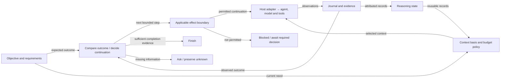
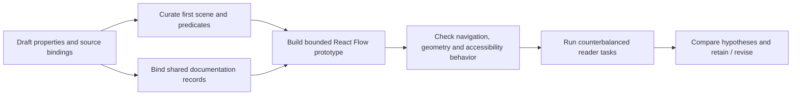

# ARE documentation as an explorable canvas

Status: candidate research and interaction design, 2026-09-16. Authority effect: none.
This extends the [documentation blueprint](DOCUMENTATION-BLUEPRINT.md). It is not an implemented UI or a promotion of new product definitions.

## Recommendation

The entry sequence is **high-level introduction → properties → interactive component map → detailed documentation and evidence**. Use the [introduction draft](DOCUMENTATION-BLUEPRINT.md#high-level-introduction-what-is-are) to explain what ARE is, the problem it addresses, its relationship to the model and host, and one familiar example before asking readers to interpret a graph. Keep this introduction directly accessible from the explorer. It should be an ordinary readable entry section, not a blocking overlay or a card-shaped graph node.

Start with the properties readers care about. Let each property reveal the components, relationships, failure modes and evidence that explain it. Use one content catalog for ordinary documentation pages, small embedded React Flow diagrams and a full canvas explorer. A component opens a compact nonmodal reader inside the canvas; a separate action opens its full documentation page.

Use React Flow directly for the first experiment, drawing on the existing Workspace canvas. LikeC4 is the strongest architecture-documentation comparator. This selection is a design inference from the sources below, not a measured usability result.

The first scene should answer “How does ARE preserve useful work within a limited context?” Keep the original goal visible: better continuity and useful outcomes for people and agents, with model-token use measured against a fair control. A graph of software packages alone does not answer that question.

## Properties before components

These are proposed reader-facing descriptions derived from the [product thesis](../../agent-reasoning-engine/product.json), [lighthouse](../../agent-reasoning-engine/LIGHTHOUSE.md), [reasoning and learning model](../../agent-reasoning-engine/REASONING-AND-LEARNING.md), [implementation profile](../../implementation/agent-reasoning-engine/product.json), and [feature inventory](feature-coverage.json). They are not new canonical terms or guarantees. Exact definitions retain their owning source IDs in the [meaning inventory](THESIS-INVENTORY.md).

Separate three kinds of “property”: a desired product quality, a component contract field, and an observed measurement. A quality such as continuity is not a boolean implementation flag.

| Candidate quality | Plain-language meaning | Components to reveal | Evidence or counterexample to show |
| --- | --- | --- | --- |
| P01 Continuity | Preserve the objective, useful evidence and unresolved work across interruptions. | reasoning-state-runtime, runtime-journal, host adapter | Checkpoint/recovery trace; stale or missing record; F08–F09, F13. |
| P02 Context fitness | Supply information relevant to this request within the selected context budget. | context-basis-runtime, reasoning-policy-runtime, retrieval adapter | Included/excluded evidence, context size, retention failures; F06–F07, F23. |
| P03 Token efficiency | Improve the useful result obtained with model tokens, or preserve quality with fewer tokens. | context assembly, policy, host/provider metering, benchmark | Paired quality and total model-token counts, overhead and failures included; F07, F19, F22. Cached usage remains separately attributed. |
| P04 Inspectability | Make interpretation, selected evidence and decision grounds visible. | request-intent-runtime, intent-route-resolver, request-decision-router | Source links, request interpretation, unknowns; F02–F05, F10. Recorded explicit state does not expose hidden model reasoning. |
| P05 Controlled action | Keep proposed decisions and permitted effects distinct. | module-port, governance-cutover, distribution-envelope, host effect boundary | Selected bindings, gate/deny/unknown branches and effect receipts; F11–F12, F35. |
| P06 Scoped learning | Let attributable corrections improve later behavior within an inspectable and revocable scope. | interaction learning, context assembly, evolution-runtime | Correction → application → outcome → retain/revoke; opt-in and missing live bindings; F14–F18, F43. |
| P07 Interoperability | Connect supported hosts, models and retrieval systems through explicit contracts. | aci-binding-contract, Codex wrapper, coding-agent-runtime, provider transports | Working host/provider matrix and unsupported cases; F20–F31. Existing model transports do not imply a universal agent gateway. |
| P08 Evidence integrity | Keep claims traceable to the exact source, configuration and evaluation scope. | runtime-journal, benchmark, source closure, release verifier | Provenance, denominator, defaults, source drift and unobserved outcomes; F19, F36–F42. |

All F references above abbreviate existing `ARE-DOC-Fxx` identifiers. Components contribute mechanisms; their presence does not prove the quality. Contextual framings remains a proposed capability and belongs in a visibly distinct target view.

Every component documentation record needs stable identity, definition source, responsibility, inputs, outputs, state ownership/lifetime, contract/version, dependencies, failure behavior, and documentation link. Keep implementation, integration, default activation and evidence scope as independent fields. Summarize them in plain language before exposing exact metadata.

## Graphs that explain interaction

Use separate lenses over linked records:

1. **Properties:** why a mechanism matters and which evidence supports it.
2. **Work loop:** how objectives, decisions, actions and observations interact.
3. **Components:** modules, contracts and adapters.
4. **Learning:** correction, application, evaluation and controlled retention.
5. **Evidence:** experiment configuration, control, treatment, measurements and limits.

A property-to-component link means “contributes a mechanism for,” never “proves.” Runtime edges name the carried artifact. Definition, dependency, observation and navigation edges have different types. A click into a document is navigation, not an engine dependency.

This first graph is a conceptual explanation with module mappings. It does not assert a single enabled end-to-end default runtime. Actual traces will be a separate dated view.

Selecting **Continuity** highlights state → context → action → observations → state. Selecting **Token efficiency** highlights context selection and measurement, then shows control/treatment evidence. Selecting **Controlled action** highlights the gate and stopped branches. Feedback loops are cyclic; the research and construction dependency plans remain DAGs.

## Existing repository precedents

Source inspection and one retained screenshot review were performed this turn. Historical test receipts below were read, not rerun.

| Precedent | Concrete reusable pattern | Required change or limit |
| --- | --- | --- |
| [Workspace ontology canvas](../../workspace/runtime/src/features/ontology/OntologyCanvas.tsx) | React Flow custom nodes, semantic icons, typed edge labels, one-hop focus, search, textual relations and focus restoration. | `DetailDialog` calls `showModal()`. Replace that interaction in an ARE prototype with a nonmodal reader; do not reuse the blocking dialog. |
| [Workspace layout](../../workspace/runtime/src/features/ontology/layout.ts) and [styles](../../workspace/runtime/src/features/ontology/ontology.css) | Dagre layout, 208×88 node geometry, worker threshold, reduced-motion styling. | Current worker threshold of 80 is a local policy, not an ARE performance result. Current small metadata text and many predicate colors are unsuitable defaults for an introductory map. |
| [Ontology canvas experiment result](../../workspace/experiments/ontology-canvas/RESULT.md) and [desktop screenshot](../../workspace/experiments/ontology-canvas/evidence/desktop.png) | Retained 15-node/14-relation example, icons and open space. Result reports 18 browser checks passed. | Screenshot shows tiny labels after fit-to-view and a large legend. Keep the calm background; improve readable opening scale and move detailed legends into progressive disclosure. Screenshot is historical, not a live test. |
| [Interactive ontology learning map research](../../development/research/2026-07-14-interactive-ontology-learning-map/findings.md) | Separate semantic, learner and navigation projections; preserve provenance and claim types. | Renderer success does not prove understanding. Learner-created links cannot silently become source relationships. |
| [Ontology evidence workbench upstream baseline](../../development/ontology-evidence-workbench/design/UPSTREAM-BASELINE.md) | Existing pinned Understand-Anything investigation; graph dashboard, learning views and provenance limitations. | Its generalized vocabulary cannot own ARE semantics. Reuse selected patterns, not generated build archives or its entire provisioning system. |

The Workspace manifest currently pins React Flow `12.11.5`, React `19.2.8`, and Dagre `3.1.1`. These are local observations, not a dependency-upgrade recommendation. The experiment should use one declared compatible dependency set and preserve existing lockfiles.

## External examples and construction sources

Inspected 2026-09-16. Sources establish available patterns, not their effectiveness for ARE. No external repository was cloned or installed.

| Source | What it offers | Use in this design |
| --- | --- | --- |
| [React Flow / xyflow GitHub](https://github.com/xyflow/xyflow) | Customizable React node interfaces; core source and examples. | Primary rendering foundation. |
| [Base Node](https://reactflow.dev/ui/components/base-node) | Shared node shell and composable content regions. | Reference only; do not adopt the card shell. Render a custom icon node with a thin border around the icon and its label outside. |
| [NodeToolbar](https://reactflow.dev/api-reference/components/node-toolbar) | Node-relative content that stays the same visual size when zoom changes. | Candidate primitive for a compact anchored summary. Collision handling and reading semantics still need our implementation. |
| [Panel](https://reactflow.dev/api-reference/components/panel) | Fixed content above the graph viewport. | Dock a longer reader inside the canvas frame; retain usable graph space. |
| [ViewportPortal](https://reactflow.dev/api-reference/components/viewport-portal) | Content in graph coordinates, affected by pan and zoom. | Optional spatial annotations. Avoid using it directly for long reading panels that would shrink with zoom. |
| [Contextual zoom](https://reactflow.dev/examples/interaction/contextual-zoom) | Change rendered detail based on zoom. | Icons/short labels at overview; summary at closer zoom; exact metadata in reader. |
| [Layout overview](https://reactflow.dev/learn/layouting/layouting), [ELK example](https://reactflow.dev/examples/layout/elkjs), [elkjs GitHub](https://github.com/kieler/elkjs) | External automatic layout options and ELK integration. | Hand-author the first small scene; compare existing Dagre with ELK if compound groups and port routing become necessary. React Flow is not itself an automatic layout engine. |
| [LikeC4 React integration](https://likec4.dev/tooling/react/) and [GitHub](https://github.com/likec4/likec4) | Model-based architecture views and embeddable React presentation. | Strong comparator if architecture-as-code and generated views become the dominant requirement. Avoid maintaining a second manually authored semantic model. |
| [LikeC4 customization example](https://github.com/likec4/example-customization) | Custom React nodes, metadata toolbar, overlays and styling. | Concrete reference for customizable detail and drill-down. Its example overlay is not proof of our nonmodal behavior. |
| [Understand-Anything GitHub](https://github.com/Egonex-AI/Understand-Anything) | Explorable/searchable code knowledge graphs and learning-oriented presentation. | Guided journeys and search inspiration; source-generated topology alone cannot express product purpose or effectiveness. |
| [Lucide React](https://lucide.dev/guide/react) | Consistent SVG icons as React components. | Optional small imported icon set with visible labels. Existing local SVG icons can also supply the first experiment. |

Use the official examples and exact repositories above as the shortlist. Pin and review licenses for any code actually imported at implementation time; this research did not perform a license compatibility audit. Avoid selecting a full workflow editor merely for its appearance: editing, execution and collaboration are outside this documentation experiment.

## Interaction contract

Proposed desktop behavior:

- Open on one readable scene with roughly 6–9 visible nodes. All 43 feature families remain searchable; they do not need simultaneous display.
- Each node is an icon with a thin border closely surrounding it and a small label underneath, outside that border. The icon is the visual focus. There is no enclosing rectangular card, header, footer, metadata block or card shadow. Its accessible name retains the full component name. Show status details in the reader; an essential status cue may be a small badge beside the icon.
- Click or keyboard-activate a node: highlight its immediate relationships and open a 320–380px summary reader beside it. The reader contains purpose, current status, inputs/outputs and links to definition, related components and evidence.
- Keep the selected node visible. Flip or shift the reader near canvas edges; dock it if it cannot fit. React Flow does not supply this complete collision policy automatically.
- “Read more” expands into a scrollable reader docked inside the canvas, with a proposed desktop maximum of 35% of its width. Reserve that area when framing the selected neighborhood. No backdrop, modal focus trap or full-canvas overlay.
- “Open full page” is an explicit navigation action. “Show in canvas” from a documentation page returns to the same component and lens. Use one content record in both renderings.
- Escape closes the reader and restores focus. Back restores the previous scene. Panning the graph remains possible while the reader is open; scrolling the reader must not zoom the graph.
- Optional later “pin beside component” creates a presentation annotation, never a runtime component or dependency. Begin with one reader to avoid window clutter.

For narrow screens, use a resizable bottom reader within the canvas frame, initially no more than half its height, plus the full-page option. Validate actual device/keyboard behavior; desktop sizing is not a mobile proof.

Implementation primitives: memoized custom nodes; stable `nodeTypes`; `nodesConnectable={false}`, `edgesReconnectable={false}`, `deleteKeyCode={null}`; disable node dragging initially while permitting pan/zoom. Interactive reader controls use `nodrag`, `nopan` and `nowheel` as appropriate ([utility classes](https://reactflow.dev/learn/customization/utility-classes)). Provide a keyboard-accessible component list and textual relationships, following [React Flow accessibility guidance](https://reactflow.dev/learn/advanced-use/accessibility). The canvas must not be the only route to the content.

Keep semantic records separate from UI state. Source records hold definitions, component bindings and exact edges; scene records hold membership/layout; session state holds selection, zoom, open reader and navigation history. Proposed route shape: `/explore?view=continuity&node=reasoning-state-runtime`. Encode stable IDs, preserve back/forward behavior, and handle missing IDs visibly. Do not serialize a document's contents into its URL.

## Minimal visual direction

User-confirmed direction: icons are the nodes, with a subtle surrounding border and small label. Card-shaped component containers are excluded. Documentation appears only after activation in a subordinate nonmodal reader within the canvas; it does not become the visual identity of the component.

Use warm white or neutral gray, dark readable text, one restrained accent for selection, thin connectors, consistent outline icons, generous spacing and quiet borders. Keep the first view centered at a readable zoom rather than fitting every catalog item. Suggested starting tokens: 28–32px icons within 44–48px lightly bordered hit targets, 12–13px labels beneath them, and 16px reader text. Use a circle or softly rounded square closely framing the icon. These sizes and border shapes are candidate values to evaluate. Selection emphasizes the icon border and connected edges, without introducing a card background.

Use color sparingly and redundantly. A proposed connection has a dashed line and a “proposed” label; a selected path has emphasis; ordinary edges stay neutral. Keep arrowheads and short predicates. Exact relationships remain available in the reader even when distant edge labels are hidden. Avoid animated particles unless replaying a specific trace, and honor reduced motion.

Use manual positions for the teaching scene and cache automatic layouts per scene revision. Selection must not relayout the whole graph. Separate the slower learning loop from the work-loop scene; a dense web of every dependency would defeat the minimalist presentation.

## Research method and next bounded experiment

Question: does property-first navigation with an in-canvas reader improve understanding without making exact reference lookup harder?

| Hypothesis | Comparison | Observable result / rejection |
| --- | --- | --- |
| H1 Property-first entry improves explanation of ARE's purpose. | Same content with property-first versus package-first opening scene. | Ask readers to explain continuity and name its state/context mechanisms. Reject the advantage if accuracy does not improve or unsupported guarantees increase. |
| H2 Keeping a reader beside the graph preserves orientation. | Anchored/docked reader versus page navigation using the same text. | Trace a feedback path, inspect a node, then return. Compare errors, successful return and time; reject if occlusion or extra navigation offsets the benefit. |
| H3 One content catalog prevents page/canvas drift. | Graph readers, pages and reference lists derived from the same IDs. | Automated exact-link/status comparisons must pass; any disagreement fails this structural hypothesis. This does not prove usability. |

First fixture: the continuity scene above, one contextual-budget explanation, one component detail, one missing/disabled capability, and one real benchmark evidence link. Include a noncoding example such as resuming a sourced research answer, without claiming a measured cross-domain benefit.

Candidate acceptance checks: every endpoint resolves; each component has a source and full-page destination; reader stays inside frame; selected node remains visible; graph remains interactive; reader scroll does not zoom; Escape and browser Back restore context; narrow-screen and keyboard tasks work; status text matches the inventory; no canvas gesture invokes the engine. Diagram rendering and these checks have not run for ARE yet.

Use the same frozen content for both interface variants, alternate their order across unfamiliar readers, and record task accuracy, navigation errors, time and qualitative confusion. Predeclare task rubrics before the sessions. A first 3–5-reader round is formative evidence, not a statistical generalization. Measure whether readers distinguish implemented, enabled and demonstrated capabilities.

Product-construction frontier: research is complete enough to specify one bounded prototype; runtime implementation and user evaluation remain pending. Next construction work is the scene/content contract and prototype, under its separately selected implementation route and exact scope. Operational residue: documentation hosting, public/private exposure review and deployment owner decisions are deferred; none is required to evaluate a local documentation fixture. No new engine benchmark, model call, dependency installation or large cache was created in this research.

## Open Questions

1. Are P01–P08 the right reader-facing qualities, or should some be grouped? Their descriptions remain candidate until reviewed against the owning definitions.
2. Does the anchored summary or docked reader work better for the first trace? Compare both inside the same canvas, with the graph usable in either case.
3. Should the explorer ultimately live in Workspace or a standalone documentation site? Keep the scene/content contract independent until the prototype establishes its needs.
4. Does the existing Dagre layout suffice beyond the curated opening scene? Evaluate actual compound scenes before adding ELK.
5. Which audited capabilities have enough verified content for a runnable tutorial? The original [blueprint](DOCUMENTATION-BLUEPRINT.md#open-questions) and [review reconciliation](REVIEW-RESOLUTION.md) retain unresolved release and evidence questions.

The preferred visual direction and canvas/page relationship now have concrete candidate answers. This research does not close implementation, accessibility, comprehension or release-evidence gaps by design choice alone.
