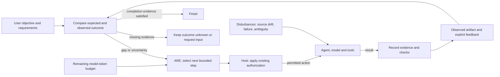
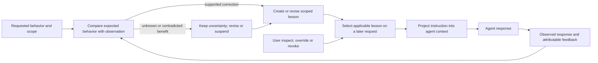

# ARE documentation blueprint

Status: proposed documentation architecture, 2026-09-16.
Authority effect: none. This is an authoring plan and first explanation draft, not a published site.

Presentation extension: [canvas research](CANVAS-RESEARCH.md) proposes a property-first interactive explorer, shared page/reader content, and nonmodal readers inside the canvas. Components appear as prominent bordered icons with small labels, without card containers. The page families below remain the content organization; the canvas adds a connected way to explore them.

## High-level introduction: what is ARE?

The Agent Reasoning Engine (ARE) is software that helps an AI agent keep track of its work. It organizes the current objective, relevant information, decisions, results and unfinished questions so the agent can use them as the task continues.

An AI model works with the information available in its current context. During a long task, useful details can fall out of that context, requirements can change, and earlier work can become difficult to recover. ARE provides explicit records and mechanisms for selecting what matters for the next step. The model still interprets requests and generates responses; the host connects it to tools and applies the applicable action permissions.

For example, imagine an agent researching a question over several sessions. It needs to remember what the user asked, which sources it checked, what those sources established and what remains uncertain. ARE is designed to help preserve that working state and bring relevant parts back into context when the research resumes.

The objective is better continuity and more useful outcomes with efficient use of model tokens. ARE also includes mechanisms for inspecting decisions, learning scoped lessons from feedback and evaluating proposed improvements. Their availability depends on the selected integration and configuration; demonstrated benefits must be read alongside their benchmark scope.

Begin here, then explore the engine's important properties and the components that contribute to them. The canvas lets readers follow those relationships, select an icon and read its explanation without losing their place in the map.

## Reader entry and proposed navigation

Start with a plain-language result: ARE helps an agent preserve useful work, select current evidence and learn from attributable feedback. Then show today's supported boundary, one bounded example, and evidence limits.

| Reader question | Proposed page family | Form | Required content |
| --- | --- | --- | --- |
| Why does ARE exist? | explanation/product-thesis | Explanation | Thesis, user problem, original GLM objective, outcomes and limits. |
| What do these words mean? | reference/definitions | Reference | Term, owning definition ID/path, plain-language explanation, example and counterexample. |
| What happens on a request? | explanation/work-loop | Explanation | Cybernetic graph and concrete trace with failure/unknown branches. |
| What can I use today? | reference/support-matrix | Reference | Implemented, integrated, enabled, validated and published status separately. |
| Can my agent connect? | how-to/connect-agent; reference/adapters | How-to / reference on separate pages | CLI consultation, Codex gateway, provider transports and proposed universal boundary. |
| Can I try a small example? | tutorials/first-decision | Tutorial | Exact checkout/runtime prerequisites, safe request, expected output and meaning. |
| How do corrections persist? | explanation/learning-loop; how-to/inspect-lessons | Explanation / how-to | Feedback attribution, scope, controls, expected versus observed result. |
| How is the software organized? | architecture/context; architecture/modules | Explanation / reference | Process boundaries, all components/integrations, dependencies and source paths. |
| What has research established? | evidence/contextbench-8k; evidence/claim-ledger | Explanation / reference | Frozen scope, baseline, denominator, metrics, failures, transfer limits. |
| How do I recover or troubleshoot? | how-to/recover; reference/failure-codes | How-to / reference | Known versus uncertain delivery, credentials, storage, versions and no-retry cases. |
| What is planned? | roadmap/limitations | Explanation | Missing proposed capabilities, existing defects, admission residue and future scope separately. |

Paths in this table are proposed site routes; pages are not claimed to exist.
Detailed feature routing lives in FEATURE-COVERAGE.md. Module and thesis inventories own the corresponding detailed mappings.

## Page contract

Each functionality gets a stable feature identifier and:

1. Reader task and promised result.
2. Thesis/concept owner and exact source links.
3. Current implementation, integration, enabled profile and evidence posture.
4. Inputs, outputs, state owner and lifetime.
5. Module and adapter dependencies, including host/version constraints.
6. Happy path and one failure or unknown-outcome example.
7. Relevant feedback graph, sequence or state transition with an explicit legend.
8. Configuration/defaults and data/token budgets.
9. Verification command, dated observed result, and what it does not establish.
10. Limitations, proposed work and Open Questions.

For missing functionality, author a clearly marked design/roadmap page with acceptance criteria. Do not fabricate commands or place it in a runnable tutorial.
Reference pages may link to implementation files; introductory prose should explain what the reader receives before naming symbols.

## Graph contract

Every graph declares scope (current implementation, opt-in candidate, or target product), level (system/process/module), and edge meaning.
Use arrows labelled with messages, observations or decisions. Use dashed edges only for proposed or explicitly injected integration, with text labels as well as styling.
Show storage boundaries and identity lifetimes when relevant. A dependency graph cannot establish feedback; a control graph cannot establish causal benefit.

Required graph set:
- System context: user/host, ARE, model provider, tools, evidence sources, authority owner.
- Current deployment: local processes, Unix socket, Codex upstream, file logs.
- Target adapter boundary: clearly proposed universal agent interface alongside existing provider transports.
- Work loop: objective, comparison, controller, authorized execution, observations and feedback.
- Learning loop: expected behavior, observed application, attributable correction, scoped lesson, reevaluation.
- Evolution loop: observed failure, competing hypotheses, frozen experiment, comparison, reviewed retention.
- Recovery sequence: checkpoint, dispatch, detach, replay and unknown outcome.
- Research DAG: versioned observations and decisions; no cyclic dependency edges.

## First explanation draft: why feedback matters

An agent can retain a long conversation and still lose track of what remains to be done. ARE records explicit objectives, evidence and outcomes so later requests can reuse the parts that remain relevant.

Consider a user asking for a plain-language explanation with sources. The requested format and citations are requirements. The response is an observed artifact. A format check can detect jargon, while citation checks examine evidence references. Neither check alone proves that the explanation is useful. User feedback and task-specific evaluation supply different observations.

The following is a conceptual product loop. Specific evaluators and host integrations must be configured; it does not assert that all branches run in the default gateway.

Feedback may be delayed or incomplete. A completed model turn is an observation, not proof of a completed objective. A learned formatting preference must stay scoped and remain inspectable, overridable and revocable.

The implementation has concrete building blocks for these operations; its default profiles do not enable every learning or semantic branch. The documentation should make that distinction visible next to each example.

## Learning-loop illustration

This diagram describes the opt-in candidate semantics. Host/user actions and evaluator bindings are explicit inputs; the default gateway does not autonomously discover preferences.

The loop's sensor is the response plus attributed feedback, the reference is the requested scoped behavior, and the control intervention is the selected lesson projection. Feedback is delayed until later application. Missing user feedback remains unknown; literal checks are limited observations. Citation accuracy, preference compliance and task usefulness require different checks.

## Research evidence presentation

Every score card must answer: which model, window, tasks, baseline, repetitions, metric, token accounting, validity rules and frozen evidence?
Show absolute scores and differences where available; explain percentage points in words. Retain failed and inconclusive trials.

The GLM 8K milestone described in the lighthouse is a context-selection result. It must not become a claim of general task completion, full ContextBench acceptance, cross-model transfer or arbitrary-domain reliability.

## Authoring order and acceptance

1. Reconcile source inventory and reviewer findings.
2. Write thesis, definitions, support matrix and current architecture.
3. Write one executable local CLI tutorial and its matching reference.
4. Write separate Codex gateway and provider-transport integration guides.
5. Write work, learning, evolution and recovery explanations.
6. Write benchmark evidence pages and missing-capability design pages.
7. Validate links, coverage, diagram rendering and executable examples.
8. Evaluate reader comprehension before selecting a site/publication rollout.

This authoring order does not postpone the larger-window research behind remote API, MCP or a universal gateway. Those are separate work streams with explicit dependencies.
Current construction frontier: research drafts and reviewed coverage. Site generation, hosting and publication remain operational work owned by the documentation owner.

## Open Questions

- Which first reader journey should receive participant validation?
- Which diagram renderer and accessible text alternative will the eventual site use?
- Which exact release will executable examples bind to after closure repairs?
- Which future features become supported scope rather than optional roadmap ideas?
