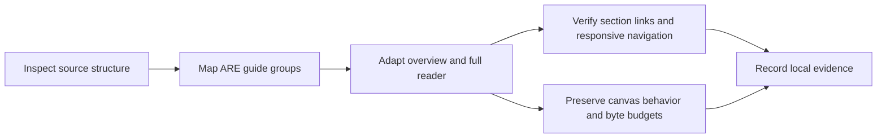

# ARE documentation reader: adaptation from AlchLang

Status: local implementation. No deployment or release claim.

## Objective and evidence

Adapt the structure of the existing AlchLang documentation page to ARE while retaining the canvas and the enforced download targets.

The inspected reference is the [AlchLang docs app README](../../../language/capabilities/alchlang/plans/general-compiler-v1/implementation/docs-app/README.md), its [page components](../../../language/capabilities/alchlang/plans/general-compiler-v1/implementation/docs-app/src/App.tsx), and its [navigation/content model](../../../language/capabilities/alchlang/plans/general-compiler-v1/implementation/docs-app/src/content.ts). The reference uses grouped left navigation, central technical content, right-side section links, current-location indicators, search, and responsive navigation.

The named source was resolved through `CA2-ROUTE-LOCATE`, then the ARE adaptation used `CA2-ROUTE-IMPLEMENT`. The owner's current request authorizes bounded local construction under CAV2-D65. Source inspection establishes a design reference, not a dependency or authority transfer.

## Adaptation

| Reference structure | ARE behavior |
| --- | --- |
| Grouped navigation | Start here; Connect an agent; Memory and learning; Operations and privacy |
| Three-column reader | Guide navigation on the left, selected article in the center, “On this page” on the right |
| Location indication | Active guide and visible article section are marked separately |
| Search | Guide title/summary search in reader navigation; existing full-text search on documentation overview |
| Section-addressable content | Existing article and heading URLs remain valid; section links focus the target heading |
| Sequential learning | Previous/next guide links follow the shared navigation order |
| Narrow-screen navigation | Inline collapsible guide list and contents; choosing a guide closes the guide list |
| Product-specific workspace | “Open in canvas” and “Return to canvas” retain ARE's movable cards, viewport, and reading offsets |

ARE keeps separate guide URLs rather than combining every guide into a single long tutorial. The documentation overview reuses the same guide groups. The canvas itself retains its established layout and card controls. No AlchLang compiler, branding, source examples, review tooling, or package dependencies were introduced.

Implementation: [ManualNavigation](../../../workspace/experiments/are-documentation/src/ManualNavigation.tsx), [ManualContents](../../../workspace/experiments/are-documentation/src/ManualContents.tsx), [DocumentationPage](../../../workspace/experiments/are-documentation/src/DocumentationPage.tsx), and [shared guide groups](../../../workspace/experiments/are-documentation/src/documentationContent.ts). Section observation is local to the contents component and does not update application or canvas state.

## Verification

- Production build, TypeScript, and guide projection freshness passed.
- Twelve workspace, persistence, and budget unit tests passed.
- [18 reader checks](../../../workspace/experiments/are-documentation/evidence/manual-reader/results.json) passed at desktop, 768 px, and 390 px widths. They cover three-column placement, unique guide coverage, active state, heading focus, sequence, search, collapsed navigation, and viewport containment.
- [44 canvas behavior checks](../../../workspace/experiments/are-documentation/evidence/canvas-docs/results.json) passed, including saved layout, card scrolling, full-page return, storage failure, and touch interaction.
- [Three cold-route asset checks](../../../workspace/experiments/are-documentation/evidence/performance/download-browser.json) passed.
- [Download budget](../../../workspace/experiments/are-documentation/evidence/performance/download-current.json): introduction 148.8/180 KiB gzip; documentation 97.6/140 KiB; canvas 157.7/180 KiB. Decoded-byte targets also passed. These figures cover initial JavaScript and CSS, not all page assets or field load time.
- [Scrolling regression](../../../workspace/experiments/are-documentation/evidence/performance/manual-structure-scroll.json) passed all six scenarios (one repetition each), including nine cards on desktop and mobile: zero App/card rerenders or Markdown reparses, two storage writes per scroll workload, no remount or viewport movement, and preserved full-page return/drag behavior.

Visual evidence: [desktop](../../../workspace/experiments/are-documentation/evidence/manual-reader/desktop.png) and [mobile](../../../workspace/experiments/are-documentation/evidence/manual-reader/reader-390.png).

## Construction and operational work

The implemented frontier is the reader structure, navigation, and local evidence. No publication decision or new runtime behavior is required for this local result. A deployment owner still owns any later hosting and release operation; that work does not block local construction. The existing publication review of the remaining manuals is unchanged.

## Open Questions

- Do first-time readers navigate these groups faster than the prior directory? Browser checks do not measure reader comprehension or preference.
- Should future search include section-level results as AlchLang does? Current ARE overview search indexes full guide text; reader navigation searches guide titles and summaries.
- Should a reviewed ARE task walkthrough complement the introductory guide? Any runnable example needs its own supported execution boundary and evidence.
- Which additional manuals should be reviewed for publication before increasing navigation coverage?
