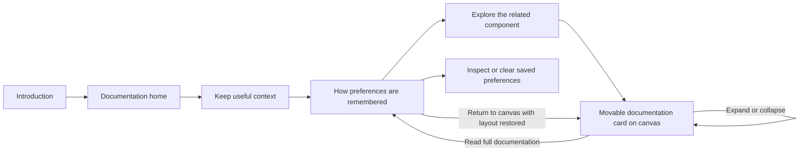
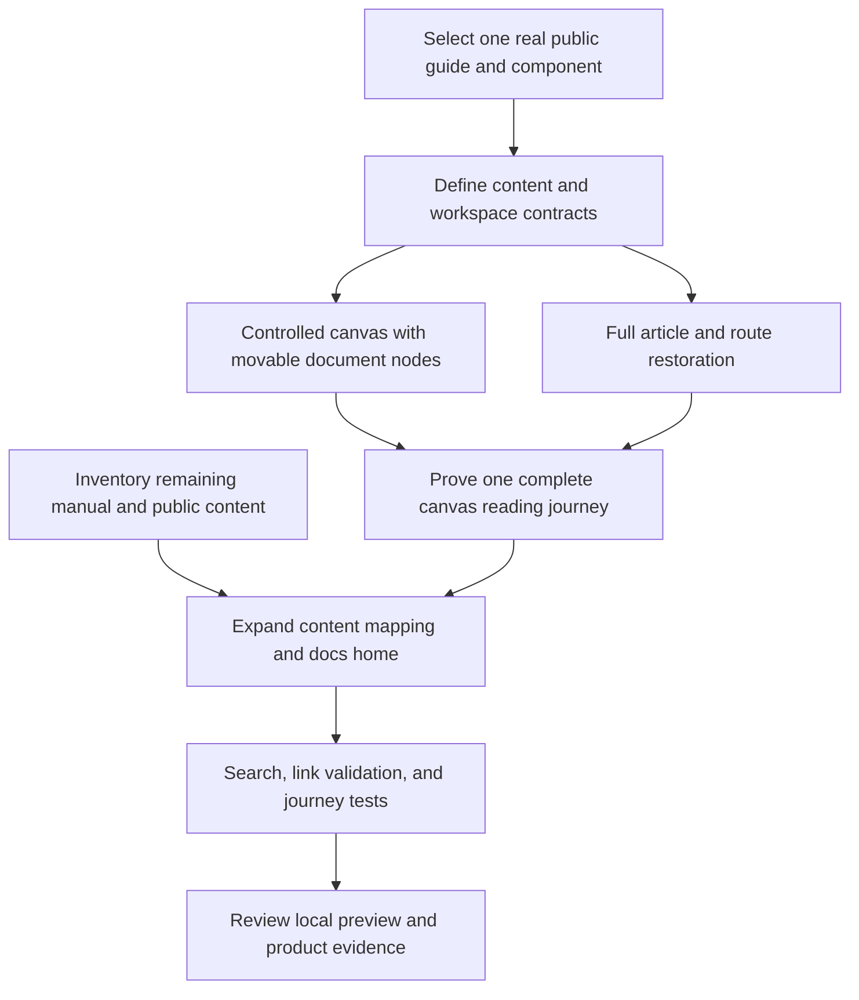

# A connected documentation experience for ARE

Date: 2026-09-18. Status: research and implementation plan. The canvas implementation now has [local evidence](IMPLEMENTATION.md); full public-manual coverage and release approval remain open.

Plan revision: canvas-native documentation, following the user's clarification. This revision replaces any interpretation of the reader as a sidebar, modal, or separate window. Candidate planning only; Goals admission remains blocked as stated in the route registry.

## Objective

Help a person understand ARE, complete a useful task, and move between a guide and the engine map without losing their place. Present the newer documentation through the website. Keep the product experience specific to ARE and usable without knowledge of the development repository.

## What exists

| Surface | Purpose today | Gap |
| --- | --- | --- |
| Introduction | Explain ARE and offer a demonstration | Documentation enters a capability category rather than a task-oriented starting page |
| Explore the engine | Inspect components and their relationships | Component summaries do not lead to the corresponding full guides |
| Documentation reader | Explain four capability groups and benchmark results | Short, separately maintained prose; the newer manual is not rendered here |
| Full Markdown manual | Getting started, integration, operation, API reference, research, releases | Separate from the website navigation and component reader |

Source evidence:

- [Application routing and engine reader](../../../workspace/experiments/are-documentation/src/main.tsx).
- [Current documentation content and links](../../../workspace/experiments/are-documentation/src/Capabilities.tsx).
- [Introduction](../../../workspace/experiments/are-documentation/src/Hero.tsx).
- [Manual index and reader journeys](../../../implementation/agent-reasoning-engine/docs/README.md).
- [Earlier editorial register](../page-register.json): candidate planning evidence, not a current publication inventory.

### Browser observations

The local site at `http://127.0.0.1:4193/` was inspected at desktop 1440 × 960 and mobile 390 × 844. Only reading and navigation were exercised; no chat or provider calls were made.

- The language topic links to `#view=continuity&node=state&page=1`.
- The engine reader's global Documentation link opens `#view=docs&doc=understand`; it does not retain the originating language topic.
- The engine reader has no explicit return-to-topic link.
- Try ARE from documentation mounts the introduction's walkthrough. Its scroll and focus behavior still need a dedicated assertion.
- The tested mobile documentation page had no horizontal overflow. The header wraps into two navigation rows; this is not a complete mobile usability or accessibility assessment.
- No browser errors were captured in this bounded audit.

See [captured observations](navigation-audit.json) and [audit script](navigation-audit.cjs). The script records a local inspection and contains environment-specific browser paths; it is not yet a portable regression test. Browser Back/Forward restoration, graph viewport restoration, keyboard navigation, and all document links have not been exhaustively tested.

Source inspection also shows that the engine's “Read full page” mode expands the same component summary; it does not load the full manual. Capability links all select the continuity view. The correct view must be mapped per component rather than inferred from the documentation group name.

## Research and its application

| Primary source | Relevant guidance | Application to ARE |
| --- | --- | --- |
| [Diátaxis](https://diataxis.fr/) and [Start here](https://diataxis.fr/start-here/) | Tutorials, how-to guides, reference, and explanation meet different reader needs | A first successful setup is a tutorial; agent connection is a guide; API fields are reference; the engine map is explanation. Link them without forcing all four into every article. |
| [W3C consistent navigation](https://www.w3.org/WAI/WCAG21/Understanding/consistent-navigation.html) | Repeated navigation should retain a consistent order | Use the same top navigation across introduction, map, and docs. |
| [W3C breadcrumbs](https://www.w3.org/WAI/ARIA/apg/patterns/breadcrumb/) | Identify a breadcrumb navigation landmark and current page | Give articles a structural path; use a separate contextual return link for the page the user came from. |
| [Stripe documentation](https://docs.stripe.com/) | Official example of task and integration entry points | Start with what the reader wants to do, not internal module names. |
| [Astro documentation](https://docs.astro.build/en/getting-started/) | Official example of guide, tutorial, reference, and searchable navigation | Provide a stable reading structure and search alongside conceptual exploration. |

The ARE recommendations below are design inferences from these sources and the local audit. They are not evidence that this design has already improved task completion.

## Recommended experience

Keep three connected surfaces under one shell: **Introduction · Explore the engine · Documentation**. Retain Try ARE as a clear action. The map explains relationships; the documentation supports completing tasks.

The canvas remains the central exploration experience. Clicking a component opens a documentation card **inside the same canvas coordinate system as the components**. Users can move cards, expand or collapse them, and keep several open. Only the explicit **Read full documentation** action navigates to a full article in the same browser tab. Returning restores the canvas workspace. A documentation sidebar, modal, screen-fixed overlay, or automatic new window does not satisfy this requirement.

The documentation home should offer these starting points:

1. **Start using ARE** — prerequisites, first command, expected result, and next step.
2. **Connect your agent** — supported integration options and a working example.
3. **Keep useful context** — state, retention, preferences, corrections, and forgetting.
4. **Deploy and operate ARE** — configuration, security, upgrade, troubleshooting, and recovery.
5. **Understand the engine** — concepts, architecture, and related map views.
6. **Review the evidence** — what was tested, measured results, limitations, and research roadmap.

The documentation home and full-page reader can group pages under Get started, Guides, Concepts, Reference, Operations, and Research and releases. This navigation belongs to those pages; it must not replace canvas cards with a reading sidebar. These are reader categories, not a requirement to rewrite the entire manual before publishing useful pages.

### Example reading journey

Use specific links: “Explore working memory” and “Read the context guide” are clearer than “See the related component.” The final mapping for language learning must be checked against actual component responsibilities; the existing link to working memory alone may be too broad.

Keep two navigation concepts separate: breadcrumbs show where an article belongs; “Back to [topic]” returns to the reader's actual origin. A direct link with no origin should still provide a useful guide link.

Preserve the topic, anchor, scroll position, selected map node, open cards, card positions, expansion states, and graph viewport when switching surfaces. This restoration is required for the first complete example. Browser Back and Forward must work. Contextual return links must validate an internal destination; they should not blindly call history.back or accept an arbitrary external return URL.

Each guide should state its outcome, prerequisites, steps, expected result, limitations, and next useful action. Explain opt-in learning in plain words. Keep source paths in optional technical references, not as the reader's main next step. Clearly distinguish supported behavior from experiments.

## Connect the new manual without duplicating it

Use the current React/Vite site initially. No evidence from this audit justifies a framework migration.

Create a build-time content index from an explicit public document allowlist. Use the Markdown manual as the prose source; avoid copying full guides into TSX. Each published entry needs a stable ID, title, summary, reader goal, category, public slug, source reference, related document IDs, related engine nodes, and applicable version/status.

Do not publish every manifest entry automatically. Internal source maps, release review evidence, private paths, unfinished drafts, and candidate-only instructions need a publication review. Public pages should describe the standalone ARE package and avoid unrelated project branding. Research results must retain their model, window size, comparison, and limitations.

Translate internal Markdown links to public routes at build time; reject unresolved links, missing anchors, duplicate IDs, and links to unpublished pages unless explicitly presented as unavailable. Render generated API field references from their existing generation pipeline and bind them to the same documented version. Sanitize rendered Markdown and disallow untrusted executable content.

Retain old hash links with explicit aliases. Replace misleading “Read full page” links with an actual article where available; label remaining component descriptions as overviews. Add search over published article titles, headings, and text, with section and version visible in results. Search must not include private documents.

## Proposed implementation DAG

| Order | Deliverable | Completion check |
| --- | --- | --- |
| A0 | Select a versioned public guide for working memory, starting with the existing context capability manual | One real document and verified component mapping; no placeholder prose |
| B | Content index, workspace state, and route contracts | IDs, ownership, restoration, legacy routes, and failure behavior are specified |
| C and D | Canvas cards and full article, independently buildable after B | Cards move and scale with the graph; reader loads the same content; route changes retain workspace state |
| E | First complete example | Open two cards, move them, expand/collapse, read the full guide, and return with positions and zoom intact |
| A then F | Remaining public inventory and broader coverage | Every manual entry has a publication disposition; user journeys map to real guides and relevant components |
| G | Search, content validation, portable browser tests | Public links resolve; keyboard, touch, history, storage failure, and restoration checks pass |
| H | Reviewed local preview | Wording and claims match the documented version; evidence supports the accepted interaction |

This DAG is a research proposal. Implementation must be separately routed through the repository's implementation/construction gates; this artifact does not grant release authority.

## Canvas implementation analysis

### Current constraints in the source

- [main.tsx](../../../workspace/experiments/are-documentation/src/main.tsx) rebuilds component nodes from static entries on every render, disables dragging globally, and has no `onNodesChange` state handling. One `route.node` selects one reader. Multiple independent cards need a separate collection from component selection.
- The former `src/CanvasExpansion.tsx` (removed by the implementation) rendered an absolutely positioned `aside`. It converts world coordinates to screen coordinates, clamps the panel to viewport bounds, and keeps panel dimensions in screen pixels. It is visually attached to a component but is not a movable graph node.
- `FrameView` automatically reframes whenever selection or canvas dimensions change. This would overwrite a restored viewport unless initialization, deliberate reveal, and restoration are separated.
- Full-reader mode replaces the graph subtree. State held only inside React Flow therefore cannot preserve the complete reading workspace across that transition.
- [style.css](../../../workspace/experiments/are-documentation/src/style.css) contains old reader/sidebar rules and later overlay overrides. New card classes should have independent styles; remove obsolete rules only when their remaining uses have been checked.

### Proposed implementation boundaries

| File or proposed module | Responsibility |
| --- | --- |
| `src/main.tsx` | Shared shell and view selection; register icon and documentation node types; connect controlled nodes and viewport |
| `src/canvasWorkspace.ts` (new) | Serializable workspace state and actions: open, focus, move, expand, collapse, close, restore, reset |
| `src/DocumentationNode.tsx` (new) | Canvas card with a drag header, title, content preview, expand/collapse, close, and full-document action |
| `src/documentationContent.ts` plus build tooling (new) | Versioned public content index, document/component mapping, safe Markdown rendering and internal-link resolution |
| `src/DocumentationPage.tsx` (new) | Full article from the shared content source; retain origin card and return action |
| `src/routes.ts` (new) | Parse and serialize routes, legacy aliases, validated internal return destinations, history handling |
| `src/CanvasExpansion.tsx` | Retire the overlay once all component-reading entry points use nodes; replace automatic framing with explicit viewport policy |
| `src/Capabilities.tsx` and `src/style.css` | Connect existing documentation entries to real guides and canvas cards; apply card-specific presentation |

Names are proposed implementation boundaries, not files already created. Keep the scope within the existing site and public documentation projection; engine behavior and learned lessons are unaffected.

### Node and interaction contract

Use a React Flow custom node type, `documentation`, in the same `nodes` array and world coordinate system as the icon nodes. No `parentId`, viewport overlay, or separate nested canvas is needed. Register node types outside render. React Flow's [custom node documentation](https://reactflow.dev/learn/customization/custom-nodes) supports embedding interactive React content in graph nodes.

Give documentation nodes `draggable: true` and a header drag handle; keep the current component layout fixed for this first change. Use controlled node changes to retain document positions. Reading controls and selectable text must not initiate dragging. Apply `nodrag`, `nopan`, and `nowheel` only where appropriate in the body and controls; the header remains draggable. These interaction exclusions are provided by React Flow's [utility classes](https://reactflow.dev/learn/customization/utility-classes).

Each card has a stable ID derived from document ID and version, a world position, expanded/collapsed state, a reading anchor/offset, and source-component references. Reopening an existing document focuses its card instead of creating a duplicate or resetting its position. Opening a different document leaves other cards open. If one document explains several components, reuse its card and retain the relevant associations.

Place a new card near the requesting component using current world bounds and a simple deterministic search for free space. Do not rearrange existing cards automatically. A subtle, noninteractive connector can indicate which component the card explains; distinguish it from engine data-flow edges. Changes in the conceptual lens update emphasis, not card existence or position.

Collapsed cards show the title and actions. Expanded cards show a bounded, scrollable guide preview generated from the same document as the full reader. Preserve the top-left position and reading offset through toggles. Toggle controls use `aria-expanded`; explicit close affects only that card. Free resizing is optional later work; expand/collapse is required now. Keep cards at the same canvas scale as components, with ordinary selection stacking rather than a permanent overlay layer.

Avoid global re-fitting on card open, drag, expansion, or close. Reveal a new offscreen card with the smallest necessary pan; allow an explicit Focus card action when needed. User-invoked Fit view can include open cards. Restore the saved viewport before any initialization fit can run.

### State, history, and full reading

Own workspace state above the conditional canvas/article branches. Store a versioned snapshot with the current lens, selected component, card IDs and positions, expansion and reading state, active card, and viewport `{x,y,zoom}`. Store public content IDs, not rendered HTML, callbacks, or React Flow internal measurement objects. Rebuild node callbacks and derived connector edges at render time.

Use in-memory state for navigation and a bounded, versioned `sessionStorage` snapshot for reload in the same tab. Validate finite coordinates, zoom limits, known IDs, schema version, and bounded payload size. Catch storage failures and retain in-memory operation. A corrupt or outdated snapshot must fail gracefully with a default canvas and a clear explanation when recovery was partial. Never evict an open card silently to satisfy a storage limit. Provide Reset canvas. Cross-device sharing and permanent workspace accounts are outside this first slice.

React Flow demonstrates serialization of nodes and viewport in its [save-and-restore example](https://reactflow.dev/examples/interaction/save-and-restore). ARE should persist the smaller application-owned schema described here rather than copying the example's whole flow object unchanged.

The full-document action saves the workspace and opens the canonical article route in the same tab, with an internal origin identifying the card. Dragging, panning, and expansion do not add history entries. Article navigation does. Handle both hash navigation and browser history consistently in one routing module. Return restores all surviving cards, scroll offsets, selection, and viewport after node measurement, then focuses the originating card's action. It must not run `FrameView`'s selection reset afterward.

A full article opened directly has no saved origin: offer Open in canvas and construct the matching card near its component. Legacy `page=1` component links resolve through an explicit mapping to the real guide; where no guide exists, show an accurately named component overview. Do not silently resolve an unknown document to an unrelated page. Workspace snapshots remain local; copied article URLs do not promise to transport another user's layout.

### Keyboard, touch, and failure behavior

Make documentation cards focusable with meaningful names and keyboard movement, while retaining text selection and normal links inside them. Supply focus/reveal controls and a list of open documents so reaching an offscreen card does not require dragging. Escape should leave an active card interaction or return focus; the existing global Escape handler must not accidentally close unrelated cards while reading. Closing returns focus to a relevant component or another reachable control.

Touch users drag the card header, scroll its body, and pan the background. On narrow screens the card remains on the canvas; the full-page action offers comfortable longer reading without silently changing the primary interaction into a drawer. Test gesture conflicts and low zoom readability. Bound preview height and load full article content on demand to avoid rendering every long manual page inside the graph.

### Construction frontier and operations

Planning baseline frontier: A0 and B, followed by C and D and the first end-to-end example E. These canvas stages are now implemented; see [current implementation status](IMPLEMENTATION.md#construction-and-operational-lanes). Runnable product work is the local content mapping, workspace model, custom nodes, article route, and restoration tests. Broad content inventory A can proceed independently and does not block the one-guide example after its content has been checked.

Operational tasks and owners: the product owner selects the publication version and public content policy; the deployment owner supplies production URLs and deployment configuration. These affect broader public publication, not local construction of E. Production deployment, commercial-site link changes, and release approval remain deferred operational work with separately routed authorization. Candidate Goals validation is a blocker to registering admitted execution state, not evidence that this candidate plan is admitted. No ontology-runtime records or selectors are required for this UI planning analysis.

## Acceptance scenarios

- A first-time reader reaches a runnable first example from the introduction in at most two navigation choices.
- A reader opens the preferences guide, explores its component, and returns to the same topic and reading position.
- An integrator finds the gateway guide and relevant API fields without knowing internal filenames.
- A reader searches for “forget a preference” and reaches documented controls rather than a source-code path.
- A direct article URL survives reload; browser Back/Forward and legacy capability URLs retain meaningful behavior.
- Keyboard users can reach the article, navigation, search, map alternative, and return links; focus follows deliberate view changes.
- Mobile readers can open the contents navigation and read code without page-wide overflow. The map has a linear text alternative.
- Reading documentation does not start a model request or modify saved lessons.
- Two cards coexist as real graph nodes; dragging one changes its world position without moving the other. Panning and zooming transform both consistently with the component nodes.
- Repeated clicks focus the existing card. Switching lenses, expanding, collapsing, and closing a different card do not reset its position.
- Selecting text, scrolling the card body, and activating controls do not drag the card or zoom the canvas. Header drag works with mouse and touch; keyboard users can move or reveal the card.
- Full-document navigation, explicit return, browser Back/Forward, and same-tab reload restore valid saved positions, expansion states, reading offsets, and viewport. Test floating-point coordinates with a defined small tolerance.
- Fresh deep links, unknown document IDs, unavailable storage, corrupted snapshots, and removed document versions have explicit tested fallbacks.
- The first example uses a real guide, with at least two cards open during the return test. A screen-fixed overlay that merely follows a component fails acceptance.

Plan review: the original reader-first order has been changed to prove the canvas interaction before broad content migration. The main risks are lost controlled-node state, automatic viewport resets, duplicate cards, and gesture conflicts; each now has a specific acceptance scenario. This is a planning/source review, not a claim that the new interaction has passed browser tests.

Measure task completion, wrong turns, time to the intended article, and success returning from the map. Compare the current site with the preview on the same tasks. Browser assertions alone cannot establish that new readers understand the content better.

## Open Questions

- Which documented package version should the first public preview represent? Candidate documents must not silently imply a released feature.
- Which pages are public, customer-only, or internal? Start with a reviewed allowlist rather than publishing the full tree.
- What is the production documentation base URL and the configured return destination to the commercial site? Current local URLs are not deployment settings.
- Should search eventually cover multiple versions? Start with the published version unless support obligations require more.
- Which component is the best explanation entry for preference learning? Validate the mapping before adding new cross-links.

These questions do not prevent content inventory, route design, or a local preview. Production publication requires their resolution.
