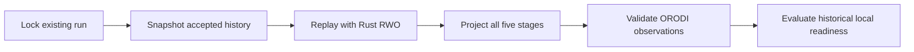

# Alch provisioning evidence for ORODI

Status: product-construction candidate. Authority effect: none. Private package.
Owner: Alch Host / RWO integration; Craft ORODI owns downstream evidence meaning.

This successor reads the existing provisioning journal, verifies it through the
Rust RWO DAG engine, and produces five observations conforming to the existing
DomainSpec ORODI `observation/v1` schema. The local evaluator answers one question:
**does this exact accepted history record all five local fixture stages as passed?**
It does not answer whether a server is running or ready to host user functions.

## Plan and DAG



The [machine plan](PLAN.json) separates runnable product construction from
operational support. The original provisioning candidate is not changed.
The [ontology scaffold](ontology.json) links existing prototype definitions
to the observation projection, without registering or admitting a new ontology.

Construction frontier: journal-to-observation adapter and local evaluation,
implemented and tested. Runnable successors: Alch deployment authoring and
local function-host integration. Cloud credentials, VM allocation, DNS/TLS and
multi-host leases remain deferred operational support owned by the platform
operator; no prerequisite on them exists for this adapter.

## Meaning and source ownership

Reuse AHP-D02 ProvisioningRun and AHP-D04 LocalReadinessReceipt from the
[provisioning definitions](../alch-host-provisioning-v1/definitions/DEFINITIONS.md).
Canonical Operational Evidence remains CAV2-D84 in
`cyberAlchemy-v2/authority/definitions/DEFINITIONS.md`; no canonical terms change.

The product behavior is a trusted operator inspecting one local run. The
business benefit being tested is making failure, absence and completed checks
distinguishable before further deployment work. This is not market evidence.
DomainSpec owns the existing observation schema in
`projects/domainspec-v2/impl/operational-resilience/contracts/evaluation-bundle.schema.json#/$defs/observation`.
The adapter validates against that source directly; it does not copy or extend it.
The five-node technical source and compiled graph remain in the predecessor.
The [policy](policy.json) binds projection attributes, cardinality and freshness.

## Run

Build and run the [provisioning prototype](../alch-host-provisioning-v1/README.md)
first. From this directory, inspect its existing run:

```bash
PYTHONDONTWRITEBYTECODE=1 python3 adapter.py \
  --run-root /tmp/alch-provision-demo \
  --observed-at 2026-09-06T12:00:00.000Z \
  --evaluated-at 2026-09-06T12:00:00.000Z
```

Use explicit UTC times for the projection and evaluation. Exit 0 means the
historical-local-fixture claim passed; 1 means rejected; 2 means the source
could not be evaluated. Missing roots are never created. Active runs are
rejected until their owner releases the lock. The SQLite connection uses
read-only mode and a read transaction; no accepted history or target state is
changed. SQLite may manage transient WAL read coordination files.

Validate the implementation and create an example from a disposable fixture:

```bash
PYTHONDONTWRITEBYTECODE=1 python3 validate.py
```

See [validation](validation.json), [example](example.json), and
[source manifest](source-manifest.json). Test fixtures clean their own temporary
directories. Generated example observations retain only a digest of the local
environment; paths, raw Ansible errors and configuration payloads are omitted.

## Interpretation

| Source result | Observation state | Local evaluation |
| --- | --- | --- |
| All five accepted successes, with expected output contracts | passed | pass |
| Accepted stage failure | failed | reject |
| Blocked, pending or issued without accepted completion | not-run | reject |
| Missing, busy, drifted or structurally inconsistent source | no fabricated observations | not_evaluable |
| Projection at least 300 seconds old | stale | reject |

A crashed configure operation may have changed files but have no accepted
result. The observer reports `not-run` for accepted-history purposes. It never
infers completion from the presence of those files; the provisioning host must
reconcile and accept the result first.

Observation time is when the journal is inspected, not when the original
operation ran: the predecessor does not record event timestamps. A fresh
projection of old history therefore does not prove fresh target readiness.
The independent file checks recorded by the provisioning host are not an
independent live observer; `independently_observed` remains false.

All observations use `plane=workflow`, `mode=simulation`, and
`deployment_effect=false`. Offered and queued telemetry are conserved, with
exported=0 and pending=1 per observation. JSON output is not an acknowledged
telemetry export. No C01-C16 control receipts or full ORODI product verdict are
manufactured; the existing full product evaluator requires more evidence.

The `observe` API/CLI verifies the local source before projection. The lower
level `evaluate` function validates candidate projection structure and policy;
it is not a cryptographic provenance verifier for arbitrary uploaded JSON.
The journal and source tree remain trusted local-owner inputs, not a signed
multi-tenant evidence service.

## Open Questions

- Which Alch deployment profile should author the successor environment binding?
- What independent live checks should precede activation of a real function host?
- Which collector acknowledgement should settle the pending telemetry export?
- What additional evidence supports the full ORODI product control evaluation?

Navigation: [RWO](../../README.md),
[Craft ORODI](../../../product/craft/capabilities/orodi/RELATED-WORK.md).
