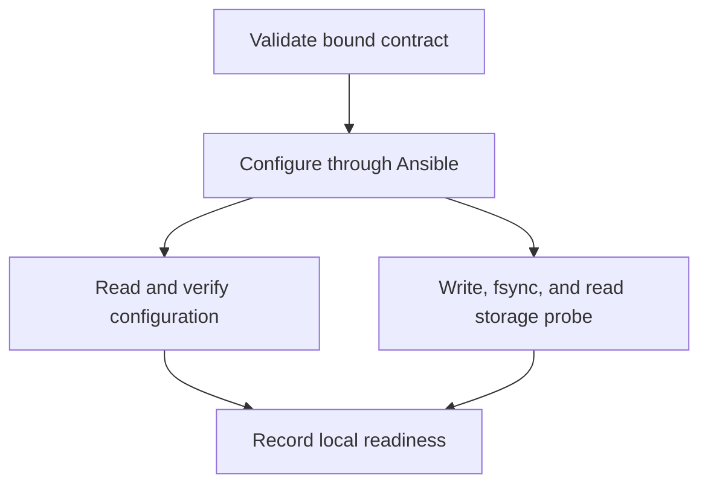
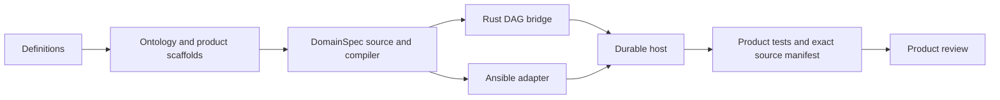

# Alch Host provisioning through RWO and Ansible

Status: product-construction prototype. Authority effect: none. Private package.
Owner: Alch Host construction, coordinated with Craft and the RWO implementation
owner. ORODI remains the evidence consumer; no capability adoption is changed.

This package configures a disposable local directory using **real Ansible**,
derives all workflow transitions through the existing Rust **RWO DagEngine**,
and recovers its accepted history after process restart. It does not provision
a VM, install services, activate a function host, or contact a cloud provider.

## Product and business prototype

The operator supplies a private temporary run directory. The platform selects
the fixed provisioning contract and playbook, runs the workflow, and returns
either historical local readiness evidence or the exact failed stage. This
tests the missing provisioning adapter and recovery boundary for Alch Host.
It does not establish a commercial SLA or customer-value result.

The [candidate definitions](definitions/DEFINITIONS.md) and
[ontology scaffold](ontology.json) identify target, run, adapter, and receipt.
[domainspec.json](domainspec.json) is an authored, closed DomainSpec extension
prototype, following the existing RWO package's source-to-DAG approach.
It is validated by [source.schema.json](source.schema.json); [compile.py](compile.py)
deterministically projects [the DAG](generated/dag.json) and
[system scaffold](generated/system-ontology.json). It is not a new registered
DomainSpec profile or `.alch` grammar. General deployment syntax remains later work.

## Execution DAG



Both verification commands are released in one RWO batch; the local adapter
executes them serially and stops at the first failure. Readiness requires an
`all` join. Each node has one structural attempt. Recovery of an unacknowledged
command is reconciliation of that command, not a newly authorized retry policy.

## Construction DAG and lanes



| Lane | Frontier / task | Owner | Stage or prerequisite |
| --- | --- | --- | --- |
| Product construction | Local DAG, adapter, durable host and product tests | Alch Host / RWO implementation owner | Current candidate; executable now |
| Product construction | Typed ORODI projection, generalized environment binding and `.alch` authoring | Alch / DomainSpec / ORODI owners | Successor prototype work; no cloud prerequisite |
| Operational support | Select cloud and obtain scoped credentials, DNS, TLS and host allocation | Platform operator | Future remote provisioning; deferred |
| Operational support | Historical Craft source-binding migration | Craft owner | No dependency on this prototype; deferred |

Causal construction blockers: none for local execution when the listed build
dependencies are installed. Product approval, deployment, and public service
activation are not claimed by test completion.

## Build and run

Requires Linux, Python 3 with `jsonschema`, `/usr/bin/ansible-playbook` (tested
with Ansible Core 2.16.3), and Cargo with the pinned dependencies cached.
Ansible Runner is not installed in this environment; the adapter uses the
Ansible CLI with an argument vector, fixed localhost inventory and isolated
configuration instead. No shell command interpolation is used.

From this directory:

```bash
cargo build --offline --locked --manifest-path bridge/Cargo.toml
PYTHONDONTWRITEBYTECODE=1 python3 compile.py
PYTHONDONTWRITEBYTECODE=1 python3 validate.py
PYTHONDONTWRITEBYTECODE=1 python3 host.py --run-root /tmp/alch-provision-demo
```

The run root must be absent or owned by the current user with mode 0700. It
contains the disposable target, Ansible working files, exclusive-owner lock,
and `history.sqlite`. Repeating the command resumes the same exact run.
Completed runs return historical evidence; they do not continuously monitor
current readiness. Choose a new root for a new provisioning run.

If the host lacks `/usr/bin/ansible-playbook`, run the provisioning test suite
in the test-only container. From the repository root, build the Rust bridge
first, then build the image and run the tests as your UID. The checkout is
read-only inside the container, its network is disabled during the test, and
the tests create and remove only their private container-local temporary roots:

```bash
tools/toolchain/run cargo build --offline --locked --manifest-path work-orchestration-implementation/extensions/alch-host-provisioning-v1/bridge/Cargo.toml
docker build -f work-orchestration-implementation/extensions/alch-host-provisioning-v1/Dockerfile.test -t alch-provision-test:local work-orchestration-implementation/extensions/alch-host-provisioning-v1
docker run --rm --network none --user "$(id -u):$(id -g)" \
  --mount "type=bind,src=$PWD,dst=$PWD,readonly" \
  --workdir "$PWD/work-orchestration-implementation/extensions/alch-host-provisioning-v1" \
  -e TMPDIR=/tmp -e PYTHONDONTWRITEBYTECODE=1 \
  alch-provision-test:local python3 -m unittest discover -s tests -v
```

This exercises the Python provisioner, its real Ansible adapter, and the Rust
bridge. It does not run the separate AlchLang local-host Node tests, which
also require bubblewrap and the locked Node/Rust build toolchains. Do not use
privileged Docker or a weaker isolation mode to make those tests pass.

The same test-only Dockerfile now also carries Node 26.8.1, bubblewrap, and
the C compiler's Ubuntu runtime libraries for a bounded local-host integration
attempt. Before the Node tests, probe the container's default unprivileged
namespace support; failure is an environment block, not permission to add
`--privileged`, disable seccomp, or switch the authored bubblewrap profile to
`trusted-process`:

```bash
docker build -f work-orchestration-implementation/extensions/alch-host-provisioning-v1/Dockerfile.test -t alch-local-host-test:node26 work-orchestration-implementation/extensions/alch-host-provisioning-v1
docker run --rm --read-only --network none --user "$(id -u):$(id -g)" \
  --tmpfs /tmp:rw,nosuid,nodev,mode=1777 alch-local-host-test:node26 \
  /usr/bin/bwrap --unshare-all --new-session --ro-bind / / \
  --proc /proc --dev /dev /usr/bin/true
```

If the probe succeeds, the following keeps the checkout and locked toolchain
assets read-only. Cargo writes only to an anonymous container-local `/var/tmp`
volume; `AR` selects the image's Ubuntu binutils 2.46 archive tool, because
the host toolchain's `ar` needs host-private linker libraries. Run from the
repository root after building the bridge above:

```bash
ca2_test_toolchain="$HOME/.local/share/cyberalchemy/toolchains/ubuntu-26.04-amd64-4664d1766b60"
docker run --rm --read-only --network none --user "$(id -u):$(id -g)" \
  --mount "type=bind,src=$PWD,dst=$PWD,readonly" \
  --mount "type=bind,src=$HOME/.rustup,dst=$HOME/.rustup,readonly" \
  --mount "type=bind,src=$HOME/.cargo/bin,dst=/var/tmp/bin,readonly" \
  --mount "type=bind,src=$HOME/.cargo/registry,dst=/var/tmp/registry,readonly" \
  --mount "type=bind,src=$ca2_test_toolchain,dst=$ca2_test_toolchain,readonly" \
  --mount type=volume,dst=/var/tmp \
  --tmpfs /tmp:rw,nosuid,nodev,mode=1777 \
  --workdir "$PWD/language/capabilities/alchlang/plans/general-compiler-v1/implementation" \
  -e HOME="$HOME" -e XDG_DATA_HOME="$HOME/.local/share" \
  -e CARGO_HOME=/var/tmp -e RUSTUP_HOME="$HOME/.rustup" \
  -e TMPDIR=/var/tmp -e PYTHONDONTWRITEBYTECODE=1 -e AR=/usr/bin/ar \
  alch-local-host-test:node26 \
  node scripts/run-toolchain.mjs tsx --test test/local-host.test.ts test/local-host-events.test.ts
```

On the current host the default-security bubblewrap probe returns "No
permissions to create a new namespace," so the isolated Node tests are not
qualified by this container path. The separately declared trusted-process
slice can be run without that probe: use the same command with only
`test/local-host.test.ts` as the final test argument. On the current host that
slice passes 8/8, including real Ansible provisioning, loopback invocation,
restart, authorization and tamper rejection. It does not qualify the eight
event/bubblewrap tests or assert a general runtime guarantee.

The host itself supports unprivileged nested bubblewrap namespaces. For a
test-only run that combines that host capability with the existing Ansible
image, first build the bridge and `alch-local-host-test:node26` as above, then
run from the checkout root:

```bash
bash work-orchestration-implementation/extensions/alch-host-provisioning-v1/run-local-host-tests.sh
```

The script pins the local image ID, exports its filesystem from a never-started
temporary container, and runs both local-host test files under host bubblewrap.
The image root, checkout, and locked toolchains are read-only; `/var/tmp` is
private, the process environment is allowlisted, and the outer namespace has
no network. It attempts to delete only its own private temporary root and
container, and reports cleanup failures.
This requires the trusted local image, Docker access, host unprivileged user
namespaces/bubblewrap, and the already-installed locked toolchains. It does
not install Ansible on the host or loosen Docker seccomp. The observed local
run passed 16/16 tests on 2026-10-03. That is integration-test evidence for
this environment, not admission, deployment readiness, or a general runtime
guarantee. A different host must run the script and inspect its own result.

`--crash-after configure` exits 75 after the real effect and before accepting
its result. Run again without that flag to observe recovery. `--fail-node`
is a local test hook. Tests use and clean only their own temporary directories.

## Persistence and failure behavior

- SQLite WAL with FULL synchronization stores event, next cursor and complete
  command batch in a single transaction. Compare-and-append rejects stale
  cursors; exact duplicate events are harmless and divergent reuse is rejected.
- On restart the Rust engine replays accepted events. Every stored cursor and
  command batch must equal its fresh derivation. Selected source, executable,
  and run-root drift reject resume.
- One process holds an exclusive advisory lock. Ansible inherits that lock so
  a successor cannot race the original provisioning child after host loss.
  This is a single-host design, not a distributed lease implementation.
- Before reissuing configuration the adapter reads exact desired content and
  modes. A matching target is reconciled without rewriting it; drift is repaired
  using the fixed idempotent playbook. The storage probe also has a fixed identity.
- Deadlines persist across restart. Subprocess timeouts kill the process group.
  Failed stages stop execution; blocked dependents are not successful checks.
  Already issued siblings remain unevaluated and are not executed on resume.
- No automatic deletion or compensation is inferred. Recovery does not claim
  exactly-once external effects, power-loss proof, or protection from a hostile
  process with the same operating-system user.

The fixture installs no isolation runtime. The CLI is for a trusted local
operator, not an endpoint for untrusted tenant submissions. Playbook success is
checked against actual files; readiness is still limited to configuration and
storage. The journal is candidate evidence suitable for a future typed ORODI
adapter, not an ORODI runtime admission.

## Evidence and definitions audit

[validation.json](validation.json) records the final checks; [source-manifest.json](source-manifest.json)
binds selected source bytes. Generated artifacts can be checked without writing
via `compile.build()`. Recompilation makes a new candidate; it is not approval.

Canonical definitions updated: none. Canonical source remains
`cyberAlchemy-v2/authority/definitions/DEFINITIONS.md`. Four local candidate terms
have formal, plain-language and domain-context voices, with a synchronized index.
They are not globally registered terms. Selected canonical dependencies are the
construction chain in CAV2-D65 and evidence boundary in CAV2-D84; unrelated
whole-file ontology drift is not a construction prerequisite.

## Open Questions

- Which provider and resource topology should the next environment binding target?
- What admitted Alch/DomainSpec deployment grammar should replace this closed prototype source?
- Which ORODI evaluation contract should consume the local execution receipts?
- What distributed lease, reconciliation and compensation policy is required before multi-host execution?

Related sources: [RWO realization](../../README.md),
[accepted-history port](../../ports/accepted-history.json),
[Craft related work](../../../product/craft/capabilities/orodi/RELATED-WORK.md),
[Alch event execution](../../../language/capabilities/alchlang/plans/general-compiler-v1/extensions/event-execution-v1/README.md).
