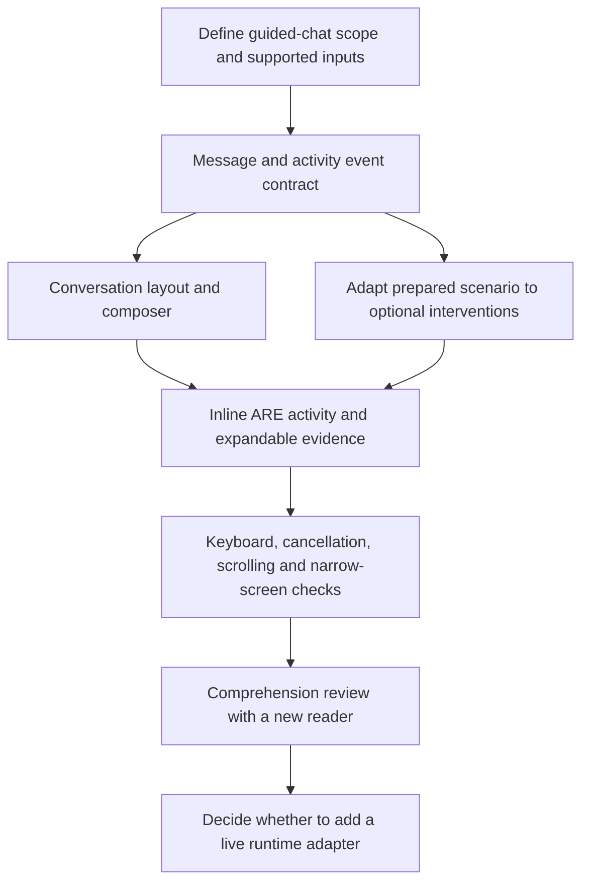

# ARE conversation experience research

Date: 2026-09-17. Status: candidate design recommendation; no UI implementation in this round.
Scope: turn the existing documentation simulation into a convincing, understandable chat experience while preserving its explicit simulation boundary.

## Findings from the current prototype

At the time of this research, the [previous simulation](AGENT-SIMULATION-PLAN.md) provided prepared messages, two task routes, vocabulary and explanation choices, timed results, continuation, and a deployment boundary. It resembled a questionnaire: terminology and style were mandatory before work, there was no composer, and an activity panel competed with the conversation. That simulation has since been removed in favor of [the protected live chat](VISITOR-CHAT-PLAN.md).

The original recommendation was to keep the blue palette and restrained icons while changing the interaction structure. Source context: [simulation plan](AGENT-SIMULATION-PLAN.md), [current live styling](src/live-chat.css), and [dependency manifest](package.json). The rest of this research records the initial design proposal, not the current implementation contract.

## External evidence

| Source | Relevant finding | Application to ARE (design inference) |
| --- | --- | --- |
| [NN/g chatbot guidelines](https://www.nngroup.com/articles/ai-chatbots-design-guidelines/) | Explain capabilities and provide relevant prompt suggestions. | Establish the demo scope and offer a small number of contextual follow-ups. |
| [assistant-ui suggestions](https://www.assistant-ui.com/docs/guides/suggestions) | Suggestions can populate the composer or send messages, and can come from application state. | Prefer filling a draft, followed by Send, so interaction is predictable. |
| [AI Elements Prompt Input](https://elements.ai-sdk.dev/components/prompt-input) | Provides a growing text input and keyboard submission behavior. | Use a persistent composer with Enter to send and Shift+Enter for a newline. |
| [AI Elements Conversation](https://elements.ai-sdk.dev/components/conversation) | Provides following new messages and a return-to-bottom affordance. | Preserve the reader's position and show “Latest messages” when they scroll up. |
| [AI Elements Tool](https://elements.ai-sdk.dev/components/tool) | Presents tool status and expandable details. | Put small operational events next to the reply they explain. |
| [W3C ARIA23](https://www.w3.org/WAI/WCAG22/Techniques/aria/ARIA23) | A named log region supports sequential updates such as chat. | Retain the existing log semantics and avoid moving keyboard focus when messages arrive. |

These sources support interaction patterns, not a claim that this particular ARE design improves comprehension. That needs a prototype evaluation.

## Recommended experience

Use one conversation column with a compact header, message history, contextual suggestions, and a composer. User messages can have a faint blue background; agent replies remain open on the page. Avoid surrounding every message or activity with a card.

Example proposed conversation (all events remain explicitly prepared in the demo):

1. User sends: “Fix invitation-only signup. Run the checks until they pass. Ask before deploying.”
2. Agent acknowledges the task and begins. A small activity line says “Implementation route selected.”
3. User adds: “We call people joining teammates.” The agent acknowledges the project-scoped wording; a later reply visibly uses “teammates.”
4. User adds: “Explain what changes for people.” The next explanation changes style without restarting the task.
5. A compact test event reports an expired invitation was accepted. The agent explains the correction and continues under the existing request.
6. The prepared retry passes. The agent reports the result using the retained vocabulary and stops before deployment.

Vocabulary and explanation changes are optional conversational interventions, not mandatory onboarding steps. Suggested replies appear when relevant; the task can complete without selecting them. Provide a separate starter for the explanation-only route so the absence of write authorization remains demonstrable.

Under relevant replies, show icon-led activity lines such as “Project wording updated” or “Check failed · continuing.” Expanding a line reveals the input, scoped decision, and observed result. This is a concise operational explanation, not a claim to expose the model's private reasoning. An optional “Inspect ARE” view can collect these records; the main conversation must make sense without it. On narrow screens, expand details inline.

The composer stays at the bottom of the chat region, not over the whole landing page. Preserve drafts, support IME composition, keep controls reachable with the mobile keyboard, and respect reduced motion. Stop must cancel pending demo events; pause and cancellation must not be presented as interchangeable runtime operations.

## Free-text boundary

The current source uses finite choices and prepared outputs. A text box alone does not add language understanding.

For the next visual prototype, use a clearly labeled guided chat. Suggestions fill supported requests into the composer; any editable input must have a documented supported set and an honest unsupported-input response. Do not silently treat arbitrary prose as a supported request, invent tool results, or label fixed character animation as live generation.

A later genuinely open chat needs a model/host adapter, actual ARE decisions, tool execution evidence, cancellation, and explicit handling of unsupported or ambiguous requests. The frontend library supplies none of these capabilities by itself. Runtime boundaries remain those in the [request decision router](../../../implementation/agent-reasoning-engine/packages/request-decision-router/README.md); scoped learning evidence is described in the [interaction learning benchmark](../../../implementation/agent-reasoning-engine/benchmarks/real-reasoning-v1/interaction-learning/README.md).

## Reuse options

| Option | Fit for this repository | Recommendation |
| --- | --- | --- |
| Existing React components and CSS | Already used; current simulation behavior can be retained. We own scrolling, cancellation, keyboard behavior, and accessibility. | Use for the next bounded documentation prototype. |
| [assistant-ui](https://github.com/assistant-ui/assistant-ui), particularly [ExternalStoreRuntime](https://www.assistant-ui.com/docs/runtimes/custom/external-store) | Can render messages supplied by an existing store through callbacks; custom primitives allow ARE styling. | Strong candidate if this becomes a reusable agent chat frontend. Trial a minimal adapter before adopting. |
| [Vercel AI Elements](https://github.com/vercel/ai-elements) | Useful conversation, composer, and tool patterns. Its documented setup includes shadcn/Tailwind and an AI SDK application; this prototype currently uses Vite and plain CSS. | Use as a reference now; adopting its documented stack would add migration work. This does not mean Vite is inherently unsupported. |

Keep message presentation independent of the event source: stable message IDs, run IDs, and typed parts for text, activity, tool status, and approval requests. A simulation adapter supplies prepared events today; a live adapter could supply verified events later. Cancelling or restarting invalidates the run so late events cannot leak into a new conversation.

## Proposed implementation DAG

Review of the proposal: removing the mandatory preference sequence addresses the current form-like behavior. Inline activity keeps cause and effect together. Separate adapters preserve the distinction between a demonstration and actual engine execution. A live backend is intentionally a later decision, not a prerequisite for evaluating the chat presentation.

Acceptance: both initial routes remain distinct; language/style interventions affect subsequent replies; authorized work continues without another confirmation; deployment is not silently authorized; unsupported text gets an explicit response; Stop/restart prevents late replies; reading history is not interrupted; keyboard and narrow embedded views remain usable. Ask an unfamiliar reader to identify what the agent did, what ARE contributed, and what still requires approval. A successful UI build alone does not establish those outcomes.

## Open Questions

- Is this ultimately a documentation demo or an entry point for a real agent session? Recommendation for the next iteration: documentation demo.
- How much editable language should the guided demo accept? Recommendation: disclose a small supported set until a real language adapter exists.
- Does an optional consolidated inspection view add value beyond inline activity? Evaluate after the conversation itself is understandable.
- What level of transcript persistence is useful? Start session-local; do not imply that a browser demo teaches the deployed engine.
