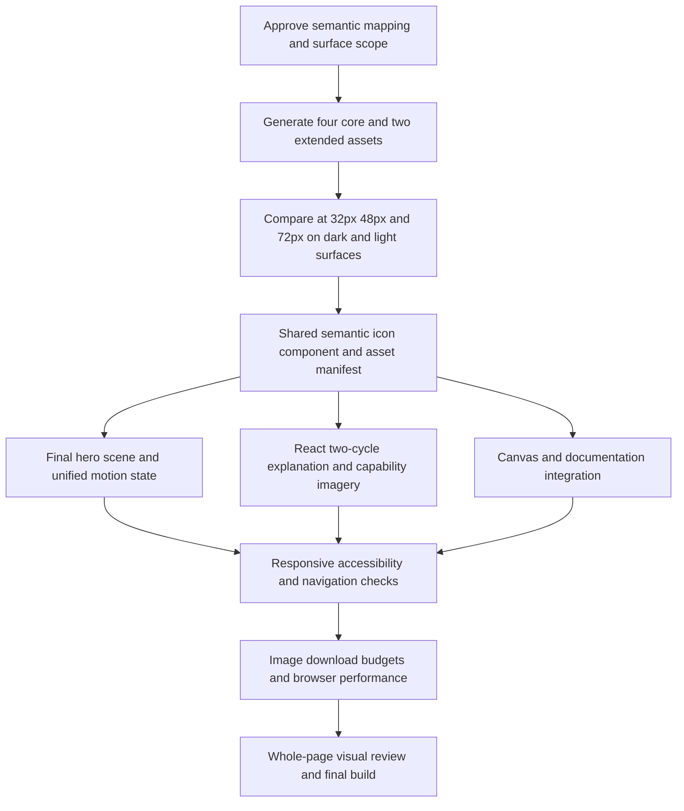

# Light Sculptures across A.R.E

Status: proposed, not implemented. Owner: product owner. Request: `are-icon-plan-119`.
Scope: final hero scene, landing explanation, capability illustrations and documentation
canvas. Initial authority: selected KELD family 01 and request to propose a page-wide plan.
This planning candidate is not admitted execution state; Goals validation remains blocked.

## Objective

Make KELD and A.R.E visibly one product through a consistent icon family, while keeping
component meanings, plain-language labels, useful motion and documentation navigation clear.
The engine connects interpretation, context, evidence and action; imagery must retain
permissions, working state and finish/ask distinctions rather than imply unrestricted action.

## Reviewed substrate

Repository-relative sources within this prototype:

- `src/Hero.tsx`: four scenes; eight final stations; two-cycle explanation.
- `src/ComponentIcon.tsx`: eight shared semantic IDs and line glyphs.
- `src/CanvasGraph.tsx`: selectable component nodes, React Flow handles and document opening.
- `src/data.ts`: eight components, relations and user-property lenses.
- `src/Capabilities.tsx`: four capability groups and detailed capability boundaries.
- `src/ExplanationPaths.tsx`: research method, evidence and live interaction sections.
- `src/hero.css`: final-scene paths, label positions and motion preferences.
- `scripts/check-download-budget.mjs`: current route checks count JS/CSS, not image downloads.
- `../../../keld-project/prototype/assets/are-icons/README.md`: selected style and prompts.

Live preview inspected at http://localhost:4193/: final hero scene, introduction/two-cycle
section and continuity canvas at 1366×768. Ephemeral screenshots: `/tmp/are-review-last.png`,
`/tmp/are-review-explanation.png`, `/tmp/are-review-canvas.png`.

Findings: final-scene icons are small relative to the field; pale line icons have limited
visual emphasis; background particles compete with the component map. Canvas is light
rather than hero navy. Final `map-flow` animation is enabled by `.explanation-open`, which
current Hero rendering does not use. Reduced-motion hero currently disappears in favour
of a text introduction, so its component overview has no equivalent static graphic there.

## Semantic asset map

| Component ID / concept | Asset direction | Action |
| --- | --- | --- |
| objective / Your goal | Focused pearl in energy ribbons | Reuse goal |
| context / Useful context | Several fragments selected through a luminous aperture | Generate distinct context |
| agent / Agent & tools | Two coupled energy components | Reuse action |
| evidence / Evidence | Layered sheets carrying an observed signal | Reuse evidence |
| decision / Next step | Branching ribbon | Reuse comparison geometry; label by context |
| boundary / Permissions | Open light gate with a clear threshold | Generate boundary |
| state / Progress | A continuous thread linking retained checkpoints | Generate state |
| outcome / Finish or ask | Terminal junction with complete and unresolved branches | Generate outcome; never conflate with refinement |
| evolution / Refine | Fragments aligning around a core | Reuse refinement in evolution explanations |
| language / Adapt to your language | Two differing waveforms aligning | Generate extended language asset |
| adapters / Connections | Distinct terminals meeting a common interface | Generate extended connection asset |

Four additional assets complete the core eight; two extended assets cover language and
connections. Eleven unique assets in total including the five existing ones. Text labels
carry meaning; do not expect abstract artwork alone to explain permission or completion.
Keep semantic IDs separate from filenames and avoid an objective fallback for unknown IDs.

## Surface plan

1. Final hero scene: keep the eight-component map around the existing A.R.E mark. Use larger
   free-standing sculptures, preserve visible labels, reduce competing ornament and sequence
   attention along relationships from `data.ts`. Artwork arrives using the current timeline.
   Once chapter 4 is formed, loop a restrained local signal sequence with a rest. Earlier
   chapters remain seekable and do not restart automatically. Pause freezes narrative and
   ambient motion together; offscreen/hidden tabs suspend work. Reduced motion shows a static
   labelled map. Narrow screens use a dedicated compact composition rather than shrinking
   the desktop map indiscriminately.
2. Introduction: port the KELD two-cycle visual into a React component placed alongside the
   existing work/evolution explanation. Reuse assets and meaning, not copied global DOM code.
   Keep captions and the conceptual-not-live distinction. Loop only while visible and allowed.
3. Capability overview: use matching sculptures at section/featured-capability scale; use
   separate language and connection imagery instead of treating evidence as every concept.
   Retain compact line glyphs where space is limited. Do not introduce another card hierarchy.
4. Examples/research/evidence: reuse relevant component identities to connect the explanation
   to the map. Keep results, scores and provenance readable; artwork must not imply unsupported
   performance, active backend execution, model-weight training or automatic deployment.
5. Documentation canvas: keep all eight IDs, graph handles, relationships, selection behaviour,
   keyboard focus and document panels. Replace component artwork without changing layout state.
   Test deeper-blue/light-surface asset treatment at actual canvas sizes; introduce only a
   restrained local contrast treatment if needed, not dark card backgrounds. Retain line icons
   for small navigation, controls and dense documentation links.
6. Documentation/live interaction: use the family for meaningful overview figures, not every
   paragraph or message. Conventional arrows, close buttons, search and chat controls stay
   compact and familiar. Icons used as illustrative signals must remain distinct from live status.

## Construction DAG

Recommended execution order: mapping → complete assets → final-scene prototype → remaining
surfaces → full verification. E/F/G are conceptual independent branches, not permission to
spawn agents. First reviewable result: final hero scene at desktop and 390px, including labels,
loop, pause and static reduced-motion state.

Use a typed semantic manifest and separate HTML/SVG renderers sharing the same asset map.
Provide explicit presentation sizes and optional compact line treatment. Keep label layout
bound to component coordinates, not unrelated percentage constants. Keep timeline transforms
on a wrapper separate from ambient icon transforms. Use scoped SVG IDs when cycles and hero
coexist. Self-host versioned WebP assets; record generation prompts/provenance. Avoid adding
an animation library: this page already vendors Anime.js. Do not import KELD DOM selectors.

## Acceptance and evidence

- All eight core meanings remain distinct and labelled; no missing asset silently becomes Goal.
- First three chapters, chapter arrows, seek and replay preserve existing behaviour.
- Final scene loops; pause/resume, OS reduced motion, offscreen and hidden-tab behaviour verified.
- Static reduced-motion overview retains the same information and useful navigation.
- Hero and canvas labels do not overlap at 320/390px, sidebar widths and laptop short heights;
  required controls remain visible. Touch/keyboard access does not rely on hover.
- Canvas node selection, document opening, persisted positions and zoom remain intact.
- No all-page continuous animation; only visible illustrative scenes animate.
- Proposed icon-family transfer ceiling: 300 KiB for optimized runtime assets, measured rather
  than inferred from source size. Extend image accounting because current budgets omit images.
- Run current build, relevant canvas/persistence/download checks, and dedicated hero motion/
  accessibility checks. Compare screenshots on dark hero and light canvas; profile real frame
  timing before claiming performance. Do not expand this visual scope into backend live tests.

## Construction and operational boundaries

D65: source meanings → selected icon family and mapping → bounded candidate UI → rendered
proof and interaction checks → owner visual acceptance. Product frontier is this proposal;
implementation follows a separately routed user request. No canonical definitions or ontology
records change; exact ontology record/selector dependencies: none.
Runnable product work after authorization: asset completion and final-scene prototype.
Operational tasks: hosted URLs/deployment owned by product owner; WSL disk maintenance owned
by workstation owner. Neither currently blocks this plan; no shutdown or publication is included.
Deferred residue: deployment, final asset visual acceptance and image-budget calibration.

## Open Questions

- Which narrow-screen composition best preserves all eight labels? Resolve with rendered
  desktop/390px/320px comparisons, not by shrinking the desktop scene further.
- Does the selected family retain sufficient contrast on the light canvas? Resolve before
  canvas rollout; a dark hero screenshot is not evidence for the canvas.
- Final creative acceptance of the six new icons and whole-page composition belongs to owner.
