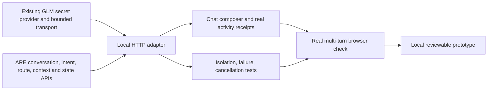

# Live ARE + GLM chat

Date: 2026-09-17. Owner-directed prototype construction, not a release or admitted runtime.

Amendment: [VISITOR-CHAT-PLAN.md](VISITOR-CHAT-PLAN.md) now governs visitor isolation, resets, current limits, and simulation removal. The comparison-simulation and earlier limit descriptions below are historical.

## Objective and authorization

User: “we shoudl really connect ARE using the glm key that we already using”. Replace the default prepared conversation with live GLM replies and actual ARE decisions. Retain the prepared simulation as an explicitly labeled comparison. Predecessor: [chat research](CHAT-EXPERIENCE-RESEARCH.md).

## D65 construction boundary

- Product frontier: a local chat backed by the existing encrypted credential provider and imported ARE modules.
- Runnable work: backend adapter → live chat presentation → failure/isolation tests → real multi-turn browser proof.
- Exact write scope: this experiment directory, including server, Vite configuration, UI, tests, notes, and ignored evidence/build output. No engine or authority source changes.
- Authorized external effect: bounded GLM model requests using the existing key, carrying chat messages and curated explanatory context. No secret is passed to the browser; no repository-wide context scan is sent to the provider.
- Operational tasks/owners: the product owner decides any future public hosting, authenticated multi-user access, persistent sessions, and execution tools. Current server binds loopback only.
- Exact affected stages: local construction and validation. Credential resolution and valid ARE source provenance are prerequisites for live turns; failure blocks the turn without a simulated fallback.
- Deferred residue: deployment, durable learning, arbitrary code execution, live retrieval, and benchmark-quality claims. These do not block the current conversational connection.
- Ontology dependencies: no ontology runtime selectors. The ARE routing profile verifies its own exact provenance. The context selector declares definition/ontology catalogs not applicable to its curated demo catalog.

## Construction DAG

## Implementation contract

The server imports ARE conversation and request-intent runtimes. GLM proposes a structured objective and optional exact preference quote; host validation rejects malformed fields or quotes absent from the current user message. The verified ARE router evaluates the inferred objective. ARE selects matching curated context; the host adds a recent-message suffix capped by bytes and up to eight current-session preference quotes. GLM generates the reply. ARE records events and a process-memory completion checkpoint.

The browser displays operational receipts, not hidden model reasoning. Model input/output token counts include both calls per successful turn. This measures overhead but does not establish savings. No actual tool execution is available, even for an implementation or publication route; routing never grants authority. Language adaptation is model-assisted contextual preference reuse, not global learning or model training.

Limits: eight active sessions; 30-minute idle expiry; 20 turns per session; two concurrent turns server-wide; one turn per session; 6,000 UTF-8 input bytes; 32,768 bytes per provider request; 2,048 maximum output tokens per call; 60-second provider timeout; no automatic retry. The recent-message projection reports omitted messages. Secret references, provider errors, and credential material are not returned to the browser. Same-origin JSON requests are required for mutations.

The UI streams ARE status/events and delivers the completed reply; it does not fabricate token streaming. Stop disconnects the request and aborts provider I/O. Run generations prevent late browser updates after reset. Session messages and preferences live in process memory and are discarded on expiry, deletion, or server restart.

## Source bindings

- [Conversation runtime](../../../implementation/agent-reasoning-engine/packages/conversation-runtime/README.md)
- [Request intent runtime](../../../implementation/agent-reasoning-engine/packages/request-intent-runtime/index.mjs)
- [Decision router](../../../implementation/agent-reasoning-engine/packages/request-decision-router/README.md)
- [Context selector](../../../implementation/agent-reasoning-engine/packages/context-basis-runtime/src/request-context-selector.mjs)
- [Reasoning state](../../../implementation/agent-reasoning-engine/packages/reasoning-state-runtime/README.md)
- [Existing secret provider](../../../implementation/agent-reasoning-engine/packages/coding-agent-runtime/sops-age-secret-provider.mjs)
- [Existing GLM transport](../../../implementation/agent-reasoning-engine/packages/coding-agent-runtime/glm-flash-v1/transport.mjs)
- [Z.ai thinking mode](https://docs.z.ai/guides/capabilities/thinking-mode): GLM 5.3 Flash requires thinking; the adapter uses low effort and does not request disabled thinking.
- [Z.ai chat API](https://docs.z.ai/api-reference/llm/chat-completion): messages, JSON output format, and provider usage.

## Validation

Commands and final results are recorded in [README.md](README.md#live-are--glm-chat). Unit tests use deterministic provider fixtures around real ARE modules. Live evidence is separately labeled and stored only in ignored `evidence/`.

## Open Questions

- Which first real execution tool should be connected after conversation is validated? Current chat cannot repair an application or run its tests.
- Should users explicitly confirm extracted preference quotes before persistence beyond the current interaction? This version does not persist them beyond the session.
- Does model-assisted intent classification justify a second model call for every turn? Usage is visible so a later experiment can compare alternatives.
- How should longer conversations select retained work state? This bounded adapter is not a replacement for ContextBench or a proven long-context policy.
