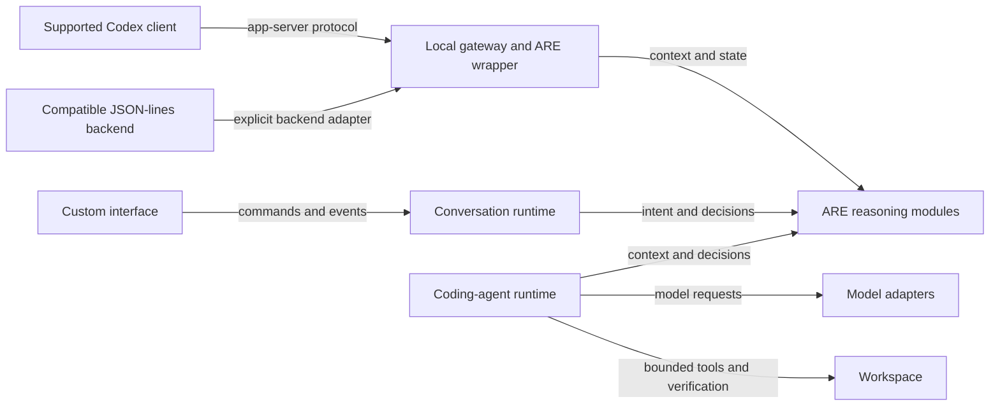
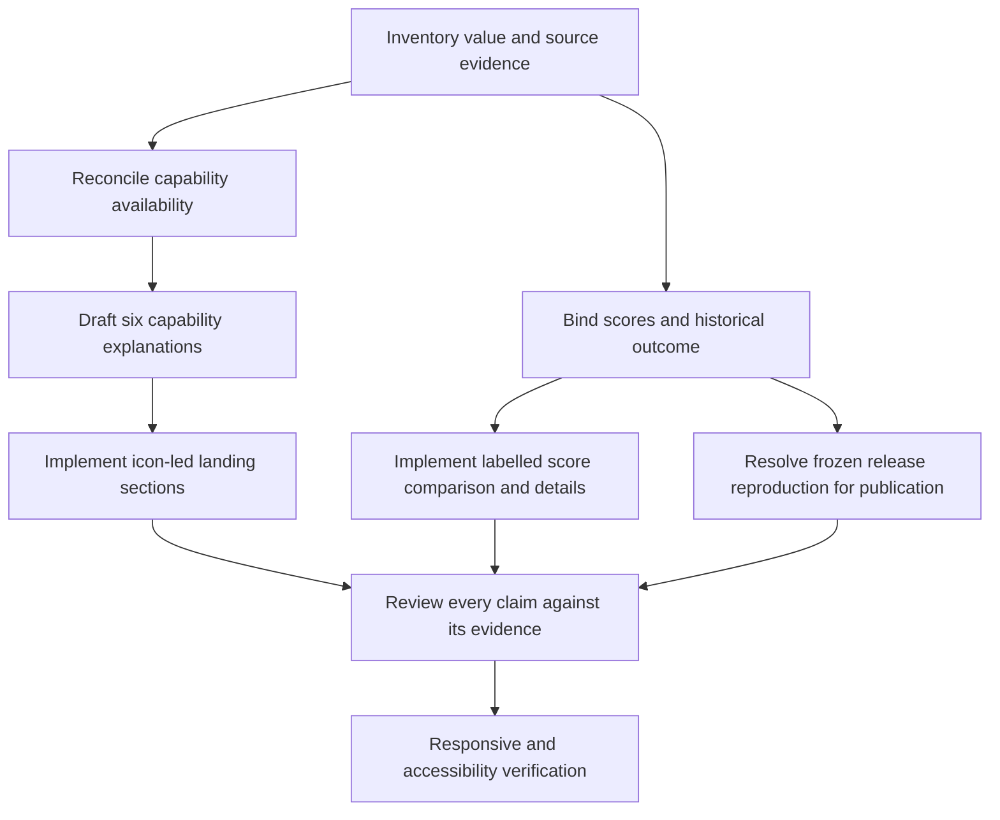

# ARE product value and landing-page evidence

Status: candidate documentation proposal, 2026-09-17 local date. No authority promotion, page implementation, live benchmark, or deployment. This inventory responds to the request to establish ARE's value before rewriting “Why is it called Agent Reasoning Engine?”.

## Product objective

ARE helps an agent connect what the user means, the objective, relevant context, observations, corrections, and the next decision across a continuing task. The enduring objective is reusable improvement in reasoning, continuity, recovery, correctness, and completed outcomes within cumulative model input-plus-output tokens. Capability presence, integration availability, and measured benefit are different claims.

Sources: [lighthouse](../../../agent-reasoning-engine/LIGHTHOUSE.md), [product thesis](../../../agent-reasoning-engine/product.json), [reasoning and learning](../../../agent-reasoning-engine/REASONING-AND-LEARNING.md).

The current [introduction](src/Hero.tsx) emphasizes carrying information forward. It omits much of interpretation, correction, decision support, recoverability, integrations, and measured context-selection work. Its emphasis should broaden; continuity remains the connection between those capabilities.

## Inventory and placement

This covers the 43 product-layer IDs in the [documentation inventory](../../../research/are-documentation-v1/FEATURE-COVERAGE.md), grouped by user value rather than package names. It is not an exhaustive export/schema catalog. Read its implementation statuses alongside the newer [product completeness audit](../../../implementation/agent-reasoning-engine/PRODUCT-COMPLETENESS-AUDIT.md): the older inventory still reports gaps subsequently repaired in conversation runtime, gateway adapters, test discovery, and release closure. Neither historical audit is a new full runtime qualification.

| Value | What the user gets | Evidence and availability | Proposed placement / inventory IDs |
| --- | --- | --- | --- |
| Interpret instructions in context | Distinguish how to construct an answer from words to print literally; bind corrections to their target | Intent compiler and targeted tests; bounded rules plus optional provider, not general language mastery | Main capability: Understand the request. F03, F05 |
| Keep the objective clear | Track continuation, refinement, replacement, interruptions, and retained/removed requirements | Opt-in objective and requirement contracts | Main capability: Keep the task on track. F04 |
| Adapt to the user's vocabulary and corrections | Reuse scoped preferences and lessons instead of requiring repeated instructions | Learning lifecycle implemented; normal serving profile disabled. Visitor chat explicitly retains quoted session preferences | Main capability with availability label. F14, F15 |
| Let the user control what is learned | Inspect, correct, revoke, disable, or reset retained state | Programmatic controls; local visitor chat offers forget language, reset route history, and start fresh | Beside learning, with actual controls. F16 |
| Select relevant context | Build request-relative context from sources and dependencies; account for omissions and freshness | Context Basis/envelope mechanisms; sufficiency is not guaranteed by schema validity | Main capability: Bring the right context. F06 |
| Work under context pressure | Keep explicit state outside the current prompt and project selected material within a budget | Context adaptation/reduction mechanisms; narrow 8K H72 result below | Main capability plus evidence. F07, F19, F22 |
| Reuse evidence precisely | Retain tool outcomes, source references, requirements, decisions, contradictions, and provenance | Explicit reasoning-state ledger; no access to hidden model reasoning | Context/continuity example. F08 |
| Recover interrupted work | Checkpoint, reconstruct dispatch, replay, branch, and resume explicit state | Memory/file sinks and bounded recovery; not a distributed durability guarantee | Main capability: Resume with the evidence. F09 |
| Find the right capability | Route a request using declared capability contracts and surface ambiguity | Decision router; routing itself does not execute or authorize | Main capability: Choose the next step. F02 |
| Continue without unnecessary interruption | Follow declared admissible successors and observe completion boundaries | Bounded continuation policies; does not guarantee autonomous completion of arbitrary tasks | With routing/continuation example. F12 |
| Respect consequential decisions | Keep proposed actions, permission, execution, and verification distinct | Effect policy and exact proposal boundaries; host applies effects | Supporting trust section. F11 |
| Check results against expectations | Make attributable evaluation evidence available for later decisions | Optional semantic evaluator/input contracts; a model judgment is not proof of correctness | Capability detail under Check the result. F10 |
| Explain and inspect engine behavior | Inspect intent, sources, route decisions, events, and replay evidence | Intent projections and runtime journal, host-dependent presentation | Cross-cutting “Look inside” action. F13 |
| Connect to agent hosts | Use CLI, persistent gateway, clients, hooks, and conversation facade | Newer audit includes model-neutral JSON-lines backend, stdio/RPC clients, and conversation runtime; exact host/protocol qualification still matters | Integration strip + documentation. F01, F24–F29 |
| Connect model providers | Use GLM and provider-neutral/native transport boundaries | Native provider tests are bounded fixtures; GLM has separate live evidence. Architectural portability is not measured transfer | Integration strip; explicit tested matrix. F21, F22 |
| Support controlled coding workflows | Observe tools, propose changes, verify within a configured sandbox, and apply through policy | Coding runtime, allowlists, secret providers, cancellation and rollback boundaries | Developer capability detail. F20, F33, F34 |
| Add retrieval | Bring source spans through a retrieval bridge | Kite integration is an opt-in prototype; no claim that it produced the reported H72 gain | Integrations detail. F23 |
| Keep module boundaries verifiable | Validate module contracts, selected governance bindings, signed envelopes, and configured admission | Module Port/governance mechanisms; effects remain separately authorized | Architecture/trust documentation. F35 |
| Improve through experiments | Connect observations to hypotheses, falsifiers, frozen experiments, comparisons, and upgrade recommendations | Evolution runtime and research process; no shipped autonomous background improvement service | Research section. F17, F18 |
| Make claims and releases inspectable | Publish source closure, test scope, versioned components, verification and release status | Candidate 013 audit records isolated tests/closure; not rerun here. Research release freshness issue below | Evidence/release documentation. F36–F42 |
| Extend delivery and interoperability | Potential additional protocols, remote hosting, SDK languages, and platforms | Scope/qualification remains explicit; local chat is not an approved hosted service | Roadmap, not current benefit headline. F30–F32 |
| Explain through contextual framings and analogies | Potential source-bound explanations at progressive depth | Source-defined, explicitly not implemented in the inventory | Roadmap only. F43 |

Direct implementation sources: [intent](../../../implementation/agent-reasoning-engine/packages/request-intent-runtime/README.md), [objective lifecycle](../../../implementation/agent-reasoning-engine/packages/request-intent-runtime/OBJECTIVE-RESOLUTION.md), [requirements](../../../implementation/agent-reasoning-engine/packages/request-intent-runtime/REQUIREMENT-CHANGE.md), [context](../../../implementation/agent-reasoning-engine/packages/context-basis-runtime), [state/recovery](../../../implementation/agent-reasoning-engine/packages/reasoning-state-runtime/README.md), [router](../../../implementation/agent-reasoning-engine/packages/request-decision-router/README.md), [gateway/learning](../../../implementation/agent-reasoning-engine/packages/codex-app-server-wrapper/README.md), [coding/providers](../../../implementation/agent-reasoning-engine/packages/coding-agent-runtime/README.md), [evolution](../../../implementation/agent-reasoning-engine/packages/evolution-runtime/README.md), [visitor integration and limits](VISITOR-CHAT-PLAN.md).

## What “not interpreting everything literally” supports

The compiler distinguishes “start with a definition, then an example” as a construction instruction from “create visible sections labelled Definition, Example…” as literal output requirements. It also binds a correction such as “not in the button, in the text” to different targets.

Fresh check: `node --test implementation/agent-reasoning-engine/packages/request-intent-runtime/test/compiler.test.mjs` passed **5/5**. These authored deterministic cases demonstrate the mechanism, including provider-contract rejection. They do not establish a model-wide semantic accuracy rate or show that GLM weights were trained. The package's `benchmark.mjs` measures latency on one repeated input, not language quality.

Page wording: **“Separate what you mean from what should appear in the answer.”** Show the two instructions above side by side with their differing interpretation. Avoid “understands any instruction” or “GLM is calibrated to never be literal.” The separate objective-language audit reports 12/20 matches, 8 safe deferrals, zero unsafe resolutions on an authored corpus; this belongs in detailed evidence, not a general 100% accuracy headline.

## Benchmark evidence to expose

Primary sources: [8K release snapshot](../../../agent-reasoning-engine/research/contextbench-v1/releases/glm-5.3-flash-8k-v1/README.md), [Round 55 outcome](../../../agent-reasoning-engine/research/contextbench-v1/round55-confirmation-outcome.json), [research history](../../../agent-reasoning-engine/research/contextbench-v1/CONTEXTBENCH-RESEARCH-REPORT.md), [10K reviewed decision](../../../agent-reasoning-engine/research/contextbench-v1/larger-window-v1/round59-reviewed-decision.json).

The headline experiment measures **terminal source-context selection**, not completed coding tasks, all forms of context retention, or general reasoning quality. Control and treatment use GLM-5.3-flash under the same 8,000-token experimental window; treatment adds H72 short request-local evidence handles resolved to exact evidence outside the prompt. This window is the experiment's constraint, not GLM's maximum context capacity.

| Independent 8K confirmation, eight pairs | Control | ARE treatment | Difference |
| --- | ---: | ---: | ---: |
| Macro Span-F1 | 2.70% | 15.85% | +13.15 percentage points |
| Span coverage | 1.46% | 17.66% | +16.20 percentage points |
| Span precision | 22.96% | 29.03% | +6.07 percentage points |
| File coverage | 25.00% | 41.67% | +16.67 percentage points |
| File precision | 50.00% | 62.50% | +12.50 percentage points |
| Valid context selections | 6/8 | 8/8 | +2 |
| Cumulative logical input + output tokens | 586,770 | 583,202 | −3,568, about −0.61% |

Span-F1 balances selecting relevant source spans and avoiding irrelevant spans. Coverage is how much required source material was found; precision is how much selected material was relevant. File metrics evaluate file selection rather than exact spans. Valid selection means the selection passed the declared validity checks, not that the task was solved. Macro scores average task-level results. Percentage points are an absolute difference: 15.85 − 2.70 = 13.15.

All eight confirmation pairs completed and passed recorded causal/accounting gates, without unknown token receipts or automatic retries. Keep absolute quality visible: **15.85% remains low**. Do not headline a relative multiple from a low baseline or describe 8/8 validity as 100% task success. The 8K context limit and ~583K cumulative tokens are different quantities: cumulative usage counts multiple calls throughout the run.

The historical 8K milestone passed; full ContextBench acceptance remains open (1,136 identities, other windows, repetitions, strata and statistical requirements). Round 59's 10K development canary had seven complete pairs and one censored pair, lost **0.21 percentage points** aggregate Span-F1 while saving **2,219 tokens**, and did not qualify. Its three activated pairs lost 0.56 points. 12K remains blocked by the declared window ladder. Cross-model/non-code transfer and completed-outcome improvement remain unproven.

### Current verification observation

Fresh invocation of `node agent-reasoning-engine/research/contextbench-v1/releases/glm-5.3-flash-8k-v1/verify.mjs` returned **failed: 69/78 checks passed, nine source hash mismatches**. Round 55 outcome, score, token, completeness, recorded-gate and normalized-claim checks passed. This is historical result evidence with a currently drifted release closure, not a currently passing release verification. No hashes or frozen records were changed to make it green.

Changed manifest members: `research/continuity-policy-v4.json`; larger-window `PLAN.md`, `hypotheses.json`, `work-plan.json`, `dag.json`, `continuity-binding.json`; implementation ContextBench `terminal-evidence-handle-incremental-validation.mjs`, `orchestrate-terminal-evidence-handles-v1.test.mjs`, and `orchestrate-completion-readiness-v1.mjs`. Paths above are relative to the ARE source/research roots linked in this section. A publication task must reproduce the frozen source or issue a reviewed successor manifest with an explicit change explanation; silently refreshing hashes would not establish reproducibility.

## Additional benchmark inventory and compaction correction — 2026-09-18

The initial investigation above was incomplete: ARE already has separate compaction benchmarks, including a recorded live automatic-compaction experiment. ContextBench must not stand in for the whole evaluation history. The [product scorecard](../../../agent-reasoning-engine/benchmark-scorecard.json) binds nine rows to the [compact evidence record](../../../agent-reasoning-engine/benchmark-evidence.json). This review checked all 50 numeric bindings against that record: zero mismatches. This is a consistency check, not a fresh benchmark execution.

| Benchmark family | Saved result | What it establishes / limits |
| --- | --- | --- |
| Automatic compaction recall | **0% control → 100% ARE exact recall, five of five automatically compacted pairs**, gpt-5.6-luna, Codex 0.153.0-alpha.5 | Real recorded automatic-compaction experiment. ARE reinjects a typed pinned-state projection before recall. A narrow recall canary, not GLM qualification or arbitrary task recovery. |
| Structural compaction projection | **100% pinned-state survival and recoverability; 96.9% mean byte reduction** | Deterministic projection/replay, including native notification replay. Byte reduction is not total model-token reduction; it does not measure summarizer quality. |
| Manual native compaction canary | Implemented `compaction-live` mode | Wrapper integration canary. No separate numerical saved outcome established in this review; do not duplicate the automatic experiment as another successful result. |
| GLM repair/recycling qualification | **36/36 final verified; 28/36 initial; 9/9 recycled continuity across 24 recycling events**, four tasks × 8K/10K/12K × three rounds | Bounded injected-fault tasks with corrections; 330 model/353 tokenizer physical attempts. One timeout retry; interrupted usage unknown. Fifth campaign after four failed campaigns, not 36 independent natural bugs. Provider-internal compaction remains unobservable. |
| Request routing/context | **100% route accuracy, 100% definition recall, 91.7% context precision** | Local deterministic corpus: 20 route cases and 10 context cases in the documented core mode, not arbitrary-language accuracy. |
| Intent compilation | **100% intent alignment** | Authored deterministic benchmark; distinct from general semantic interpretation and the separate objective-language corpus. |
| Lifecycle/failure boundaries | **PASS** | Deterministic lifecycle and fail-closed checks, not a model-quality comparison. |
| Adaptive reasoning-state reuse | **100% fact preservation and intent fidelity; stale reuse 5 → 0; exact reuse 2/2** | Structural scenario checks, not provider cache-hit or open-domain reasoning evidence. |
| Adaptive reuse holdout | **8/8 scenarios, 100% fact preservation, zero stale reuse** | Disjoint authored structural holdout. |
| Route continuation | **16/16**, no premature stops or over-continuation | Explicit scenario/frontier decisions, not universal autonomous task completion. |
| Literal-versus-intent scorer | Agreement **66.7% → 100%**, false negatives **57.1% → 0%**, zero false positives; **overall FAIL** | Saved experiment missed its latency gate. This evaluates a scorer, not a model's universal understanding; retain the historical failure even if a future protocol prioritizes only tokens. |
| GLM fitting | Initial pilot **6/6** training tasks; 3,386 input + 91 output tokens | 48-task authored starter corpus, pilot is supplied-evidence single-turn QA; not held-out retention. |
| Interaction learning | 48 synthetic three-turn episodes, four ablation variants | Scripted local lifecycle comparison; no empirical model-quality gain established by that comparison. |
| External task outcomes | SWE-bench-Live MultiLang development experiments and follow-up families retained | Separate completed-repair track with custom bounded tools; not an official leaderboard score. Aggregate success not reconstructed in this review. |
| External retrieval | Agent Retrieval Bench adapter and structural fixture | Full upstream benchmark is explicitly NOT_EVALUATED in the scorecard. |

Sources beyond the scorecard: [real-reasoning modes and compaction contracts](../../../implementation/agent-reasoning-engine/benchmarks/real-reasoning-v1/README.md), [automatic experiment implementation](../../../implementation/agent-reasoning-engine/benchmarks/real-reasoning-v1/src/compaction-auto-live.mjs), [GLM final qualification and independent-audit links](../../../implementation/agent-reasoning-engine/benchmarks/glm-episodes-v1/evidence/complete-transport-qualification-2026-09-09/README.md), [fitting](../../../implementation/agent-reasoning-engine/benchmarks/glm-fitting-v1/README.md), [interaction learning](../../../implementation/agent-reasoning-engine/benchmarks/real-reasoning-v1/interaction-learning/README.md), [external tasks](../../../implementation/agent-reasoning-engine/benchmarks/external-context-v1/README.md).

The six raw run paths referenced by the compact scorecard evidence are absent from their recorded locations in this checkout, including `2026-09-04T04-48-30.152Z-compaction-auto-live.json`. Their saved hashes and projected metrics remain available, but per-pair transcripts and independent raw-run replay cannot be verified here. Do not call this a fresh verification of the original experiments. The harness also documents a preceding five-pair automatic-compaction failure with the old application-metadata treatment; the successful typed-text treatment superseded it. Preserve this experiment history when recovering the raw archive.

The stronger supported compaction story is: **“In a recorded five-pair automatic-compaction test, ARE restored access to pinned facts and the model recalled all tested facts; the control recalled none.”** Put the model, narrow exact-recall task, sample size, historical date, and raw-evidence availability beside it. It supports useful behavior **after** observed compaction, not a guarantee that compaction never happens.

Page adjustment: make **Keep the work connected when context fills up** an explicit capability. Present three distinct evidence views: compaction recall (Luna), recycling continuity (GLM repair episodes), and source-context selection (GLM ContextBench). Their metrics, models, controls, and task definitions must remain separate. A successful 10K/12K repair campaign does not contradict failed 10K ContextBench transfer: they test different mechanisms and outcomes.

Open evidence task: recover or locate the raw scorecard runs and reconcile the broader external-task, learning-transfer, and host-recovery reports before calling the public evidence catalog exhaustive. No live model calls or benchmark reruns were made for this amendment.

## Run and connect ARE — integration inventory, 2026-09-18

The runtime and connection layer deserve their own visible landing-page section, alongside the reasoning capabilities and benchmarks. The product story must include both using ARE within an existing agent and constructing a bounded agent workflow using its runtime. This expands the integration-strip proposal below into a full section.

| Surface | Product value / proposed page wording | Implemented boundary and evidence |
| --- | --- | --- |
| Agent runtime | **Run the work, not just the conversation.** A bounded loop connects model requests, observations, tool use, candidate changes, checks, and continuation. | [Coding-agent runtime](../../../implementation/agent-reasoning-engine/packages/coding-agent-runtime/README.md): configured iterative loop and CLI, exact proposal/apply boundary, sandbox verification and rollback. This is a coding-agent runtime, not proof of arbitrary autonomous workflows. |
| Codex connection | **Bring ARE into your Codex workflow.** Add context, explicit reasoning state, and policy checks around supported app-server interactions. | [Codex wrapper](../../../implementation/agent-reasoning-engine/packages/codex-app-server-wrapper/README.md), runtime App Server adapter/session owner, and [host callback bridge](../../../implementation/agent-reasoning-engine/src/hook-callback-bridge.mjs). Exact version/protocol and host setup matter; local implementation does not mean installed in every Codex client. |
| Persistent gateway | **Reconnect to ongoing work.** Keep declared consumer sessions and their state across connection interruptions. | Local permission-restricted Unix socket, isolated consumers, acknowledged event delivery, resume secrets, idempotent requests, bounded buffers, and optional file-backed recovery. Stronger acknowledgement guarantees do not apply to legacy transparent stdio clients. Unknown dispatch outcomes block instead of silently retrying. |
| Client adapters | **Connect an interface to the engine.** Use a gateway client, stdio proxy, or RPC transport to submit work and receive events. | [Gateway session client](../../../implementation/agent-reasoning-engine/src/gateway-session-client.mjs) and wrapper clients; exact protocol contracts, not a universal cross-language SDK. |
| Backend adapters | **Connect a compatible agent backend.** Use the Codex backend or supply a process adapter. | [Backend adapter contract](../../../implementation/agent-reasoning-engine/packages/codex-app-server-wrapper/src/backend-adapter.mjs) implements Codex and generic JSON-lines process adapters. A process transport alone does not translate an arbitrary agent's semantics into ARE's lifecycle contract. |
| Model adapters | **Choose the model behind the workflow.** Keep provider transport separate from the engine's state and decisions. | GLM, OpenAI-compatible transport, and injected native OpenAI Responses, Anthropic Messages, and Google SDK-shaped adapters. The [provider matrix](../../../implementation/agent-reasoning-engine/packages/coding-agent-runtime/README.md) is fixture-tested without live provider calls; GLM's live benchmarks are separate. |
| Conversation runtime | **Build your own conversational interface.** Submit turns, render ordered events, and expose pending human decisions. | [Conversation facade](../../../implementation/agent-reasoning-engine/packages/conversation-runtime/README.md) owns IDs, intent and decision validation; host supplies handlers, persistence, provider transport and effects. The visitor chat is a bounded local integration of this layer, not the persistent Codex gateway. |
| Retrieval adapter | **Bring source evidence into the workflow.** Connect a retrieval system without confusing retrieval with the reasoning engine. | [Kite retrieval prototype](../../../implementation/agent-reasoning-engine/packages/coding-agent-runtime/kite-retrieval-v1/README.md), opt-in injected bridge. No implication that retrieval produced the automatic-compaction or H72 benchmark gains. |
| Secret adapters | **Keep credentials behind the host boundary.** Configure opaque secret references independently of model requests. | Environment, injected and SOPS-age providers in coding runtime; deployment owns custody and configuration. |

Use a small icon-led integration graph with typed edges and two entry paths, not a row of provider logos suggesting equal live qualification:

Caption: these are implemented integration surfaces with host-specific wiring. The drawing does not claim one automatic connection among every component or universal agent compatibility. Provider adapters serve the coding runtime; Codex has its own upstream backend path. Browser chat is not automatically a client of the persistent gateway.

Suggested section title: **“Use ARE with your agent. Build with its runtime.”** Give readers two paths: **Connect Codex** and **Build an integration**, each linking to exact setup/contracts and availability. Follow with model and retrieval adapter choices. Keep MCP/ACP, unsupported platforms, universal compatibility, and public hosted-gateway guarantees outside current-capability claims.

Open Questions: which exact Codex versions and entry paths should the first public setup guide support; which additional backend should receive a live conformance test; which stable SDK surface should be published? These affect setup promises, not whether the existing runtime and gateway belong in the product inventory.

## Earlier landing-page composition (superseded)

The compact four-group layout and separate documentation destinations in [LANDING-CAPABILITIES-PLAN.md](LANDING-CAPABILITIES-PLAN.md) supersede the expanded six-capability and extra walkthrough proposal below. The existing live chat remains; no simulated conversation is added.

1. **Why is it called Agent Reasoning Engine?** Lead with meaning → objective → context → decision → result → correction, connecting the whole loop. Suggested thesis: “Help your agent understand the request, use the right context, and carry the work forward.” Supporting copy should explain interpretation, context, and checked results rather than list modules.
2. **What changes when your agent works with ARE?** Six icon-led capabilities: Understand the request; Keep the task on track; Adapt to your language; Bring the right context; Resume with the evidence; Choose and check the next step. Expand inline into outcome, concrete interaction, mechanism, availability, and evidence. Use the established blue palette and open layout, not a grid of heavy cards.
3. **Follow one task.** Use an invitation-only signup task in explanatory text: clarify “people” versus the product's preferred term; retain “invitation only” when asked to simplify; select the relevant evidence; resume after interruption; inspect the next action. Label illustrations as explanations. Keep the actual live chat distinct and accurately limited to its wired capabilities; do not restore the removed simulated conversation or imply it edits a repository.
4. **What we have measured.** Show two directly labelled, zero-based 0–100% Span-F1 bars and a compact baseline/treatment table. Lead with the absolute 2.70% → 15.85%, then +13.15 percentage points. Put model, 8K window, eight pairs, historical confirmation status, and selection-only scope beside the numbers. Show token reduction with its modest 0.61% magnitude. A details link opens protocol, per-pair data, checks, failed rounds, and current verification status.
5. **Connect ARE to your agent.** Explain engine modules, agent-host adapters, model transports, and retrieval as separate integration choices. Show actual supported boundaries and documentation links. Do not claim universal drop-in compatibility.
6. **Try it, inspect it, control it.** Existing local live chat, reset controls, and documentation entry. Label session preference adaptation accurately; it is not training model weights or learning new routing rules.

Keep four evidence labels distinct: **implemented mechanism**, **demonstrated in this integration**, **measured experiment**, and **planned capability**. A benchmark result also needs an independent verification-status field so historical experimental success cannot hide current artifact drift.

## Score publication contract

Proposed data per displayed experiment: stable ID; model/version; mechanism; baseline; dataset/pinned identities; experimental window; cohort selection; development/independent-confirmation distinction; attempted/complete/censored/valid counts; metric definitions and denominator; absolute scores and deltas; cumulative input/output token scope; gates; dates; protocol/scorer/source identities; limitations; historical outcome; latest verification outcome; raw evidence links.

Do not combine unit-test counts, language fixtures, context-selection F1, live demo checks, or repair correctness into one “ARE score.” Show failed and inconclusive research alongside the successful milestone. Do not invent confidence intervals or statistical significance from eight pairs. Do not use development Round 52's larger gain as the headline in place of independent Round 55 confirmation.

## Implementation order

A and source comparison for B/C are completed by this research. D remains a publication dependency; this document records drift without changing the benchmark. F/G are proposed page work, not performed in this turn. No live calls, deployment, or new benchmark runs are required to draft the page.

## Open Questions

- Which opt-in engine capabilities should become demonstrable in the visitor integration? Current chat coverage must not determine the complete product story.
- Which exact frozen source artifact should the public 8K evidence link reproduce? Current manifest drift must be resolved before a current verified-release badge.
- What held-out paraphrase evaluation should support a broader interpretation claim beyond authored cases?
- Can the 8K selection gain transfer to larger windows, other models/domains, and completed outcomes? The research method and [lighthouse](../../../agent-reasoning-engine/LIGHTHOUSE.md) own those questions.
- Which release/profile availability labels should become stable user-facing terminology? Until selected, this document's labels remain a documentation proposal.
